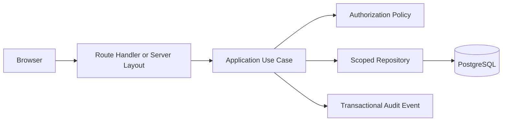

# Architecture Overview

## Runtime shape

The R1 application is a Next.js 16 App Router modular monolith. Local development uses PostgreSQL from Docker Compose. HTTP route handlers and server layouts call application services; application services enforce authentication and authorization before repositories access PostgreSQL through Drizzle and Postgres.js.

## Dependency direction

Presentation code depends on access-control application services. Application services depend on domain types and repository contracts. Infrastructure owns Postgres.js composition, Drizzle mappings, password verification, JWT signing, cookie handling and CSRF primitives. Database modules do not import HTTP responses or UI components.

## Implemented R1-00/R1-01 boundary

- Versioned migration bookkeeping fingerprints the existing fresh-schema initializer and applies incremental migrations.
- Employee authentication uses database-backed, revocable sessions behind short-lived cookie JWTs.
- Authorization is default-deny across resource, action, record scope and explicit field lists.
- Only M29 access-administration grants can be bootstrapped. CRM business grants remain inactive pending module-level approval.
- Invitations are delivered through an operator CLI in R1. No email provider or automated outbound delivery is implemented.
- The implemented REST boundary has an OpenAPI 3.1 contract and self-hosted Swagger UI. Both are server-authorized with `access.grants:read`; planned endpoints are excluded.

Approved R1.0 shared components (decimal/ROUND_HALF_EVEN, state machines, snapshot helper, idempotency keys, document numbering, pagination, repository scope filters, error model, OpenAPI, storage port/adapter, in-app notifications, `rate_history`) are listed in [R1 decisions](../business/r1-decisions.md#2-shared-r10-components). They are planned, not implemented, unless a task records otherwise. File storage goes through a port so the production provider can change without business changes.

R1-06 Product Specifications backend work is in progress: migration `0004`, scoped API/use cases, audit-aware lifecycle, immutable snapshot contract and BigInt-scaled decimal utility are implemented. The workspace currently supports list/filter and draft creation; detail/revision/compare UI and full acceptance verification remain. No storage adapter or M10 quotation/PDF workflow is implemented. The application remains a partial R1 implementation; other prototype modules must not be treated as database-backed or production-ready.
