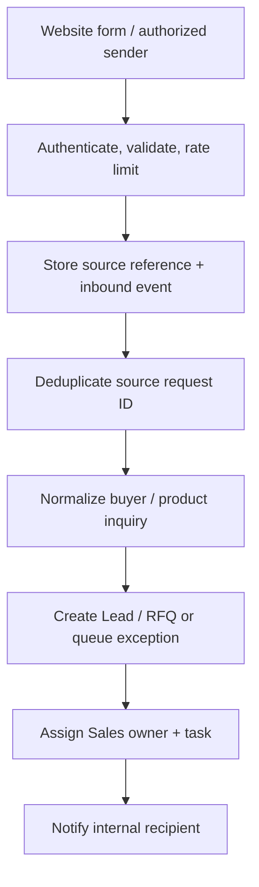

# BUS-10 — Operational Alerts, Notifications and External Integrations

> **Status:** Proposed business specification (not implemented)  
> **Release:** R1 internal tasks/reminders; R2 shipment/document integrations and alerts; R3 supplier/finance/reefer extensions  
> **Related modules:** [M05 Tasks & Activities](../modules/tasks-activities.md), [M20 Vessel Tracking](../modules/vessel-tracking.md), [M23 Shipping Alerts](../modules/shipping-alerts.md), [M25 Reefer Monitoring](../modules/reefer-monitoring.md), [M26 Receivables](../modules/receivables.md), [M28 Customer Feedback](../modules/customer-feedback.md), [M32 Integrations](../modules/integrations.md)  
> **Business owner:** Operations / Department Leads / Integration Owner (to confirm)  
> **Updated:** 2026-11-04

## 1. Objective and boundary

Turn significant CRM events into actionable internal tasks, warnings and — only under an approved communication policy — external customer messages. Allow external websites, email gateways, carriers, document providers, ERP/WMS and finance sources to exchange verified information without compromising the CRM's core transactions.

**Important:** The existing public website is not assumed to be already integrated. Existing provider APIs are not assumed to support specific capabilities until confirmed. No web scraping or uncertified external status claims are in scope by default.

## 2. Alert classes

| Class | Intended result | Examples |
|---|---|---|
| Informational | Show fact without urgent workflow | Booking confirmed, quote issued |
| Action required | Assign task and due date | Missing buyer specs, quote approval pending |
| Warning | Risk to timeline/business obligation | Quote nearing expiry, ETA changed materially |
| Critical / escalated | Require explicit acknowledgement and reviewer | Missed L/C deadline, major shipping delay, verified cold-chain incident |
| Data quality | Signal unreliable or missing source | Carrier feed stale, bank import conflict, invalid external payload |

Alerts should identify affected entity, owner, reason, source, initial observation, severity, due time, action link, acknowledgment state and last change time.

## 3. Candidate business alert catalog

| Trigger | Recipient (candidate) | Response and dedup concept | Release |
|---|---|---|---|
| New website RFQ unassigned | Sales Manager/assignment queue | Claim/assign; one active unassigned alert per RFQ | R1/R2 intake |
| Lead or opportunity stale | Owner + Sales Manager | Review next action; configurable threshold | R1 |
| Quotation approaching expiry | Quote owner | Follow up before deadline; skip closed/withdrawn | R1 |
| Commercial approval pending | Authorized reviewer | Approve/reject exact revision | R1 |
| Shipment ETA/ETD materially changed | Export Ops + assigned Sales | Investigate source and notify buyer if approved | R2 |
| Shipment document missing/rejected | Documents owner | Correct/obtain exact document version | R2 |
| L/C expiry or presentation deadline | Finance + Documents | Human deadline review, escalation if unacknowledged | R2 |
| Carrier or webhook data stale | Ops / Integration Owner | Source-health incident, not false shipment event | R2 |
| Receivable due/overdue | Finance + limited Sales summary | Reconcile and follow-up according to policy | R3 |
| QC hold or reefer anomaly | QC + Export Ops | Investigate and control cargo release | R3 |

Values such as `3 days before expiry`, `ETA changes by 24 hours` and escalation SLAs are **not finalized business policy**; store as configurable only after approval.

## 4. Alert lifecycle (proposed)

`OPEN → ACKNOWLEDGED → IN_PROGRESS → RESOLVED` or `DISMISSED` with reason. `ESCALATED` may be a separate severity/delivery flag rather than a replacement of the base workflow state. Preserve alert history and acknowledgement actors.

### Deduplication example

Use a stable logical key such as `(rule_id, entity_id, triggering_event_or_revision_id, recipient_scope)` to prevent duplicate alerts after retries and scheduled evaluations. A new materially different revision may create a new alert or update an existing open alert according to an approved rule.

## 5. External communication policy

- Distinguish an **internal alert** from a **buyer-facing message**.
- Validate recipients, channel preferences, lawful messaging basis, language and message template.
- Do not send sensitive financial, supplier pricing, internal QC evidence or unverified location detail in generic notifications.
- External communication may require an assigned employee's approval; capture sent content/version, time, channel, recipient and provider outcome.
- Provider accepted/delivered/opened statuses are distinct from buyer acknowledgement or business acceptance.
- Retries must not cause unintended multiple identical customer messages.

Potential channels: internal CRM inbox, assigned task, email, and optional supported messaging provider (Kakao/LINE where a legitimate approved integration exists). No unofficial personal-chat automation is assumed.

## 6. Integration catalog (proposed)

| Integration | Direction | Key data | Minimum business controls |
|---|---|---|---|
| Website RFQ form | Inbound | Buyer/contact, product inquiry, language, source and consent/preferences | Signed/authenticated intake or protected API, spam checks, dedupe, source references |
| Email delivery | Outbound | Quote, approved buyer update, deadline notification | Approved template/recipient, delivery tracking, no secret leakage |
| Carrier / tracking provider | Inbound (optional) | Vessel/container milestone, ETA/ETD, raw source reference | Source reliability, last update, status mapping, idempotency, conflict review |
| Document/authority portal | Manual/approved integration | Certificate/document reference and outcome | Human review of legal validity, approved API/legal usage |
| ERP/WMS | Bidirectional where approved | Lot, stock, allocations and receipts | Defined system of record, reconciliation and stale-data handling |
| Bank/accounting system | Approved read/write per policy | Receivable, payment/settlement reference, cost source | Segregated service account, verified posting, duplicate protection |
| Reefer telemetry provider | Inbound (optional) | Sensor readings, setpoint, data age | Reliability/coverage and threshold policy, secure device mapping |

## 7. Reliable processing principles

| ID | Rule |
|---|---|
| INT-01 | Every integration has an owner, documented data contract, credential management, rate limits and error handling. |
| INT-02 | Verify sender authentication/signature where supported; unknown/invalid webhook sources cannot modify business data. |
| INT-03 | Preserve source-scoped external IDs and idempotency keys so retries do not duplicate leads, events or postings. |
| INT-04 | Normalize and validate external data; retain safe raw references and ingestion outcomes for support. |
| INT-05 | Distinguish source event time, ingestion time, processing time and CRM effective time. |
| INT-06 | Retry transient failures with bounded backoff; permanent invalid inputs go to a reviewable failure queue or exception log. |
| INT-07 | External failures should not corrupt core CRM state; use durable event/outbox and worker processing only where reliability justifies it. |
| INT-08 | Reconciliation jobs find missing/late events; provider omissions are not proof that real-world status reversed. |
| INT-09 | Access keys/secrets must not be committed, included in logs or exposed to client-side code. |
| INT-10 | Integration disable/reconfigure actions require controlled permissions and audit evidence. |

## 8. Suggested workflow for external RFQ intake

A failed intake should be retryable without duplicate Lead/RFQ creation. Untrusted free text and uploaded files must be sanitized, restricted and treated as external input; don't trust inbound claimed company identity automatically.

## 9. Operational monitoring and observability

Track: successful/failed ingestion count, dedupe rate, processing latency, stale provider feeds, pending/retrying/dead-letter items, outbound message status, alert acknowledgement time, escalation count and reconciliation differences.

Log correlation keys and safe event metadata, not customer bank details, tokens or unredacted personal information. Alerts for provider outages should route to an internal operator instead of mass-messaging customers with speculative delays.

## 10. Exceptions

| Situation | Expected behavior |
|---|---|
| Provider sends same milestone repeatedly | One effective event/alert, retries visible |
| Carrier status arrives out of order | Reconcile with source precedence; no false regression |
| API is down for hours | Mark integration stale, queue safe retries, show operational impact |
| Customer unsubscribes/changes channel preference | Future sends respect approved policy and latest preference |
| Message delivery accepted but buyer did not acknowledge | Show delivery evidence only; do not infer buyer acceptance |
| L/C reminder timezone ambiguous | Escalate missing cutoff/locale clarification, don't invent deadline |
| Misconfigured reefer rule triggers many readings | Deduplicate/aggregate incident; don't flood recipients |
| Manual reprocess | Authorized operator sees reason and obtains idempotent result |

## 11. Acceptance / UAT

1. A repeated website RFQ payload with the same provider request ID creates one effective inquiry.
2. Webhook with invalid signature/authentication cannot change shipment state.
3. Carrier polling retries do not create duplicate ETA alerts or milestones.
4. Customer email failure is retried safely without duplicate successful sends.
5. Unauthorized team cannot subscribe to restricted bank or supplier-cost alerts.
6. An acknowledged alert retains event and resolution history; a new materially different issue is handled per rule.
7. A stale carrier feed is shown as stale, not as "container delayed" without verified evidence.
8. R1 works with internal task reminders before a queue/broker is introduced; reliability requirements can justify durable workers in R2/R3.

## 12. Open decisions

- [ ] R1 notification channels, alert owners and default severity policy.
- [ ] Per-alert thresholds, escalation rules, timezones, quiet hours and holiday calendars.
- [ ] Customer-facing language templates and approval/consent rules.
- [ ] External website integration contract, spam protection and credentials.
- [ ] Approved carrier, bank, email, ERP and messaging providers and their capabilities.
- [ ] Notification retention, audit, delivery SLA and incident response responsibilities.
- [ ] Background worker/queue adoption timing based on volume and delivery guarantees.

## 13. References

[Customer Lifecycle](customer-lifecycle.md) · [Export Workflow](export-workflow.md) · [Shipping and Containers](shipping-and-containers.md) · [Export Documents](export-documents.md) · [Finance Workflow](finance-workflow.md) · [Permissions](permissions.md) · [M32 Integrations](../modules/integrations.md)
