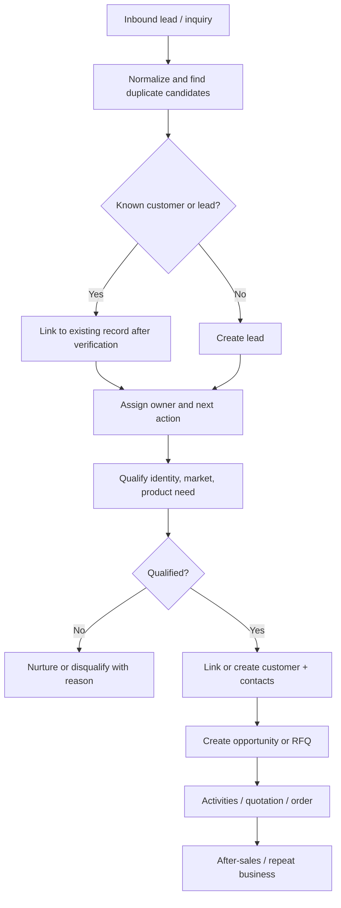

# BUS-01 — Customer, Contact, Lead and Opportunity Lifecycle

> **Status:** Proposed business specification (not implemented)  
> **Release:** R1 Core CRM  
> **Related modules:** [M01 Customers](../modules/customers.md), [M02 Contacts](../modules/contacts.md), [M03 Leads](../modules/leads.md), [M04 Opportunities](../modules/opportunities.md), [M05 Tasks & Activities](../modules/tasks-activities.md), [M29 Access Control](../modules/access-control.md)  
> **Primary business owners:** Sales Lead / Management (to confirm)  
> **Updated:** 2026-11-04

## 1. Business objective

Maintain one traceable view of every international B2B buyer from first inquiry through repeated purchase, while distinguishing **organizations**, **people**, **unqualified leads**, **commercial opportunities**, and **activities**. A prospect can contact the company through the website, email, trade fair, referral or manual introduction. A lead is not automatically an approved customer.

**Confirmed R1 boundary (D01):** one exporting company manages customers across countries, with multiple employees and teams. Independent tenants and a buyer portal are outside R1. Business qualification/ownership policies below remain proposed.

## 2. Actors and responsibility

| Actor | Business responsibility |
|---|---|
| Sales Representative | Capture inquiries, qualify buyer, maintain contacts, own next action |
| Sales Manager | Assign/reassign ownership, resolve duplicates, review stalled opportunities |
| Export Operations | Read order-linked delivery information on a need-to-know basis |
| Finance | Assess payment/credit risks through authorized fields; manage finance-specific data |
| Management | Review pipeline, conversion and commercial risk |
| System/Admin | Configure roles, controlled reference data and permitted integrations |

No role in this document automatically grants access. Apply the policies in [Permissions](permissions.md).

## 3. Key concepts and minimum business data

| Concept | Identity and business fields | Notes |
|---|---|---|
| Lead | Source, source reference, received time, buyer/company text, country, language, contact, interest, owner, next action, status | May be incomplete; preserve raw inquiry |
| Customer | Legal/trading name, country, addresses, registration/tax identifiers if available, website, business type, owner/team, lifecycle state, risk flags | One legal entity may have many locations/contacts |
| Contact | Customer reference, name, title/function, email/phone, language, communication preference, active flag | Procurement, shipping, finance contacts can differ |
| Opportunity | Customer, owner, product interest, expected volume/value/currency, target closing date, stage, probability (if used), loss reason | Forecast is not a contractual sale |
| Activity | Actor, type, time, summary, related entity, due date, outcome, visibility | Calls/emails/meetings/tasks, no uncontrolled secrets |

Values like `country`, `currency`, `phone`, `locale` and `email` require normalization without overwriting their originally supplied text when evidence matters.

## 4. Reference workflow

## 5. Reference lifecycle states (proposed, configurable)

- **Lead:** `NEW → CONTACTED → QUALIFIED → CONVERTED`, or `NURTURING / DISQUALIFIED`; reactivation must retain history.
- **Customer:** `PROSPECT → ACTIVE → ON_HOLD → ARCHIVED` with controlled reopen paths. `ON_HOLD` should *block restricted commercial actions only after an explicit policy is approved*.
- **Opportunity:** `OPEN → NEEDS_ANALYSIS → PROPOSAL → NEGOTIATION → WON | LOST`; `ON_HOLD` is optional.
- **Task:** `OPEN → IN_PROGRESS → DONE | CANCELLED`; completion records the actor and time.

Do not conflate a lead's `QUALIFIED` status with customer's `ACTIVE` status, or opportunity `WON` with an actual paid/shipped order.

## 6. Business rules

| ID | Rule |
|---|---|
| CUS-01 | Never silently merge customers based only on approximate company name. Offer duplicate candidates using name/country, domain, registration ID and contact data. |
| CUS-02 | Customer and contact are distinct entities; a customer can have multiple contacts with multiple functions. |
| CUS-03 | A lead converted more than once must not create duplicate customer/contact/opportunity records; record the original lead and conversion event. |
| CUS-04 | Every active lead/opportunity has a responsible owner or explicitly assigned queue and a next action or due date. |
| CUS-05 | An owner change records old/new owner, reason, approver if required, timestamp, and impact on access scope. |
| CUS-06 | Customer commercial/credit restrictions are not exposed to unauthorized roles; order creation respects approved restrictions. |
| CUS-07 | Contact consent/preference and lawful communication basis must be reviewed by channel/market; do not assume unsolicited messaging permission. |
| CUS-08 | Repeated RFQs can link to one customer but remain independent inquiries with separate quotations. |
| CUS-09 | Archive is reversible and not hard deletion of records linked to issued quotations, orders, shipments or audit history. |
| CUS-10 | External identifiers from website or integrations must be source-scoped and deduplicated. |

## 7. Exceptions and resolution

| Exception | Required business handling |
|---|---|
| Same trading name, different country/legal registration | Flag as possible duplicate, require manual resolution |
| Two sales users claim ownership | Manager assigns owner; audit decision and downstream visibility |
| Buyer requests data correction | Authorized edit, history for significant changes; follow applicable data obligations |
| Existing customer becomes blocked | Preserve history; restrict new sales actions per approved rule, surface explanation |
| Lead arrives missing critical fields | Keep as incomplete inquiry and create enrichment task; do not fabricate |
| Import contains repeated records | Preview, dedup candidates, error report and safe retry |

## 8. Reporting and evidence

Recommended R1 reporting: inquiries by source/market, qualified lead rate, lead-to-opportunity rate, age of open leads, next actions overdue, sales ownership, opportunity stage and estimated pipeline. Clearly label estimates and avoid treating opportunity value as booked revenue.

Evidence includes source payload reference, activity timestamp, conversion linkage, change history and ownership transfer reason. Sensitive contact details are masked where not authorized.

## 9. Acceptance criteria / UAT

1. Two inquiries from the same verified buyer link to one Customer and separate Leads/RFQs.
2. Similar names from different countries are suggested for manual review, not auto-merged.
3. Repeating lead conversion results in one effective linked customer and preserved history.
4. Sales user cannot retrieve another team's private customer through a guessed URL/API ID.
5. Ownership transfer changes visibility according to policy and records an auditable event.
6. Archiving a customer preserves linked orders, quotations and activity history.
7. A pipeline report does not count closed-lost opportunities as sales orders.
8. Invalid/missing contact data yields a validation or enrichment state, not invented values.

## 10. Open business decisions

- [ ] Definition of a *qualified buyer* and required verification evidence.
- [ ] Customer classification and `ON_HOLD`/credit restriction policy.
- [ ] Lead SLA and stale-opportunity reminder intervals.
- Handover grants the new owner full history. The former owner retains only their records as of transfer. See [R1 task plan](../../plan-r1-task.md).
- [ ] Legal retention and outbound communication/consent policy by jurisdiction.
- [ ] Customer merge permissions and correction/reversal workflow.

## 11. Dependencies and boundaries

See [Sales Workflow](sales-workflow.md) for RFQ-to-order conversion and [Permissions](permissions.md) for data scope. Functional and database definitions belong in the corresponding [module specifications](../modules/README.md); this file is business policy, not a declaration that implementation exists.
