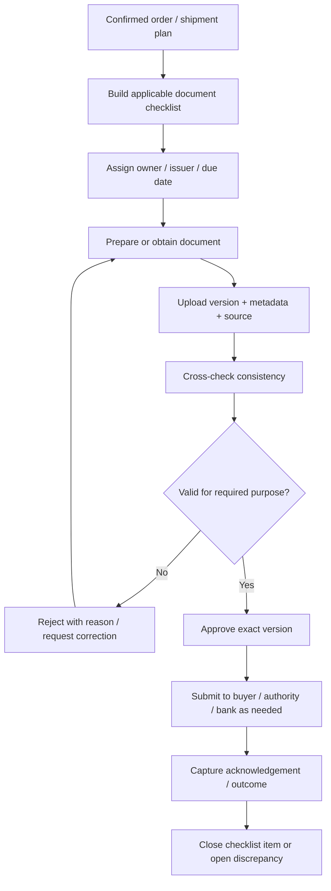

# BUS-06 — Export Documents, Checklist and Documentary Credit Controls

> **Status:** Proposed business specification (not implemented; requires regulatory/bank review)  
> **Release:** R2 Export Execution  
> **Related modules:** [M21 Export Documents](../modules/export-documents.md), [M22 L/C Management](../modules/lc-management.md), [M24 Compliance](../modules/compliance.md), [M18 Shipments](../modules/shipments.md), [M31 Audit Log](../modules/audit-log.md)  
> **Business owners:** Documentation / Export Operations / Finance (to confirm)  
> **Updated:** 2026-11-04

## 1. Objective and safety boundary

Maintain a **shipment-specific, buyer-specific and destination-specific** document checklist, controlled file versions, review/approval evidence and handoff deadlines. The CRM **tracks documents and workflow**; it does not issue legal certificates, replace the customs portal, certify regulatory compliance, or autonomously determine documentary credit acceptance.

Regulatory rules differ by destination, product, origin, transaction and date. Treat the catalog below as **candidate document types**, not an assertion that every shipment needs all documents.

## 2. Candidate document catalog

| Type | Purpose | Typical data / cross-check |
|---|---|---|
| Commercial Invoice | Agreed commercial invoice | Exporter/buyer, invoice no., order, product, quantity, price, currency, Incoterm, destination |
| Packing List | Carton/pallet, product and weight details | Count, net/gross, marks, product lot/pack, container when known |
| B/L or sea waybill | Carrier transport document | Shipper, consignee/notify, vessel, ports, container/seal, on-board evidence and release method |
| Certificate of Origin (C/O) | Origin declaration/certification if required | Product origin, permitted form, destination, shipment and issuing authority |
| Health / food-safety certificate | Competent authority document if required by market | Establishment, lot, product, destination, product/consignment data |
| Inspection / quality certificate | Buyer/contract/market specific | Inspection reference, inspected lot, results and issuer |
| Insurance evidence | Contractual or L/C requirement if applicable | Insured party, value, currency, risk cover, shipment linkage |
| Customs export declaration | Export clearance evidence | Declaration reference/date, importer/exporter, goods/quantity and regime |
| Other certificates | Depending on market/product | Additional catch/traceability, treatment, labeling or buyer requirements |

Document names are a controlled vocabulary; user-uploaded files still require a human classification and verification.

## 3. Checklist generation inputs

- Destination market and buyer, receiving/importer requirements.
- Product species/processing method, origin, lot/establishment and applicable authorization.
- Agreed Incoterms rule/edition/named place; transport mode and route.
- Payment instrument: advance, collection, open account, L/C and exact bank conditions.
- Sales Order and shipment, container, dates, ports, party and quantity snapshots.
- Applicable law or competent-authority guidance, checked by authorized reviewer **at the time of shipment**.

Suggested checklist item states: `NOT_REQUIRED`, `REQUIRED`, `IN_PREPARATION`, `UNDER_REVIEW`, `APPROVED`, `SUBMITTED`, `REJECTED`, `WAIVED` (authorized and evidenced). A **document file** may separately have `DRAFT`, `REVIEWED`, `ISSUED`, `REPLACED`, `REVOKED` lifecycle. Do not conflate the two.

## 4. Reference workflow

## 5. Document consistency checks

| Check ID | Check |
|---|---|
| DOC-01 | Exporter/shipper/consignee/notify names and addresses match the required source and role definitions. |
| DOC-02 | Product description, grade, packing and net/gross quantities reconcile with approved shipment allocations and actual loading as applicable. |
| DOC-03 | Containers, seal, voyage, ports and transport date fields match available verified source; blank fields are not fabricated. |
| DOC-04 | Currency, invoice total, Incoterms named place and buyer references match approved commercial terms. |
| DOC-05 | Each file has document type, linked shipment/order, version, issuer, reviewer, status and timestamps. |
| DOC-06 | Expired, revoked or replaced versions cannot silently satisfy an active checklist item. |
| DOC-07 | Corrected documents keep old versions, reason, actor and relevant recipient acknowledgement. |
| DOC-08 | Required regulatory forms/certificates are validated against current official destination/authority requirements, not static CRM assumptions. |
| DOC-09 | Sensitive originals and bank files have strictly scoped download/access history. |

Any mismatch generates a task or exception; rules should distinguish blocking defects from nonblocking differences.

## 6. L/C (letter of credit) controls

For L/C-backed orders, track: issuing/advising banks, beneficiary/applicant, L/C number, amount/currency, latest shipment date, expiry date/place, presentation period, tolerances, partial shipment/transshipment conditions, required documents, amendments, presentation and discrepancy results.

### Candidate L/C lifecycle

`EXPECTED → RECEIVED → UNDER_REVIEW → CONFIRMED → DOCUMENT_PREPARATION → PRESENTED → ACCEPTED | DISCREPANT → SETTLED / CLOSED`

Bank terminology and transition detail must be confirmed by Finance/Bank. A state called `ACCEPTED` must identify **who accepted what** (e.g. documents accepted by bank) and its evidence, not merely a CRM reviewer marking a checklist complete.

**UCP 600 is not automatically applicable to every L/C:** ICC states it applies when the credit text expressly makes it subject to UCP 600. Reference: [ICC UCP 600](https://library.iccwbo.org/content/tfb/RULES/tfb-ucp600-rules.htm?AGENT=ICC_HQ&l3=Rules&trk=article-ssr-frontend-pulse_little-text-block).

### L/C operational controls

1. Register actual credit and all amendments as separate traceable revisions.
2. Human reviewer checks requirements, dates, names, currency, presentation location and supporting evidence.
3. Derive configurable reminders from documented bank terms; use accurate banking days/cutoffs where verified.
4. Record presenting bank, submitted set/version, date, bank feedback and discrepancy resolution.
5. Never automatically mark bank acceptance, compliance or settlement without authenticated bank/human evidence.

## 7. Regulatory evidence — reference as of 2026-11-04

- Vietnam's [Circular 80/2025/TT-BNNMT](https://baochinhphu.vn/quy-dinh-tham-dinh-cap-chung-nhan-an-toan-thuc-pham-thuy-san-xuat-khau-10226010911190714.htm) concerns appraisal/certification for exported seafood, effective **2026-02-02**. Actual requirements vary by importing market and consignment; validate with competent authority.
- [NAFIQPM Center's procedure for export seafood consignment health certification](https://nafi4.vn/en/tthc-2-001281/) describes official application procedures and timing; do **not** encode a one-size-fits-all deadline without confirming product category, current procedural requirements and authority.
- Vietnam's [eCoSys](https://ecosys.gov.vn/Homepage/DocumentView.aspx) publishes C/O legal documents and forms, which may vary by trade agreement, product and market.

These links support a **human-verified compliance checklist**, not a software guarantee of legal sufficiency. Verify their continued currency when the feature is implemented.

## 8. File protection and retention

- Private storage only; no publicly guessable static document URLs.
- Access by authenticated scoped permission; temporary access only if authorized, short-lived, and logged when required.
- Malware scanning/content-type/file-size controls and restrictions for executable/unsafe attachments.
- Immutable document version metadata; revisions should be additive, not destructive.
- Confidential buyer/bank/identity documents need narrower roles than general shipment updates.
- Retention/archiving and disclosure rules to be approved with legal/finance/compliance, not guessed by Codex.

## 9. Exception handling

| Exception | Handling |
|---|---|
| Packing List quantity differs from verified loading | Block approval until corrected or reviewed/approved variance |
| B/L correction requested after issue | Create replacement/revision workflow; keep previous evidence |
| Certificate not required by destination | Checklist `NOT_REQUIRED` with basis/source; not a fake certificate |
| L/C deadline moves through amendment | Preserve old terms, register amendment, recalculate reminders after review |
| Missing original after email sends | Track version/recipient and evidence; do not treat email success as authority acceptance |
| Document rejected by bank/authority | Attach response, owner, reason, deadline and amended document link |

## 10. Acceptance / UAT

1. Shipment to one market has a different approved checklist from a shipment to another market.
2. Replacing a Packing List retains v1, creates v2 and updates only intended checklist links.
3. Draft/revoked file does not count as approved/issued document.
4. Unauthorized Sales cannot download Finance-only bank attachments by guessing object keys.
5. Verified loading discrepancy is detected before release of final packing list.
6. L/C amendment updates applicable reminders without destroying previous terms.
7. A human acceptance decision and supporting bank evidence are required before recording acceptance.
8. Certificate not required is documented as such rather than blocking all shipments.

## 11. Open decisions

- [ ] Responsible compliance reviewer and evidence source per importing market/product.
- [ ] Required documents and due dates per buyer, payment term and destination.
- [ ] Document template, multilingual labeling and acceptable electronic originals.
- [ ] Bank/authority submission integration: manual upload, API or external portal only.
- [ ] L/C bank-cutoff/business-day policy and exact status vocabulary.
- [ ] Who can waive requirements or release corrected documents.
- [ ] Storage retention, approval, signature and audit policy.

## 12. Related documents

[Export Workflow](export-workflow.md) · [Shipping and Containers](shipping-and-containers.md) · [Finance Workflow](finance-workflow.md) · [Permissions](permissions.md) · [M24 Compliance](../modules/compliance.md)
