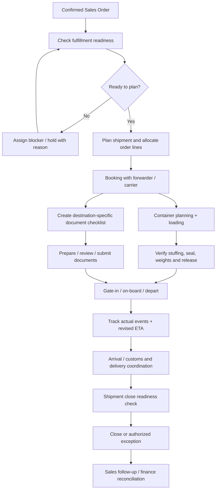

# BUS-04 — Export Execution: Confirmed Order to Delivery

> **Status:** Proposed business specification (not implemented)  
> **Release:** R2 Export Execution; R3 supply/finance handoffs  
> **Related modules:** [M12 Sales Orders](../modules/sales-orders.md), [M18 Shipments](../modules/shipments.md), [M19 Containers](../modules/containers.md), [M20 Vessel Tracking](../modules/vessel-tracking.md), [M21 Export Documents](../modules/export-documents.md), [M23 Shipping Alerts](../modules/shipping-alerts.md), [M24 Compliance](../modules/compliance.md)  
> **Business owners:** Export Operations / Documentation / Sales (to confirm)  
> **Updated:** 2026-11-04

## 1. Objective and assumptions

Manage physical seafood export after a confirmed commercial Sales Order, including planning, booking, container loading, documentation, customs coordination, sailing, arrival, delivery, exceptions and closure.

Initial company operations often involve **one or two containers per shipment**, but neither shipments nor orders are restricted to two containers in the data model. A single Sales Order may have multiple partial shipments. Shipment execution is not the same as receiving payment or closing the sales relationship.

## 2. Roles and responsibility

| Role | Primary responsibility |
|---|---|
| Sales | Handoff buyer requirements and commercial terms; communicate approved changes |
| Export Operations | Own shipping plan, bookings, milestone verification and exception handling |
| Documents | Prepare/verify documents against market, buyer, shipment and payment requirements |
| Finance | Check deposit/L/C obligations, review charges and payment prerequisites |
| QC / Procurement | Verify production, inspection and eligible product availability where applicable |
| Forwarder / Carrier | External provider of booking, movement and delivery evidence; not authoritative until verified by business policy |

## 3. Workflow

Some steps operate concurrently; document submission timing is contract-, carrier- and destination-dependent. Do not block all shipments on one rigid global sequence.

## 4. Handoff data from Sales

- Confirmed Sales Order reference and immutable order-line/spec/pack/quantity snapshot.
- Buyer/consignee/notify parties and responsible contacts; shipping marks if agreed.
- Incoterms rule, edition, named place/port, agreed shipping window and destination.
- Payment/L/C requirements affecting document issue or release.
- Required product certifications, labeling, origin and destination regulatory constraints.
- Shipment allocations (quantities and UoM per sales order line), tolerance and remaining balance.
- Special cold-chain/setpoint and loading constraints, when verified and contractually required.

## 5. Shipment lifecycle (proposed)

`PLANNED → BOOKED → LOADING → DEPARTED → ARRIVED → DELIVERED → CLOSED`

`ON_HOLD` and `CANCELLED` represent controlled exception paths; moving backward or reopening requires a reason, actor and permitted transition. A booking confirmation alone does not prove actual departure; a vessel tracking provider's estimated arrival does not prove actual delivery.

## 6. Business rules

| ID | Rule |
|---|---|
| EXP-01 | Shipment can be created only from confirmed or explicitly authorized order commitments; unauthorized draft orders must not generate real bookings. |
| EXP-02 | Allocate shipment quantities at order-line level; total active allocations may not exceed approved quantity plus explicitly approved tolerance. |
| EXP-03 | Partial fulfillment retains allocated, shipped, remaining and cancelled quantities independently; never infer full order completion from first shipment. |
| EXP-04 | Booking, carrier, vessel/voyage, POL/POD and estimated dates are stored with their source and update history. |
| EXP-05 | Planned, estimated, and verified actual milestones are distinct; revised ETA must not overwrite `actual_arrival`. |
| EXP-06 | Container loading records actual container assignment, seal, verified weights/pack counts and exceptions when available. |
| EXP-07 | Document readiness depends on agreed buyer, bank, product, market, route and applicable regulation; it is not a universal flat checklist. |
| EXP-08 | Shipment readiness gates are configured/approved by authorized business owners. Overrides are reasoned, actor-attributed and audited. |
| EXP-09 | Shipment cancellation after booking/dispatch preserves history, external costs, documents and linked customer notices. |
| EXP-10 | A shipment is not financially settled merely because it is delivered, and a paid invoice does not prove physical delivery. |
| EXP-11 | A supplier/QC hold must block affected cargo allocation when that hold information is available and approved as an operational gate. |
| EXP-12 | External carrier events and manual edits must be traceable, deduplicated and reconciled; never fabricate missing milestones. |

## 7. Readiness gates (candidate, pending approval)

| Gate | Evidence or review | Responsible role |
|---|---|---|
| Commercial release | Valid order, customer instructions and payment prerequisites | Sales + Finance as applicable |
| Cargo readiness | Product specification, pack, quantity, QC disposition | QC/Procurement/Ops |
| Booking readiness | Port, timing, carrier/forwarder, agreed cost allocation | Export Ops |
| Shipping release | Stuffing/loading, seal/VGM where applicable, customs and carrier instructions | Export Ops / customs agent |
| Document release | Approved copies, certificates/checklists, bank requirements where applicable | Documents / Finance |
| Shipment close | Final verified logistics milestone, exceptions disposition, handoff to finance/customer service | Export Ops |

Gate activation and approver responsibility must be confirmed for each customer/market/trade term. **Do not implement these candidates as non-overridable hard requirements without sign-off.**

## 8. Exceptions and escalation

| Exception | Initial response |
|---|---|
| Cargo not ready by cut-off | Mark at-risk; notify Ops/Sales; evaluate rebooking and customer communication |
| Vessel rolled / ETD changes | Keep prior schedule and source; record new estimate, impact and reason |
| One container delayed in a multi-container shipment | Track per-container exception; do not overwrite sibling container state |
| Document rejected | Open correction task linked to exact document version; block only applicable release action |
| Bank/L/C discrepancy | Finance/Documents review, no automated declaration of bank acceptance |
| Customer requests destination change | Commercial amendment + logistics feasibility + docs/compliance reassessment |
| Provider has no update | Display last verified timestamp and stale-data warning; do not infer departure/arrival |

## 9. Customer communication

Internal status updates may be automatic if enabled. External messages (booking confirmed, vessel departed, ETA changed, documents ready) require explicit recipient and communication policy. The customer-visible summary should exclude bank details, supplier cost, internal dispute notes and unverified carrier claims.

## 10. Acceptance / UAT

1. One confirmed order is fulfilled by two shipments without double allocation; remaining quantity is correct.
2. One shipment has two container assignments with separate seal numbers and events.
3. ETA change retains the former value, evidence and who/what changed it.
4. An unauthorized user cannot mark shipment `DEPARTED` by directly changing a status field.
5. Document rejection creates a corrective path while maintaining older versions and review notes.
6. A cancellation preserves historic bookings, communications and associated costs.
7. The order remains partially fulfilled until every required allocated quantity has an approved disposition.
8. Delivery and financial settlement states are displayed independently.

## 11. Open decisions

- [ ] Rules for multi-order consolidation into one shipment and partial order tolerance.
- [ ] Business approval for bookings, cut-offs, changes and exceptions.
- [ ] Source of truth for actual movement events and provider priority.
- [ ] Destination-market document validation ownership.
- [ ] Whether `DELIVERED` means port arrival, buyer warehouse receipt or other agreed proof.
- [ ] Release gates for credit, deposit, QC and documentation by order type.
- [ ] Roles and wording for customer-facing notifications.

## 12. Related documents

[Shipping and Containers](shipping-and-containers.md) · [Export Documents](export-documents.md) · [Alerts and Integrations](alerts-and-integrations.md) · [Sales Workflow](sales-workflow.md) · [Permissions](permissions.md)
