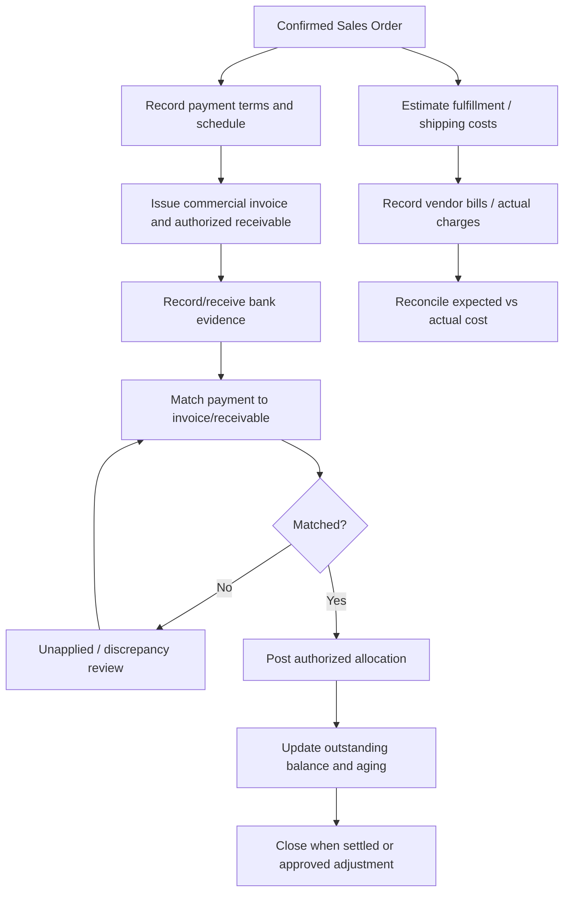

# BUS-07 — Payment Terms, Receivables and Cost Reconciliation

> **Status:** Proposed business specification (not implemented)  
> **Release:** R2 L/C tracking; R3 receivables and cost reconciliation  
> **Related modules:** [M12 Sales Orders](../modules/sales-orders.md), [M22 L/C Management](../modules/lc-management.md), [M26 Receivables](../modules/receivables.md), [M27 Cost Reconciliation](../modules/cost-reconciliation.md), [M31 Audit Log](../modules/audit-log.md)  
> **Business owner:** Finance / Management (to confirm)  
> **Updated:** 2026-11-04

## 1. Objective and non-goals

Track commercial payment obligations, due dates, receipts, balances, overdue exposure and expected-versus-actual export costs. Preserve the distinction between **sales order**, **commercial invoice document**, **internal receivable**, **bank/payment evidence**, and **accounting posting**.

**Initial boundary:** CRM does not replace a regulated bank, general ledger, statutory accounting or tax system. If an accounting/ERP system becomes authoritative, CRM reconciles references and statuses through an explicit integration policy.

## 2. Payment models (candidate)

Payment terms are contract-specific and must be stored as **documented customer/contract facts**, for example advance deposit, balance before document release, payment after shipment, collection or L/C. Do not assume that `T/T 30/70`, net-30 or an L/C presentation pattern applies company-wide.

A payment schedule may consist of multiple installments with their own trigger, amount/currency, due date and required evidence. Due date calculation (calendar vs business day, timezone, from invoice/B/L/arrival) requires a policy or explicit contract term.

## 3. Workflow

## 4. Business concepts

| Concept | Meaning |
|---|---|
| Payment Term | Agreed rule from quote/order/contract; may contain installment triggers |
| Payment Schedule | Expected amounts and deadlines per order/invoice |
| Commercial Invoice | Export/commercial document, not automatically a posted receivable |
| Receivable | Authorized internal outstanding amount in currency, linked to commercial source |
| Payment Evidence | Bank credit, advice, remittance or approved manually verified proof |
| Payment Allocation | Part of a confirmed payment applied to one/more receivables |
| Credit / Adjustment | Authorized reduction or reversal with reason and source |
| Planned Cost | Predicted charge for product, packing, freight, insurance, docs, bank etc. |
| Actual Cost | Verified vendor invoice/charge with currency, source and allocation basis |

## 5. Receivable lifecycle and rules

Suggested states: `DRAFT → POSTED → PARTIALLY_PAID → PAID`, with `OVERDUE`, `DISPUTED`, `VOIDED/REVERSED` as controlled dimensions or exception states. `OVERDUE` is derived from an as-of date and outstanding balance; it should not destroy the underlying financial posting status.

| ID | Rule |
|---|---|
| FIN-01 | Receivables must identify order/invoice source, customer, currency, original amount, due date and posting actor/evidence. |
| FIN-02 | Posted amounts cannot be silently edited; corrections use authorized adjustments/reversals and linked evidence. |
| FIN-03 | Partial receipts are supported; allocation must not exceed available eligible payment or approved receivable balance. |
| FIN-04 | Bank reference imports and webhook retries must be idempotent within institution/source context. |
| FIN-05 | Unmatched/overpaid/cross-currency receipts remain visible as exceptions until authorized allocation. |
| FIN-06 | Currency conversion requires stored source/date/rate/rounding; never silently net different currencies. |
| FIN-07 | Aging is computed using approved due-date rule, unapplied credits, reversals and as-of date. |
| FIN-08 | Write-off, refund and reversal require separate privileges from general receivable editing. |
| FIN-09 | Payment proof does not imply bank settlement until reconciliation evidence and approval are recorded. |
| FIN-10 | Financial records and sensitive bank information are limited to authorized roles and fields. |

## 6. Cost categories and reconciliation

Candidate cost categories: seafood raw material or supplier purchase, processing, packaging, domestic freight, loading/stuffing, cold storage, sea freight, insurance, export documents/certificates, customs agency, bank fees, quality inspection, demurrage/detention and other approved charges.

For each cost store: category, expected amount/currency, actual amount/currency, supplier/payee, invoice/source, responsible order/shipment, allocation method, cost period, approval, and status.

### Candidate comparison

`Variance amount = actual cost - planned cost`  
`Variance percentage = variance amount / planned cost × 100`, where planned cost is nonzero.

A variance percentage is not defined when planned cost is zero. Margin/profit reporting is **indicative** until inventory valuation, exchange-rate snapshots, overhead allocation and revenue-recognition policies are approved.

## 7. L/C integration with finance

L/C details and documentary presentation belong to [Export Documents](export-documents.md) and M22. Finance tracks agreed obligation, bank communications, discrepancies, bank charges and collection/settlement evidence. L/C `RECEIVED` or document `PRESENTED` is **not** equivalent to cash received.

For credits explicitly governed by UCP 600, apply the terms of the credit and applicable rules as interpreted by authorized personnel/bank; the CRM cannot autonomously determine compliance. [ICC UCP 600](https://library.iccwbo.org/content/tfb/RULES/tfb-ucp600-rules.htm?AGENT=ICC_HQ&l3=Rules&trk=article-ssr-frontend-pulse_little-text-block).

## 8. Roles and separation of duties

- **Sales:** view approved order-level payment summary/overdue flag for owned accounts where allowed; cannot post payment or see full bank transactions.
- **Finance:** manage receivables, allocations, reconciliation and controlled financial corrections.
- **Management:** read approved aggregate financial KPIs and act as exception approver where policy permits.
- **System/Admin:** manage access/integration, not automatically entitled to approve write-offs or bank disbursements.

See [Permissions](permissions.md) for record-level scopes and restricted fields.

## 9. Exceptions and investigations

| Event | Business action |
|---|---|
| Customer pays in two installments | Allocate separately, compute remaining open balance |
| Same bank credit imported twice | Deduplicate or flag; no duplicate posting |
| Buyer disputes invoice | Mark dispute, retain full history, notify appropriate owner |
| Payment in unexpected currency | Keep unapplied; authorized FX conversion or separate settlement process |
| Invoice cancelled after payment | Authorized reversal/credit/refund workflow, no destructive deletion |
| Freight cost changes after vessel roll | Update actual/estimate version, preserve variance driver |
| Vendor invoice covers multiple shipments | Record documented allocation basis, no silent equal split |

## 10. Acceptance / UAT

1. Two verified partial payments fully settle one receivable without over-allocation.
2. Replayed bank import does not create another payment or change balance twice.
3. Sales user sees only safe customer debt indicators, not bank account or supplier cost.
4. Outstanding/overdue report is reproducible for an explicit as-of date.
5. Posted receivable correction leaves original posting, adjustment, actor and reason.
6. Cost reconciliation shows unallocated vendor bills separately from matched charges.
7. Same shipment under distinct currency costs does not claim a definitive single-currency margin without documented FX rule.
8. A presented L/C document set does not mark an invoice as paid.

## 11. Open business decisions

- [ ] Accounting system of record and integration timing.
- [ ] Receivable posting authority and rules for invoice vs receivable creation.
- [ ] Installment deadline calculation, grace periods and aging buckets.
- [ ] Credit limits, write-offs, refunds and approval threshold matrix.
- [ ] Bank feed/statement verification and reconciliation process.
- [ ] Supported currencies, FX source/time and rounding conventions.
- [ ] Cost allocation basis, overhead treatment, financial profitability definition.
- [ ] Retention/privacy policy for bank/payment records.

## 12. Related documents

[Sales Workflow](sales-workflow.md) · [Pricing and Quotations](pricing-and-quotations.md) · [Export Documents](export-documents.md) · [Permissions](permissions.md)
