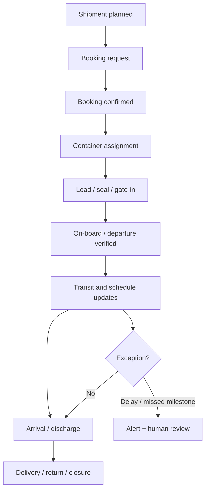

# BUS-05 — Shipping, Containers, Timelines and Reefer Events

> **Status:** Proposed business specification (not implemented)  
> **Release:** R2 shipments/containers/tracking; R3 optional reefer telemetry  
> **Related modules:** [M18 Shipments](../modules/shipments.md), [M19 Containers](../modules/containers.md), [M20 Vessel Tracking](../modules/vessel-tracking.md), [M23 Shipping Alerts](../modules/shipping-alerts.md), [M25 Reefer Monitoring](../modules/reefer-monitoring.md)  
> **Business owner:** Export Operations / Logistics (to confirm)  
> **Updated:** 2026-11-04

## 1. Objective

Give Export Operations an auditable view of bookings, movement milestones, container details, ETA/ETD changes and cold-chain exceptions without confusing forecasts with actual events. Prioritize manual entry and trustworthy source references in early R2; external carrier/API feeds may be added as verified integrations.

## 2. Business entities and cardinality

| Entity | Key business attributes | Relationship |
|---|---|---|
| Shipment | Shipment number, buyer/order links, ports, carrier/forwarder, booking, vessel/voyage, owner and lifecycle | Can have multiple allocations and containers |
| Shipment Allocation | Order line, quantity, UoM, reservation/shipped/cancelled disposition | Many allocations per shipment; preserve order-line balance |
| Container Assignment | Container number (if known), size/type, seal, weight, booking, assigned shipment and time | Physical container number may be reused across different shipments over time |
| Tracking Event | Milestone code, location, occurredAt, observedAt/receivedAt, source, confidence, raw source reference | Append-oriented event history |
| Schedule Revision | ETD/ETA type, old/new estimate, source, revision time, reason | Keep history; don't overwrite verified actual events |
| Reefer Reading (optional) | Setpoint, temperature, unit, sensor/device/source, measured timestamp, quality flag | Available only if there is a reliable telemetry provider |

**Important:** A container number is not an immutable globally unique shipment record. Use a shipment-specific assignment and preserve time/booking context.

## 3. Operations workflow

Track loading cut-off, documentation cut-off and carrier-specific milestones only when information is verified or supplied by a responsible party.

## 4. Timeline semantics

| Property | Business meaning |
|---|---|
| `planned_at` | Original working plan or booked date |
| `estimated_at` | Latest forecast by a specified source |
| `actual_at` | Occurred milestone, with verification source |
| `source_updated_at` | When external provider last updated its event |
| `received_at` | When CRM learned about it |
| `recorded_by` | Actor/integration responsible for entry |
| `source_ref` | External event ID or evidence attachment |
| `status` / `quality` | Verified, provisional, disputed, stale, corrected |

Time must be stored and compared unambiguously (typically UTC instants), with port-local time and named IANA timezone displayed where appropriate. Never drop timezone or confuse date-only schedule with a timestamp.

## 5. Event and schedule business rules

| ID | Rule |
|---|---|
| SHP-01 | Status can advance only with an authorized operation and sufficient evidence or approved exception. |
| SHP-02 | ETA and ETD are separate; planned, estimated and actual values must remain distinguishable. |
| SHP-03 | Every revision to an estimate retains old value, source, observed time and reason where available. |
| SHP-04 | Provider records are deduplicated by `(provider, external_event_id)` or approved deterministic fallback; a retry cannot create duplicate milestones. |
| SHP-05 | Late, out-of-order provider events do not blindly overwrite newer verified data; source-precedence policy is explicit. |
| SHP-06 | Absence of a provider event is not evidence that a milestone was cancelled or a container disappeared. |
| SHP-07 | Operator edits keep actor/source and never silently rewrite the raw source evidence. |
| SHP-08 | One shipment can have multiple containers; container assignment and cargo allocation are separate business concepts. |
| SHP-09 | Same physical container identifier on distinct historical shipments is allowed; conflicting concurrent assignment requires review. |
| SHP-10 | Shipping-alert triggers use event/change identity and dedupe, not every background poll. |
| SHP-11 | A carrier tracking API may give only vessel-level data; do not claim container-level location without a supporting source. |
| SHP-12 | Cold-chain monitoring is only declared "monitored" when valid measurement coverage and source freshness are known. |

## 6. Container information (candidate)

- Booking reference, carrier, container number, ISO size/type, seal number and verified gross mass when applicable.
- Factory/warehouse loading reference, loading place/date, gate-in and on-board information when supplied.
- Product and packed quantity allocations, gross/net weights and temperature/setpoint instructions.
- Reefer power/inspection notes, pre-trip inspection proof and telemetry references if present.
- Exception history: seal mismatch, missing temperature record, damage, port roll, extra fees.

Do not derive net weight automatically from gross without defined tare/packaging data.

## 7. Reefer monitoring (optional R3)

**Three distinct values:** contractually requested setpoint, manually observed reading, and telemetry-measured reading. Never overwrite one with another.

| Event | Proposed action |
|---|---|
| Measurement outside approved range | Create reviewable incident; alert Ops/QC based on severity policy |
| Gap in device data | Raise *missing/stale telemetry* warning, not temperature excursion |
| Device mismatch / calibration issue | Flag measurement reliability and require operator verification |
| Confirmed excursion | Record investigation, evidence, affected cargo and disposition; do not automatically declare product safe/unsafe |

Thresholds, allowable duration, recording interval and quality disposition require product/QC decisions. **No default freezer temperature or excursion threshold is assumed.**

## 8. Exception matrix

| Event | Primary actor | Business action |
|---|---|---|
| Booking cancelled by carrier | Export Ops | Rebook; preserve cancelled booking and costs |
| ETD moves after doc cut-off | Ops + Documents | Assess impact on document issue and L/C terms |
| Container seal mismatch | Ops + QC | Hold/review before release per policy |
| ETA slips beyond threshold | Ops + Sales | Alert and prepare approved customer notice |
| Stale tracking provider | Ops/Integration Owner | Show stale indicator; investigate, do not fabricate |
| Reefer reading anomaly | Ops + QC | Assess data quality, initiate incident as appropriate |

## 9. Acceptance / UAT

1. Two containers in one shipment retain individual seal, loading and arrival events.
2. A historical container number may reappear on a later distinct shipment without overwriting its earlier record.
3. Multiple provider retries produce one logical milestone and visible processing history.
4. A verified `actual_departure` cannot be overwritten with an ETA/ETD estimate.
5. Out-of-order provider event and manual update produce a visible conflict, not silent data loss.
6. Shipment page shows source, age and confidence of latest ETA.
7. Missing reefer readings are classified as data gap, not automatic excursion.
8. Unauthorized user cannot update container details through a direct endpoint.

## 10. Open decisions

- [ ] Authoritative providers and supported carrier/event coverage.
- [ ] Event-code mapping, precedence and human verification policy.
- [ ] Definitions of `ARRIVED`, `DISCHARGED`, `DELIVERED`, `CLOSED`.
- [ ] Delay thresholds, alert audience, quiet hours and escalation.
- [ ] Container number standard validation and concurrency conflict rules.
- [ ] Reefer provider, sensor reliability, freshness SLA, thresholds and data retention.
- [ ] Port timezone, manual evidence and correction-review requirements.

## 11. Related documents

[Export Workflow](export-workflow.md) · [Alerts and Integrations](alerts-and-integrations.md) · [Supply and Quality](supply-and-quality.md) · [Permissions](permissions.md)
