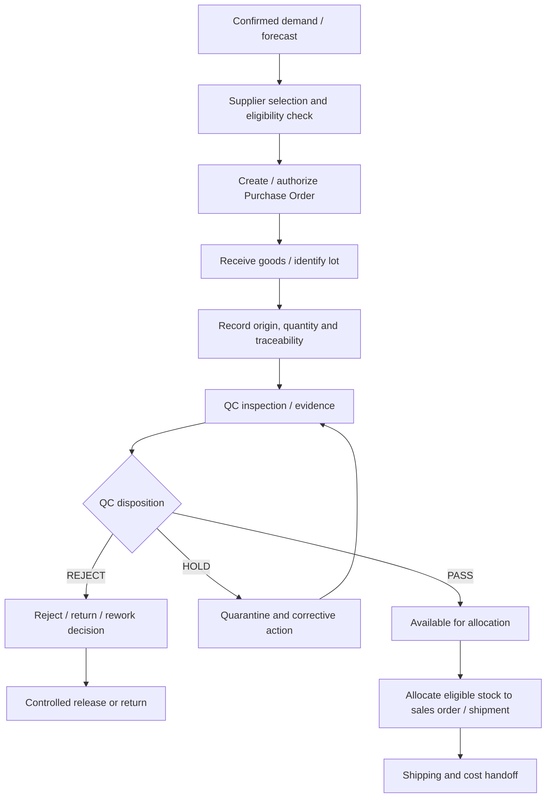

# BUS-08 — Supplier, Procurement, Batch, QC and Inventory Workflow

> **Status:** Proposed business specification (not implemented)  
> **Release:** R3 Supply & Financial Control  
> **Related modules:** [M13 Suppliers](../modules/suppliers.md), [M14 Purchase Orders](../modules/purchase-orders.md), [M15 Batches](../modules/batches.md), [M16 Quality Control](../modules/quality-control.md), [M17 Inventory Integration](../modules/inventory-integration.md), [M25 Reefer Monitoring](../modules/reefer-monitoring.md)  
> **Business owner:** Procurement / Production / Quality Assurance (to confirm)  
> **Updated:** 2026-11-04

## 1. Objective and scope

Track supplier sourcing, purchase commitments, receipt/production batches, quality disposition, export allocation and traceability. Initial CRM may **integrate** with external factory/warehouse systems instead of becoming the authoritative warehouse management, MES or ERP system.

A supplier is not a buyer/customer merely because its data model contains company contact fields. Procurement cost is confidential and separate from sales pricing.

## 2. Reference workflow

## 3. Business objects

| Object | Key business information |
|---|---|
| Supplier | Legal name, contacts, country/location, approved product categories, authorization/certification status, restrictions |
| Supplier Evaluation | Approval status, evaluator, effective date, supporting documents, review/expiry schedule |
| Purchase Order | Supplier, requested product/spec, quantity/UoM, price/currency, delivery date, authorization and revision |
| Receipt | Date, receiving location, shipment/PO references, quantity and condition evidence |
| Batch/Lot | Unique scoped lot ID, supplier/source, species, spec, origin, processing date, pack, received/produced quantity and traceability |
| QC Inspection | Sample method, inspection date, inspector, results/measurements, attachments, disposition and correction history |
| Inventory Snapshot | SKU/lot/location, on-hand, reserved, available, UoM, source system, as-of timestamp and synchronization status |
| Allocation | Stock/lot quantity assigned to order/shipment with lineage and release status |

## 4. Supply and QC rules

| ID | Rule |
|---|---|
| SUP-01 | Supplier approval/market eligibility and supporting certifications are distinct from commercial performance scores. |
| SUP-02 | Purchase Order is a commitment, not proof that material has been received or is available. |
| SUP-03 | Received and produced quantities require evidence and clear UoM; net/gross/glaze bases must not be silently mixed. |
| SUP-04 | Each lot has traceable supplier/production provenance and may have distinct product/pack and QC attributes. |
| SUP-05 | QC inspection result is immutable once approved/submitted; corrections are explicit amendments with evidence and approval. |
| SUP-06 | A lot on `HOLD`, `REJECTED` or unresolved investigation cannot become eligible for shipment by a simple UI status edit. |
| SUP-07 | Rework/retest/release must identify approving authority and new supporting evidence. |
| SUP-08 | Shipment allocation from lots must not exceed available authorized stock and must preserve lineage. |
| SUP-09 | One Sales Order line may be fulfilled by multiple verified lots; one lot may serve multiple orders only with tracked allocations. |
| SUP-10 | ERP/WMS ownership of stock balances is explicit; CRM cannot silently overwrite the authoritative external balance. |
| SUP-11 | Duplicate receipt/inventory sync events cannot increment stock or allocations twice. |
| SUP-12 | Product recall/quality investigation must identify affected lots, orders, shipments and customers without fabricating relationships. |

## 5. Quality disposition (candidate)

`PENDING_INSPECTION → UNDER_INSPECTION → PASS | HOLD | REJECTED`

A `HOLD` batch may enter `RETEST_PENDING`, `REWORK_PENDING`, or `RELEASED_BY_EXCEPTION` only via explicitly approved procedures. Passing a retest or management override may not remove market-specific legal restrictions. Never treat a QC pass as proof of complete regulatory compliance.

## 6. Traceability and recall readiness

For each shipment line, the company should be able to answer (within the available source system capabilities):

1. Which supplier and receiving/production lot contributed?
2. Which species, product spec and declared origin/processing data were used?
3. What inspection/certificate evidence covers this lot or shipment?
4. Which customer orders and containers were affected?
5. Which warnings, hold/release decisions and replacement events were recorded?

Traceability granularity, mandatory field list and retention period must be approved for actual markets/products. For seafood export health certification, apply relevant competent-authority and market requirements rather than assuming a universal certificate: see [Vietnam seafood certification overview, Circular 80/2025/TT-BNNMT](https://baochinhphu.vn/quy-dinh-tham-dinh-cap-chung-nhan-an-toan-thuc-pham-thuy-san-xuat-khau-10226010911190714.htm).

## 7. Inventory integration boundary

Possible operating models:

| Mode | Source of truth | CRM responsibility |
|---|---|---|
| CRM-only prototype | Manually managed controlled snapshots (temporary) | Display clearly as provisional; reconciled by authorized owner |
| External ERP/WMS (preferred if one exists) | ERP/WMS authoritative for physical inventory | Consume versioned balances, reservations and reconciliation status |
| Future internal WMS | Separate approved system | CRM holds references, allocation intents, exceptions and snapshots |

Do not add an authoritative stock ledger inside CRM and concurrently treat ERP stock as authoritative without an explicit conflict and reservation strategy.

## 8. Exceptions

| Exception | Required handling |
|---|---|
| Supplier certificate expired | Flag market eligibility and block affected step according to approved rule |
| Receipt differs from purchase order | Record variance and supplier response, not silent overwrite |
| Lot fails QC after being reserved | Mark affected allocations at-risk, notify Ops, require corrective decision |
| Quality document replaced | Keep history and link approved newer evidence |
| Stock sync stale | Show as-of time, avoid promising stock availability |
| Conflicting reservation from two users | Prevent oversubscription and show conflict |
| Recall notice | Trace linked lots/shipments and open incident with owner and evidence |

## 9. Acceptance / UAT

1. Purchase Order does not increase available stock without a verified receipt or authoritative inventory event.
2. QC rejected/held lot cannot be allocated through a forged API request.
3. One shipment can reference two compliant lots with correct per-lot quantity lineage.
4. Retried inventory sync does not duplicate stock or reservations.
5. Product/inspection revisions do not erase earlier evidence.
6. An expired supplier approval is visible to an authorized reviewer before release.
7. Recall search returns affected orders/shipments from actual traceability links, not guesses.
8. Sales user cannot view restricted supplier purchase costs by retrieving another module's endpoint.

## 10. Open business decisions

- [ ] Actual sourcing model: purchased finished goods, own processing or subcontracted production.
- [ ] Approved supplier review criteria and destination eligibility rules.
- [ ] Batch/lot numbering and granular traceability standards.
- [ ] QC inspection matrix, acceptance thresholds, rework/retest and release authority.
- [ ] Warehouse/ERP as system of record, reservation and synchronization policy.
- [ ] Return, scrapping, recall and cost impact workflows.
- [ ] Market-specific certificate sources, version and verification owners.

## 11. Related documents

[Export Workflow](export-workflow.md) · [Shipping and Containers](shipping-and-containers.md) · [Export Documents](export-documents.md) · [Finance Workflow](finance-workflow.md) · [Permissions](permissions.md)
