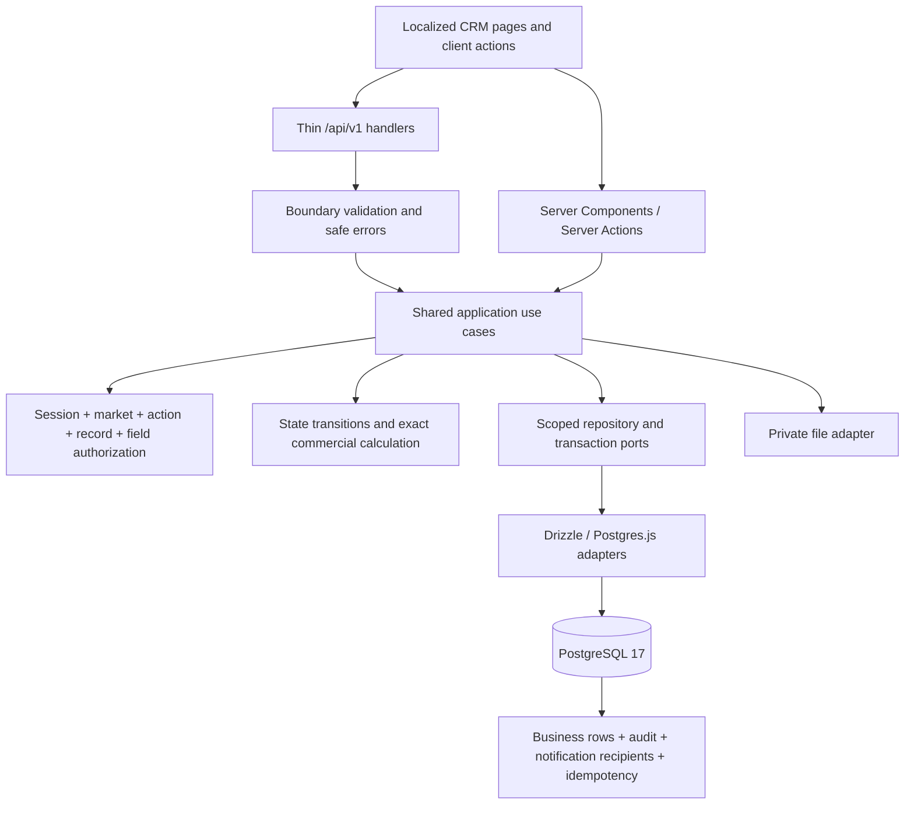

# R1 Backend Architecture and API Specification

> **RP-04 documentation design approved on 2026-11-06; not implemented APIs.** Owner approved the documentation plan and the decisions below. Business grants, unresolved lifecycle details and security gates are not approved by that sign-off. Companion: [database specification](database.md). Technical artifacts are English.

## 1. Goal and current context

Describe the 15 R1 modules from inquiry to confirmed order, including their required access, evidence and reporting support. The current checkout has a Next.js 16.4.5 / React 19.3.1 / Node 26 prototype using synthetic JSON fixtures. It has localized list screens, a selected market, profile preferences, search and notifications. It has no implemented business API, authentication integration or relational application schema. Docker Compose declares PostgreSQL `17-alpine`; this is configuration evidence, not proof of a running database. Drizzle/Postgres.js are the selected architecture, not installed application dependencies.

Sources: [context](../context.md), [module catalog](../modules/README.md), [release map](../modules/RELEASES.md), [frontend specification](frontend.md), [approved market contract](market-ui-plan.md), [sales workflow](../business/sales-workflow.md), [pricing workflow](../business/pricing-and-quotations.md), [customer lifecycle](../business/customer-lifecycle.md), [draft permission matrix](../business/permissions.md).

R1 task status and content are maintained in Nimbalyst Tracker; no local R1 task plan file is part of this checkout. R1-00/R1-01 added `docs/architecture/overview.md`, `docs/architecture/security.md` and `docs/architecture/testing.md` from owner-approved implementation decisions; no details were reconstructed from another project. Old proposed roles and ADR references in module prose do not override current contributor guidance. This project records decisions in architecture documentation, not ADR files. The existing frontend document contains older installation snapshots; its later localization/market sections and actual locale routes describe the current prototype.

## 2. Decisions, scope and non-scope

| ID  | Classification              | Decision / boundary                                                                                                                                                                                                                                                                   |
| --- | --------------------------- | ------------------------------------------------------------------------------------------------------------------------------------------------------------------------------------------------------------------------------------------------------------------------------------- |
| D01 | Confirmed                   | One operating company; Next.js modular monolith, REST `/api/v1`, strict TypeScript, application record authorization, PostgreSQL + Drizzle/Postgres.js, one versioned SQL migration history.                                                                                          |
| D02 | Confirmed                   | Roles are `admin`, `manager`, `sale`, `accountant`. Roles are global; market memberships are explicit; admin is not a business superuser.                                                                                                                                             |
| D03 | Confirmed                   | Market is independent of country, locale and tenant. KR/JP/US initially, no All markets selection or transfers between markets. Products are global; eligibility/specifications/prices are market-owned.                                                                              |
| D04 | Confirmed in RP-04          | Quote/order R1 output stays USD; original inputs USD/VND; one positive VND-per-USD rate per revision, half-even final cents. Market currency suggestions do not change this rule. Other currencies may describe forecasts/reference data but cannot silently enter quote calculation. |
| D05 | Confirmed in RP-04          | Former-owner frozen history still requires current active market membership and appropriate action/field grants. Revocation blocks historical access too.                                                                                                                             |
| D06 | Confirmed in RP-04          | Missing module grants remain Pending/default-deny. Completing this design does not authorize them.                                                                                                                                                                                    |
| D07 | Approved design conventions | PostgreSQL INTEGER IDENTITY entity IDs, UUID correlation IDs, UTC timestamps, decimal strings, application-managed logical references, archive/deactivate, optimistic versioning and database-persisted idempotency.                                                                  |
| D08 | Confirmed scope             | Only these two specifications, Mermaid ERDs and DDL in Markdown. No source, dependencies, frontend edits, live migrations, database startup, deployment or external messages.                                                                                                         |

All endpoint names and DTOs below are **Proposed technical contracts** within the approved documentation plan, unless marked Pending for a specific gate. Confirmed business behavior is traceable to the module source, not inferred from fixture fields. No endpoint is claimed to exist. R2/R3 shipments, containers, invoices, inventory, finance, external integrations, public buyer access and automated outbound messaging are Out of Scope. Generic import/export execution, background scheduling infrastructure, password recovery and production storage need separately approved contracts; they are not silently implemented here.

## 3. Architecture, technology and responsibilities



- Runtime/framework remain the pinned project versions. Implemented REST operations are published as an executable OpenAPI 3.1 document at `/api/v1/openapi.json` and rendered through the self-hosted `/{locale}/api-docs` page. Both surfaces require `access.grants:read`; proposed operations remain Markdown-only until their implementation is approved and verified.
- `src/app/api/v1/**/route.ts` and Server Actions parse/validate transport input, establish request context, invoke a use case and map a typed result/error. No inline authorization or SQL-only shortcuts. Server Components call the same use cases directly; no loopback HTTP dependency is needed.
- Proposed `src/modules/<domain>/{application,domain,infrastructure}` contains use cases, rules, repository ports and adapters. DTO validation belongs at input boundaries; invariants are checked again by domain/service logic. Composition supplies adapters. Do not scaffold all modules merely from this document.
- Identity/access owns sessions, effective grants, memberships and manager/team relationships. CRM owns customer history, lead decisions, opportunities and activities. Catalogue owns global identities plus market offers. Sales owns versioned quote/order workflows. Supporting capabilities own private file access, in-app notifications and mandatory audit without becoming a generic business logic service.
- Connection/configuration modules are server-only and cannot depend on routes, views or HTTP responses. Validate environment variables without logging their values; expose no database/signing/storage secrets through `NEXT_PUBLIC_*`.
- A request-scoped unit of work owns a single transaction/client. Every use case receives principal, market, effective policy and request ID. Repositories require scope arguments; there is no unscoped business repository escape hatch for list, aggregate, export or nested lookup.

## 4. API and schema conventions

### 4.1 Transport and validation

**Entity identity contract:** every relational table uses an INTEGER GENERATED BY DEFAULT AS IDENTITY primary key. The database returns the assigned id after INSERT; APIs do not accept caller-selected ids for ordinary create operations. Path IDs and every entity/logical-reference field in JSON are positive canonical integers no greater than 2,147,483,647. Parse without rounding/coercion from decimal strings, fractions, exponent syntax or unsafe numbers; malformed/out-of-range IDs return 400. Sequence gaps are expected; IDs are immutable and never recycled. When a future controlled import supplies explicit IDs, it must synchronize the associated identity sequence before ordinary writes. No import endpoint is included here.

`requestId`/`request_id` and trace identifiers remain CorrelationId UUID tokens, not entity IDs. Polymorphic audit `resource_id` and idempotency `result_id` are INTEGER internal pointers resolved by their typed codes, but are not authorization evidence. `created_by_uid` is not present in the current schema proposal; if added to point to users.id, it must use INTEGER.

Base `/api/v1`, plural kebab-case resources, positive INTEGER entity-ID path parameters (canonical base-10), explicit action commands for state changes. No locale or market URL prefix. Body/query field names are camelCase; the selected market is transmitted as **`marketId`**, mapped to `market_id` in SQL. The earlier market contract's `market_id` describes the concept; this specification standardizes the wire name. GET uses query; mutations use JSON body, except multipart uploads. A client locale affects labels only, never identity/currency/access.

Reject unknown fields and unknown enum values. All path IDs, parent IDs and referenced entities are re-authorized. Reject conflicting market values rather than silently preferring one. Normalize employee emails and duplicate hints without merging people or buyers. Validate text length/body size limits before allocating/parsing large payloads; numeric limits and file limits require G06/G08 approval. Use bound parameters and allowlisted sort/filter identifiers. Do not derive SQL fragments from user strings.

Canonical scalar schema: `EntityId` is a positive PostgreSQL INTEGER (1..2,147,483,647) represented as a JSON integer number; `CorrelationId` is a UUID string used only for request/trace correlation; `Instant` is an ISO-8601 timestamp with offset, normalized to UTC; `Date` is `YYYY-MM-DD`; `Decimal` is a finite base-10 JSON string without exponent/NaN/Infinity; versions/line numbers are positive integers; amounts/quantities follow column checks; currency/country are uppercase ISO code strings; `?` means optional (omit when not supplied). Nullable storage columns permit explicit `null` only for documented nullable editable fields. JSON technical requirements and frozen snapshots must be objects validated by the module, never arbitrary executable HTML. Arrays have validated element schemas and bounded lengths before implementation.

The companion dictionary is the scalar type source: camelCase maps to snake_case. `Id` suffixes are EntityIds, timestamp fields use Instant, dates use Date, money/quantity/weight/probability use Decimal, flags use boolean. No JavaScript number accumulation for financial amounts. Conditional presence and business validation in section 7 apply beyond scalar validation.

| Symbol          | Request / response schema                                                                                                                                                                                                                  |
| --------------- | ------------------------------------------------------------------------------------------------------------------------------------------------------------------------------------------------------------------------------------------ |
| `Session`       | HttpOnly cookie session; never caller-supplied user/role identity.                                                                                                                                                                         |
| `M`             | `{marketId: EntityId}`; membership, resource/action and record scope must all pass.                                                                                                                                                        |
| `I`             | Path identifiers (`id`, `childId`, `lineId`, `aliasId`, `marketId`) are EntityIds; `kind`, `type` and report `code` are explicit allowlisted strings. Business requests also require M; nested child IDs must belong to the path parent.   |
| `W`             | I plus `{expectedVersion: positive integer}` for the aggregate being mutated. Parent path owns this token for child edits; lock and advance parent version.                                                                                |
| `Reason`        | W plus `{reason: nonblank string}`.                                                                                                                                                                                                        |
| `L(T)`          | M plus `{q?, cursor?, limit?: 1..100 (default 25), sort?, ownerId?, status?, from?, to?}`; resource-specific filters listed below.                                                                                                         |
| `AdminList`     | Authenticated explicit administrative grant; `{cursor?,limit?:1..100, q?, status?}`. Never broad business-market access.                                                                                                                   |
| `AdminId`       | Administrative path EntityId, session and explicit access grant.                                                                                                                                                                           |
| `Create<T>`     | M plus the exact T Input allowlist below; server creates id/version/state/timestamps. `TInput` is the same allowlist without the wrapper; `CustomerInput`, `ContactInput` and `OpportunityInput` in conversion refer to these definitions. |
| `Patch<T>`      | W plus nonempty partial T Input, minus immutable relationship/ownership/identity fields. Reassignment/transition commands are separate.                                                                                                    |
| `One<T>`        | `{data: T, meta:{requestId:CorrelationId}}`; serialize only permitted fields.                                                                                                                                                              |
| `Page<T>`       | `{data:T[], page:{nextCursor:string                                                                                                                                                                                                        | null, hasMore:boolean}, meta:{requestId:CorrelationId, asOf:Instant}}`. |
| `CommandResult` | `{data:{id:EntityId, version:integer, state?:string},meta:{requestId:CorrelationId}}`.                                                                                                                                                     |
| `NoContent`     | HTTP 204 and no body.                                                                                                                                                                                                                      |
| `PrivateBinary` | Authorized byte stream, safe Content-Type/Content-Disposition, no storage key; `Cache-Control: private, no-store`.                                                                                                                         |

`marketId` is mandatory for business operations including global-product discovery through a market. Global product identity mutation additionally needs a global catalog action grant; market membership alone cannot rename or retire a global SKU. Access administration is a separate system policy boundary. System audit scope must be explicit; omitting marketId never means ALL for an ordinary reader.

### 4.2 Response/error and concurrency contract

POST creation returns 201; successful commands/updates/reads return 200 unless `NoContent` explicitly says 204. File staging returns 201 with PENDING scan state, not a usable download. No unsupported asynchronous 202 job contract is implied. Authentication sets cookies through headers; never returns a bearer token in JSON. Mutating cookie requests require CSRF/origin controls; details gated by G02.

```json
{
  "error": {
    "code": "VERSION_CONFLICT",
    "message": "The record changed; reload before retrying.",
    "requestId": "00000000-0000-4000-8000-000000000001",
    "details": []
  }
}
```

| HTTP      | Stable code family                                       | Semantics                                                                                                      |
| --------- | -------------------------------------------------------- | -------------------------------------------------------------------------------------------------------------- |
| 400       | INVALID_REQUEST / INVALID_CURSOR                         | Malformed JSON, path, query or unsupported field; sanitized field-path errors only.                            |
| 401       | UNAUTHENTICATED                                          | Missing/expired/revoked/disabled session; no identity existence leak at login.                                 |
| 403       | ACTION_FORBIDDEN / MARKET_FORBIDDEN                      | No action/selected-market permission, independent of a guessed record.                                         |
| 404       | NOT_FOUND                                                | Unknown, out-of-scope or wrong-market record; identical disclosure behavior.                                   |
| 409       | VERSION_CONFLICT / STATE_CONFLICT / IDEMPOTENCY_CONFLICT | Stale write, losing concurrent command, incompatible duplicate key, or already-selected different alternative. |
| 422       | BUSINESS_RULE_VIOLATION                                  | Authorized record fails prerequisite: evidence, SKU/spec, reason, FX or validity.                              |
| 413 / 415 | PAYLOAD_TOO_LARGE / UNSUPPORTED_MEDIA                    | Approved payload/file policies violated.                                                                       |
| 429       | RATE_LIMITED                                             | Shared-store limit and Retry-After; policy/backend G02 remains pending.                                        |
| 500 / 503 | INTERNAL_ERROR / DEPENDENCY_UNAVAILABLE                  | Safe message/request ID, transaction rolled back; no SQL/stack/secret response.                                |

Require `Idempotency-Key` for authenticated business creation and effectful business POST commands, especially conversion, dispatch, acceptance and confirmation. Public login/invitation-token entry points use their own credential/single-use-consumption policy under G02; they cannot use a caller-supplied actor identity to address this table. The persisted key is unique by principal + market + canonical operation/target + key. Hash the validated canonical request; same key/different hash returns 409. Authorize again before returning a replay. Store a safe result pointer, reconstruct current permitted DTO fields, and do not replay stale sensitive JSON. Insert dedup outcome, business changes, mandatory audit and in-app notifications in one transaction; unique-key races wait/re-read and return the original outcome. Failed transactions leave no successful key. Natural constraints remain effective after any future key cleanup.

Check authorization, then idempotent replay, then expectedVersion/state for a new command. A valid retry can succeed despite the original expectedVersion becoming stale. Missing expectedVersion is 400; mismatch is 409. Child mutations lock/increment their parent aggregate. PUT membership creation accepts no version only when the unique assignment does not exist; concurrent creation is 409. No generic PATCH may change marketId, ownerId, parent IDs, acceptance, totals, audit fields or status.

### 4.3 Pagination, filtering and search

Use deterministic keyset pagination ordered `(created_at DESC,id DESC)` by default. An opaque authenticated/validated cursor binds market, principal/scope revision, resource, filter and sort values; changed filters or scope reject the cursor. Counts are separate scoped queries and are never unfiltered ORM totals. Safe sort allowlist starts with createdAt/id; add exact indexed sorts only for an approved access pattern. No promised arbitrary multi-column ordering.

- Customers: countryCode, status, ownerId, safe name/code q. Contacts: customerId, active, safe name; sensitive channels require their own action.
- Leads/opportunities/RFQs/quotes/orders/samples: ownerId, lifecycle state, created/received interval and explicitly relevant customerId/RFQ relation filters. No cross-owner candidate detail in ordinary search.
- Tasks: assigneeId, due range, status; overdue is computed from dueAt and unfinished states.
- Products/specifications: productId, market eligibility, active/published state, safe name/SKU. Prices: exact product/spec/unit/currency/quantity/time and customer context.
- Audit: authorized actor/resource/time; notifications: current recipient, selected market and unread state.

All filters are conjunctive with authorization and apply **before** pagination and aggregation. Start with PostgreSQL bounded queries and B-tree access paths. Case-insensitive substring search may scan a scoped subset; no claim that a normal B-tree makes `%term%` indexed. Measure before approving text-search/trigram extensions. No Elasticsearch or external search service in R1 design. No process-local baseline/cache used for security or cross-process coordination.

## 5. Frontend → feature → API → entity traceability

Every frontend business route is prefixed `/en` or `/vi`; the table omits that locale prefix. `/` is a redirect, not an API consumer. Backend detail/create/edit capabilities below derive from module use cases and do **not** approve new frontend routes. Existing list controls remain prototype-only until implementation gates are met.

| Module / source | Current frontend | Business use cases | Main entity boundary | Coverage classification |
| [M01 customers](../modules/customers.md) | `/customers` | Buyer CRUD, duplicate review, assignments and frozen history | customers / contacts / customer_transfers / history_snapshots | Confirmed R1 need; Proposed API; grants Pending |
| [M02 contacts](../modules/contacts.md) | `/contacts` | Buyer-scoped contacts, channels, preference and primary recipient | contacts / contact_channels / contact_preferences / customer_primary_contacts | Confirmed R1 need; Implemented API; grants Activated |
| [M03 leads](../modules/leads.md) | `/leads` | Qualification, restricted duplicate decision, atomic conversion | leads / lead_conversions / duplicate_reviews | Confirmed R1 need; Proposed API; grants Pending |
| [M04 opportunities](../modules/opportunities.md) | `/opportunities` | Forecast stages and first-confirmed-order win | opportunities / opportunity_history / opportunity_wins | Confirmed R1 need; Proposed API; grants Pending |
| [M05 tasks-activities](../modules/tasks-activities.md) | `/tasks` | Follow-ups and immutable interactions without access escalation | tasks / activities / record_links | Confirmed R1 need; Proposed API; grants Pending |
| [M06 products](../modules/products.md) | `/products` | Global SKU identity and market eligibility | products / product_aliases / market_products | Confirmed R1 need; Proposed API; grants Pending |
| [M07 product-specifications](../modules/product-specifications.md) | `/products/specifications` | Versioned offered product specifications and controlled files | specifications / specification_versions / file_attachments | Confirmed R1 need; Proposed API; grants Pending |
| [M08 price-lists](../modules/price-lists.md) | `/price-lists` | Market-scoped eligible references and append-only AD_HOC selections | price_lists / price_list_items / price_selections | Approved R1-08 contract; implementation pending |
| [M09 rfqs](../modules/rfqs.md) | `/rfqs` | Buyer request text, assignment, original lines and alternatives | rfqs / rfq_lines | Confirmed R1 need; Proposed API; grants Pending |
| [M10 quotations](../modules/quotations.md) | `/quotations` | Versioned approval, issue, evidence-backed acceptance and precise price calculation | quotations / quotation_versions / quotation_lines / rfq_acceptances | Confirmed R1 need; Proposed API; grants Pending |
| [M11 samples](../modules/samples.md) | `/samples` | Sample items, dispatch, feedback and manager notification | samples / sample_dispatches / sample_feedback | Confirmed R1 need; Proposed API; grants Pending |
| [M12 sales-orders](../modules/sales-orders.md) | `/sales-orders` | Order creation/confirmation, amendments and reviewed cancellation | sales_orders / order_versions / order_amendments / order_cancellation_requests | Confirmed R1 need; Proposed API; grants Pending |
| [M29 access-control](../modules/access-control.md) | `/admin/users; /login; profile/market shell` | Invite/session, roles, teams, manager and market access | users / sessions / role_grants / user_market_memberships | Confirmed R1 need; Proposed API; grants Pending |
| [M30 dashboard-reporting](../modules/dashboard-reporting.md) | `/dashboard; /search; shell search` | Scoped KPIs, five dashboard views, shell and page search | Authorized queries; no reporting warehouse | Confirmed R1 need; Proposed API; grants Pending |
| [M31 audit-log](../modules/audit-log.md) | `/audit-log` | Transactional immutable audit and administrator-only review | audit_events | R1-02 API/UI implemented; non-admin grants remain Pending |

Shared shell additions are traced to the [market contract](market-ui-plan.md): granted markets, server preferences, recipient notifications and safe search. Notifications are also required by M11/M12. Files support M07/M09/M10/M11/M12 evidence; they are not an R2 document management implementation. Account 360 sections reuse the same authorized lists; contact pages use `/contacts?customerId=...` rather than duplicating a second contact list API. Quote alternatives are created with `POST /quotations` plus rfqId rather than a second competing creation route under RFQs. Dashboard tabs use a code/filter, not a separate endpoint per visual card.

No current R1 list/shell route is omitted from this inventory. Detail/create/edit screens, audit exports, report exports, reminders scheduling and integrations are not current frontend flows. Their implementation readiness is not implied by list coverage. Export/download grants remain distinct; download is specified here, export execution is gated separately rather than assumed from disabled UI controls.

## 6. Complete proposed route inventory

All rows require a valid employee session except public credential/invitation entry points explicitly identified. The Permission column names a required resource/action, **not a role grant**. Apply market and record/field scope in addition. Every mutation also writes `audit_events`; effectful creation/POST commands use `idempotency_records`, even when these common tables are omitted from the row. Tx refers to section 8. Request/response aliases are defined in sections 4 and 7. Administrative and security Pending entries cannot be enabled before their gates close.

### M01 — customers

Frontend: `/customers`. Source: [customers](../modules/customers.md).

| Method | Endpoint                                       | Purpose                                                             | Request                                                                               | Response                   | Tables                                                                                                   | Permission         | Tx       | Status   |
| ------ | ---------------------------------------------- | ------------------------------------------------------------------- | ------------------------------------------------------------------------------------- | -------------------------- | -------------------------------------------------------------------------------------------------------- | ------------------ | -------- | -------- |
| GET    | `/api/v1/customers`                            | List authorized customers                                           | L(Customer)                                                                           | Page<Customer>             | `customers`                                                                                              | customers.list     | Read     | Proposed |
| GET    | `/api/v1/customers/{id}`                       | Read authorized customers                                           | I                                                                                     | One<Customer>              | `customers`                                                                                              | customers.read     | Read     | Proposed |
| POST   | `/api/v1/customers`                            | Create customers                                                    | Create<Customer>                                                                      | One<Customer>              | `customers`                                                                                              | customers.create   | Write    | Proposed |
| PATCH  | `/api/v1/customers/{id}`                       | Edit allowlisted draft fields                                       | Patch<Customer>                                                                       | One<Customer>              | `customers`                                                                                              | customers.edit     | Write    | Proposed |
| GET    | `/api/v1/customers/{id}/overview`              | Scoped account 360 with independently authorized sections           | I + section + cursor                                                                  | CustomerOverview           | `customers`, `contacts`, `rfqs`, `quotations`, `sales_orders`, `tasks`, `activities`                     | customers.read     | Read     | Proposed |
| GET    | `/api/v1/customers/{id}/addresses`             | Read buyer addresses                                                | I                                                                                     | Page<addresses>            | `customer_addresses`                                                                                     | customers.read     | Read     | Proposed |
| POST   | `/api/v1/customers/{id}/addresses`             | Add buyer addresses                                                 | W + {kind, addressLines, city?, region?, postalCode?, countryCode, isDefault}         | One<addresses>             | `customer_addresses`                                                                                     | customers.edit     | Write    | Proposed |
| PATCH  | `/api/v1/customers/{id}/addresses/{childId}`   | Update buyer addresses                                              | W + partial {kind, addressLines, city?, region?, postalCode?, countryCode, isDefault} | One<addresses>             | `customer_addresses`                                                                                     | customers.edit     | Write    | Proposed |
| GET    | `/api/v1/customers/{id}/identifiers`           | Read buyer identifiers                                              | I                                                                                     | Page<identifiers>          | `customer_identifiers`                                                                                   | customers.read     | Read     | Proposed |
| POST   | `/api/v1/customers/{id}/identifiers`           | Add buyer identifiers                                               | W + {kind, value, issuingCountry?}                                                    | One<identifiers>           | `customer_identifiers`                                                                                   | customers.edit     | Write    | Proposed |
| PATCH  | `/api/v1/customers/{id}/identifiers/{childId}` | Update buyer identifiers                                            | W + partial {kind, value, issuingCountry?}                                            | One<identifiers>           | `customer_identifiers`                                                                                   | customers.edit     | Write    | Proposed |
| POST   | `/api/v1/customers/{id}/reassign`              | reassign                                                            | W + {newOwnerId, teamId?, reason}                                                     | TransferResult             | `customers`, `customer_transfers`, `history_snapshots`, `history_entitlements`, `history_snapshot_files` | customers.assign   | Transfer | Proposed |
| POST   | `/api/v1/customers/{id}/archive`               | archive                                                             | Reason                                                                                | One<Customer>              | `customers`                                                                                              | customers.archive  | Write    | Proposed |
| GET    | `/api/v1/customers/{id}/history`               | Current full history or entitled frozen history, never silently mix | I + cursor                                                                            | Page<HistoricalProjection> | `customer_transfers`, `history_snapshots`, `history_entitlements`, `history_snapshot_files`              | customers.history  | Read     | Proposed |
| GET    | `/api/v1/duplicate-reviews`                    | Reviewer-only same-market candidate queue                           | L(Review)                                                                             | Page<DuplicateReview>      | `duplicate_reviews`                                                                                      | duplicates.review  | Read     | Proposed |
| POST   | `/api/v1/duplicate-reviews/requests`           | requests                                                            | M + {leadId / customerId, candidateHints}                                             | ReviewReceipt              | `duplicate_reviews`                                                                                      | duplicates.request | Write    | Proposed |
| POST   | `/api/v1/duplicate-reviews/{id}/resolve`       | resolve                                                             | W + {decision, reason}                                                                | ReviewReceipt              | `duplicate_reviews`                                                                                      | duplicates.review  | Write    | Proposed |

### M02 — contacts

Frontend: `/contacts`. Source: [contacts](../modules/contacts.md).

| Method | Endpoint                                      | Purpose                             | Request                                                     | Response          | Tables                                  | Permission              | Tx    | Status   |
| ------ | --------------------------------------------- | ----------------------------------- | ----------------------------------------------------------- | ----------------- | --------------------------------------- | ----------------------- | ----- | -------- |
| GET    | `/api/v1/contacts`                            | List authorized contacts            | L(Contact)                                                  | Page<Contact>     | `contacts`                              | contacts.list           | Read  | Implemented |
| GET    | `/api/v1/contacts/{id}`                       | Read authorized contacts            | I                                                           | One<Contact>      | `contacts`                              | contacts.read           | Read  | Implemented |
| POST   | `/api/v1/contacts`                            | Create contacts                     | Create<Contact>                                             | One<Contact>      | `contacts`                              | contacts.create         | Write | Implemented |
| PATCH  | `/api/v1/contacts/{id}`                       | Edit allowlisted draft fields       | Patch<Contact>                                              | One<Contact>      | `contacts`                              | contacts.edit           | Write | Implemented |
| GET    | `/api/v1/contacts/{id}/channels`              | Read permitted contact channels     | I                                                           | Page<channels>    | `contact_channels`                      | contacts.sensitive-read | Read  | Implemented |
| POST   | `/api/v1/contacts/{id}/channels`              | Record explicit contact channels    | W + {kind, handle, isPrimary}                               | One<channels>     | `contact_channels`                      | contacts.edit           | Write | Implemented |
| PATCH  | `/api/v1/contacts/{id}/channels/{childId}`    | Update contact channels             | W + partial {kind, handle, isPrimary}                       | One<channels>     | `contact_channels`                      | contacts.edit           | Write | Implemented |
| GET    | `/api/v1/contacts/{id}/preferences`           | Read permitted contact preferences  | I                                                           | Page<preferences> | `contact_preferences`                   | contacts.sensitive-read | Read  | Implemented |
| POST   | `/api/v1/contacts/{id}/preferences`           | Record explicit contact preferences | W + {purpose, allowed, evidenceFileId?, recordedAt}         | One<preferences>  | `contact_preferences`                   | contacts.edit           | Write | Implemented |
| PATCH  | `/api/v1/contacts/{id}/preferences/{childId}` | Update contact preferences          | W + partial {purpose, allowed, evidenceFileId?, recordedAt} | One<preferences>  | `contact_preferences`                   | contacts.edit           | Write | Implemented |
| POST   | `/api/v1/contacts/{id}/set-primary`           | set primary                         | W + {context}                                               | One<Contact>      | `contacts`, `customer_primary_contacts` | contacts.edit           | Write | Implemented |
| POST   | `/api/v1/contacts/{id}/deactivate`            | deactivate                          | Reason                                                      | One<Contact>      | `contacts`                              | contacts.edit           | Write | Implemented |
| POST   | `/api/v1/contacts/{id}/transfer`              | transfer to another authorized buyer | W + {targetCustomerId, reason}                             | One<Contact>      | `contacts`, `customer_primary_contacts` | contacts.edit           | Write | Implemented |
| GET    | `/api/v1/contacts/{id}/timeline`              | audited contact timeline            | I + cursor                                                  | Page<AuditEvent>  | `audit_events`                          | contacts.read           | Read  | Implemented |
| POST   | `/api/v1/contacts/duplicate-candidates`       | in-scope normalized channel matches | M + {customerId?, channels}                                | Page<Contact>     | `contact_channels`, `contacts`          | contacts.list           | Read  | Implemented |

### M03 — leads

Frontend: `/leads`. Source: [leads](../modules/leads.md).

| Method | Endpoint                        | Purpose                       | Request                                                                                                                                     | Response         | Tables                                                                                     | Permission    | Tx      | Status   |
| ------ | ------------------------------- | ----------------------------- | ------------------------------------------------------------------------------------------------------------------------------------------- | ---------------- | ------------------------------------------------------------------------------------------ | ------------- | ------- | -------- |
| GET    | `/api/v1/leads`                 | List authorized leads         | L(Lead)                                                                                                                                     | Page<Lead>       | `leads`                                                                                    | leads.list    | Read    | Proposed |
| GET    | `/api/v1/leads/{id}`            | Read authorized leads         | I                                                                                                                                           | One<Lead>        | `leads`                                                                                    | leads.read    | Read    | Proposed |
| POST   | `/api/v1/leads`                 | Create leads                  | Create<Lead>                                                                                                                                | One<Lead>        | `leads`                                                                                    | leads.create  | Write   | Proposed |
| PATCH  | `/api/v1/leads/{id}`            | Edit allowlisted draft fields | Patch<Lead>                                                                                                                                 | One<Lead>        | `leads`                                                                                    | leads.edit    | Write   | Proposed |
| POST   | `/api/v1/leads/{id}/qualify`    | qualify                       | W + {qualificationNotes, nextFollowUpAt?}                                                                                                   | CommandResult    | `leads`                                                                                    | leads.qualify | Write   | Proposed |
| POST   | `/api/v1/leads/{id}/assign`     | assign                        | W + {ownerId, reason}                                                                                                                       | CommandResult    | `leads`                                                                                    | leads.assign  | Write   | Proposed |
| POST   | `/api/v1/leads/{id}/disqualify` | disqualify                    | Reason                                                                                                                                      | CommandResult    | `leads`                                                                                    | leads.qualify | Write   | Proposed |
| POST   | `/api/v1/leads/{id}/reopen`     | reopen                        | Reason                                                                                                                                      | CommandResult    | `leads`                                                                                    | leads.qualify | Write   | Proposed |
| POST   | `/api/v1/leads/{id}/convert`    | convert                       | W + {decision:CREATE / LINK, customer:CustomerInput / customerId, contact:ContactInput / contactId?, opportunity:OpportunityInput?, reason} | ConversionResult | `leads`, `lead_conversions`, `customers`, `contacts`, `opportunities`, `duplicate_reviews` | leads.convert | Convert | Proposed |

### M04 — opportunities

Frontend: `/opportunities`. Source: [opportunities](../modules/opportunities.md).

| Method | Endpoint                                 | Purpose                             | Request                             | Response           | Tables                                 | Permission               | Tx    | Status   |
| ------ | ---------------------------------------- | ----------------------------------- | ----------------------------------- | ------------------ | -------------------------------------- | ------------------------ | ----- | -------- |
| GET    | `/api/v1/opportunities`                  | List authorized opportunities       | L(Opportunity)                      | Page<Opportunity>  | `opportunities`                        | opportunities.list       | Read  | Proposed |
| GET    | `/api/v1/opportunities/{id}`             | Read authorized opportunities       | I                                   | One<Opportunity>   | `opportunities`                        | opportunities.read       | Read  | Proposed |
| POST   | `/api/v1/opportunities`                  | Create opportunities                | Create<Opportunity>                 | One<Opportunity>   | `opportunities`                        | opportunities.create     | Write | Proposed |
| PATCH  | `/api/v1/opportunities/{id}`             | Edit allowlisted draft fields       | Patch<Opportunity>                  | One<Opportunity>   | `opportunities`                        | opportunities.edit       | Write | Proposed |
| POST   | `/api/v1/opportunities/{id}/transitions` | transitions                         | W + {toStage, reason?, nextAction?} | CommandResult      | `opportunities`, `opportunity_history` | opportunities.transition | Write | Proposed |
| GET    | `/api/v1/opportunities/{id}/history`     | Immutable opportunity stage history | I + cursor                          | Page<StageHistory> | `opportunity_history`                  | opportunities.read       | Read  | Proposed |

### M05 — tasks-activities

Frontend: `/tasks`. Source: [tasks-activities](../modules/tasks-activities.md).

| Method | Endpoint                        | Purpose                                           | Request                                                                      | Response       | Tables                       | Permission        | Tx    | Status   |
| ------ | ------------------------------- | ------------------------------------------------- | ---------------------------------------------------------------------------- | -------------- | ---------------------------- | ----------------- | ----- | -------- |
| GET    | `/api/v1/tasks`                 | List authorized tasks                             | L(Task)                                                                      | Page<Task>     | `tasks`                      | tasks.list        | Read  | Proposed |
| GET    | `/api/v1/tasks/{id}`            | Read authorized tasks                             | I                                                                            | One<Task>      | `tasks`                      | tasks.read        | Read  | Proposed |
| POST   | `/api/v1/tasks`                 | Create tasks                                      | Create<Task>                                                                 | One<Task>      | `tasks`                      | tasks.create      | Write | Proposed |
| PATCH  | `/api/v1/tasks/{id}`            | Edit allowlisted draft fields                     | Patch<Task>                                                                  | One<Task>      | `tasks`                      | tasks.edit        | Write | Proposed |
| POST   | `/api/v1/tasks/{id}/assign`     | assign                                            | W + {assigneeId, reason}                                                     | CommandResult  | `tasks`                      | tasks.assign      | Write | Proposed |
| POST   | `/api/v1/tasks/{id}/reschedule` | reschedule                                        | W + {dueAt, reason}                                                          | CommandResult  | `tasks`, `task_reminders`    | tasks.edit        | Write | Proposed |
| POST   | `/api/v1/tasks/{id}/complete`   | complete                                          | W                                                                            | CommandResult  | `tasks`                      | tasks.complete    | Write | Proposed |
| POST   | `/api/v1/tasks/{id}/cancel`     | cancel                                            | Reason                                                                       | CommandResult  | `tasks`                      | tasks.cancel      | Write | Proposed |
| GET    | `/api/v1/activities`            | Parent-scoped immutable timeline                  | L(Activity) + recordLink                                                     | Page<Activity> | `activities`, `record_links` | activities.read   | Read  | Proposed |
| POST   | `/api/v1/activities`            | Record interaction without sending communications | M + {recordLink, kind, summary, occurredAt, visibility, correctsActivityId?} | One<Activity>  | `activities`, `record_links` | activities.create | Write | Proposed |

### M06 — products

Frontend: `/products`. Source: [products](../modules/products.md).

| Method | Endpoint                                  | Purpose                                      | Request                                  | Response            | Tables                        | Permission             | Tx    | Status   |
| ------ | ----------------------------------------- | -------------------------------------------- | ---------------------------------------- | ------------------- | ----------------------------- | ---------------------- | ----- | -------- |
| GET    | `/api/v1/products`                        | List authorized products                     | L(Product)                               | Page<Product>       | `products`                    | products.list          | Read  | Proposed |
| GET    | `/api/v1/products/{id}`                   | Read authorized products                     | I                                        | One<Product>        | `products`                    | products.read          | Read  | Proposed |
| POST   | `/api/v1/products`                        | Create products                              | Create<Product>                          | One<Product>        | `products`                    | products.create        | Write | Proposed |
| PATCH  | `/api/v1/products/{id}`                   | Edit allowlisted draft fields                | Patch<Product>                           | One<Product>        | `products`                    | products.edit          | Write | Proposed |
| POST   | `/api/v1/products/{id}/retire`            | retire                                       | Reason                                   | CommandResult       | `products`                    | products.retire        | Write | Proposed |
| POST   | `/api/v1/products/{id}/aliases`           | Add localized alias                          | W + {locale, label}                      | Alias               | `product_aliases`             | products.edit          | Write | Proposed |
| PATCH  | `/api/v1/products/{id}/aliases/{aliasId}` | Correct localized alias                      | W + {locale?, label?}                    | Alias               | `product_aliases`             | products.edit          | Write | Proposed |
| GET    | `/api/v1/market-products`                 | Read eligible products, not other markets    | L(Product)                               | Page<MarketProduct> | `market_products`, `products` | products.list          | Read  | Proposed |
| POST   | `/api/v1/market-products`                 | Grant catalog eligibility in selected market | M + {productId, eligible, availability?} | MarketProduct       | `market_products`             | market-products.manage | Write | Proposed |
| PATCH  | `/api/v1/market-products/{id}`            | Change market eligibility/availability       | W + {eligible?, availability?}           | MarketProduct       | `market_products`             | market-products.manage | Write | Proposed |

### M07 — product-specifications

Frontend: `/products/specifications`. Source: [product-specifications](../modules/product-specifications.md).

| Method | Endpoint                                         | Purpose                                | Request                               | Response                   | Tables                   | Permission             | Tx    | Status   |
| ------ | ------------------------------------------------ | -------------------------------------- | ------------------------------------- | -------------------------- | ------------------------ | ---------------------- | ----- | -------- |
| GET    | `/api/v1/specifications`                         | List authorized specifications         | L(Specification)                      | Page<Specification>        | `specifications`         | specifications.list    | Read  | Proposed |
| GET    | `/api/v1/specifications/{id}`                    | Read authorized specifications         | I                                     | One<Specification>         | `specifications`         | specifications.read    | Read  | Proposed |
| POST   | `/api/v1/specifications`                         | Create specifications                  | Create<Specification>                 | One<Specification>         | `specifications`         | specifications.create  | Write | Proposed |
| PATCH  | `/api/v1/specifications/{id}`                    | Edit allowlisted draft fields          | Patch<Specification>                  | One<Specification>         | `specifications`         | specifications.edit    | Write | Proposed |
| GET    | `/api/v1/specifications/{id}/versions`           | List exact child revisions/rows        | I + cursor                            | Page<SpecificationVersion> | `specification_versions` | specifications.read    | Read  | Proposed |
| POST   | `/api/v1/specifications/{id}/versions`           | Create child under parent version lock | W + SpecificationVersionInput         | One<SpecificationVersion>  | `specification_versions` | specifications.edit    | Write | Proposed |
| PATCH  | `/api/v1/specifications/{id}/versions/{childId}` | Edit draft child only                  | W + partial SpecificationVersionInput | One<SpecificationVersion>  | `specification_versions` | specifications.edit    | Write | Proposed |
| POST   | `/api/v1/specification-versions/{id}/publish`    | publish                                | W                                     | One<SpecificationVersion>  | `specification_versions` | specifications.publish | Write | Proposed |

### M08 — price-lists

Frontend: `/price-lists`. Source: [price-lists](../modules/price-lists.md).

| Method | Endpoint                                   | Purpose                                                   | Request                                                                               | Response         | Tables                                                                         | Permission          | Tx    | Status   |
| ------ | ------------------------------------------ | --------------------------------------------------------- | ------------------------------------------------------------------------------------- | ---------------- | ------------------------------------------------------------------------------ | ------------------- | ----- | -------- |
| GET    | `/api/v1/price-lists`                      | List market-authorized price lists                         | L(PriceList)                                                                          | Page<PriceList>  | `price_lists`                                                                  | price_lists.read    | Read  | Approved contract |
| GET    | `/api/v1/price-lists/{id}`                 | Read list and items with derived effective state           | I                                                                                     | One<PriceList>   | `price_lists`, `price_list_items`                                              | price_lists.read    | Read  | Approved contract |
| POST   | `/api/v1/price-lists`                      | Create draft                                               | Create<PriceList>                                                                     | One<PriceList>   | `price_lists`, `audit_events`                                                  | price_lists.create | Write | Approved contract |
| PATCH  | `/api/v1/price-lists/{id}`                 | Edit draft fields with expectedVersion                     | Patch<PriceList>                                                                      | One<PriceList>   | `price_lists`, `audit_events`                                                  | price_lists.update | Write | Approved contract |
| GET    | `/api/v1/price-lists/{id}/items`           | List items                                                | I + cursor                                                                            | Page<PriceItem>  | `price_list_items`                                                             | price_lists.read    | Read  | Approved contract |
| POST   | `/api/v1/price-lists/{id}/items`           | Add item; return non-blocking overlaps[]                   | W + PriceItemInput                                                                    | One<PriceItem>   | `price_list_items`, `audit_events`                                             | price_lists.update | Write | Approved contract |
| PATCH  | `/api/v1/price-lists/{id}/items/{itemId}`  | Edit item on draft parent                                  | W + partial PriceItemInput                                                            | One<PriceItem>   | `price_list_items`, `audit_events`                                             | price_lists.update | Write | Approved contract |
| POST   | `/api/v1/price-lists/{id}/approve`         | Approve with optimistic version check                      | W + expectedVersion                                                                   | One<PriceList>   | `price_lists`, `audit_events`                                                  | price_lists.approve| Write | Approved contract |
| POST   | `/api/v1/price-lists/{id}/archive`          | Archive with required reason                                | W + reason                                                                            | One<PriceList>   | `price_lists`, `audit_events`                                                  | price_lists.archive| Write | Approved contract |
| GET    | `/api/v1/price-lists/applicable`           | Return all eligible options and deterministic suggestion   | M + product/spec/customer/quantity/unit/currency/basis/at                             | ApplicablePrices | `price_lists`, `price_list_items`, `market_products`, `specification_versions` | price_lists.read    | Read  | Approved contract |
| POST   | `/api/v1/price-selections`                 | Record AD_HOC reference/manual/override selection           | SelectionInput                                                                        | PriceSelection   | `price_selections`, `audit_events`                                             | price_lists.select; override for manual/override | Write | Approved contract |
| GET    | `/api/v1/price-selections`                 | Read market-scoped selection history                        | Filters + cursor                                                                      | Page<PriceSelection> | `price_selections`                                                          | price_lists.read    | Read  | Approved contract |

M08 uses `price_lists` grants: admin/manager create, read, update, approve, archive, select, override; sale read/select; accountant has no grant. Every operation requires `?market=<code>`; mutations require CSRF. Standalone selections use `context_type=AD_HOC`, `context_id=NULL`. This contract is approved but remains unimplemented until the separate implementation gate.

### M09 — rfqs

Frontend: `/rfqs`. Source: [rfqs](../modules/rfqs.md).

| Method | Endpoint                            | Purpose                                | Request                  | Response      | Tables      | Permission  | Tx    | Status   |
| ------ | ----------------------------------- | -------------------------------------- | ------------------------ | ------------- | ----------- | ----------- | ----- | -------- |
| GET    | `/api/v1/rfqs`                      | List authorized rfqs                   | L(RFQ)                   | Page<RFQ>     | `rfqs`      | rfqs.list   | Read  | Proposed |
| GET    | `/api/v1/rfqs/{id}`                 | Read authorized rfqs                   | I                        | One<RFQ>      | `rfqs`      | rfqs.read   | Read  | Proposed |
| POST   | `/api/v1/rfqs`                      | Create rfqs                            | Create<RFQ>              | One<RFQ>      | `rfqs`      | rfqs.create | Write | Proposed |
| PATCH  | `/api/v1/rfqs/{id}`                 | Edit allowlisted draft fields          | Patch<RFQ>               | One<RFQ>      | `rfqs`      | rfqs.edit   | Write | Proposed |
| GET    | `/api/v1/rfqs/{id}/lines`           | List exact child revisions/rows        | I + cursor               | Page<RFQLine> | `rfq_lines` | rfqs.read   | Read  | Proposed |
| POST   | `/api/v1/rfqs/{id}/lines`           | Create child under parent version lock | W + RFQLineInput         | One<RFQLine>  | `rfq_lines` | rfqs.edit   | Write | Proposed |
| PATCH  | `/api/v1/rfqs/{id}/lines/{childId}` | Edit draft child only                  | W + partial RFQLineInput | One<RFQLine>  | `rfq_lines` | rfqs.edit   | Write | Proposed |
| POST   | `/api/v1/rfqs/{id}/assign`          | assign                                 | W + {ownerId, reason}    | One<RFQ>      | `rfqs`      | rfqs.assign | Write | Proposed |
| POST   | `/api/v1/rfqs/{id}/close`           | close                                  | W + {outcome, reason}    | One<RFQ>      | `rfqs`      | rfqs.close  | Write | Proposed |

### M10 — quotations

Frontend: `/quotations`. Source: [quotations](../modules/quotations.md).

| Method | Endpoint                                             | Purpose                                | Request                               | Response           | Tables                                                                                           | Permission           | Tx     | Status   |
| ------ | ---------------------------------------------------- | -------------------------------------- | ------------------------------------- | ------------------ | ------------------------------------------------------------------------------------------------ | -------------------- | ------ | -------- |
| GET    | `/api/v1/quotations`                                 | List authorized quotations             | L(Quotation)                          | Page<Quotation>    | `quotations`                                                                                     | quotations.list      | Read   | Proposed |
| GET    | `/api/v1/quotations/{id}`                            | Read authorized quotations             | I                                     | One<Quotation>     | `quotations`                                                                                     | quotations.read      | Read   | Proposed |
| POST   | `/api/v1/quotations`                                 | Create quotations                      | Create<Quotation>                     | One<Quotation>     | `quotations`                                                                                     | quotations.create    | Write  | Proposed |
| PATCH  | `/api/v1/quotations/{id}`                            | Edit allowlisted draft fields          | Patch<Quotation>                      | One<Quotation>     | `quotations`                                                                                     | quotations.edit      | Write  | Proposed |
| GET    | `/api/v1/quotations/{id}/versions`                   | List exact child revisions/rows        | I + cursor                            | Page<QuoteVersion> | `quotation_versions`                                                                             | quotations.read      | Read   | Proposed |
| POST   | `/api/v1/quotations/{id}/versions`                   | Create child under parent version lock | W + QuoteVersionInput                 | One<QuoteVersion>  | `quotation_versions`                                                                             | quotations.edit      | Write  | Proposed |
| PATCH  | `/api/v1/quotations/{id}/versions/{childId}`         | Edit draft child only                  | W + partial QuoteVersionInput         | One<QuoteVersion>  | `quotation_versions`                                                                             | quotations.edit      | Write  | Proposed |
| GET    | `/api/v1/quotation-versions/{id}`                    | Read exact commercial revision         | I                                     | One<QuoteVersion>  | `quotation_versions`, `quotation_lines`, `quotation_adjustments`, `quotation_decisions`          | quotations.read      | Read   | Proposed |
| GET    | `/api/v1/quotation-versions/{id}/lines`              | Read exact offered lines               | I + cursor                            | Page<QuoteLine>    | `quotation_lines`                                                                                | quotations.read      | Read   | Proposed |
| POST   | `/api/v1/quotation-versions/{id}/lines`              | Add offered line to draft              | W + QuoteLineInput                    | One<QuoteLine>     | `quotation_lines`                                                                                | quotations.edit      | Quote  | Proposed |
| PATCH  | `/api/v1/quotation-versions/{id}/lines/{lineId}`     | Edit offered draft line                | W + partial QuoteLineInput            | One<QuoteLine>     | `quotation_lines`                                                                                | quotations.edit      | Quote  | Proposed |
| PUT    | `/api/v1/quotation-versions/{id}/adjustments/{kind}` | Set draft freight/insurance charge     | W + {inputCurrency, originalAmount}   | QuoteAdjustment    | `quotation_adjustments`                                                                          | quotations.edit      | Quote  | Proposed |
| POST   | `/api/v1/quotation-versions/{id}/calculate`          | calculate                              | W                                     | One<QuoteVersion>  | `quotation_versions`, `quotation_lines`, `quotation_adjustments`, `quotation_decisions`, `files` | quotations.calculate | Quote  | Proposed |
| POST   | `/api/v1/quotation-versions/{id}/submit`             | submit                                 | W                                     | One<QuoteVersion>  | `quotation_versions`, `quotation_lines`, `quotation_adjustments`, `quotation_decisions`, `files` | quotations.submit    | Quote  | Proposed |
| POST   | `/api/v1/quotation-versions/{id}/approve`            | approve                                | W + {comment?}                        | One<QuoteVersion>  | `quotation_versions`, `quotation_lines`, `quotation_adjustments`, `quotation_decisions`, `files` | quotations.approve   | Quote  | Proposed |
| POST   | `/api/v1/quotation-versions/{id}/reject`             | reject                                 | Reason                                | One<QuoteVersion>  | `quotation_versions`, `quotation_lines`, `quotation_adjustments`, `quotation_decisions`, `files` | quotations.reject    | Quote  | Proposed |
| POST   | `/api/v1/quotation-versions/{id}/withdraw`           | withdraw                               | Reason                                | One<QuoteVersion>  | `quotation_versions`, `quotation_lines`, `quotation_adjustments`, `quotation_decisions`, `files` | quotations.withdraw  | Quote  | Proposed |
| POST   | `/api/v1/quotation-versions/{id}/issue`              | issue                                  | W                                     | One<QuoteVersion>  | `quotation_versions`, `quotation_lines`, `quotation_adjustments`, `quotation_decisions`, `files` | quotations.issue     | Quote  | Proposed |
| POST   | `/api/v1/quotation-versions/{id}/copy-to-draft`      | copy to draft                          | W                                     | One<QuoteVersion>  | `quotation_versions`, `quotation_lines`, `quotation_adjustments`                                 | quotations.edit      | Quote  | Proposed |
| GET    | `/api/v1/quotation-versions/{id}/decisions`          | Scoped append-only decision history    | I + cursor                            | Page<QuoteDecision>| `quotation_versions`, `quotation_decisions`                                                      | quotations.read      | Read   | Proposed |
| POST   | `/api/v1/quotation-versions/{id}/accept`             | accept                                 | W + {evidenceFileId, buyerAcceptedAt} | AcceptanceResult   | `rfqs`, `rfq_acceptances`, `quotation_versions`, `quotation_decisions`                           | quotations.accept    | Accept | Proposed |
| GET    | `/api/v1/quotation-versions/{id}/pdf`                | Download approved-issued version PDF   | I                                     | PrivateBinary      | `quotation_versions`, `files`                                                                    | quotations.download  | Read   | Proposed |

R1-10 notes (owner-confirmed 2026-11-12; see [quotations](../modules/quotations.md) "R1-10 implementation slice"):

- `approve` keeps `{comment?}` optional on the wire. The mandatory minimum of 10 trimmed characters applies only when the decision is a self-approval, and is enforced in the application service plus a database CHECK, not by the request schema. Self-approval means the approver is the version's `created_by` or the quotation's `owner_id`.
- `withdraw` is permitted only from `SUBMITTED`. `reject` is permitted only from `SUBMITTED`.
- `GET .../decisions` was added for scoped historical decision lookup (reasons, comments, `self_approved`, total and FX rate at decision). Reading it through `GET /api/v1/quotation-versions/{id}` alone cannot satisfy cursor-paginated history.
- `quotations.*` grants: Admin and Manager hold the full set at `ALL`; Sale holds read, edit, submit, withdraw and download at `OWN` and **cannot** approve or reject; Accountant receives no grant. This closes gate G01 for M10.
- `issue` and `GET .../pdf` stay blocked by gate G08 until a storage adapter, PDF renderer and approved template exist.

### M11 — samples

Frontend: `/samples`. Source: [samples](../modules/samples.md).

| Method | Endpoint                                  | Purpose                           | Request                                                                                        | Response         | Tables                                                                                   | Permission       | Tx       | Status   |
| ------ | ----------------------------------------- | --------------------------------- | ---------------------------------------------------------------------------------------------- | ---------------- | ---------------------------------------------------------------------------------------- | ---------------- | -------- | -------- |
| GET    | `/api/v1/samples`                         | List authorized samples           | L(Sample)                                                                                      | Page<Sample>     | `samples`                                                                                | samples.list     | Read     | Proposed |
| GET    | `/api/v1/samples/{id}`                    | Read authorized samples           | I                                                                                              | One<Sample>      | `samples`                                                                                | samples.read     | Read     | Proposed |
| POST   | `/api/v1/samples`                         | Create samples                    | Create<Sample>                                                                                 | One<Sample>      | `samples`                                                                                | samples.create   | Write    | Proposed |
| PATCH  | `/api/v1/samples/{id}`                    | Edit allowlisted draft fields     | Patch<Sample>                                                                                  | One<Sample>      | `samples`                                                                                | samples.edit     | Write    | Proposed |
| GET    | `/api/v1/samples/{id}/items`              | Sample request items              | I                                                                                              | Page<SampleItem> | `sample_items`                                                                           | samples.read     | Read     | Proposed |
| POST   | `/api/v1/samples/{id}/items`              | Add requested SKU/spec            | W + {productId, specificationVersionId, quantity, unit}                                        | SampleItem       | `sample_items`                                                                           | samples.edit     | Write    | Proposed |
| GET    | `/api/v1/samples/{id}/dispatches`         | Read authorized sample dispatches | I                                                                                              | Page<Dispatch>   | `sample_dispatches`, `sample_dispatch_items`                                             | samples.read     | Read     | Proposed |
| POST   | `/api/v1/samples/{id}/dispatch`           | dispatch                          | W + {items:[{sampleItemId,quantity}], carrier?, trackingRef?, dispatchedAt, recipientSnapshot} | Dispatch         | `sample_dispatches`, `sample_dispatch_items`, `notifications`, `notification_recipients` | samples.dispatch | Dispatch | Proposed |
| PATCH  | `/api/v1/sample-dispatches/{id}`          | Record tracking/receipt update    | W + {carrier?, trackingRef?, receivedAt?}                                                      | Dispatch         | `sample_dispatches`                                                                      | samples.edit     | Write    | Proposed |
| POST   | `/api/v1/sample-dispatches/{id}/feedback` | feedback                          | M + {feedback, receivedAt}                                                                     | Feedback         | `sample_feedback`                                                                        | samples.feedback | Write    | Proposed |
| GET    | `/api/v1/sample-dispatches/{id}/feedback` | Read actual dispatch feedback     | I                                                                                              | Page<Feedback>   | `sample_feedback`                                                                        | samples.read     | Read     | Proposed |
| POST   | `/api/v1/samples/{id}/close`              | close                             | Reason                                                                                         | One<Sample>      | `samples`                                                                                | samples.close    | Write    | Proposed |

### M12 — sales-orders

Frontend: `/sales-orders`. Source: [sales-orders](../modules/sales-orders.md).

| Method | Endpoint                                           | Purpose                                                    | Request                                                                       | Response           | Tables                                                                                                                          | Permission                  | Tx    | Status   |
| ------ | -------------------------------------------------- | ---------------------------------------------------------- | ----------------------------------------------------------------------------- | ------------------ | ------------------------------------------------------------------------------------------------------------------------------- | --------------------------- | ----- | -------- |
| GET    | `/api/v1/sales-orders`                             | List accessible orders                                     | L(Order)                                                                      | Page<Order>        | `sales_orders`                                                                                                                  | sales-orders.list           | Read  | Proposed |
| GET    | `/api/v1/sales-orders/{id}`                        | Read order with effective confirmed revision               | I                                                                             | OrderDetail        | `sales_orders`, `order_versions`, `order_lines`                                                                                 | sales-orders.read           | Read  | Proposed |
| POST   | `/api/v1/sales-orders`                             | Create once from accepted quote, never direct free-form PO | Create<Order>                                                                 | One<Order>         | `sales_orders`, `order_versions`, `order_lines`, `rfq_acceptances`                                                              | sales-orders.create         | Order | Proposed |
| POST   | `/api/v1/sales-orders/{id}/confirm`                | confirm                                                    | W + {orderVersionId, evidenceFileIds:[EntityId]}                              | OrderDetail        | `sales_orders`, `order_versions`, `order_confirmation_evidence`, `opportunity_wins`, `notifications`, `notification_recipients` | sales-orders.confirm        | Order | Proposed |
| GET    | `/api/v1/sales-orders/{id}/versions`               | Read immutable order revisions                             | I + cursor                                                                    | Page<OrderVersion> | `order_versions`, `order_lines`                                                                                                 | sales-orders.read           | Read  | Proposed |
| POST   | `/api/v1/sales-orders/{id}/amendments`             | amendments                                                 | W + {reason, proposedTerms:QuoteVersionInput, proposedLines:[QuoteLineInput]} | Amendment          | `order_amendments`, `order_versions`, `order_lines`                                                                             | sales-orders.amend          | Order | Proposed |
| GET    | `/api/v1/sales-orders/{id}/amendments`             | Read amendment history                                     | I + cursor                                                                    | Page<Amendment>    | `order_amendments`                                                                                                              | sales-orders.read           | Read  | Proposed |
| POST   | `/api/v1/order-amendments/{id}/approve`            | approve                                                    | W + {comment?}                                                                | Amendment          | `order_amendments`, `order_versions`                                                                                            | sales-orders.amend-review   | Order | Proposed |
| POST   | `/api/v1/order-amendments/{id}/reject`             | reject                                                     | Reason                                                                        | Amendment          | `order_amendments`, `order_versions`                                                                                            | sales-orders.amend-review   | Order | Proposed |
| POST   | `/api/v1/order-amendments/{id}/confirm`            | confirm                                                    | W + {evidenceFileIds:[EntityId]}                                              | OrderDetail        | `order_amendments`, `order_versions`, `order_confirmation_evidence`, `notifications`, `notification_recipients`                 | sales-orders.confirm        | Order | Proposed |
| POST   | `/api/v1/sales-orders/{id}/cancellation-requests`  | cancellation requests                                      | W + {reason, evidenceFileId:EntityId}                                         | Cancellation       | `order_cancellation_requests`                                                                                                   | sales-orders.cancel-request | Order | Proposed |
| GET    | `/api/v1/sales-orders/{id}/cancellation-requests`  | Read cancellation history                                  | I + cursor                                                                    | Page<Cancellation> | `order_cancellation_requests`                                                                                                   | sales-orders.read           | Read  | Proposed |
| POST   | `/api/v1/order-cancellation-requests/{id}/approve` | approve                                                    | W + {comment?}                                                                | Cancellation       | `order_cancellation_requests`, `sales_orders`                                                                                   | sales-orders.cancel-review  | Order | Proposed |
| POST   | `/api/v1/order-cancellation-requests/{id}/reject`  | reject                                                     | Reason                                                                        | Cancellation       | `order_cancellation_requests`, `sales_orders`                                                                                   | sales-orders.cancel-review  | Order | Proposed |

### M29 — access-control

Frontend: `/admin/users; /login; profile/market shell`. Source: [access-control](../modules/access-control.md).

| Method | Endpoint                                                 | Purpose                                                     | Request                                                                                     | Response             | Tables                                                 | Permission                                  | Tx     | Status          |
| ------ | -------------------------------------------------------- | ----------------------------------------------------------- | ------------------------------------------------------------------------------------------- | -------------------- | ------------------------------------------------------ | ------------------------------------------- | ------ | --------------- |
| POST   | `/api/v1/auth/login`                                     | Employee login                                              | {email,password}                                                                            | SessionResult        | `users`, `sessions`                                    | Public rate-limited credential verification | Auth   | Implemented R1-01 |
| POST   | `/api/v1/auth/refresh`                                   | Renew access cookie under active server session             | Cookie + CSRF                                                                               | SessionResult        | `users`, `sessions`                                    | Active session                              | Auth   | Implemented R1-01 |
| POST   | `/api/v1/auth/logout`                                    | Revoke current session and clear cookies                    | Cookie + CSRF                                                                               | NoContent            | `sessions`                                             | Current session                             | Auth   | Implemented R1-01 |
| POST   | `/api/v1/auth/invitations/accept`                        | Consume invitation once                                     | {token,password,displayName}                                                                | InvitationResult     | `invitations`, `users`                                 | Valid invitation token                      | Auth   | Implemented R1-01 |
| GET    | `/api/v1/me`                                             | Safe current profile                                        | Session                                                                                     | One<User>            | `users`, `user_roles`, `team_memberships`              | Self                                        | Read   | Proposed        |
| PATCH  | `/api/v1/me`                                             | Edit own display name only                                  | {expectedVersion,displayName}                                                               | One<User>            | `users`                                                | Self                                        | Write  | Proposed        |
| GET    | `/api/v1/me/permissions`                                 | Safe effective action/field/scope projection                | M?                                                                                          | EffectivePermissions | `user_roles`, `role_grants`, `user_market_memberships` | Self                                        | Read   | Proposed        |
| GET    | `/api/v1/me/preferences`                                 | Read preference hints                                       | Session                                                                                     | Preferences          | `user_preferences`                                     | Self                                        | Read   | Proposed        |
| PATCH  | `/api/v1/me/preferences`                                 | Save locale/authorized last market                          | {expectedVersion,preferredLocale?,lastMarketId?}                                            | Preferences          | `user_preferences`, `user_market_memberships`          | Self                                        | Write  | Proposed        |
| GET    | `/api/v1/markets`                                        | List only granted active markets                            | Session                                                                                     | GrantedMarkets       | `markets`, `user_market_memberships`                   | Active membership                           | Read   | Proposed        |
| GET    | `/api/v1/admin/users`                                    | List employees under explicit admin policy                  | AdminList                                                                                   | Page<User>           | `users`                                                | access.users.read                           | Read   | Pending G01/G02 |
| PATCH  | `/api/v1/admin/users/{id}`                               | Edit name/direct manager; reject manager cycles             | {expectedVersion,displayName?,directManagerId?}                                             | One<User>            | `users`                                                | access.users.manage                         | Write  | Pending G01/G02 |
| POST   | `/api/v1/admin/invitations`                              | Invite employee without silently granting roles/markets     | {email,displayName}                                                                         | InvitationReceipt    | `users`, `invitations`                                 | access.users.invite                         | Auth   | Pending G01/G02 |
| POST   | `/api/v1/admin/users/{id}/disable`                       | Disable employee and revoke sessions                        | {expectedVersion,reason}                                                                    | One<User>            | `users`, `sessions`                                    | access.users.disable                        | Auth   | Pending G01/G02 |
| POST   | `/api/v1/admin/users/{id}/roles`                         | Grant/revoke one confirmed role                             | {expectedVersion,roleCode,active,reason}                                                    | RoleAssignment       | `user_roles`                                           | access.roles.manage                         | Access | Pending G01/G02 |
| GET    | `/api/v1/admin/role-grants`                              | Inspect policy candidates                                   | AdminList                                                                                   | Page<Grant>          | `role_grants`                                          | access.grants.read                          | Read   | Pending G01/G02 |
| PUT    | `/api/v1/admin/role-grants/{id}`                         | Set approved grant only; no bootstrapping by self-elevation | {expectedVersion,roleCode,resource,action,recordScope,readFields,writeFields,active,reason} | Grant                | `role_grants`                                          | access.grants.manage                        | Access | Pending G01/G02 |
| POST   | `/api/v1/admin/role-grants`                              | Create explicitly approved grant                            | {roleCode,resource,action,recordScope,readFields,writeFields,reason}                        | Grant                | `role_grants`                                          | access.grants.manage                        | Access | Pending G01/G02 |
| GET    | `/api/v1/admin/teams`                                    | Read teams                                                  | AdminList                                                                                   | Page<Team>           | `teams`                                                | access.teams.read                           | Read   | Pending G01/G02 |
| POST   | `/api/v1/admin/teams`                                    | Create team                                                 | {name}                                                                                      | One<Team>            | `teams`                                                | access.teams.manage                         | Write  | Pending G01/G02 |
| PATCH  | `/api/v1/admin/teams/{id}`                               | Edit team                                                   | {expectedVersion,name?,active?}                                                             | One<Team>            | `teams`                                                | access.teams.manage                         | Write  | Pending G01/G02 |
| POST   | `/api/v1/admin/teams/{id}/memberships`                   | Grant/end explicit team membership                          | {userId,startsAt,endsAt?,reason}                                                            | TeamMembership       | `team_memberships`                                     | access.teams.manage                         | Access | Pending G01/G02 |
| GET    | `/api/v1/admin/users/{id}/market-memberships`            | Read explicit market assignments                            | AdminList                                                                                   | Page<Membership>     | `user_market_memberships`                              | access.markets.read                         | Read   | Pending G01/G02 |
| PUT    | `/api/v1/admin/users/{id}/market-memberships/{marketId}` | Grant/revoke market access with audit                       | {expectedVersion?,active,reason}                                                            | Membership           | `user_market_memberships`                              | access.markets.manage                       | Access | Pending G01/G02 |
| POST   | `/api/v1/admin/markets`                                  | Create future market independently of locale/country        | {code,nameEn,nameVi,defaultCurrency}                                                        | Market               | `markets`                                              | access.markets.manage                       | Access | Pending G01/G02 |
| PATCH  | `/api/v1/admin/markets/{id}`                             | Edit market labels/availability                             | {expectedVersion,nameEn?,nameVi?,defaultCurrency?,active?}                                  | Market               | `markets`                                              | access.markets.manage                       | Access | Pending G01/G02 |
| GET    | `/api/v1/admin/users/{id}`                               | Read employee and separately authorized role/team metadata  | AdminId                                                                                     | UserAccessDetail     | `users`, `user_roles`, `team_memberships`              | access.users.read                           | Read   | Pending G01     |
| GET    | `/api/v1/admin/users/{id}/roles`                         | Read role assignment concurrency versions                   | AdminId                                                                                     | Page<RoleAssignment> | `user_roles`                                           | access.roles.read                           | Read   | Pending G01     |

### M30 — dashboard-reporting

Frontend: `/dashboard; /search; shell search`. Source: [dashboard-reporting](../modules/dashboard-reporting.md).

| Method | Endpoint                    | Purpose                                                      | Request                                 | Response         | Tables                                                                                                                  | Permission                       | Tx   | Status                            |
| ------ | --------------------------- | ------------------------------------------------------------ | --------------------------------------- | ---------------- | ----------------------------------------------------------------------------------------------------------------------- | -------------------------------- | ---- | --------------------------------- |
| GET    | `/api/v1/search`            | Shared shell search and search page, safe allowlisted fields | M + {q,types?,cursor?,limit?}           | SearchPage       | `customers`, `contacts`, `leads`, `opportunities`, `products`, `rfqs`, `quotations`, `sales_orders`, `samples`, `tasks` | Per-result list/read grants      | Read | Proposed                          |
| GET    | `/api/v1/dashboard/summary` | Reconciled KPIs with explicit metric/filter/as-of            | M + {from?,to?,ownerId?,status?}        | DashboardSummary | `rfqs`, `quotation_versions`, `sales_orders`, `opportunities`, `tasks`                                                  | reports.read + underlying grants | Read | Proposed                          |
| GET    | `/api/v1/reports/{code}`    | Five dashboard views and drill-down using same filters       | M + {from?,to?,ownerId?,cursor?,limit?} | ReportPage       | `rfqs`, `quotation_versions`, `sales_orders`, `opportunities`, `tasks`, `market_products`, `customers`                  | reports.read + underlying grants | Read | Pending G07 for advanced formulas |

### M31 — audit-log

Frontend: `/audit-log`. Source: [audit-log](../modules/audit-log.md).

| Method | Endpoint                            | Purpose                                              | Request                                                            | Response         | Tables                         | Permission                  | Tx   | Status   |
| ------ | ----------------------------------- | ---------------------------------------------------- | ------------------------------------------------------------------ | ---------------- | ------------------------------ | --------------------------- | ---- | -------- |
| GET    | `/api/v1/audit-events`              | Administrator-only audit event list                 | {actorId?,resourceType?,resourceId?,action?,from?,to?,cursor?,limit?} | {data:{items,nextCursor}} | `audit_events`                 | `admin` role                 | Read | Implemented |
| GET    | `/api/v1/records/{type}/{id}/audit` | Entity audit after actual typed parent authorization | I + cursor                                                         | Page<AuditEvent> | `audit_events`, `record_links` | audit.history + parent read | Read | Proposed |

### Support — Shared support

Frontend: `shared shell; authorized module evidence`. Sources: market contract and M07/M09/M10/M11/M12.

| Method | Endpoint                          | Purpose                                                                | Request                                                 | Response              | Tables                                                                        | Permission                   | Tx    | Status      |
| ------ | --------------------------------- | ---------------------------------------------------------------------- | ------------------------------------------------------- | --------------------- | ----------------------------------------------------------------------------- | ---------------------------- | ----- | ----------- |
| GET    | `/api/v1/notifications`           | Current recipient and selected market only                             | L(Notification) + unread?                               | Page<Notification>    | `notifications`, `notification_recipients`                                    | Self + target read           | Read  | Proposed    |
| PATCH  | `/api/v1/notifications/{id}/read` | Update only current recipient read state                               | M + {expectedVersion,read:true}                         | NotificationReadState | `notification_recipients`                                                     | Self                         | Write | Proposed    |
| POST   | `/api/v1/files`                   | Stage private upload for an authorized target; scanning policy gated   | Multipart: marketId,target,expectedVersion,file,purpose | FileReceipt           | `files`, `file_attachments`                                                   | files.upload + target edit   | File  | Pending G08 |
| GET    | `/api/v1/files/{id}/content`      | Authorized private download; snapshotId selects historical entitlement | I + snapshotId?                                         | PrivateBinary         | `files`, `file_attachments`, `history_snapshot_files`, `history_entitlements` | files.download + target read | Read  | Pending G08 |

## 7. DTO contracts, rules and projections

### 7.1 Resource DTO allowlists

Fields below are exhaustive baseline allowlists. Output fields are still filtered by current field grants; prohibited fields are omitted, never merely blurred. `marketId` is included in market-owned DTOs; primary IDs and record version are server-generated. Resource Inputs use the scalar rules and dictionary in section 4. A generic Patch excludes code/SKU identity changes, all parent/reference identity changes and owner reassignment even when present in Create Input. Explicit nullable business fields may be cleared. Missing data needed only at submission may remain absent in drafts; submission revalidates all requirements. Generated business numbers use a concurrency-safe market-scoped allocation strategy; format remains G04, never `MAX(number)+1`.

| DTO                  | Create/Input fields                                                                                                                    | Read projection (subject to grants)                                                                                                                                                                                                                                                       |
| -------------------- | -------------------------------------------------------------------------------------------------------------------------------------- | ----------------------------------------------------------------------------------------------------------------------------------------------------------------------------------------------------------------------------------------------------------------------------------------- |
| Customer             | `code, legalName, tradeName?, countryCode, preferredLanguage?, preferredCurrency?, website?, ownerId, teamId?`                         | `id, code, legalName, tradeName?, countryCode, status, ownerId, teamId?, version, createdAt, updatedAt`                                                                                                                                                                                   |
| Contact              | `customerId, displayName, jobTitle?, department?, preferredLanguage?, timezone?`                                                       | `id, customerId, displayName, jobTitle?, department?, active, version`                                                                                                                                                                                                                    |
| Lead                 | `source, externalRef?, companyName?, contactName?, email?, phone?, countryCode?, productInterest?, ownerId, nextFollowUpAt?`           | `id, source, companyName?, contactName?, countryCode?, status, ownerId, nextFollowUpAt?, version`                                                                                                                                                                                         |
| Opportunity          | `customerId, leadId?, name, ownerId, expectedAmount?, currency?, probability?, expectedCloseDate?`                                     | `id, customerId, name, ownerId, stage, expectedAmount?, currency?, probability?, expectedCloseDate?, wonAt?, version`                                                                                                                                                                     |
| Task                 | `recordLink, subject, description?, assigneeId, priority, dueAt?`                                                                      | `id, recordLink, subject, assigneeId, priority, dueAt?, status, overdue, completedAt?, version`                                                                                                                                                                                           |
| Product              | `sku, displayName, category?, speciesCommonName?, speciesScientificName?, defaultUnit`                                                 | `id, sku, displayName, category?, defaultUnit, active, version`                                                                                                                                                                                                                           |
| Specification        | `productId, code`                                                                                                                      | `id, productId, code, active, version`                                                                                                                                                                                                                                                    |
| SpecificationVersion | `grade?, processing?, netWeightPerPack?, grossWeightPerPack?, weightUnit?, packsPerCarton?, glazingPercent?, packaging?, requirements` | `id, specificationId, productId, revisionNo, status, grade?, processing?, netWeightPerPack?, grossWeightPerPack?, weightUnit?, packsPerCarton?, glazingPercent?, packaging?, requirements, publishedAt?, version`                                                                         |
| PriceList            | `code, customerId?, tier, currency, validFrom, validTo?`                                                                               | `id, code, customerId?, tier, currency, validFrom, validTo?, status, version`                                                                                                                                                                                                             |
| PriceItem            | `productId, specificationVersionId?, unit, priceBasis, unitPrice, minQuantity?, maxQuantity?, validFrom, validTo?`                     | `id, priceListId, productId, specificationVersionId?, unit, priceBasis, unitPrice, minQuantity?, maxQuantity?, validFrom, validTo?, version`                                                                                                                                              |
| RFQ                  | `customerId, contactId?, opportunityId?, source, receivedAt, responseDueAt?, destinationCountry?, ownerId`                             | `id, number, customerId, contactId?, opportunityId?, source, receivedAt, responseDueAt?, destinationCountry?, ownerId, status, version`                                                                                                                                                   |
| RFQLine              | `lineNo, productId?, freeTextRequest?, requirements, quantity?, unit?, targetPrice?, currency?`                                        | `id, rfqId, lineNo, productId?, freeTextRequest?, requirements, quantity?, unit?, targetPrice?, currency?, version`                                                                                                                                                                       |
| Quotation            | `rfqId, ownerId`                                                                                                                       | `id, number, rfqId, ownerId, version`                                                                                                                                                                                                                                                     |
| QuoteVersion         | `vndPerUsd?, fxSource?, fxAt?, incoterm?, incotermPlace?, incotermYear?, paymentTerms?, validUntil?`                                   | `id, quotationId, rfqId, revisionNo, state, currency, vndPerUsd?, fxSource?, fxAt?, incoterm?, incotermPlace?, incotermYear?, paymentTerms?, validUntil?, originalUsdTotal?, originalVndTotal?, unroundedUsdTotal?, roundedUsdTotal?, submittedAt?, issuedAt?, version`                   |
| QuoteLine            | `rfqLineId?, lineNo, productId, specificationVersionId, quantity, unit, inputCurrency, inputUnitPrice, priceListItemId?, priceReason?` | `id, quotationVersionId, rfqLineId?, lineNo, productId, specificationVersionId, quantity, unit, inputCurrency, inputUnitPrice, originalLineAmount, convertedUsdAmount, referencePrice?, referenceCurrency?, priceReason?, productSnapshot, specificationSnapshot, selectedBy, selectedAt` |
| Sample               | `customerId, contactId?, opportunityId?, recipientSnapshot, requestedAt, ownerId`                                                      | `id, customerId, contactId?, opportunityId?, status, recipientSnapshot, requestedAt, ownerId, version`                                                                                                                                                                                    |
| Order                | `acceptedQuoteVersionId, buyerPoRef?, ownerId`                                                                                         | `id, number, rfqId, acceptedQuoteVersionId, buyerPoRef?, ownerId, status, confirmedAt?, version`                                                                                                                                                                                          |
| User                 | `displayName`                                                                                                                          | `id, displayName, email, status, directManagerId?, version`                                                                                                                                                                                                                               |
| Team                 | `name`                                                                                                                                 | `id, name, active, version`                                                                                                                                                                                                                                                               |

Ownership and identifiers on draft mutations must not leak into a generic update mapper. Public User DTO never contains password hash, session verifier, invitation token or credential data. Email is available only to self or an explicitly permitted access administrator. Contact list projection intentionally omits channel values; contact-detail UI reads authorized channels separately. RFQ target prices, commercial prices, forecasts and historical snapshots require field policy even when the parent is readable.

### 7.2 Supporting and command contracts

All JSON response names below use `One<T>` wrapping unless Page or another envelope is stated in the inventory. `CustomerInput`, `ContactInput` and similar names alias section 7.1 Input fields; `specificationVersionId` always selects an exact version, never a mutable family. EntityId/CorrelationId/Instant/Decimal field types follow section 4; booleans are explicit. Optional fields use `?`.

| Name                    | Data schema / validation                                                                                                                                                                                                                                                                  |
| ----------------------- | ----------------------------------------------------------------------------------------------------------------------------------------------------------------------------------------------------------------------------------------------------------------------------------------- |
| `recordLink`            | Discriminated union `{type:customer\|contact\|lead\|opportunity\|rfq\|quotation\|sales-order\|sample,id:EntityId}`. Map to one typed logical reference; reject unknown type and unauthorized parent. Never accept a raw table name.                                                       |
| `addresses`             | `{id, customerId, kind, addressLines, city?,region?,postalCode?,countryCode,isDefault,version}`. One default per customer/kind, changed atomically.                                                                                                                                       |
| `identifiers`           | `{id,customerId,kind,value,issuingCountry?,version}`. Normalized hints stay server-side; no global unique tax/email constraint.                                                                                                                                                           |
| `channels`              | `{id,contactId,kind,handle,isPrimary,verifiedAt?,version}`. Same-email different people allowed after warning; consent not inferred.                                                                                                                                                      |
| `preferences`           | `{id,contactId,purpose,allowed,evidenceFileId?,recordedAt,version}`. Explicit allowed=false by default.                                                                                                                                                                                   |
| `CustomerOverview`      | `{customer:Customer,sections:[{code,items,nextCursor?}]}`; sections from authorized contacts/RFQs/quotes/orders/tasks/activities. No unbounded eager-loading or hidden totals.                                                                                                            |
| `HistoricalProjection`  | `{snapshotId,sourceType,sourceId,sourceVersion,asOf,payload,files:[{id,name,mediaType}]}`; only frozen entitled projection and file IDs; apply current field grants.                                                                                                                      |
| `DuplicateReview`       | `{id,state,sourceType,sourceId,candidate:{id,name},reason?,version}` only for reviewer. Requester gets `ReviewReceipt={id,state}` with no candidate existence/name/count leakage. Candidate hints are normalized name/country/domain/identifier text, not unauthorized raw candidate IDs. |
| `ConversionResult`      | `{leadId,decision,customerId?,contactId?,opportunityId?,reviewReceiptId?}`. Hide inaccessible linked record IDs; LINK never grants access or ownership. No mutation if reviewer approval is required but absent.                                                                          |
| `StageHistory`          | `{id,opportunityId,fromStage,toStage,reason?,actorId,createdAt}`. Client cannot request WON; first order confirmation creates it.                                                                                                                                                         |
| `Activity`              | `{id,recordLink,kind,summary,occurredAt,actorId,visibility,correctsActivityId?}`. Append a correction; do not edit previous entry.                                                                                                                                                        |
| `Alias`                 | `{id,productId,locale,label}`. Global identity grant required to edit.                                                                                                                                                                                                                    |
| `MarketProduct`         | `{id,marketId,productId,eligible,availability?,version,product:Product}`. Global product projection excludes other-market eligibility.                                                                                                                                                    |
| `ApplicablePrices`      | `{options:[{item:PriceItem,listId,tier,currency,eligibleAt}],suggestedItemId:EntityId                                                                                                                                                                                                     | null}`. Only permitted options in selected market. Deterministic tie ordering by list/item ID; never silently use the lowest price.                                             |
| `QuoteAdjustment`       | `{id,quotationVersionId,kind:FREIGHT\|INSURANCE,inputCurrency:USD\|VND,originalAmount:Decimal,convertedUsdAmount:Decimal}`. Only draft revision can change; parent version token applies.                                                                                                 |
| `QuoteDecision`         | `{id,quotationVersionId,action:submit\|approve\|reject\|withdraw\|issue\|supersede\|accept,actorId,selfApproved,reason?,comment?,decidedVersion,versionStateBefore,versionStateAfter,roundedUsdTotalAtDecision?,vndPerUsdAtDecision?,createdAt}`. Append-only; never updated or deleted. Reason is non-blank for reject and withdraw; comment is non-blank and at least 10 trimmed characters when `selfApproved`. |
| `AcceptanceResult`      | `{id,rfqId,quotationVersionId,buyerAcceptedAt,recordedAt}`. File must be clean, same-market and accessible evidence. Acceptance instant must be within issued validity; late upload alone does not invalidate timely evidence.                                                            |
| `SampleItem`            | `{id,sampleId,productId,specificationVersionId,quantity:Decimal,unit}`. Items freeze once dispatched; further requests need separately validated additions, not silent edits.                                                                                                             |
| `Dispatch`              | `{id,sampleId,carrier?,trackingRef?,dispatchedAt,receivedAt?,recipientSnapshot,items:[{sampleItemId,quantity:Decimal}],version}`. Dispatch item must belong to request; quantity positive. Dispatch cost/budget policy is not inferred.                                                   |
| `Feedback`              | `{id,dispatchId,feedback,receivedAt,recordedBy}`; parent sample access rechecked.                                                                                                                                                                                                         |
| `OrderVersion`          | `{id,salesOrderId,revisionNo,state,currency,vndPerUsd?,originalUsdTotal,originalVndTotal,unroundedUsdTotal,roundedUsdTotal,termsSnapshot,confirmedAt?,version}`; terms are immutable once submitted.                                                                                      |
| `OrderDetail`           | `{order:Order,effectiveVersion:OrderVersion                                                                                                                                                                                                                                               | null,lines:[OrderLine],pendingAmendmentIds:EntityId[],pendingCancellationIds:EntityId[]}`. Effective version is highest confirmed revision under parent lock, not latest draft. |
| `OrderLine`             | `{id,orderVersionId,lineNo,productId,specificationVersionId,quantity,unit,inputCurrency,inputUnitPrice,originalLineAmount,convertedUsdAmount,commercialSnapshot}`. Decimal strings; no live catalogue repricing.                                                                          |
| `Amendment`             | `{id,salesOrderId,proposedVersionId,reason,state,reviewReason?,requestedBy,reviewedBy?,version}`. Manager approval then assigned-sales confirmation with evidence.                                                                                                                        |
| `Cancellation`          | `{id,salesOrderId,reason,state,reviewReason?,requestedBy,reviewedBy?,version}`. Manager rejection requires reason and leaves order CONFIRMED.                                                                                                                                             |
| `TransferResult`        | `{customerId,transferId,newOwnerId,version,cutoffAt}`; no historical private payload in mutation result.                                                                                                                                                                                  |
| `SessionResult`         | `{user:{id,displayName},accessExpiresAt:Instant}` plus Set-Cookie; cookie flags/rotation policy G02.                                                                                                                                                                                      |
| `InvitationReceipt`     | `{id,userId,expiresAt}` for inviter; no raw token in ordinary response/log. Secure invitation delivery/expiry remains G02, no email sent by this task.                                                                                                                                    |
| `InvitationResult`      | `{userId,acceptedAt}`; no automatic market/role bootstrap or implicit login.                                                                                                                                                                                                              |
| `Preferences`           | `{preferredLocale:en\|vi,lastMarketId:EntityId                                                                                                                                                                                                                                            | null,version}`; last market is validated hint, never a grant.                                                                                                                   |
| `GrantedMarkets`        | `{markets:[{id:EntityId,code,nameEn,nameVi,defaultCurrency}],selectedMarketId:EntityId                                                                                                                                                                                                    | null}`; validate stored preference, deterministic code-order fallback among authorized active markets. No membership returns empty/no-access.                                   |
| `Market`                | `{id,code,nameEn,nameVi,defaultCurrency,active,version}`; code immutable after creation.                                                                                                                                                                                                  |
| `EffectivePermissions`  | `{marketId?,actions:[{resource,action,recordScope,readFields,writeFields}]}`; safe current effective grants, no unrelated employees/policy secrets.                                                                                                                                       |
| `UserAccessDetail`      | `{user:User,roles:[RoleAssignment],teams:[TeamMembership]}`; each nested section separately granted.                                                                                                                                                                                      |
| `RoleAssignment`        | `{id,userId,roleCode,active,version}`; only four role codes.                                                                                                                                                                                                                              |
| `Grant`                 | `{id,roleCode,resource,action,recordScope,readFields:string[],writeFields:string[],active,version}`; empty fields confer no field access.                                                                                                                                                 |
| `TeamMembership`        | `{id,userId,teamId,startsAt,endsAt?}`; end > start, validate overlaps/manager relationships in service.                                                                                                                                                                                   |
| `Membership`            | `{id,userId,marketId,active,grantedAt,revokedAt?,version}`; audit actor retained server-side.                                                                                                                                                                                             |
| `SearchPage`            | Page of `{type,id,label,secondaryLabel?,href}` with href built from allowlisted routes and authorized IDs; no email/phone/currency/hidden administrative data.                                                                                                                            |
| `DashboardSummary`      | `{asOf,filters,metrics:[{code,value:Decimal\|integer,currency?,drilldown:{code,filters}}]}`; filters echoed safely. No unavailable R2/R3 metric represented as zero.                                                                                                                      |
| `ReportPage`            | `{code,asOf,filters,rows:approved projection[],nextCursor?}`. Allowlisted codes `overview,orders,products,customers,sales`; advanced formula rows pending G07.                                                                                                                            |
| `AuditEvent`            | `{id,occurredAt,actorId?,action,resourceType,resourceId?,resourceVersion?,reason?,safeDiff,requestId,result}`; scope and field policy apply before pagination.                                                                                                                            |
| `Notification`          | `{id,kind,messageCode,target:{type,id,href},createdAt,readAt?,version}` from current recipient; hide inaccessible target and its counts.                                                                                                                                                  |
| `NotificationReadState` | `{id,readAt:Instant,version}`; recipient inferred from session.                                                                                                                                                                                                                           |
| `FileReceipt`           | `{id,scanState:PENDING\|CLEAN\|REJECTED,originalName,mediaType,byteSize}`; no storage key. `target` uses recordLink or explicit specificationVersion/quotationVersion discriminant with EntityId.                                                                                         |

### 7.3 Business validation and state boundaries

- Customer create requires legal name/country/owner and active membership of assignee. Duplicate detection stays within market and authorized reviewer scope. A warning is not an auto-merge; customer identifier/email similarity is not a UNIQUE identity rule. Primary contact must belong to the same buyer. Handover does not rewrite commercial snapshots.
- Leads convert at most once, with separate link decision/reason and assignment authority. Cross-owner duplicate candidates require reviewer workflow without ordinary sales disclosure. Duplicate review never implements a destructive merge. Required qualification criteria, optional ON_HOLD and final lifecycle spellings remain G04.
- Task assignment must intersect assignee scope and parent visibility; subject/counts cannot leak inaccessible parent data. Activities are append-only. No public arbitrary polymorphic entity lookup.
- Product retirement or market ineligibility prevents new selections while leaving past terms intact. Spec publication requires validated product/unit/weights and immutable revision. Required technical fields/approver remain G04/G01. Prices show all currently eligible options in customer → market → general precedence; GENERAL is still market-scoped, never a cross-market fallback.
- RFQ must have buyer and sales owner. Original free-text request survives SKU mapping. Draft incompleteness does not authorize quote submission. Quote lines require SKU and exact offered spec before submit; DTO rejects client-controlled totals/snapshots/approvers.
- Quote transitions: DRAFT→SUBMITTED; SUBMITTED→APPROVED or REJECTED or WITHDRAWN; APPROVED→ISSUED; ISSUED→ACCEPTED. Copy rejected/withdrawn version to a **new** draft. An issued revision may be SUPERSEDED only by its own alternative's next issued revision; competing alternatives retain separate identity. Submitted commercial fields are immutable. The service permits manager self-approval only with a nonblank comment. Submission, approval, rejection, withdrawal, issue and acceptance append version-bound history.
- USD/VND originals and selected reference amount/actor/time are preserved. Selecting another eligible listed price needs no reason; manual/overridden price requires one. Every draft price-reference selection or manual-price change appends a mandatory audit event containing the permitted reference ID/amount/currency, actor/time and reason; updating the current line must not erase prior selections. Positive FX plus source/time required with VND inputs. No implicit KRW/JPY conversion. Sum exact original USD and VND components; with a single FX rate, compute final value as `sumUSD + sumVND / rate` and round half-even **once** to cents. Per-line conversions may be repeating decimals: preserve exact original/rate as canonical inputs, never sum truncated displays. G06 requires an agreed representation for stored/displayed repeating conversions before implementation. Do not use PostgreSQL `round()` as proof of half-even.
- Acceptance locks RFQ and validates issued version, evidence and buyer acceptance time. One winner per RFQ; partial acceptance requires a newly approved/issued version. A late upload of timely evidence is allowed; late/unverifiable acceptance requires new terms. Close other alternatives with audited history; no destructive overwrite or second acceptance row.
- Order creation requires accepted quote even for direct PO, copies exact immutable terms and preserves stable number. Confirmation requires assigned-sales authority and at least one clean private image/scan for the exact order revision. First linked confirmation sets opportunity WON once. Amendment/cancellation requests do not change effective terms/status until required approval and evidence-backed confirmation. Shipment eligibility check for cancellation is a future R2 boundary, not an invented shipment table.

## 8. Transaction, concurrency and failure strategy

Default proposed isolation is READ COMMITTED plus explicit row locks and unique constraints; use stronger isolation only with tested invariant requirements. Acquire aggregate locks in consistent order (RFQ → quotation version → order → opportunity) and never hold DB locks while uploading/scanning/rendering PDFs or calling providers. Bounded retry of serialization/deadlock failures must reuse the same idempotency key; validation/permission failures are not retried automatically. Timeouts/pool sizes are deployment gates, not guessed constants.

| Tx       | Atomic unit / failure invariant                                                                                                                                                                                                                                                                                                                |
| -------- | ---------------------------------------------------------------------------------------------------------------------------------------------------------------------------------------------------------------------------------------------------------------------------------------------------------------------------------------------- |
| Read     | Authenticate and load current policy; scoped query and field projection. Counts/drill-down share the same filters and read snapshot where reconciliation matters.                                                                                                                                                                              |
| Write    | Lock aggregate or conditional UPDATE by version, validate references/state, mutate, increment version, append mandatory audit; persisted idempotency outcome when applicable. Audit failure rolls back.                                                                                                                                        |
| Access   | Lock affected identity/policy, recheck grant authority, update role/team/market assignment plus audit. Next request re-reads effective policy; no process-local authorization cache.                                                                                                                                                           |
| Auth     | Atomic invitation consumption or session mutation and security audit. Disabled/revoked state checked on every request. JWT signature alone never establishes current access. G02 still blocks implementation.                                                                                                                                  |
| Convert  | Lock lead; validate reviewed link or create buyer/contact/opportunity; persist one lead_conversions row, lead state, audit and key. No partial buyer creation or implicit reassignment.                                                                                                                                                        |
| Transfer | Lock customer and affected records; define deterministic cutoff, snapshot permitted historical data and immutable file associations, create explicit former-handler entitlements, change owner/team and append audit. All concurrent related writes participate in the same customer lock protocol. Missing snapshot or audit aborts handover. |
| Quote    | Lock owning RFQ/version, check expectedVersion, immutable-state boundary and author/approver rules. Recompute amounts from canonical inputs, persist action history and audit. Approval vs withdrawal has one winner; stale approval cannot approve a successor revision.                                                                      |
| Accept   | Lock RFQ, validate exact issued revision and evidence, insert unique RFQ acceptance, mark chosen version and close competing alternatives with history; audit/key in same commit. Losing different-version request returns 409.                                                                                                                |
| Dispatch | Lock sample, verify item/quantity references, insert dispatch/items, one notifications event and unique recipient row for direct manager, plus audit/key. Retry produces one logical notification.                                                                                                                                             |
| Order    | Lock parent RFQ/order; insert unique RFQ order or confirm exact revision/evidence, update opportunity_wins once, create notification event and deduplicated direct-manager/quote-approver recipients, audit/key. Amendment confirmation keeps prior revision until commit. Pending cancellation leaves order CONFIRMED.                        |
| File     | Stage private immutable object, verify metadata/type and scan outside business transaction, then bind metadata/authorized association. Failed staging/metadata commit leaves quarantined orphan for separately approved cleanup; never exposes a public object. Business evidence use requires CLEAN and authorized association.               |

A missing/inactive manager or recipient without required target access cannot be solved by silently granting access or dropping a mandatory notification. G03 must define the operational resolution; proposed safe default is reject the business command with a recoverable prerequisite error before commit. If manager and quote approver are the same employee, unique(notification,recipient) collapses duplicates and read state remains per person.

PDF issue is two-phase: render a deterministic approved snapshot to private staging outside locks, then lock/revalidate exact version/approval, associate the clean file and mark ISSUED atomically with audit. A stale renderer cannot issue changed terms. File cleanup is not a distributed transaction with PostgreSQL and remains explicitly gated.

## 9. Logical relationship integrity and lifecycle

No database FOREIGN KEY/REFERENCES constraint or database-level referential-integrity enforcement is used. Logical reference columns remain typed to the referenced INTEGER primary key. The authoritative catalog is the relationship matrix in [database specification section 5](database.md#5-logical-relationship-matrix). Every entity relationship, including market scope, parent ownership, creator/assignee, files, evidence and composite same-parent links, must be registered there and exposed through a typed service/repository relationship operation.

- **Use case/service:** authorize the actor and selected market, validate state/field grants and normalize the full set of requested logical targets. Validate existence, same-market, same-parent, active/published eligibility and target lifecycle. Generic create/patch mappers cannot accept unlisted reference columns. Validate every row before returning success; do not rely on a later SQL constraint exception.
- **Repository:** provides typed reference lookups, target locks, dependent scans, transaction-bound writes and integrity reporting. No unscoped dynamic table/column SQL; table/column identifiers come only from the reviewed registry. Apply authorization scope in existence checks so cross-market target existence is never disclosed.
- **Create/update race protocol:** in one transaction, sort distinct target locks by stable entity name then integer id; lock each parent row with a write-conflicting row lock (proposed PostgreSQL `FOR UPDATE`), then re-read existence, market, parent linkage and active lifecycle. Acquire the child aggregate lock in a documented consistent order. Write the child/version and mandatory audit before commit. Parent edits/archive/delete use the same lock. A row lock is only effective because every writer and deleter follows this protocol.
- **Delete/archive:** lock the parent, then query every inbound logical-reference column declared for it in the matrix. If any dependent remains, reject physical delete with a stable `DEPENDENTS_EXIST` conflict and a safe count only for authorized actors. Prefer domain-approved archive/deactivate; preserve historical links and snapshots. Archive may block new references but must not silently break existing ones. Never cascade in SQL or in application code without a separately confirmed rule. Retention purge is disabled until G05 is resolved and the full registry scan plus audit succeeds.
- **Deadlocks and retries:** use one global entity-type/ID ordering for multi-target commands and dependent scans. Retry only known deadlock/serialization failures with bounded backoff while preserving the same idempotency key and canonical request. Return a retryable service-unavailable error after exhaustion; do not retry validation or permission denial.
- **Bulk:** any separately approved future bulk write validates and locks all targets in deterministic order and commits all rows atomically. One invalid row aborts the whole request; no partial result contract is implied. Current API inventory has no bulk endpoint.
- **Errors:** nonexistent or inaccessible references return a non-disclosing `404 NOT_FOUND` or documented `422 INVALID_REFERENCE` according to the owning operation; use the same response for wrong-market IDs. Existing but archived/ineligible references return `409 STATE_CONFLICT` or `422 BUSINESS_RULE_VIOLATION`. Do not branch on SQL database constraint violation codes: none exist. Current checkout implements no business API, so these are proposed future contracts.
- **Read and reconciliation:** a dangling/inactive target never becomes trusted because an integer resolves. Detail/list responses safely mark the relationship unavailable or omit its optional nested projection, log a safe integrity category and preserve the source record for review. A read-only registry-driven scan reports required-null, missing target, cross-market/parent mismatch and lifecycle-invalid references with table, integer IDs, relationship code and count only. It is operator-run or scheduled only after operational ownership is approved. No automatic reparent/delete. Corrections use an explicit audited service command and are followed by a rescan.
- **Database bypass risk:** application-managed referential integrity cannot protect direct SQL, manual scripts or an unregistered writer. Restrict runtime database access to application services; all imports/workers/admin tools must use the same transaction/relationship registry. Periodic read-only reconciliation detects bypass damage but does not prevent it.

## 10. Authentication, authorization and security

The current context confirms invite-only employee email/password login, JWTs in HttpOnly cookies, one-hour access token, seven-day absolute and three-day idle session, no MFA and next-request revocation. It does not settle password hashing parameters, JWT algorithm/key rotation, refresh token rotation/reuse, CSRF details, invitation delivery/expiry, reset/recovery, rate limiting storage or security event retention. These are G02 gates; this document's candidate tables/routes are not approval to invent them.

Effective business authorization is `active user/session ∩ active market membership ∩ resource/action grant ∩ OWN/TEAM/ASSIGNED/ALL record predicate ∩ field grant ∩ lifecycle policy`. NONE/unknown is deny. Role names do not seed grants. TEAM derives from current approved team membership; direct manager identity is not automatically TEAM membership. Historical entitlement narrows to a frozen snapshot and cannot defeat membership revocation or field policy. Recheck file/history/search/report APIs and recipient target links; menu visibility and browser selection are never evidence.

| Role / capability | Confirmed workflow responsibility                                                  | Actual grant status                                                                                    |
| ----------------- | ---------------------------------------------------------------------------------- | ------------------------------------------------------------------------------------------------------ |
| sale              | Assigned sales work; evidence-backed order confirmation; sample dispatch           | Resource actions, OWN/ASSIGNED fields require signed policy; Pending/default-deny.                     |
| manager           | Every quote-version approval; self-approval comment; order amendment/cancel review | TEAM definition and sensitive-field grants Pending/default-deny.                                       |
| admin             | Access administration only through explicit grant authority                        | No implicit market membership, business approvals or cross-market reads. Bootstrap/authorizer Pending. |
| accountant        | Confirmed role identity only                                                       | R1 business/contact/commercial field access Pending; no inferred finance module.                       |

No application RLS is assumed. Use least-privilege DB credentials; separate migration ownership from runtime DML before implementation. Repositories and transaction services enforce record rules. Append-only evidence tables need runtime privilege restrictions and/or narrowly reviewed stored operations; DDL constraints alone cannot prove immutability, authorization, state transitions or audit completeness.

Trace applicable ASVS 5.0.0 verification requirements during implementation (authentication/session, authorization, input validation, API, data protection, cryptography, files, logging); exact requirement IDs/evidence remain Missing until the absent security/testing baseline is reconciled. Do not label this design ASVS-verified. PR gates remain SCA, secret scanning and SAST; release gates add DAST and applicable ASVS evidence. No unresolved Critical/High finding may merge; Medium needs owner/deadline or approved unexpired acceptance.

## 11. Performance, scaling, logging and operations

Use scoped indexes documented in the database specification; paginate parents before fetching children in bounded batches to avoid N+1. Projections exclude hidden fields before serialization. No shared/private data cache initially; `private, no-store` for authenticated API and files. If later measured, cache keys must include principal, active grant/membership revision, market, resource/filter and field policy, with reliable revocation. Do not use process-local locks or counters for cross-process correctness.

No independent worker/queue is required for transactional in-app notifications. Reminder scheduling, external emails, exports and integration delivery remain separate design gates; a future durable outbox/worker must carry principal/market and reauthorize before delivery. Do not use request-tail fire-and-forget tasks for required evidence. Scale stateless Next.js processes only after accounting for per-process pools, clients, memory, database connection limits and deployment pooler compatibility. Production DB/storage/region/backups/restore proof remain unresolved.

Structured logs include requestId, operation, safe actor/resource identifiers, latency, outcome and safe denial category. Exclude passwords/tokens/raw bodies/contact channels/bank data/file contents. Business audit records are transactionally required; general operational logs are separate. Monitor latency/error rate, permission denials, version/idempotency conflicts, DB pool saturation, audit failure, scan failure and notification prerequisites. No unsupported throughput or p95 promise. Logs and metrics must not expose candidate buyer identity through labels.

## 12. Missing/conflicting policies and readiness gates

| Gate | Classification      | Required decision / resolution                                                                                                                                                                                                                                            |
| ---- | ------------------- | ------------------------------------------------------------------------------------------------------------------------------------------------------------------------------------------------------------------------------------------------------------------------- |
| G01  | Partially resolved R1-01 | Fixed M29 access-administration bootstrap is approved and implemented. Business module grants remain default-deny pending their owning module policy.                                                                                                                  |
| G02  | Resolved R1-01 boundary | Password, JWT, refresh rotation/reuse, cookie, CSRF, operator invitation and DB throttling controls are documented and implemented. MFA, recovery, email delivery and production key operations remain separate scope.                                                    |
| G03  | Missing             | Direct-manager/team membership rules, reassignment eligibility and missing/inaccessible mandatory notification recipients. Reject unmet prerequisite pending an approved recovery path.                                                                                   |
| G04  | Conflict / Proposed | Final non-commercial state vocabularies, required qualification/spec fields, archive/reopen restrictions and business number format. Draft docs disagree on NURTURE/NURTURING, RFQ DRAFT/NEW/LOST, optional ON_HOLD. Do not enforce one undocumented choice as confirmed. |
| G05  | Missing             | Retention, physical deletion, merge/reversal, historical entitlement purge and export policy. No hard-delete API, CASCADE or retention job is authorized.                                                                                                                 |
| G06  | Missing             | Decimal precision/input bounds and representation of repeating per-line FX conversions. Canonical originals/rate and one final half-even rounding are confirmed; floating/truncated arithmetic is forbidden.                                                              |
| G07  | Proposed / Missing  | Exact advanced report formulas/time windows, conversion denominator and forecast probability configuration. Core definitions below are proposed; no revenue=profit claim.                                                                                                 |
| G08  | Missing             | File size/type/scan implementation, orphan cleanup, invitation delivery, production storage and backup/restore controls. Private development volume outside public/ is the confirmed direction.                                                                           |
| G09  | Out of Scope        | Shipment existence/eligibility in R2, external intake/outbound delivery, imports/exports scheduling, deployment and future financial modules. No fabricated R2 tables.                                                                                                    |

Proposed minimal metrics: pending RFQs are eligible NEW/IN_REVIEW requests until G04 confirms names; quote approvals count SUBMITTED **versions**, not alternatives; confirmed orders count distinct orders whose current state is CONFIRMED; overdue tasks have dueAt < asOf and OPEN/IN_PROGRESS; pipeline is grouped opportunity forecast by original currency; won count uses one opportunity_wins row per opportunity. Each drill-down uses identical principal/market/filter predicates and asOf. Revenue/order totals use effective confirmed revisions; any range defines its time column explicitly. `products` tab shows eligible catalogue counts, `customers` shows authorized buyer counts, `sales` shows scoped owner workload; undefined financial/conversion calculations stay unavailable, not zero.

## 13. Implementation, testing, deployment and rollback plan

Implementation is future work after gates: identity/access and audit → buyer/contact/history → catalogue/specs → RFQ/quote → order/sample transactions → reporting. Deliver vertical slices; this design does not authorize implementation now. Contracts should become OpenAPI 3.1 schemas and shared validated DTOs before endpoints are exposed; source-specific security verification then applies.

Required future tests include anonymous/expired/disabled/revoked/foreign-market/foreign-owner and sensitive-field denial on list/detail/mutate/search/count/history/file/report paths; changed membership on next request; parent/child mismatch; snapshot cutoff and file access after handover; duplicate contact email warning without identity collapse; concurrent conversion, approval/withdrawal, accepted alternatives, order creation and confirmation; deduplicated notification recipients; mandatory audit rollback; exact pricing examples 20.005→20.00, 20.015→20.02 and 10.004+10.004→20.01; VND repeating division without intermediate rounding; stale amendments/cancellations; cursor scope changes; logical-reference failures and transaction rollback on an isolated database. Browser and real HTTP workflows must be verified only after implementation.

No deployment in RP-04. Keep APIs unimplemented and UI fixtures explicitly synthetic. Future production release requires database/storage configuration, secrets, pool limits, security evidence and restore drill. Rollback for this task restores only these two document changes; no database rollback is needed or authorized.

Acceptance: all 15 modules/current frontend routes covered, each operation maps to source use case and schema tables, no duplicate method/path, DTO/error/concurrency policy explicit, DDL/dictionary/ERDs consistent, decisions vs gates distinguishable, and no unrelated source/frontend/database changes. Documentation validation is not implementation readiness.

## 14. Validation record — 2026-11-06

- **PASS — Static validation:** 175 unique method/path operations cover all 15 R1 modules and all tracked locale pages; each API entity name resolves to the proposed schema. Classified pending policy entries remain gates, not implemented endpoints.
- **PASS — Structural consistency:** 63 tables, 667 described/commented columns, 187 logical relationship rows and 204 indexes. Checked logical reference columns/types, referenced PK/UNIQUE keys, same-market composite references and creation order; dictionary/DDL/entity diagrams derive from the same reviewed design. This is static model validation, not PostgreSQL execution.
- **PASS — Artifact hygiene:** local Markdown link targets, fenced-block balance, absence of destructive SQL/runtime grants, full table/column SQL comments and scoped final file review. Formatting checked explicitly with the repository ignore file bypassed; normal repository formatting ignores these documents.
- **NOT RUN:** PostgreSQL parsing/execution, isolated migration/negative-constraint tests, physical catalog introspection, Mermaid rendering, API/service/browser/security/deployment checks. No database was started or migrated. No SQL parser was available locally; no dependency was installed to change that.
- **NOT APPLICABLE:** application lint/build and graph code update because no application code changed. Only the two requested specifications were edited; graph query cache bookkeeping and pre-existing untracked files were preserved.
- **Outstanding:** G01–G09 are documented. Complete technical policy/migration validation before implementation. This deliverable does not assert production readiness, signed business grants or security compliance.
- **Skills used:** project `grill-me` for two owner-confirmed decision/plan rounds; project `database-migrations` for schema, referential integrity and migration boundaries. No other skill was applied.
