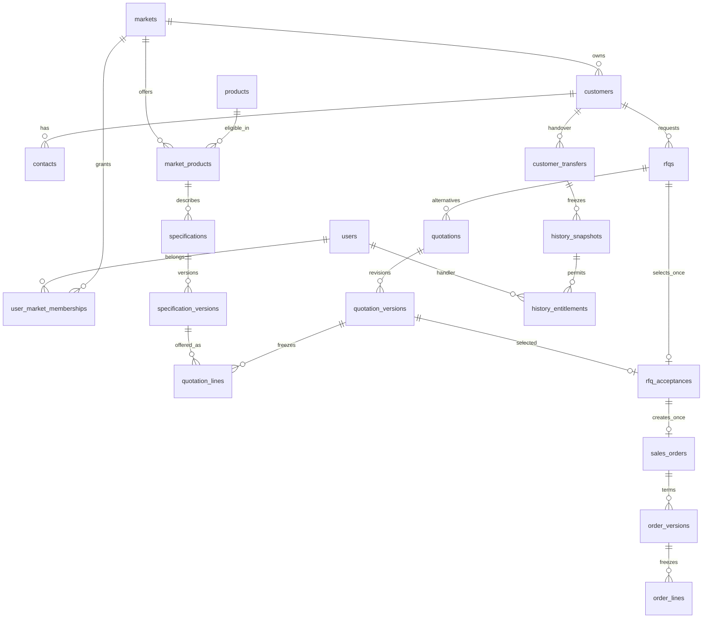
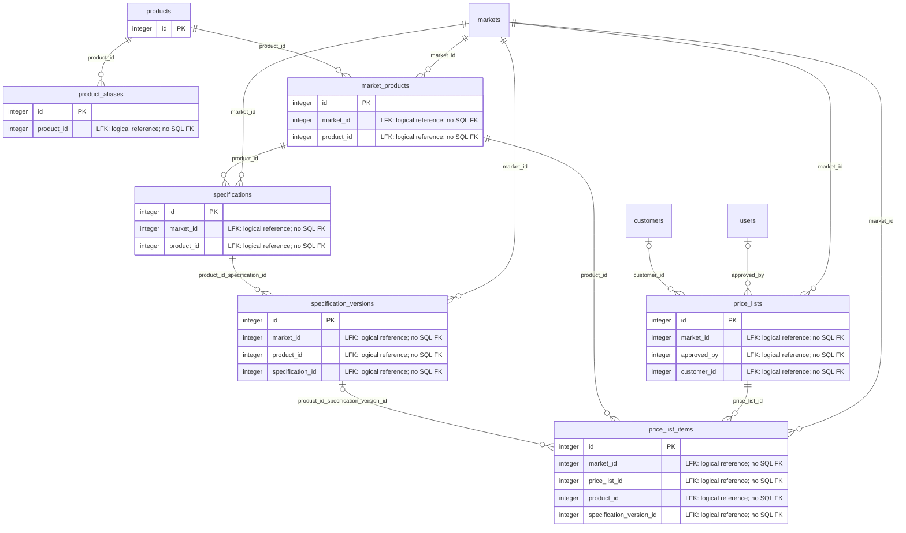

# R1 Database Architecture and Schema Specification

> **RP-04 documentation design approved 2026-11-06. Proposed fresh schema, not an applied migration.** Companion: [backend specification](backend.md). All lifecycle/grant/security gates in that document also apply here. SQL execution and physical database introspection were deliberately not run.

## 1. Goal and evidence boundary

Design a relational foundation for all 15 R1 modules and their market, identity, historical access, file, audit and notification requirements. Preserve request→alternative→version→acceptance→order traceability without overwriting commercial terms. Existing source is a synthetic UI prototype, not a database contract. Existing `docker/compose.yaml` selects PostgreSQL 17 (`postgres:17-alpine`) with a named development volume; no running database or data contents were inspected. Drizzle/Postgres.js are selected for future query adapters; there is currently no application schema/migration implementation to extend.

Sources: [context](../context.md), [module catalog](../modules/README.md), [market decisions](market-ui-plan.md), [frontend](frontend.md), [sales workflow](../business/sales-workflow.md), [pricing workflow](../business/pricing-and-quotations.md), [customer lifecycle](../business/customer-lifecycle.md), [draft permissions](../business/permissions.md). Missing architecture/security/testing files and R1 plan are explicitly recorded in the companion specification. No foreign-project schema or ADR assumptions were imported.

This is a **new-schema proposal**, not a migration for populated tables. It intentionally contains no DROP, TRUNCATE, destructive UPDATE, automatic grants, production connection strings, extensions, retention cleanup or seed credentials. The model's SQL is a reviewable baseline; incomplete policies remain gates and must be settled before turning it into executable migrations.

## 2. Confirmed decisions and schema conventions

- PostgreSQL 17 baseline from current Compose; no additional extensions required by the proposed DDL. PostgreSQL INTEGER GENERATED BY DEFAULT AS IDENTITY supplies positive 32-bit entity primary keys. Service and API boundaries validate range and positivity. request_id remains a UUID correlation token; explicitly untyped polymorphic resource/result pointers are reviewed separately below.
- Every entity table has id INTEGER GENERATED BY DEFAULT AS IDENTITY PRIMARY KEY. A separate human business number/code has an explicitly scoped UNIQUE key. Number formatting remains Pending and generation must be concurrency-safe. Integer IDs are not authorization secrets.
- `timestamptz` instants, UTC service/database presentation; use `date` for forecast calendar date. `created_at` is automatic; application commands advance `updated_at` and `version` on mutable aggregates. No hidden update trigger is assumed. Child tables without a version token use the owning aggregate version/lock; no API treats an absent child version as permission for an unchecked write.
- SQL snake_case maps to API camelCase. JSON decimal values are strings. `numeric` preserves finite original values exactly and avoids a premature commercial precision/size cap. G06 must define safe input bounds and repeating-conversion storage precision before implementation. No binary float money columns.
- Market-owned tables retain NOT NULL integer `market_id`; same-market and parent-child composite semantics are logical relationships validated by application services. PK `id` is globally unique; remove composite UNIQUE keys that existed only as SQL logical-reference targets and retain ordinary market/reference indexes for scoped lookups and dependent scans. No SQL FOREIGN KEY or REFERENCES constraints exist.
- Products are global. `market_products` is the market/product join. Customer identities, duplicate hints, specifications and prices are independent per market. No global buyer identity or cross-market transfer in R1. A general price reference remains general **within a market**.
- Relationships are normalized. JSONB is reserved for flexible technical requirements, frozen historical/commercial snapshots and redacted audit diff. Never store a list of IDs in JSON as a substitute for access-controlling logical references. `record_links` has explicit nullable integer reference columns plus an exactly-one-target CHECK.
- Archive/deactivate and application-level restrict behavior preserve evidence. SQL declares no referential action or cascade. Physical purge is blocked while logical dependents exist and remains gated by G05 retention policy. Unsubmitted draft correction uses authorized updates and audited replacement; no silent removal of historical rows.
- Business grants are not seeded. The four role-code checks do not grant permissions. `role_grants.active` defaults false. No default admin bypass. Auth tables are candidate support for the confirmed session direction and remain gated by G02.

## 3. Entity inventory, ownership and API relationships

The dictionary below and SQL share one reviewed model. “Mutable” means an explicit versioned service command may change fields while the lifecycle permits; it does not authorize arbitrary updates. Evidence/ledger rows are append-only except explicitly described operational scan/read/session state. Runtime DB privileges and application state checks still need implementation. Cross-domain relationships appear in the logical relationship matrix and diagrams; none is a SQL foreign-key constraint, and a row is not authorized merely because its integer reference resolves.

| Table                         | Domain    | Business purpose                                                                         | Lifecycle / owning operations                                                                               |
| ----------------------------- | --------- | ---------------------------------------------------------------------------------------- | ----------------------------------------------------------------------------------------------------------- |
| `teams`                       | Access    | Organizational team used by explicit TEAM grants.                                        | Versioned authorized command; preserve referenced history; M29                                              |
| `users`                       | Access    | Invite-only employee identity; never a customer login.                                   | Versioned authorized command; preserve referenced history; M29                                              |
| `user_roles`                  | Access    | Assignment of one of four confirmed global roles.                                        | Versioned authorized command; preserve referenced history; M29                                              |
| `role_grants`                 | Access    | Explicit resource/action/record-scope and field policy. No grants are seeded.            | Versioned authorized command; preserve referenced history; M29                                              |
| `team_memberships`            | Access    | Time-bounded team membership for TEAM checks.                                            | Append-only evidence/relationship; change only by specifically reviewed lifecycle; M29                      |
| `markets`                     | Access    | Sales responsibility units independent of country and locale.                            | Versioned authorized command; preserve referenced history; M29                                              |
| `user_market_memberships`     | Access    | Explicit market access; role alone grants no membership.                                 | Versioned authorized command; preserve referenced history; M29                                              |
| `user_preferences`            | Access    | Non-authoritative locale and last-market preferences.                                    | Versioned authorized command; preserve referenced history; M29                                              |
| `sessions`                    | Access    | Server-revocable sessions behind cookie JWTs; token design is gated.                     | Versioned authorized command; preserve referenced history; M29                                              |
| `invitations`                 | Access    | Single-use invitation to an employee identity.                                           | Single-use accept/revoke transition under row lock; M29                                                     |
| `files`                       | Evidence  | Immutable private file metadata; associations grant no access by themselves.             | Immutable bytes/metadata; scan state transitions PENDING → CLEAN/REJECTED; M10, Support                     |
| `customers`                   | CRM       | Independent buyer identity per market; never globally merged.                            | Versioned authorized command; preserve referenced history; M01, M03, M30                                    |
| `customer_addresses`          | CRM       | Addresses retained independently from frozen order snapshots.                            | Versioned authorized command; preserve referenced history; M01                                              |
| `customer_identifiers`        | CRM       | Identifier evidence for duplicate suggestions, not automatic merge.                      | Versioned authorized command; preserve referenced history; M01                                              |
| `contacts`                    | CRM       | Distinct people under a buyer; duplicate email is allowed.                               | Versioned authorized command; preserve referenced history; M01, M02, M03, M30                               |
| `contact_channels`            | CRM       | Multiple communication channels without inferred consent.                                | Versioned authorized command; preserve referenced history; M02                                              |
| `contact_preferences`         | CRM       | Explicit purpose-specific communication restrictions.                                    | Versioned authorized command; preserve referenced history; M02                                              |
| `customer_primary_contacts`   | CRM       | Primary person per buyer recipient context.                                              | Versioned authorized command; preserve referenced history; M02                                              |
| `leads`                       | CRM       | Unqualified market inquiry, independent of buyer master data.                            | Versioned authorized command; preserve referenced history; M03, M30                                         |
| `opportunities`               | CRM       | Forecast opportunity; WON is set by first confirmed related order.                       | Versioned authorized command; preserve referenced history; M03, M04, M30                                    |
| `lead_conversions`            | CRM       | One conversion outcome per lead; linking grants no access.                               | Append-only evidence/relationship; change only by specifically reviewed lifecycle; M03                      |
| `duplicate_reviews`           | CRM       | Restricted review of possible same-market buyer duplicates.                              | Versioned authorized command; preserve referenced history; M01, M03                                         |
| `opportunity_history`         | CRM       | Immutable stage transition history.                                                      | Append-only evidence/relationship; change only by specifically reviewed lifecycle; M04                      |
| `products`                    | Catalogue | Global SKU identity, with market eligibility stored separately.                          | Versioned authorized command; preserve referenced history; M06, M30                                         |
| `product_aliases`             | Catalogue | Localized product names and search aliases.                                              | Append-only evidence/relationship; change only by specifically reviewed lifecycle; M06                      |
| `market_products`             | Catalogue | Product eligibility/availability within one sales market.                                | Versioned authorized command; preserve referenced history; M06, M08, M30                                    |
| `specifications`              | Catalogue | Market-owned technical specification family for a product.                               | Versioned authorized command; preserve referenced history; M07                                              |
| `specification_versions`      | Catalogue | Immutable published technical revision; draft changes version token.                     | Versioned authorized command; preserve referenced history; M07, M08                                         |
| `price_lists`                 | Catalogue | Market price reference; GENERAL means general within the selected market.                | Versioned authorized command; preserve referenced history; M08                                              |
| `price_list_items`            | Catalogue | Exact product/spec/unit price and quantity eligibility.                                  | Versioned authorized command; preserve referenced history; M08                                              |
| `rfqs`                        | Sales     | Buyer request; original requested terms stay separate from offered terms.                | Versioned authorized command; preserve referenced history; M01, M09, M10, M30                               |
| `rfq_lines`                   | Sales     | Original buyer line, allowing text before SKU mapping.                                   | Versioned authorized command; preserve referenced history; M09                                              |
| `quotations`                  | Sales     | Independent alternative for a buyer RFQ.                                                 | Versioned authorized command; preserve referenced history; M01, M10, M30                                    |
| `quotation_versions`          | Sales     | Version-locked commercial terms; approval always binds to one revision.                  | Versioned authorized command; preserve referenced history; M10, M30                                         |
| `quotation_lines`             | Sales     | Offered line with stable product/spec and pricing provenance.                            | Editable only while parent is DRAFT; immutable after submission; M10                                        |
| `quotation_adjustments`       | Sales     | Explicit freight/insurance amounts included in exact quote calculation.                  | Editable only while parent is DRAFT; immutable after submission; M10                                        |
| `quotation_decisions`         | Sales     | Append-only approval/rejection/withdrawal and issue history.                             | Append-only evidence/relationship; change only by specifically reviewed lifecycle; M10                      |
| `rfq_acceptances`             | Sales     | Single accepted issued version per RFQ; immutable buyer evidence timing.                 | Append-only evidence/relationship; change only by specifically reviewed lifecycle; M10, M12                 |
| `sales_orders`                | Sales     | One order per RFQ, including direct PO workflow through accepted quote.                  | Versioned authorized command; preserve referenced history; M01, M12, M30                                    |
| `order_versions`              | Sales     | Frozen terms for initial confirmation and each amendment.                                | Versioned authorized command; preserve referenced history; M12                                              |
| `order_lines`                 | Sales     | Immutable line snapshot tied to an order version.                                        | Append-only evidence/relationship; change only by specifically reviewed lifecycle; M12                      |
| `order_amendments`            | Sales     | Review request; current confirmed terms remain effective until confirmation.             | Versioned authorized command; preserve referenced history; M12                                              |
| `order_cancellation_requests` | Sales     | Pre-shipment cancellation requires manager decision and evidence.                        | Versioned authorized command; preserve referenced history; M12                                              |
| `order_confirmation_evidence` | Evidence  | At least one CLEAN image/scan required by confirmation transaction.                      | Append-only evidence/relationship; change only by specifically reviewed lifecycle; M12                      |
| `opportunity_wins`            | CRM       | Exactly one winning order marks an opportunity WON.                                      | Append-only evidence/relationship; change only by specifically reviewed lifecycle; M12                      |
| `samples`                     | Sales     | Buyer sample request; dispatch does not require quote approval.                          | Versioned authorized command; preserve referenced history; M11, M30                                         |
| `sample_items`                | Sales     | SKU/spec and quantity requested for a sample.                                            | Append-only evidence/relationship; change only by specifically reviewed lifecycle; M11                      |
| `sample_dispatches`           | Sales     | One dispatch event with tracking and recipient snapshot.                                 | Versioned authorized command; preserve referenced history; M11                                              |
| `sample_dispatch_items`       | Sales     | Quantities actually dispatched, tied to requested items.                                 | Append-only evidence/relationship; change only by specifically reviewed lifecycle; M11                      |
| `sample_feedback`             | Sales     | Feedback identifies the actual dispatch, not only a generic request.                     | Append-only evidence/relationship; change only by specifically reviewed lifecycle; M11                      |
| `record_links`                | Evidence  | Typed relational reference for tasks, activities, files and history; exactly one target. | Append-only evidence/relationship; change only by specifically reviewed lifecycle; M05, M31                 |
| `tasks`                       | CRM       | CRM follow-up, distinct from development tracker tasks.                                  | Versioned authorized command; preserve referenced history; M01, M05, M30                                    |
| `activities`                  | CRM       | Append-only interaction history, corrected through a new linked entry.                   | Append-only evidence/relationship; change only by specifically reviewed lifecycle; M01, M05                 |
| `task_reminders`              | CRM       | Persisted deduplication of a task reminder window; scheduling policy gated.              | Append-only evidence/relationship; change only by specifically reviewed lifecycle; M05                      |
| `file_attachments`            | Evidence  | Authorized relation to a business parent or technical specification.                     | Append-only evidence/relationship; change only by specifically reviewed lifecycle; Support                  |
| `customer_transfers`          | Evidence  | Audited ownership handover boundary.                                                     | Append-only evidence/relationship; change only by specifically reviewed lifecycle; M01                      |
| `history_snapshots`           | Evidence  | Frozen allowed record projection at handover; never joins live private fields.           | Append-only evidence/relationship; change only by specifically reviewed lifecycle; M01                      |
| `history_entitlements`        | Evidence  | Explicit former-handler access to one snapshot, intersected with current grants.         | Append-only evidence/relationship; change only by specifically reviewed lifecycle; M01, Support             |
| `history_snapshot_files`      | Evidence  | Immutable list of files visible at history cutoff.                                       | Append-only evidence/relationship; change only by specifically reviewed lifecycle; M01, Support             |
| `notifications`               | Evidence  | Transactional in-app event; does not grant access to its target.                         | Append-only evidence/relationship; change only by specifically reviewed lifecycle; M11, M12, Support        |
| `notification_recipients`     | Evidence  | Independent recipient read state; duplicate recipients collapse.                         | Versioned authorized command; preserve referenced history; M11, M12, Support                                |
| `audit_events`                | Evidence  | Append-only safe audit in the business transaction; system events may lack market.       | Append-only evidence/relationship; change only by specifically reviewed lifecycle; All authorized mutations |
| `idempotency_records`         | Evidence  | Transactional command deduplication; authorize before replay.                            | Append-only evidence/relationship; change only by specifically reviewed lifecycle; All authorized mutations |

Exact endpoint→table mapping is in [backend inventory](backend.md#6-complete-proposed-route-inventory). Supporting audit/idempotency records participate in each applicable mutation even when omitted from the endpoint row. M30 reports query source entities; no denormalized warehouse or speculative report-run tables. Field, lifecycle and ownership rules in [backend section 7](backend.md#7-dto-contracts-rules-and-projections) apply to every table below.

## 4. Cross-domain ERD

The overview selects the main ownership/commercial path; detailed domain diagrams below enumerate all tables and their outgoing logical references. Every ERD edge is logical only and does not represent a SQL FOREIGN KEY constraint. Mermaid `PK` marks a database primary key; the quoted `LFK` attribute comment marks a logical reference without using Mermaid's `FK` key token. Crow's-foot many means zero or many children unless a specific UNIQUE constraint below limits it to one. `||` at a parent means the child logical reference is required; `o|` means the child logical reference is nullable. Exact composite keys and one-of conditions are authoritative in the dictionary/DDL.



### Cardinality and optionality details

- One buyer has many contacts/addresses/identifiers; duplicate emails and identifiers are suggestions, not globally unique identity. A context has at most one primary person per buyer, enforced by UNIQUE and same-buyer logical reference.
- A user can hold several of the four roles, several teams with effective intervals and several explicit market memberships. Current team/manager authorization and overlap/cycle checks are application rules. Preference is at most one row per user and never an access grant.
- One global product has at most one eligibility row per market; one specification family has many revisions; a line's product and spec revision must match. Retiring eligibility does not delete history.
- RFQ has many independent quote alternatives; each has many revisions and lines. One acceptance per RFQ, one order per RFQ. The acceptance's revision must belong to that RFQ; the order must reference that exact accepted tuple. Version and line immutable-state checks belong in services/runtime privileges.
- Order has many terms revisions and reviewed requests; only a confirmed revision becomes effective. At most one active amendment and one pending cancellation per order are indexed separately; competing amendment vs cancellation still serialize on the same order and revalidate state.
- One opportunity can have many related RFQs/orders but exactly zero or one first-win row. Service verifies winning order's RFQ belongs to the opportunity; a same-market logical reference validation alone cannot enforce this join predicate.
- A sample has many request items/dispatches. Dispatch-item logical composite relationships guarantee the dispatched item and dispatch have the same sample and market. Feedback belongs to an actual dispatch.
- Typed record links name exactly one CRM/sales target. A task's assignment cannot authorize that target. Activity corrections are append-only and must retain same-parent authorization. Reusing an equivalent record link is an optimization, not required for correctness.
- History snapshots are immutable cutoff projections. Each entitlement joins a user to one snapshot; immutable file lists only include authorized pre-cutoff objects. Current membership/grants still gate all reads. Full historical projection for the new owner is not derived by showing the former owner's filtered snapshot alone.
- Notifications have one event-key identity and unique recipient rows, each with independent read time. Audit/resource identifiers are historical metadata and deliberately not a polymorphic authorization relationship. An audit reader must authorize the actual typed parent or explicit system scope before querying.

### Access detail

```mermaid
erDiagram
  teams {
    integer id PK
  }
  users {
    integer id PK
    integer direct_manager_id "LFK: logical reference; no SQL FK"
  }
  user_roles {
    integer id PK
    integer user_id "LFK: logical reference; no SQL FK"
    integer granted_by "LFK: logical reference; no SQL FK"
  }
  role_grants {
    integer id PK
    integer changed_by "LFK: logical reference; no SQL FK"
  }
  team_memberships {
    integer id PK
    integer user_id "LFK: logical reference; no SQL FK"
    integer team_id "LFK: logical reference; no SQL FK"
  }
  markets {
    integer id PK
  }
  user_market_memberships {
    integer id PK
    integer market_id "LFK: logical reference; no SQL FK"
    integer user_id "LFK: logical reference; no SQL FK"
    integer granted_by "LFK: logical reference; no SQL FK"
    integer revoked_by "LFK: logical reference; no SQL FK"
  }
  user_preferences {
    integer id PK
    integer user_id "LFK: logical reference; no SQL FK"
    integer last_market_id "LFK: logical reference; no SQL FK"
  }
  sessions {
    integer id PK
    integer user_id "LFK: logical reference; no SQL FK"
  }
  invitations {
    integer id PK
    integer user_id "LFK: logical reference; no SQL FK"
    integer invited_by "LFK: logical reference; no SQL FK"
  }
  users o|--o{ users : direct_manager_id
  users ||--o{ user_roles : user_id
  users ||--o{ user_roles : granted_by
  users ||--o{ role_grants : changed_by
  users ||--o{ team_memberships : user_id
  teams ||--o{ team_memberships : team_id
  markets ||--o{ user_market_memberships : market_id
  users ||--o{ user_market_memberships : user_id
  users ||--o{ user_market_memberships : granted_by
  users o|--o{ user_market_memberships : revoked_by
  users ||--o| user_preferences : user_id
  markets o|--o{ user_preferences : last_market_id
  users ||--o{ sessions : user_id
  users ||--o{ invitations : user_id
  users ||--o{ invitations : invited_by
```



### CRM detail

```mermaid
erDiagram
  customers {
    integer id PK
    integer market_id "LFK: logical reference; no SQL FK"
    integer owner_id "LFK: logical reference; no SQL FK"
    integer team_id "LFK: logical reference; no SQL FK"
  }
  customer_addresses {
    integer id PK
    integer market_id "LFK: logical reference; no SQL FK"
    integer customer_id "LFK: logical reference; no SQL FK"
  }
  customer_identifiers {
    integer id PK
    integer market_id "LFK: logical reference; no SQL FK"
    integer customer_id "LFK: logical reference; no SQL FK"
  }
  contacts {
    integer id PK
    integer market_id "LFK: logical reference; no SQL FK"
    integer customer_id "LFK: logical reference; no SQL FK"
  }
  contact_channels {
    integer id PK
    integer market_id "LFK: logical reference; no SQL FK"
    integer contact_id "LFK: logical reference; no SQL FK"
  }
  contact_preferences {
    integer id PK
    integer market_id "LFK: logical reference; no SQL FK"
    integer contact_id "LFK: logical reference; no SQL FK"
    integer evidence_file_id "LFK: logical reference; no SQL FK"
  }
  customer_primary_contacts {
    integer id PK
    integer market_id "LFK: logical reference; no SQL FK"
    integer customer_id "LFK: logical reference; no SQL FK"
    integer contact_id "LFK: logical reference; no SQL FK"
  }
  leads {
    integer id PK
    integer market_id "LFK: logical reference; no SQL FK"
    integer owner_id "LFK: logical reference; no SQL FK"
  }
  opportunities {
    integer id PK
    integer market_id "LFK: logical reference; no SQL FK"
    integer owner_id "LFK: logical reference; no SQL FK"
    integer customer_id "LFK: logical reference; no SQL FK"
    integer lead_id "LFK: logical reference; no SQL FK"
  }
  lead_conversions {
    integer id PK
    integer market_id "LFK: logical reference; no SQL FK"
    integer decided_by "LFK: logical reference; no SQL FK"
    integer lead_id "LFK: logical reference; no SQL FK"
    integer customer_id "LFK: logical reference; no SQL FK"
    integer contact_id "LFK: logical reference; no SQL FK"
    integer opportunity_id "LFK: logical reference; no SQL FK"
  }
  duplicate_reviews {
    integer id PK
    integer market_id "LFK: logical reference; no SQL FK"
    integer requested_by "LFK: logical reference; no SQL FK"
    integer reviewed_by "LFK: logical reference; no SQL FK"
    integer lead_id "LFK: logical reference; no SQL FK"
    integer customer_id "LFK: logical reference; no SQL FK"
    integer candidate_customer_id "LFK: logical reference; no SQL FK"
  }
  opportunity_history {
    integer id PK
    integer market_id "LFK: logical reference; no SQL FK"
    integer actor_id "LFK: logical reference; no SQL FK"
    integer opportunity_id "LFK: logical reference; no SQL FK"
  }
  opportunity_wins {
    integer id PK
    integer market_id "LFK: logical reference; no SQL FK"
    integer opportunity_id "LFK: logical reference; no SQL FK"
    integer sales_order_id "LFK: logical reference; no SQL FK"
  }
  tasks {
    integer id PK
    integer market_id "LFK: logical reference; no SQL FK"
    integer assignee_id "LFK: logical reference; no SQL FK"
    integer completed_by "LFK: logical reference; no SQL FK"
    integer record_link_id "LFK: logical reference; no SQL FK"
  }
  activities {
    integer id PK
    integer market_id "LFK: logical reference; no SQL FK"
    integer actor_id "LFK: logical reference; no SQL FK"
    integer record_link_id "LFK: logical reference; no SQL FK"
    integer corrects_activity_id "LFK: logical reference; no SQL FK"
  }
  task_reminders {
    integer id PK
    integer market_id "LFK: logical reference; no SQL FK"
    integer recipient_id "LFK: logical reference; no SQL FK"
    integer task_id "LFK: logical reference; no SQL FK"
  }
  markets ||--o{ customers : market_id
  users ||--o{ customers : owner_id
  teams o|--o{ customers : team_id
  markets ||--o{ customer_addresses : market_id
  customers ||--o{ customer_addresses : customer_id
  markets ||--o{ customer_identifiers : market_id
  customers ||--o{ customer_identifiers : customer_id
  markets ||--o{ contacts : market_id
  customers ||--o{ contacts : customer_id
  markets ||--o{ contact_channels : market_id
  contacts ||--o{ contact_channels : contact_id
  markets ||--o{ contact_preferences : market_id
  contacts ||--o{ contact_preferences : contact_id
  files o|--o{ contact_preferences : evidence_file_id
  markets ||--o{ customer_primary_contacts : market_id
  contacts ||--o{ customer_primary_contacts : customer_id_contact_id
  markets ||--o{ leads : market_id
  users ||--o{ leads : owner_id
  markets ||--o{ opportunities : market_id
  users ||--o{ opportunities : owner_id
  customers ||--o{ opportunities : customer_id
  leads o|--o{ opportunities : lead_id
  markets ||--o{ lead_conversions : market_id
  users ||--o{ lead_conversions : decided_by
  leads ||--o| lead_conversions : lead_id
  customers ||--o{ lead_conversions : customer_id
  contacts o|--o{ lead_conversions : customer_id_contact_id
  opportunities o|--o{ lead_conversions : customer_id_opportunity_id
  markets ||--o{ duplicate_reviews : market_id
  users ||--o{ duplicate_reviews : requested_by
  users o|--o{ duplicate_reviews : reviewed_by
  leads o|--o{ duplicate_reviews : lead_id
  customers o|--o{ duplicate_reviews : customer_id
  customers ||--o{ duplicate_reviews : candidate_customer_id
  markets ||--o{ opportunity_history : market_id
  users ||--o{ opportunity_history : actor_id
  opportunities ||--o{ opportunity_history : opportunity_id
  markets ||--o{ opportunity_wins : market_id
  opportunities ||--o| opportunity_wins : opportunity_id
  sales_orders ||--o{ opportunity_wins : sales_order_id
  markets ||--o{ tasks : market_id
  users ||--o{ tasks : assignee_id
  users o|--o{ tasks : completed_by
  record_links ||--o{ tasks : record_link_id
  markets ||--o{ activities : market_id
  users ||--o{ activities : actor_id
  record_links ||--o{ activities : record_link_id
  activities o|--o{ activities : corrects_activity_id
  markets ||--o{ task_reminders : market_id
  users ||--o{ task_reminders : recipient_id
  tasks ||--o{ task_reminders : task_id
```



### Catalogue detail



### Sales detail

```mermaid
erDiagram
  rfqs {
    integer id PK
    integer market_id "LFK: logical reference; no SQL FK"
    integer owner_id "LFK: logical reference; no SQL FK"
    integer customer_id "LFK: logical reference; no SQL FK"
    integer contact_id "LFK: logical reference; no SQL FK"
    integer opportunity_id "LFK: logical reference; no SQL FK"
  }
  rfq_lines {
    integer id PK
    integer market_id "LFK: logical reference; no SQL FK"
    integer rfq_id "LFK: logical reference; no SQL FK"
    integer product_id "LFK: logical reference; no SQL FK"
  }
  quotations {
    integer id PK
    integer market_id "LFK: logical reference; no SQL FK"
    integer owner_id "LFK: logical reference; no SQL FK"
    integer rfq_id "LFK: logical reference; no SQL FK"
  }
  quotation_versions {
    integer id PK
    integer market_id "LFK: logical reference; no SQL FK"
    integer created_by "LFK: logical reference; no SQL FK"
    integer rfq_id "LFK: logical reference; no SQL FK"
    integer quotation_id "LFK: logical reference; no SQL FK"
    integer pdf_file_id "LFK: logical reference; no SQL FK"
  }
  quotation_lines {
    integer id PK
    integer market_id "LFK: logical reference; no SQL FK"
    integer selected_by "LFK: logical reference; no SQL FK"
    integer rfq_id "LFK: logical reference; no SQL FK"
    integer quotation_version_id "LFK: logical reference; no SQL FK"
    integer rfq_line_id "LFK: logical reference; no SQL FK"
    integer product_id "LFK: logical reference; no SQL FK"
    integer specification_version_id "LFK: logical reference; no SQL FK"
    integer price_list_item_id "LFK: logical reference; no SQL FK"
  }
  quotation_adjustments {
    integer id PK
    integer market_id "LFK: logical reference; no SQL FK"
    integer quotation_version_id "LFK: logical reference; no SQL FK"
  }
  quotation_decisions {
    integer id PK
    integer market_id "LFK: logical reference; no SQL FK"
    integer actor_id "LFK: logical reference; no SQL FK"
    integer quotation_version_id "LFK: logical reference; no SQL FK"
  }
  rfq_acceptances {
    integer id PK
    integer market_id "LFK: logical reference; no SQL FK"
    integer recorded_by "LFK: logical reference; no SQL FK"
    integer rfq_id "LFK: logical reference; no SQL FK"
    integer quotation_version_id "LFK: logical reference; no SQL FK"
    integer evidence_file_id "LFK: logical reference; no SQL FK"
  }
  sales_orders {
    integer id PK
    integer market_id "LFK: logical reference; no SQL FK"
    integer owner_id "LFK: logical reference; no SQL FK"
    integer rfq_id "LFK: logical reference; no SQL FK"
    integer accepted_quote_version_id "LFK: logical reference; no SQL FK"
  }
  order_versions {
    integer id PK
    integer market_id "LFK: logical reference; no SQL FK"
    integer sales_order_id "LFK: logical reference; no SQL FK"
  }
  order_lines {
    integer id PK
    integer market_id "LFK: logical reference; no SQL FK"
    integer order_version_id "LFK: logical reference; no SQL FK"
    integer product_id "LFK: logical reference; no SQL FK"
    integer specification_version_id "LFK: logical reference; no SQL FK"
  }
  order_amendments {
    integer id PK
    integer market_id "LFK: logical reference; no SQL FK"
    integer requested_by "LFK: logical reference; no SQL FK"
    integer reviewed_by "LFK: logical reference; no SQL FK"
    integer sales_order_id "LFK: logical reference; no SQL FK"
    integer proposed_version_id "LFK: logical reference; no SQL FK"
  }
  order_cancellation_requests {
    integer id PK
    integer market_id "LFK: logical reference; no SQL FK"
    integer requested_by "LFK: logical reference; no SQL FK"
    integer reviewed_by "LFK: logical reference; no SQL FK"
    integer sales_order_id "LFK: logical reference; no SQL FK"
    integer evidence_file_id "LFK: logical reference; no SQL FK"
  }
  samples {
    integer id PK
    integer market_id "LFK: logical reference; no SQL FK"
    integer owner_id "LFK: logical reference; no SQL FK"
    integer customer_id "LFK: logical reference; no SQL FK"
    integer contact_id "LFK: logical reference; no SQL FK"
    integer opportunity_id "LFK: logical reference; no SQL FK"
  }
  sample_items {
    integer id PK
    integer market_id "LFK: logical reference; no SQL FK"
    integer sample_id "LFK: logical reference; no SQL FK"
    integer product_id "LFK: logical reference; no SQL FK"
    integer specification_version_id "LFK: logical reference; no SQL FK"
  }
  sample_dispatches {
    integer id PK
    integer market_id "LFK: logical reference; no SQL FK"
    integer dispatched_by "LFK: logical reference; no SQL FK"
    integer sample_id "LFK: logical reference; no SQL FK"
  }
  sample_dispatch_items {
    integer id PK
    integer market_id "LFK: logical reference; no SQL FK"
    integer sample_id "LFK: logical reference; no SQL FK"
    integer dispatch_id "LFK: logical reference; no SQL FK"
    integer sample_item_id "LFK: logical reference; no SQL FK"
  }
  sample_feedback {
    integer id PK
    integer market_id "LFK: logical reference; no SQL FK"
    integer recorded_by "LFK: logical reference; no SQL FK"
    integer dispatch_id "LFK: logical reference; no SQL FK"
  }
  markets ||--o{ rfqs : market_id
  users ||--o{ rfqs : owner_id
  customers ||--o{ rfqs : customer_id
  contacts o|--o{ rfqs : customer_id_contact_id
  opportunities o|--o{ rfqs : customer_id_opportunity_id
  markets ||--o{ rfq_lines : market_id
  rfqs ||--o{ rfq_lines : rfq_id
  market_products o|--o{ rfq_lines : product_id
  markets ||--o{ quotations : market_id
  users ||--o{ quotations : owner_id
  rfqs ||--o{ quotations : rfq_id
  markets ||--o{ quotation_versions : market_id
  users ||--o{ quotation_versions : created_by
  quotations ||--o{ quotation_versions : rfq_id_quotation_id
  files o|--o{ quotation_versions : pdf_file_id
  markets ||--o{ quotation_lines : market_id
  users ||--o{ quotation_lines : selected_by
  quotation_versions ||--o{ quotation_lines : rfq_id_quotation_version_id
  rfq_lines o|--o{ quotation_lines : rfq_id_rfq_line_id
  specification_versions ||--o{ quotation_lines : product_id_specification_version_id
  price_list_items o|--o{ quotation_lines : price_list_item_id
  markets ||--o{ quotation_adjustments : market_id
  quotation_versions ||--o{ quotation_adjustments : quotation_version_id
  markets ||--o{ quotation_decisions : market_id
  users ||--o{ quotation_decisions : actor_id
  quotation_versions ||--o{ quotation_decisions : quotation_version_id
  markets ||--o{ rfq_acceptances : market_id
  users ||--o{ rfq_acceptances : recorded_by
  quotation_versions ||--o| rfq_acceptances : rfq_id_quotation_version_id
  files ||--o{ rfq_acceptances : evidence_file_id
  markets ||--o{ sales_orders : market_id
  users ||--o{ sales_orders : owner_id
  rfq_acceptances ||--o| sales_orders : rfq_id_accepted_quote_version_id
  markets ||--o{ order_versions : market_id
  sales_orders ||--o{ order_versions : sales_order_id
  markets ||--o{ order_lines : market_id
  order_versions ||--o{ order_lines : order_version_id
  specification_versions ||--o{ order_lines : product_id_specification_version_id
  markets ||--o{ order_amendments : market_id
  users ||--o{ order_amendments : requested_by
  users o|--o{ order_amendments : reviewed_by
  order_versions ||--o| order_amendments : sales_order_id_proposed_version_id
  markets ||--o{ order_cancellation_requests : market_id
  users ||--o{ order_cancellation_requests : requested_by
  users o|--o{ order_cancellation_requests : reviewed_by
  sales_orders ||--o{ order_cancellation_requests : sales_order_id
  files ||--o{ order_cancellation_requests : evidence_file_id
  markets ||--o{ samples : market_id
  users ||--o{ samples : owner_id
  customers ||--o{ samples : customer_id
  contacts o|--o{ samples : customer_id_contact_id
  opportunities o|--o{ samples : customer_id_opportunity_id
  markets ||--o{ sample_items : market_id
  samples ||--o{ sample_items : sample_id
  specification_versions ||--o{ sample_items : product_id_specification_version_id
  markets ||--o{ sample_dispatches : market_id
  users ||--o{ sample_dispatches : dispatched_by
  samples ||--o{ sample_dispatches : sample_id
  markets ||--o{ sample_dispatch_items : market_id
  sample_dispatches ||--o{ sample_dispatch_items : sample_id_dispatch_id
  sample_items ||--o{ sample_dispatch_items : sample_id_sample_item_id
  markets ||--o{ sample_feedback : market_id
  users ||--o{ sample_feedback : recorded_by
  sample_dispatches ||--o{ sample_feedback : dispatch_id
```



### Evidence detail

```mermaid
erDiagram
  files {
    integer id PK
    integer market_id "LFK: logical reference; no SQL FK"
    integer uploaded_by "LFK: logical reference; no SQL FK"
  }
  order_confirmation_evidence {
    integer id PK
    integer market_id "LFK: logical reference; no SQL FK"
    integer recorded_by "LFK: logical reference; no SQL FK"
    integer order_version_id "LFK: logical reference; no SQL FK"
    integer file_id "LFK: logical reference; no SQL FK"
  }
  record_links {
    integer id PK
    integer market_id "LFK: logical reference; no SQL FK"
    integer customer_id "LFK: logical reference; no SQL FK"
    integer contact_id "LFK: logical reference; no SQL FK"
    integer lead_id "LFK: logical reference; no SQL FK"
    integer opportunity_id "LFK: logical reference; no SQL FK"
    integer rfq_id "LFK: logical reference; no SQL FK"
    integer quotation_id "LFK: logical reference; no SQL FK"
    integer sales_order_id "LFK: logical reference; no SQL FK"
    integer sample_id "LFK: logical reference; no SQL FK"
  }
  file_attachments {
    integer id PK
    integer market_id "LFK: logical reference; no SQL FK"
    integer file_id "LFK: logical reference; no SQL FK"
    integer record_link_id "LFK: logical reference; no SQL FK"
    integer specification_version_id "LFK: logical reference; no SQL FK"
    integer quotation_version_id "LFK: logical reference; no SQL FK"
  }
  customer_transfers {
    integer id PK
    integer market_id "LFK: logical reference; no SQL FK"
    integer former_owner_id "LFK: logical reference; no SQL FK"
    integer new_owner_id "LFK: logical reference; no SQL FK"
    integer authorized_by "LFK: logical reference; no SQL FK"
    integer customer_id "LFK: logical reference; no SQL FK"
  }
  history_snapshots {
    integer id PK
    integer market_id "LFK: logical reference; no SQL FK"
    integer transfer_id "LFK: logical reference; no SQL FK"
    integer record_link_id "LFK: logical reference; no SQL FK"
  }
  history_entitlements {
    integer id PK
    integer market_id "LFK: logical reference; no SQL FK"
    integer user_id "LFK: logical reference; no SQL FK"
    integer snapshot_id "LFK: logical reference; no SQL FK"
  }
  history_snapshot_files {
    integer id PK
    integer market_id "LFK: logical reference; no SQL FK"
    integer snapshot_id "LFK: logical reference; no SQL FK"
    integer file_id "LFK: logical reference; no SQL FK"
  }
  notifications {
    integer id PK
    integer market_id "LFK: logical reference; no SQL FK"
    integer record_link_id "LFK: logical reference; no SQL FK"
  }
  notification_recipients {
    integer id PK
    integer market_id "LFK: logical reference; no SQL FK"
    integer user_id "LFK: logical reference; no SQL FK"
    integer notification_id "LFK: logical reference; no SQL FK"
  }
  audit_events {
    integer id PK
    integer market_id "LFK: logical reference; no SQL FK"
    integer actor_id "LFK: logical reference; no SQL FK"
    integer resource_id "LFK: logical reference; no SQL FK"
  }
  idempotency_records {
    integer id PK
    integer market_id "LFK: logical reference; no SQL FK"
    integer actor_id "LFK: logical reference; no SQL FK"
  }
  markets ||--o{ files : market_id
  users ||--o{ files : uploaded_by
  markets ||--o{ order_confirmation_evidence : market_id
  users ||--o{ order_confirmation_evidence : recorded_by
  order_versions ||--o{ order_confirmation_evidence : order_version_id
  files ||--o{ order_confirmation_evidence : file_id
  markets ||--o{ record_links : market_id
  customers o|--o{ record_links : customer_id
  contacts o|--o{ record_links : contact_id
  leads o|--o{ record_links : lead_id
  opportunities o|--o{ record_links : opportunity_id
  rfqs o|--o{ record_links : rfq_id
  quotations o|--o{ record_links : quotation_id
  sales_orders o|--o{ record_links : sales_order_id
  samples o|--o{ record_links : sample_id
  markets ||--o{ file_attachments : market_id
  files ||--o{ file_attachments : file_id
  record_links o|--o{ file_attachments : record_link_id
  specification_versions o|--o{ file_attachments : specification_version_id
  quotation_versions o|--o{ file_attachments : quotation_version_id
  markets ||--o{ customer_transfers : market_id
  users ||--o{ customer_transfers : former_owner_id
  users ||--o{ customer_transfers : new_owner_id
  users ||--o{ customer_transfers : authorized_by
  customers ||--o{ customer_transfers : customer_id
  markets ||--o{ history_snapshots : market_id
  customer_transfers ||--o{ history_snapshots : transfer_id
  record_links ||--o{ history_snapshots : record_link_id
  markets ||--o{ history_entitlements : market_id
  users ||--o{ history_entitlements : user_id
  history_snapshots ||--o{ history_entitlements : snapshot_id
  markets ||--o{ history_snapshot_files : market_id
  history_snapshots ||--o{ history_snapshot_files : snapshot_id
  files ||--o{ history_snapshot_files : file_id
  markets ||--o{ notifications : market_id
  record_links ||--o{ notifications : record_link_id
  markets ||--o{ notification_recipients : market_id
  users ||--o{ notification_recipients : user_id
  notifications ||--o{ notification_recipients : notification_id
  markets o|--o{ audit_events : market_id
  users o|--o{ audit_events : actor_id
  markets o|--o{ idempotency_records : market_id
  users ||--o{ idempotency_records : actor_id
```



## 5. Logical relationship matrix

These are **application-managed logical references**, not SQL FOREIGN KEY constraints or REFERENCES clauses. Entity ID columns listed below use INTEGER and must resolve to the referenced entity's id; schema fields keep NOT NULL/NULL shape. Cardinality states intended relationship cardinality. For entity→child, each parent has 1:N children unless the child relation is unique (1:0..1); “Required” says whether each child row must identify the parent. Checks run under the shared transaction lock protocol in the backend specification. A “Restricted” delete is an application decision after locking the target and scanning all declared dependent relationships; no SQL cascade runs.

| Child entity                  | Child PK | Logical reference column(s)                           | Referenced entity / PK                                            | Relationship     | Required | Application validation                                                                                             | Delete behavior                                                                                           | Supporting index                                                                                                                                                                                                                                                                                                                                                        |
| ----------------------------- | -------- | ----------------------------------------------------- | ----------------------------------------------------------------- | ---------------- | -------- | ------------------------------------------------------------------------------------------------------------------ | --------------------------------------------------------------------------------------------------------- | ----------------------------------------------------------------------------------------------------------------------------------------------------------------------------------------------------------------------------------------------------------------------------------------------------------------------------------------------------------------------- |
| `activities`                  | `id`     | `actor_id`                                            | `users` (`id`)                                                    | 1:0..N           | Required | Verify employee exists and lifecycle permits the role; independently authorize actor/assignee/grant action.        | Disable/deactivate/retire; block physical purge while any declared logical dependent remains.             | `idx_activities_actor_id`                                                                                                                                                                                                                                                                                                                                               |
| `activities`                  | `id`     | `market_id`                                           | `markets` (`id`)                                                  | 1:0..N           | Required | Verify market exists and is permitted for operation; reads additionally require active user membership.            | Disable/deactivate/retire; block physical purge while any declared logical dependent remains.             | `idx_activities_market_id`, `activities_parent_page`, `idx_activities_market_id_corrects_activity_id`                                                                                                                                                                                                                                                                   |
| `activities`                  | `id`     | `market_id`, `corrects_activity_id`                   | `activities` (`market_id`, `id`)                                  | 1:0..N           | Optional | Resolve target, same-market/parent scope, lifecycle and caller action/field grants inside the transaction.         | Archive/deactivate when allowed; block physical purge while this or any other declared dependent remains. | `idx_activities_market_id_corrects_activity_id`                                                                                                                                                                                                                                                                                                                         |
| `activities`                  | `id`     | `market_id`, `record_link_id`                         | `record_links` (`market_id`, `id`)                                | 1:0..N           | Required | Resolve exactly one typed target in same market and authorize target; assignment never grants parent access.       | Archive/deactivate when allowed; block physical purge while this or any other declared dependent remains. | `activities_parent_page`                                                                                                                                                                                                                                                                                                                                                |
| `audit_events`                | `id`     | `actor_id`                                            | `users` (`id`)                                                    | 1:0..N           | Optional | Verify employee exists and lifecycle permits the role; independently authorize actor/assignee/grant action.        | Disable/deactivate/retire; block physical purge while any declared logical dependent remains.             | `idx_audit_events_actor_id`                                                                                                                                                                                                                                                                                                                                             |
| `audit_events`                | `id`     | `market_id`                                           | `markets` (`id`)                                                  | 1:0..N           | Optional | Verify market exists and is permitted for operation; reads additionally require active user membership.            | Disable/deactivate/retire; block physical purge while any declared logical dependent remains.             | `audit_resource_lookup`                                                                                                                                                                                                                                                                                                                                                 | `audit_events (resource_type, resource_id)` | `idx_audit_events_market_id` |
| `contact_channels`            | `id`     | `market_id`                                           | `markets` (`id`)                                                  | 1:0..N           | Required | Verify market exists and is permitted for operation; reads additionally require active user membership.            | Disable/deactivate/retire; block physical purge while any declared logical dependent remains.             | `idx_contact_channels_market_id`, `contact_channel_duplicate`, `idx_contact_channels_market_id_contact_id`                                                                                                                                                                                                                                                              |
| `contact_channels`            | `id`     | `market_id`, `contact_id`                             | `contacts` (`market_id`, `id`)                                    | 1:0..N           | Required | Resolve target, same-market/parent scope, lifecycle and caller action/field grants inside the transaction.         | Archive/deactivate when allowed; block physical purge while this or any other declared dependent remains. | `idx_contact_channels_market_id_contact_id`                                                                                                                                                                                                                                                                                                                             |
| `contact_preferences`         | `id`     | `market_id`                                           | `markets` (`id`)                                                  | 1:0..N           | Required | Verify market exists and is permitted for operation; reads additionally require active user membership.            | Disable/deactivate/retire; block physical purge while any declared logical dependent remains.             | `idx_contact_preferences_market_id`, `idx_contact_preferences_market_id_contact_id`, `idx_contact_preferences_market_id_evidence_file_id`                                                                                                                                                                                                                               |
| `contact_preferences`         | `id`     | `market_id`, `contact_id`                             | `contacts` (`market_id`, `id`)                                    | 1:0..N           | Required | Resolve target, same-market/parent scope, lifecycle and caller action/field grants inside the transaction.         | Archive/deactivate when allowed; block physical purge while this or any other declared dependent remains. | `idx_contact_preferences_market_id_contact_id`                                                                                                                                                                                                                                                                                                                          |
| `contact_preferences`         | `id`     | `market_id`, `evidence_file_id`                       | `files` (`market_id`, `id`)                                       | 1:0..N           | Optional | Verify same market, scan_state=CLEAN, intended purpose/parent, and caller download/use grant.                      | Archive/deactivate when allowed; block physical purge while this or any other declared dependent remains. | `idx_contact_preferences_market_id_evidence_file_id`                                                                                                                                                                                                                                                                                                                    |
| `contacts`                    | `id`     | `market_id`                                           | `markets` (`id`)                                                  | 1:0..N           | Required | Verify market exists and is permitted for operation; reads additionally require active user membership.            | Disable/deactivate/retire; block physical purge while any declared logical dependent remains.             | `idx_contacts_market_id`, `contacts_parent_page`                                                                                                                                                                                                                                                                                                                        |
| `contacts`                    | `id`     | `market_id`, `customer_id`                            | `customers` (`market_id`, `id`)                                   | 1:0..N           | Required | Resolve target, same-market/parent scope, lifecycle and caller action/field grants inside the transaction.         | Archive/deactivate when allowed; block physical purge while this or any other declared dependent remains. | `contacts_parent_page`                                                                                                                                                                                                                                                                                                                                                  |
| `customer_addresses`          | `id`     | `market_id`                                           | `markets` (`id`)                                                  | 1:0..N           | Required | Verify market exists and is permitted for operation; reads additionally require active user membership.            | Disable/deactivate/retire; block physical purge while any declared logical dependent remains.             | `idx_customer_addresses_market_id`, `idx_customer_addresses_market_id_customer_id`                                                                                                                                                                                                                                                                                      |
| `customer_addresses`          | `id`     | `market_id`, `customer_id`                            | `customers` (`market_id`, `id`)                                   | 1:0..N           | Required | Resolve target, same-market/parent scope, lifecycle and caller action/field grants inside the transaction.         | Archive/deactivate when allowed; block physical purge while this or any other declared dependent remains. | `idx_customer_addresses_market_id_customer_id`                                                                                                                                                                                                                                                                                                                          |
| `customer_identifiers`        | `id`     | `market_id`                                           | `markets` (`id`)                                                  | 1:0..N           | Required | Verify market exists and is permitted for operation; reads additionally require active user membership.            | Disable/deactivate/retire; block physical purge while any declared logical dependent remains.             | `idx_customer_identifiers_market_id`, `customer_identifier_duplicate`, `idx_customer_identifiers_market_id_customer_id`                                                                                                                                                                                                                                                 |
| `customer_identifiers`        | `id`     | `market_id`, `customer_id`                            | `customers` (`market_id`, `id`)                                   | 1:0..N           | Required | Resolve target, same-market/parent scope, lifecycle and caller action/field grants inside the transaction.         | Archive/deactivate when allowed; block physical purge while this or any other declared dependent remains. | `idx_customer_identifiers_market_id_customer_id`                                                                                                                                                                                                                                                                                                                        |
| `customer_primary_contacts`   | `id`     | `market_id`                                           | `markets` (`id`)                                                  | 1:0..N           | Required | Verify market exists and is permitted for operation; reads additionally require active user membership.            | Disable/deactivate/retire; block physical purge while any declared logical dependent remains.             | `idx_customer_primary_contacts_market_id`, `idx_customer_primary_contacts_market_id_customer_id_contact_id`                                                                                                                                                                                                                                                             |
| `customer_primary_contacts`   | `id`     | `market_id`, `customer_id`, `contact_id`              | `contacts` (`market_id`, `customer_id`, `id`)                     | 1:0..N           | Required | Resolve target and parent customer in same market; verify both access predicates and lifecycle.                    | Archive/deactivate when allowed; block physical purge while this or any other declared dependent remains. | `idx_customer_primary_contacts_market_id_customer_id_contact_id`                                                                                                                                                                                                                                                                                                        |
| `customer_transfers`          | `id`     | `authorized_by`                                       | `users` (`id`)                                                    | 1:0..N           | Required | Verify employee exists and lifecycle permits the role; independently authorize actor/assignee/grant action.        | Disable/deactivate/retire; block physical purge while any declared logical dependent remains.             | `idx_customer_transfers_authorized_by`                                                                                                                                                                                                                                                                                                                                  |
| `customer_transfers`          | `id`     | `former_owner_id`                                     | `users` (`id`)                                                    | 1:0..N           | Required | Verify employee exists and lifecycle permits the role; independently authorize actor/assignee/grant action.        | Disable/deactivate/retire; block physical purge while any declared logical dependent remains.             | `idx_customer_transfers_former_owner_id`                                                                                                                                                                                                                                                                                                                                |
| `customer_transfers`          | `id`     | `market_id`                                           | `markets` (`id`)                                                  | 1:0..N           | Required | Verify market exists and is permitted for operation; reads additionally require active user membership.            | Disable/deactivate/retire; block physical purge while any declared logical dependent remains.             | `idx_customer_transfers_market_id`, `customer_transfers_parent_page`                                                                                                                                                                                                                                                                                                    |
| `customer_transfers`          | `id`     | `market_id`, `customer_id`                            | `customers` (`market_id`, `id`)                                   | 1:0..N           | Required | Resolve target, same-market/parent scope, lifecycle and caller action/field grants inside the transaction.         | Archive/deactivate when allowed; block physical purge while this or any other declared dependent remains. | `customer_transfers_parent_page`                                                                                                                                                                                                                                                                                                                                        |
| `customer_transfers`          | `id`     | `new_owner_id`                                        | `users` (`id`)                                                    | 1:0..N           | Required | Verify employee exists and lifecycle permits the role; independently authorize actor/assignee/grant action.        | Disable/deactivate/retire; block physical purge while any declared logical dependent remains.             | `idx_customer_transfers_new_owner_id`                                                                                                                                                                                                                                                                                                                                   |
| `customers`                   | `id`     | `market_id`                                           | `markets` (`id`)                                                  | 1:0..N           | Required | Verify market exists and is permitted for operation; reads additionally require active user membership.            | Disable/deactivate/retire; block physical purge while any declared logical dependent remains.             | `idx_customers_market_id`, `customers_owner_page`                                                                                                                                                                                                                                                                                                                       |
| `customers`                   | `id`     | `owner_id`                                            | `users` (`id`)                                                    | 1:0..N           | Required | Verify employee exists and lifecycle permits the role; independently authorize actor/assignee/grant action.        | Disable/deactivate/retire; block physical purge while any declared logical dependent remains.             | `idx_customers_owner_id`                                                                                                                                                                                                                                                                                                                                                |
| `customers`                   | `id`     | `team_id`                                             | `teams` (`id`)                                                    | 1:0..N           | Optional | Verify team exists, is active when assigned, and actor has assignment authority.                                   | Archive/deactivate when allowed; block physical purge while this or any other declared dependent remains. | `idx_customers_team_id`                                                                                                                                                                                                                                                                                                                                                 |
| `duplicate_reviews`           | `id`     | `market_id`                                           | `markets` (`id`)                                                  | 1:0..N           | Required | Verify market exists and is permitted for operation; reads additionally require active user membership.            | Disable/deactivate/retire; block physical purge while any declared logical dependent remains.             | `idx_duplicate_reviews_market_id`, `idx_duplicate_reviews_market_id_lead_id`, `idx_duplicate_reviews_market_id_customer_id`, `idx_duplicate_reviews_market_id_candidate_customer_id`                                                                                                                                                                                    |
| `duplicate_reviews`           | `id`     | `market_id`, `candidate_customer_id`                  | `customers` (`market_id`, `id`)                                   | 1:0..N           | Required | Resolve target, same-market/parent scope, lifecycle and caller action/field grants inside the transaction.         | Archive/deactivate when allowed; block physical purge while this or any other declared dependent remains. | `idx_duplicate_reviews_market_id_candidate_customer_id`                                                                                                                                                                                                                                                                                                                 |
| `duplicate_reviews`           | `id`     | `market_id`, `customer_id`                            | `customers` (`market_id`, `id`)                                   | 1:0..N           | Optional | Resolve target, same-market/parent scope, lifecycle and caller action/field grants inside the transaction.         | Archive/deactivate when allowed; block physical purge while this or any other declared dependent remains. | `idx_duplicate_reviews_market_id_customer_id`                                                                                                                                                                                                                                                                                                                           |
| `duplicate_reviews`           | `id`     | `market_id`, `lead_id`                                | `leads` (`market_id`, `id`)                                       | 1:0..N           | Optional | Resolve target, same-market/parent scope, lifecycle and caller action/field grants inside the transaction.         | Archive/deactivate when allowed; block physical purge while this or any other declared dependent remains. | `idx_duplicate_reviews_market_id_lead_id`                                                                                                                                                                                                                                                                                                                               |
| `duplicate_reviews`           | `id`     | `requested_by`                                        | `users` (`id`)                                                    | 1:0..N           | Required | Verify employee exists and lifecycle permits the role; independently authorize actor/assignee/grant action.        | Disable/deactivate/retire; block physical purge while any declared logical dependent remains.             | `idx_duplicate_reviews_requested_by`                                                                                                                                                                                                                                                                                                                                    |
| `duplicate_reviews`           | `id`     | `reviewed_by`                                         | `users` (`id`)                                                    | 1:0..N           | Optional | Verify employee exists and lifecycle permits the role; independently authorize actor/assignee/grant action.        | Disable/deactivate/retire; block physical purge while any declared logical dependent remains.             | `idx_duplicate_reviews_reviewed_by`                                                                                                                                                                                                                                                                                                                                     |
| `file_attachments`            | `id`     | `market_id`                                           | `markets` (`id`)                                                  | 1:0..N           | Required | Verify market exists and is permitted for operation; reads additionally require active user membership.            | Disable/deactivate/retire; block physical purge while any declared logical dependent remains.             | `idx_file_attachments_market_id`, `file_attachments_parent_page`, `idx_file_attachments_market_id_file_id`, `idx_file_attachments_market_id_specification_version_id`, `idx_file_attachments_market_id_quotation_version_id`                                                                                                                                            |
| `file_attachments`            | `id`     | `market_id`, `file_id`                                | `files` (`market_id`, `id`)                                       | 1:0..N           | Required | Verify same market, scan_state=CLEAN, intended purpose/parent, and caller download/use grant.                      | Archive/deactivate when allowed; block physical purge while this or any other declared dependent remains. | `idx_file_attachments_market_id_file_id`                                                                                                                                                                                                                                                                                                                                |
| `file_attachments`            | `id`     | `market_id`, `quotation_version_id`                   | `quotation_versions` (`market_id`, `id`)                          | 1:0..N           | Optional | Verify target version belongs to same RFQ/quotation, is in expected state, and market matches.                     | Archive/deactivate when allowed; block physical purge while this or any other declared dependent remains. | `idx_file_attachments_market_id_quotation_version_id`                                                                                                                                                                                                                                                                                                                   |
| `file_attachments`            | `id`     | `market_id`, `record_link_id`                         | `record_links` (`market_id`, `id`)                                | 1:0..N           | Optional | Resolve exactly one typed target in same market and authorize target; assignment never grants parent access.       | Archive/deactivate when allowed; block physical purge while this or any other declared dependent remains. | `file_attachments_parent_page`                                                                                                                                                                                                                                                                                                                                          |
| `file_attachments`            | `id`     | `market_id`, `specification_version_id`               | `specification_versions` (`market_id`, `id`)                      | 1:0..N           | Optional | Verify version exists under same market/product and is published/eligible for new commercial use.                  | Archive/deactivate when allowed; block physical purge while this or any other declared dependent remains. | `idx_file_attachments_market_id_specification_version_id`                                                                                                                                                                                                                                                                                                               |
| `files`                       | `id`     | `market_id`                                           | `markets` (`id`)                                                  | 1:0..N           | Required | Verify market exists and is permitted for operation; reads additionally require active user membership.            | Disable/deactivate/retire; block physical purge while any declared logical dependent remains.             | `idx_files_market_id`                                                                                                                                                                                                                                                                                                                                                   |
| `files`                       | `id`     | `uploaded_by`                                         | `users` (`id`)                                                    | 1:0..N           | Required | Verify employee exists and lifecycle permits the role; independently authorize actor/assignee/grant action.        | Disable/deactivate/retire; block physical purge while any declared logical dependent remains.             | `idx_files_uploaded_by`                                                                                                                                                                                                                                                                                                                                                 |
| `history_entitlements`        | `id`     | `market_id`                                           | `markets` (`id`)                                                  | 1:0..N           | Required | Verify market exists and is permitted for operation; reads additionally require active user membership.            | Disable/deactivate/retire; block physical purge while any declared logical dependent remains.             | `idx_history_entitlements_market_id`, `idx_history_entitlements_market_id_snapshot_id`                                                                                                                                                                                                                                                                                  |
| `history_entitlements`        | `id`     | `market_id`, `snapshot_id`                            | `history_snapshots` (`market_id`, `id`)                           | 1:0..N           | Required | Resolve target, same-market/parent scope, lifecycle and caller action/field grants inside the transaction.         | Archive/deactivate when allowed; block physical purge while this or any other declared dependent remains. | `idx_history_entitlements_market_id_snapshot_id`                                                                                                                                                                                                                                                                                                                        |
| `history_entitlements`        | `id`     | `user_id`                                             | `users` (`id`)                                                    | 1:0..N           | Required | Verify employee exists and lifecycle permits the role; independently authorize actor/assignee/grant action.        | Disable/deactivate/retire; block physical purge while any declared logical dependent remains.             | `history_reader`                                                                                                                                                                                                                                                                                                                                                        |
| `history_snapshot_files`      | `id`     | `market_id`                                           | `markets` (`id`)                                                  | 1:0..N           | Required | Verify market exists and is permitted for operation; reads additionally require active user membership.            | Disable/deactivate/retire; block physical purge while any declared logical dependent remains.             | `idx_history_snapshot_files_market_id`, `idx_history_snapshot_files_market_id_snapshot_id`, `idx_history_snapshot_files_market_id_file_id`                                                                                                                                                                                                                              |
| `history_snapshot_files`      | `id`     | `market_id`, `file_id`                                | `files` (`market_id`, `id`)                                       | 1:0..N           | Required | Verify same market, scan_state=CLEAN, intended purpose/parent, and caller download/use grant.                      | Archive/deactivate when allowed; block physical purge while this or any other declared dependent remains. | `idx_history_snapshot_files_market_id_file_id`                                                                                                                                                                                                                                                                                                                          |
| `history_snapshot_files`      | `id`     | `market_id`, `snapshot_id`                            | `history_snapshots` (`market_id`, `id`)                           | 1:0..N           | Required | Resolve target, same-market/parent scope, lifecycle and caller action/field grants inside the transaction.         | Archive/deactivate when allowed; block physical purge while this or any other declared dependent remains. | `idx_history_snapshot_files_market_id_snapshot_id`                                                                                                                                                                                                                                                                                                                      |
| `history_snapshots`           | `id`     | `market_id`                                           | `markets` (`id`)                                                  | 1:0..N           | Required | Verify market exists and is permitted for operation; reads additionally require active user membership.            | Disable/deactivate/retire; block physical purge while any declared logical dependent remains.             | `idx_history_snapshots_market_id`, `idx_history_snapshots_market_id_transfer_id`, `idx_history_snapshots_market_id_record_link_id`                                                                                                                                                                                                                                      |
| `history_snapshots`           | `id`     | `market_id`, `record_link_id`                         | `record_links` (`market_id`, `id`)                                | 1:0..N           | Required | Resolve exactly one typed target in same market and authorize target; assignment never grants parent access.       | Archive/deactivate when allowed; block physical purge while this or any other declared dependent remains. | `idx_history_snapshots_market_id_record_link_id`                                                                                                                                                                                                                                                                                                                        |
| `history_snapshots`           | `id`     | `market_id`, `transfer_id`                            | `customer_transfers` (`market_id`, `id`)                          | 1:0..N           | Required | Resolve target, same-market/parent scope, lifecycle and caller action/field grants inside the transaction.         | Archive/deactivate when allowed; block physical purge while this or any other declared dependent remains. | `idx_history_snapshots_market_id_transfer_id`                                                                                                                                                                                                                                                                                                                           |
| `idempotency_records`         | `id`     | `actor_id`                                            | `users` (`id`)                                                    | 1:0..N           | Required | Verify employee exists and lifecycle permits the role; independently authorize actor/assignee/grant action.        | Disable/deactivate/retire; block physical purge while any declared logical dependent remains.             | `idx_idempotency_records_actor_id`                                                                                                                                                                                                                                                                                                                                      |
| `idempotency_records`         | `id`     | `market_id`                                           | `markets` (`id`)                                                  | 1:0..N           | Optional | Verify market exists and is permitted for operation; reads additionally require active user membership.            | Disable/deactivate/retire; block physical purge while any declared logical dependent remains.             | `idx_idempotency_records_market_id`                                                                                                                                                                                                                                                                                                                                     |
| `invitations`                 | `id`     | `invited_by`                                          | `users` (`id`)                                                    | 1:0..N           | Required | Verify employee exists and lifecycle permits the role; independently authorize actor/assignee/grant action.        | Disable/deactivate/retire; block physical purge while any declared logical dependent remains.             | `idx_invitations_invited_by`                                                                                                                                                                                                                                                                                                                                            |
| `invitations`                 | `id`     | `user_id`                                             | `users` (`id`)                                                    | 1:0..N           | Required | Verify employee exists and lifecycle permits the role; independently authorize actor/assignee/grant action.        | Disable/deactivate/retire; block physical purge while any declared logical dependent remains.             | `idx_invitations_user_id`                                                                                                                                                                                                                                                                                                                                               |
| `lead_conversions`            | `id`     | `decided_by`                                          | `users` (`id`)                                                    | 1:0..N           | Required | Verify employee exists and lifecycle permits the role; independently authorize actor/assignee/grant action.        | Disable/deactivate/retire; block physical purge while any declared logical dependent remains.             | `idx_lead_conversions_decided_by`                                                                                                                                                                                                                                                                                                                                       |
| `lead_conversions`            | `id`     | `market_id`                                           | `markets` (`id`)                                                  | 1:0..N           | Required | Verify market exists and is permitted for operation; reads additionally require active user membership.            | Disable/deactivate/retire; block physical purge while any declared logical dependent remains.             | `idx_lead_conversions_market_id`, `idx_lead_conversions_market_id_lead_id`, `idx_lead_conversions_market_id_customer_id`, `idx_lead_conversions_market_id_customer_id_contact_id`, `idx_lead_conversions_market_id_customer_id_opportunity_id`                                                                                                                          |
| `lead_conversions`            | `id`     | `market_id`, `customer_id`                            | `customers` (`market_id`, `id`)                                   | 1:0..N           | Required | Resolve target, same-market/parent scope, lifecycle and caller action/field grants inside the transaction.         | Archive/deactivate when allowed; block physical purge while this or any other declared dependent remains. | `idx_lead_conversions_market_id_customer_id`, `idx_lead_conversions_market_id_customer_id_contact_id`, `idx_lead_conversions_market_id_customer_id_opportunity_id`                                                                                                                                                                                                      |
| `lead_conversions`            | `id`     | `market_id`, `customer_id`, `contact_id`              | `contacts` (`market_id`, `customer_id`, `id`)                     | 1:0..N           | Optional | Resolve target and parent customer in same market; verify both access predicates and lifecycle.                    | Archive/deactivate when allowed; block physical purge while this or any other declared dependent remains. | `idx_lead_conversions_market_id_customer_id_contact_id`                                                                                                                                                                                                                                                                                                                 |
| `lead_conversions`            | `id`     | `market_id`, `customer_id`, `opportunity_id`          | `opportunities` (`market_id`, `customer_id`, `id`)                | 1:0..N           | Optional | Resolve target and parent customer in same market; verify both access predicates and lifecycle.                    | Archive/deactivate when allowed; block physical purge while this or any other declared dependent remains. | `idx_lead_conversions_market_id_customer_id_opportunity_id`                                                                                                                                                                                                                                                                                                             |
| `lead_conversions`            | `id`     | `market_id`, `lead_id`                                | `leads` (`market_id`, `id`)                                       | 1:0..1           | Required | Resolve target, same-market/parent scope, lifecycle and caller action/field grants inside the transaction.         | Archive/deactivate when allowed; block physical purge while this or any other declared dependent remains. | `idx_lead_conversions_market_id_lead_id`                                                                                                                                                                                                                                                                                                                                |
| `leads`                       | `id`     | `market_id`                                           | `markets` (`id`)                                                  | 1:0..N           | Required | Verify market exists and is permitted for operation; reads additionally require active user membership.            | Disable/deactivate/retire; block physical purge while any declared logical dependent remains.             | `idx_leads_market_id`, `leads_owner_page`                                                                                                                                                                                                                                                                                                                               |
| `leads`                       | `id`     | `owner_id`                                            | `users` (`id`)                                                    | 1:0..N           | Required | Verify employee exists and lifecycle permits the role; independently authorize actor/assignee/grant action.        | Disable/deactivate/retire; block physical purge while any declared logical dependent remains.             | `idx_leads_owner_id`                                                                                                                                                                                                                                                                                                                                                    |
| `market_products`             | `id`     | `market_id`                                           | `markets` (`id`)                                                  | 1:0..N           | Required | Verify market exists and is permitted for operation; reads additionally require active user membership.            | Disable/deactivate/retire; block physical purge while any declared logical dependent remains.             | `idx_market_products_market_id`                                                                                                                                                                                                                                                                                                                                         |
| `market_products`             | `id`     | `product_id`                                          | `products` (`id`)                                                 | 1:0..N           | Required | Verify global SKU exists; for commercial use also verify eligibility in selected market.                           | Disable/deactivate/retire; block physical purge while any declared logical dependent remains.             | `idx_market_products_product_id`                                                                                                                                                                                                                                                                                                                                        |
| `notification_recipients`     | `id`     | `market_id`                                           | `markets` (`id`)                                                  | 1:0..N           | Required | Verify market exists and is permitted for operation; reads additionally require active user membership.            | Disable/deactivate/retire; block physical purge while any declared logical dependent remains.             | `idx_notification_recipients_market_id`, `idx_notification_recipients_market_id_notification_id`                                                                                                                                                                                                                                                                        |
| `notification_recipients`     | `id`     | `market_id`, `notification_id`                        | `notifications` (`market_id`, `id`)                               | 1:0..N           | Required | Resolve target, same-market/parent scope, lifecycle and caller action/field grants inside the transaction.         | Archive/deactivate when allowed; block physical purge while this or any other declared dependent remains. | `idx_notification_recipients_market_id_notification_id`                                                                                                                                                                                                                                                                                                                 |
| `notification_recipients`     | `id`     | `user_id`                                             | `users` (`id`)                                                    | 1:0..N           | Required | Verify employee exists and lifecycle permits the role; independently authorize actor/assignee/grant action.        | Disable/deactivate/retire; block physical purge while any declared logical dependent remains.             | `recipient_unread`                                                                                                                                                                                                                                                                                                                                                      |
| `notifications`               | `id`     | `market_id`                                           | `markets` (`id`)                                                  | 1:0..N           | Required | Verify market exists and is permitted for operation; reads additionally require active user membership.            | Disable/deactivate/retire; block physical purge while any declared logical dependent remains.             | `idx_notifications_market_id`, `idx_notifications_market_id_record_link_id`                                                                                                                                                                                                                                                                                             |
| `notifications`               | `id`     | `market_id`, `record_link_id`                         | `record_links` (`market_id`, `id`)                                | 1:0..N           | Required | Resolve exactly one typed target in same market and authorize target; assignment never grants parent access.       | Archive/deactivate when allowed; block physical purge while this or any other declared dependent remains. | `idx_notifications_market_id_record_link_id`                                                                                                                                                                                                                                                                                                                            |
| `opportunities`               | `id`     | `market_id`                                           | `markets` (`id`)                                                  | 1:0..N           | Required | Verify market exists and is permitted for operation; reads additionally require active user membership.            | Disable/deactivate/retire; block physical purge while any declared logical dependent remains.             | `idx_opportunities_market_id`, `opportunities_owner_page`, `idx_opportunities_market_id_customer_id`, `idx_opportunities_market_id_lead_id`                                                                                                                                                                                                                             |
| `opportunities`               | `id`     | `market_id`, `customer_id`                            | `customers` (`market_id`, `id`)                                   | 1:0..N           | Required | Resolve target, same-market/parent scope, lifecycle and caller action/field grants inside the transaction.         | Archive/deactivate when allowed; block physical purge while this or any other declared dependent remains. | `idx_opportunities_market_id_customer_id`                                                                                                                                                                                                                                                                                                                               |
| `opportunities`               | `id`     | `market_id`, `lead_id`                                | `leads` (`market_id`, `id`)                                       | 1:0..N           | Optional | Resolve target, same-market/parent scope, lifecycle and caller action/field grants inside the transaction.         | Archive/deactivate when allowed; block physical purge while this or any other declared dependent remains. | `idx_opportunities_market_id_lead_id`                                                                                                                                                                                                                                                                                                                                   |
| `opportunities`               | `id`     | `owner_id`                                            | `users` (`id`)                                                    | 1:0..N           | Required | Verify employee exists and lifecycle permits the role; independently authorize actor/assignee/grant action.        | Disable/deactivate/retire; block physical purge while any declared logical dependent remains.             | `idx_opportunities_owner_id`                                                                                                                                                                                                                                                                                                                                            |
| `opportunity_history`         | `id`     | `actor_id`                                            | `users` (`id`)                                                    | 1:0..N           | Required | Verify employee exists and lifecycle permits the role; independently authorize actor/assignee/grant action.        | Disable/deactivate/retire; block physical purge while any declared logical dependent remains.             | `idx_opportunity_history_actor_id`                                                                                                                                                                                                                                                                                                                                      |
| `opportunity_history`         | `id`     | `market_id`                                           | `markets` (`id`)                                                  | 1:0..N           | Required | Verify market exists and is permitted for operation; reads additionally require active user membership.            | Disable/deactivate/retire; block physical purge while any declared logical dependent remains.             | `idx_opportunity_history_market_id`, `idx_opportunity_history_market_id_opportunity_id`                                                                                                                                                                                                                                                                                 |
| `opportunity_history`         | `id`     | `market_id`, `opportunity_id`                         | `opportunities` (`market_id`, `id`)                               | 1:0..N           | Required | Resolve target, same-market/parent scope, lifecycle and caller action/field grants inside the transaction.         | Archive/deactivate when allowed; block physical purge while this or any other declared dependent remains. | `idx_opportunity_history_market_id_opportunity_id`                                                                                                                                                                                                                                                                                                                      |
| `opportunity_wins`            | `id`     | `market_id`                                           | `markets` (`id`)                                                  | 1:0..N           | Required | Verify market exists and is permitted for operation; reads additionally require active user membership.            | Disable/deactivate/retire; block physical purge while any declared logical dependent remains.             | `idx_opportunity_wins_market_id`, `idx_opportunity_wins_market_id_opportunity_id`, `idx_opportunity_wins_market_id_sales_order_id`                                                                                                                                                                                                                                      |
| `opportunity_wins`            | `id`     | `market_id`, `opportunity_id`                         | `opportunities` (`market_id`, `id`)                               | 1:0..1           | Required | Resolve target, same-market/parent scope, lifecycle and caller action/field grants inside the transaction.         | Archive/deactivate when allowed; block physical purge while this or any other declared dependent remains. | `idx_opportunity_wins_market_id_opportunity_id`                                                                                                                                                                                                                                                                                                                         |
| `opportunity_wins`            | `id`     | `market_id`, `sales_order_id`                         | `sales_orders` (`market_id`, `id`)                                | 1:0..N           | Required | Resolve target, same-market/parent scope, lifecycle and caller action/field grants inside the transaction.         | Archive/deactivate when allowed; block physical purge while this or any other declared dependent remains. | `idx_opportunity_wins_market_id_sales_order_id`                                                                                                                                                                                                                                                                                                                         |
| `order_amendments`            | `id`     | `market_id`                                           | `markets` (`id`)                                                  | 1:0..N           | Required | Verify market exists and is permitted for operation; reads additionally require active user membership.            | Disable/deactivate/retire; block physical purge while any declared logical dependent remains.             | `idx_order_amendments_market_id`, `idx_order_amendments_market_id_sales_order_id_proposed_version_id`                                                                                                                                                                                                                                                                   |
| `order_amendments`            | `id`     | `market_id`, `sales_order_id`, `proposed_version_id`  | `order_versions` (`market_id`, `sales_order_id`, `id`)            | 1:0..1           | Required | Resolve target, same-market/parent scope, lifecycle and caller action/field grants inside the transaction.         | Archive/deactivate when allowed; block physical purge while this or any other declared dependent remains. | `idx_order_amendments_market_id_sales_order_id_proposed_version_id`                                                                                                                                                                                                                                                                                                     |
| `order_amendments`            | `id`     | `requested_by`                                        | `users` (`id`)                                                    | 1:0..N           | Required | Verify employee exists and lifecycle permits the role; independently authorize actor/assignee/grant action.        | Disable/deactivate/retire; block physical purge while any declared logical dependent remains.             | `idx_order_amendments_requested_by`                                                                                                                                                                                                                                                                                                                                     |
| `order_amendments`            | `id`     | `reviewed_by`                                         | `users` (`id`)                                                    | 1:0..N           | Optional | Verify employee exists and lifecycle permits the role; independently authorize actor/assignee/grant action.        | Disable/deactivate/retire; block physical purge while any declared logical dependent remains.             | `idx_order_amendments_reviewed_by`                                                                                                                                                                                                                                                                                                                                      |
| `order_cancellation_requests` | `id`     | `market_id`                                           | `markets` (`id`)                                                  | 1:0..N           | Required | Verify market exists and is permitted for operation; reads additionally require active user membership.            | Disable/deactivate/retire; block physical purge while any declared logical dependent remains.             | `idx_order_cancellation_requests_market_id`, `idx_order_cancellation_requests_market_id_sales_order_id`, `idx_order_cancellation_requests_market_id_evidence_file_id`                                                                                                                                                                                                   |
| `order_cancellation_requests` | `id`     | `market_id`, `evidence_file_id`                       | `files` (`market_id`, `id`)                                       | 1:0..N           | Required | Verify same market, scan_state=CLEAN, intended purpose/parent, and caller download/use grant.                      | Archive/deactivate when allowed; block physical purge while this or any other declared dependent remains. | `idx_order_cancellation_requests_market_id_evidence_file_id`                                                                                                                                                                                                                                                                                                            |
| `order_cancellation_requests` | `id`     | `market_id`, `sales_order_id`                         | `sales_orders` (`market_id`, `id`)                                | 1:0..N           | Required | Resolve target, same-market/parent scope, lifecycle and caller action/field grants inside the transaction.         | Archive/deactivate when allowed; block physical purge while this or any other declared dependent remains. | `idx_order_cancellation_requests_market_id_sales_order_id`                                                                                                                                                                                                                                                                                                              |
| `order_cancellation_requests` | `id`     | `requested_by`                                        | `users` (`id`)                                                    | 1:0..N           | Required | Verify employee exists and lifecycle permits the role; independently authorize actor/assignee/grant action.        | Disable/deactivate/retire; block physical purge while any declared logical dependent remains.             | `idx_order_cancellation_requests_requested_by`                                                                                                                                                                                                                                                                                                                          |
| `order_cancellation_requests` | `id`     | `reviewed_by`                                         | `users` (`id`)                                                    | 1:0..N           | Optional | Verify employee exists and lifecycle permits the role; independently authorize actor/assignee/grant action.        | Disable/deactivate/retire; block physical purge while any declared logical dependent remains.             | `idx_order_cancellation_requests_reviewed_by`                                                                                                                                                                                                                                                                                                                           |
| `order_confirmation_evidence` | `id`     | `market_id`                                           | `markets` (`id`)                                                  | 1:0..N           | Required | Verify market exists and is permitted for operation; reads additionally require active user membership.            | Disable/deactivate/retire; block physical purge while any declared logical dependent remains.             | `idx_order_confirmation_evidence_market_id`, `idx_order_confirmation_evidence_market_id_order_version_id`, `idx_order_confirmation_evidence_market_id_file_id`                                                                                                                                                                                                          |
| `order_confirmation_evidence` | `id`     | `market_id`, `file_id`                                | `files` (`market_id`, `id`)                                       | 1:0..N           | Required | Verify same market, scan_state=CLEAN, intended purpose/parent, and caller download/use grant.                      | Archive/deactivate when allowed; block physical purge while this or any other declared dependent remains. | `idx_order_confirmation_evidence_market_id_file_id`                                                                                                                                                                                                                                                                                                                     |
| `order_confirmation_evidence` | `id`     | `market_id`, `order_version_id`                       | `order_versions` (`market_id`, `id`)                              | 1:0..N           | Required | Resolve target, same-market/parent scope, lifecycle and caller action/field grants inside the transaction.         | Archive/deactivate when allowed; block physical purge while this or any other declared dependent remains. | `idx_order_confirmation_evidence_market_id_order_version_id`                                                                                                                                                                                                                                                                                                            |
| `order_confirmation_evidence` | `id`     | `recorded_by`                                         | `users` (`id`)                                                    | 1:0..N           | Required | Verify employee exists and lifecycle permits the role; independently authorize actor/assignee/grant action.        | Disable/deactivate/retire; block physical purge while any declared logical dependent remains.             | `idx_order_confirmation_evidence_recorded_by`                                                                                                                                                                                                                                                                                                                           |
| `order_lines`                 | `id`     | `market_id`                                           | `markets` (`id`)                                                  | 1:0..N           | Required | Verify market exists and is permitted for operation; reads additionally require active user membership.            | Disable/deactivate/retire; block physical purge while any declared logical dependent remains.             | `idx_order_lines_market_id`, `idx_order_lines_market_id_order_version_id`, `idx_order_lines_market_id_product_id_specification_version_id`                                                                                                                                                                                                                              |
| `order_lines`                 | `id`     | `market_id`, `order_version_id`                       | `order_versions` (`market_id`, `id`)                              | 1:0..N           | Required | Resolve target, same-market/parent scope, lifecycle and caller action/field grants inside the transaction.         | Archive/deactivate when allowed; block physical purge while this or any other declared dependent remains. | `idx_order_lines_market_id_order_version_id`                                                                                                                                                                                                                                                                                                                            |
| `order_lines`                 | `id`     | `market_id`, `product_id`, `specification_version_id` | `specification_versions` (`market_id`, `product_id`, `id`)        | 1:0..N           | Required | Verify version exists under same market/product and is published/eligible for new commercial use.                  | Archive/deactivate when allowed; block physical purge while this or any other declared dependent remains. | `idx_order_lines_market_id_product_id_specification_version_id`                                                                                                                                                                                                                                                                                                         |
| `order_versions`              | `id`     | `market_id`                                           | `markets` (`id`)                                                  | 1:0..N           | Required | Verify market exists and is permitted for operation; reads additionally require active user membership.            | Disable/deactivate/retire; block physical purge while any declared logical dependent remains.             | `idx_order_versions_market_id`, `idx_order_versions_market_id_sales_order_id`                                                                                                                                                                                                                                                                                           |
| `order_versions`              | `id`     | `market_id`, `sales_order_id`                         | `sales_orders` (`market_id`, `id`)                                | 1:0..N           | Required | Resolve target, same-market/parent scope, lifecycle and caller action/field grants inside the transaction.         | Archive/deactivate when allowed; block physical purge while this or any other declared dependent remains. | `idx_order_versions_market_id_sales_order_id`                                                                                                                                                                                                                                                                                                                           |
| `price_list_items`            | `id`     | `market_id`                                           | `markets` (`id`)                                                  | 1:0..N           | Required | Verify market exists and is permitted for operation; reads additionally require active user membership.            | Disable/deactivate/retire; block physical purge while any declared logical dependent remains.             | `idx_price_list_items_market_id`, `price_product_unit`, `idx_price_list_items_market_id_price_list_id`, `idx_price_list_items_market_id_product_id_specification_version_id`                                                                                                                                                                                            |
| `price_list_items`            | `id`     | `market_id`, `price_list_id`                          | `price_lists` (`market_id`, `id`)                                 | 1:0..N           | Required | Resolve target, same-market/parent scope, lifecycle and caller action/field grants inside the transaction.         | Archive/deactivate when allowed; block physical purge while this or any other declared dependent remains. | `idx_price_list_items_market_id_price_list_id`                                                                                                                                                                                                                                                                                                                          |
| `price_list_items`            | `id`     | `market_id`, `product_id`                             | `market_products` (`market_id`, `product_id`)                     | 1:0..N           | Required | Verify market_id and product_id resolve together, market access passes, and eligibility allows this new use.       | Archive/deactivate when allowed; block physical purge while this or any other declared dependent remains. | `price_product_unit`, `idx_price_list_items_market_id_product_id_specification_version_id`                                                                                                                                                                                                                                                                              |
| `price_list_items`            | `id`     | `market_id`, `product_id`, `specification_version_id` | `specification_versions` (`market_id`, `product_id`, `id`)        | 1:0..N           | Optional | Verify version exists under same market/product and is published/eligible for new commercial use.                  | Archive/deactivate when allowed; block physical purge while this or any other declared dependent remains. | `idx_price_list_items_market_id_product_id_specification_version_id`                                                                                                                                                                                                                                                                                                    |
| `price_lists`                 | `id`     | `approved_by`                                         | `users` (`id`)                                                    | 1:0..N           | Optional | Verify employee exists and lifecycle permits the role; independently authorize actor/assignee/grant action.        | Disable/deactivate/retire; block physical purge while any declared logical dependent remains.             | `idx_price_lists_approved_by`                                                                                                                                                                                                                                                                                                                                           |
| `price_lists`                 | `id`     | `market_id`                                           | `markets` (`id`)                                                  | 1:0..N           | Required | Verify market exists and is permitted for operation; reads additionally require active user membership.            | Disable/deactivate/retire; block physical purge while any declared logical dependent remains.             | `idx_price_lists_market_id`, `price_eligibility`, `idx_price_lists_market_id_customer_id`                                                                                                                                                                                                                                                                               |
| `price_lists`                 | `id`     | `market_id`, `customer_id`                            | `customers` (`market_id`, `id`)                                   | 1:0..N           | Optional | Resolve target, same-market/parent scope, lifecycle and caller action/field grants inside the transaction.         | Archive/deactivate when allowed; block physical purge while this or any other declared dependent remains. | `idx_price_lists_market_id_customer_id`                                                                                                                                                                                                                                                                                                                                 |
| `product_aliases`             | `id`     | `product_id`                                          | `products` (`id`)                                                 | 1:0..N           | Required | Verify global SKU exists; for commercial use also verify eligibility in selected market.                           | Disable/deactivate/retire; block physical purge while any declared logical dependent remains.             | `idx_product_aliases_product_id`                                                                                                                                                                                                                                                                                                                                        |
| `quotation_adjustments`       | `id`     | `market_id`                                           | `markets` (`id`)                                                  | 1:0..N           | Required | Verify market exists and is permitted for operation; reads additionally require active user membership.            | Disable/deactivate/retire; block physical purge while any declared logical dependent remains.             | `idx_quotation_adjustments_market_id`, `idx_quotation_adjustments_market_id_quotation_version_id`                                                                                                                                                                                                                                                                       |
| `quotation_adjustments`       | `id`     | `market_id`, `quotation_version_id`                   | `quotation_versions` (`market_id`, `id`)                          | 1:0..N           | Required | Verify target version belongs to same RFQ/quotation, is in expected state, and market matches.                     | Archive/deactivate when allowed; block physical purge while this or any other declared dependent remains. | `idx_quotation_adjustments_market_id_quotation_version_id`                                                                                                                                                                                                                                                                                                              |
| `quotation_decisions`         | `id`     | `actor_id`                                            | `users` (`id`)                                                    | 1:0..N           | Required | Verify employee exists and lifecycle permits the role; independently authorize actor/assignee/grant action.        | Disable/deactivate/retire; block physical purge while any declared logical dependent remains.             | `idx_quotation_decisions_actor_id`                                                                                                                                                                                                                                                                                                                                      |
| `quotation_decisions`         | `id`     | `market_id`                                           | `markets` (`id`)                                                  | 1:0..N           | Required | Verify market exists and is permitted for operation; reads additionally require active user membership.            | Disable/deactivate/retire; block physical purge while any declared logical dependent remains.             | `idx_quotation_decisions_market_id`, `quotation_decisions_parent_page`                                                                                                                                                                                                                                                                                                  |
| `quotation_decisions`         | `id`     | `market_id`, `quotation_version_id`                   | `quotation_versions` (`market_id`, `id`)                          | 1:0..N           | Required | Verify target version belongs to same RFQ/quotation, is in expected state, and market matches.                     | Archive/deactivate when allowed; block physical purge while this or any other declared dependent remains. | `quotation_decisions_parent_page`                                                                                                                                                                                                                                                                                                                                       |
| `quotation_lines`             | `id`     | `market_id`                                           | `markets` (`id`)                                                  | 1:0..N           | Required | Verify market exists and is permitted for operation; reads additionally require active user membership.            | Disable/deactivate/retire; block physical purge while any declared logical dependent remains.             | `idx_quotation_lines_market_id`, `idx_quotation_lines_market_id_rfq_id_quotation_version_id`, `idx_quotation_lines_market_id_rfq_id_rfq_line_id`, `idx_quotation_lines_market_id_product_id_specification_version_id`, `idx_quotation_lines_market_id_price_list_item_id`                                                                                               |
| `quotation_lines`             | `id`     | `market_id`, `price_list_item_id`                     | `price_list_items` (`market_id`, `id`)                            | 1:0..N           | Optional | Resolve target, same-market/parent scope, lifecycle and caller action/field grants inside the transaction.         | Archive/deactivate when allowed; block physical purge while this or any other declared dependent remains. | `idx_quotation_lines_market_id_price_list_item_id`                                                                                                                                                                                                                                                                                                                      |
| `quotation_lines`             | `id`     | `market_id`, `product_id`, `specification_version_id` | `specification_versions` (`market_id`, `product_id`, `id`)        | 1:0..N           | Required | Verify version exists under same market/product and is published/eligible for new commercial use.                  | Archive/deactivate when allowed; block physical purge while this or any other declared dependent remains. | `idx_quotation_lines_market_id_product_id_specification_version_id`                                                                                                                                                                                                                                                                                                     |
| `quotation_lines`             | `id`     | `market_id`, `rfq_id`, `quotation_version_id`         | `quotation_versions` (`market_id`, `rfq_id`, `id`)                | 1:0..N           | Required | Verify target version belongs to same RFQ/quotation, is in expected state, and market matches.                     | Archive/deactivate when allowed; block physical purge while this or any other declared dependent remains. | `idx_quotation_lines_market_id_rfq_id_quotation_version_id`                                                                                                                                                                                                                                                                                                             |
| `quotation_lines`             | `id`     | `market_id`, `rfq_id`, `rfq_line_id`                  | `rfq_lines` (`market_id`, `rfq_id`, `id`)                         | 1:0..N           | Optional | Resolve target, same-market/parent scope, lifecycle and caller action/field grants inside the transaction.         | Archive/deactivate when allowed; block physical purge while this or any other declared dependent remains. | `idx_quotation_lines_market_id_rfq_id_rfq_line_id`                                                                                                                                                                                                                                                                                                                      |
| `quotation_lines`             | `id`     | `selected_by`                                         | `users` (`id`)                                                    | 1:0..N           | Required | Verify employee exists and lifecycle permits the role; independently authorize actor/assignee/grant action.        | Disable/deactivate/retire; block physical purge while any declared logical dependent remains.             | `idx_quotation_lines_selected_by`                                                                                                                                                                                                                                                                                                                                       |
| `quotation_versions`          | `id`     | `created_by`                                          | `users` (`id`)                                                    | 1:0..N           | Required | Verify employee exists and lifecycle permits the role; independently authorize actor/assignee/grant action.        | Disable/deactivate/retire; block physical purge while any declared logical dependent remains.             | `idx_quotation_versions_created_by`                                                                                                                                                                                                                                                                                                                                     |
| `quotation_versions`          | `id`     | `market_id`                                           | `markets` (`id`)                                                  | 1:0..N           | Required | Verify market exists and is permitted for operation; reads additionally require active user membership.            | Disable/deactivate/retire; block physical purge while any declared logical dependent remains.             | `idx_quotation_versions_market_id`, `idx_quotation_versions_market_id_rfq_id_quotation_id`, `idx_quotation_versions_market_id_pdf_file_id`                                                                                                                                                                                                                              |
| `quotation_versions`          | `id`     | `market_id`, `pdf_file_id`                            | `files` (`market_id`, `id`)                                       | 1:0..N           | Optional | Verify same market, scan_state=CLEAN, intended purpose/parent, and caller download/use grant.                      | Archive/deactivate when allowed; block physical purge while this or any other declared dependent remains. | `idx_quotation_versions_market_id_pdf_file_id`                                                                                                                                                                                                                                                                                                                          |
| `quotation_versions`          | `id`     | `market_id`, `rfq_id`, `quotation_id`                 | `quotations` (`market_id`, `rfq_id`, `id`)                        | 1:0..N           | Required | Resolve target, same-market/parent scope, lifecycle and caller action/field grants inside the transaction.         | Archive/deactivate when allowed; block physical purge while this or any other declared dependent remains. | `idx_quotation_versions_market_id_rfq_id_quotation_id`                                                                                                                                                                                                                                                                                                                  |
| `quotations`                  | `id`     | `market_id`                                           | `markets` (`id`)                                                  | 1:0..N           | Required | Verify market exists and is permitted for operation; reads additionally require active user membership.            | Disable/deactivate/retire; block physical purge while any declared logical dependent remains.             | `idx_quotations_market_id`, `quotations_owner_page`, `idx_quotations_market_id_rfq_id`                                                                                                                                                                                                                                                                                  |
| `quotations`                  | `id`     | `market_id`, `rfq_id`                                 | `rfqs` (`market_id`, `id`)                                        | 1:0..N           | Required | Resolve target, same-market/parent scope, lifecycle and caller action/field grants inside the transaction.         | Archive/deactivate when allowed; block physical purge while this or any other declared dependent remains. | `idx_quotations_market_id_rfq_id`                                                                                                                                                                                                                                                                                                                                       |
| `quotations`                  | `id`     | `owner_id`                                            | `users` (`id`)                                                    | 1:0..N           | Required | Verify employee exists and lifecycle permits the role; independently authorize actor/assignee/grant action.        | Disable/deactivate/retire; block physical purge while any declared logical dependent remains.             | `idx_quotations_owner_id`                                                                                                                                                                                                                                                                                                                                               |
| `record_links`                | `id`     | `market_id`                                           | `markets` (`id`)                                                  | 1:0..N           | Required | Verify market exists and is permitted for operation; reads additionally require active user membership.            | Disable/deactivate/retire; block physical purge while any declared logical dependent remains.             | `idx_record_links_market_id`, `idx_record_links_market_id_customer_id`, `idx_record_links_market_id_contact_id`, `idx_record_links_market_id_lead_id`, `idx_record_links_market_id_opportunity_id`, `idx_record_links_market_id_rfq_id`, `idx_record_links_market_id_quotation_id`, `idx_record_links_market_id_sales_order_id`, `idx_record_links_market_id_sample_id` |
| `record_links`                | `id`     | `market_id`, `contact_id`                             | `contacts` (`market_id`, `id`)                                    | 1:0..N           | Optional | Resolve target, same-market/parent scope, lifecycle and caller action/field grants inside the transaction.         | Archive/deactivate when allowed; block physical purge while this or any other declared dependent remains. | `idx_record_links_market_id_contact_id`                                                                                                                                                                                                                                                                                                                                 |
| `record_links`                | `id`     | `market_id`, `customer_id`                            | `customers` (`market_id`, `id`)                                   | 1:0..N           | Optional | Resolve target, same-market/parent scope, lifecycle and caller action/field grants inside the transaction.         | Archive/deactivate when allowed; block physical purge while this or any other declared dependent remains. | `idx_record_links_market_id_customer_id`                                                                                                                                                                                                                                                                                                                                |
| `record_links`                | `id`     | `market_id`, `lead_id`                                | `leads` (`market_id`, `id`)                                       | 1:0..N           | Optional | Resolve target, same-market/parent scope, lifecycle and caller action/field grants inside the transaction.         | Archive/deactivate when allowed; block physical purge while this or any other declared dependent remains. | `idx_record_links_market_id_lead_id`                                                                                                                                                                                                                                                                                                                                    |
| `record_links`                | `id`     | `market_id`, `opportunity_id`                         | `opportunities` (`market_id`, `id`)                               | 1:0..N           | Optional | Resolve target, same-market/parent scope, lifecycle and caller action/field grants inside the transaction.         | Archive/deactivate when allowed; block physical purge while this or any other declared dependent remains. | `idx_record_links_market_id_opportunity_id`                                                                                                                                                                                                                                                                                                                             |
| `record_links`                | `id`     | `market_id`, `quotation_id`                           | `quotations` (`market_id`, `id`)                                  | 1:0..N           | Optional | Resolve target, same-market/parent scope, lifecycle and caller action/field grants inside the transaction.         | Archive/deactivate when allowed; block physical purge while this or any other declared dependent remains. | `idx_record_links_market_id_quotation_id`                                                                                                                                                                                                                                                                                                                               |
| `record_links`                | `id`     | `market_id`, `rfq_id`                                 | `rfqs` (`market_id`, `id`)                                        | 1:0..N           | Optional | Resolve target, same-market/parent scope, lifecycle and caller action/field grants inside the transaction.         | Archive/deactivate when allowed; block physical purge while this or any other declared dependent remains. | `idx_record_links_market_id_rfq_id`                                                                                                                                                                                                                                                                                                                                     |
| `record_links`                | `id`     | `market_id`, `sales_order_id`                         | `sales_orders` (`market_id`, `id`)                                | 1:0..N           | Optional | Resolve target, same-market/parent scope, lifecycle and caller action/field grants inside the transaction.         | Archive/deactivate when allowed; block physical purge while this or any other declared dependent remains. | `idx_record_links_market_id_sales_order_id`                                                                                                                                                                                                                                                                                                                             |
| `record_links`                | `id`     | `market_id`, `sample_id`                              | `samples` (`market_id`, `id`)                                     | 1:0..N           | Optional | Resolve target, same-market/parent scope, lifecycle and caller action/field grants inside the transaction.         | Archive/deactivate when allowed; block physical purge while this or any other declared dependent remains. | `idx_record_links_market_id_sample_id`                                                                                                                                                                                                                                                                                                                                  |
| `rfq_acceptances`             | `id`     | `market_id`                                           | `markets` (`id`)                                                  | 1:0..N           | Required | Verify market exists and is permitted for operation; reads additionally require active user membership.            | Disable/deactivate/retire; block physical purge while any declared logical dependent remains.             | `idx_rfq_acceptances_market_id`, `idx_rfq_acceptances_market_id_rfq_id_quotation_version_id`, `idx_rfq_acceptances_market_id_evidence_file_id`                                                                                                                                                                                                                          |
| `rfq_acceptances`             | `id`     | `market_id`, `evidence_file_id`                       | `files` (`market_id`, `id`)                                       | 1:0..N           | Required | Verify same market, scan_state=CLEAN, intended purpose/parent, and caller download/use grant.                      | Archive/deactivate when allowed; block physical purge while this or any other declared dependent remains. | `idx_rfq_acceptances_market_id_evidence_file_id`                                                                                                                                                                                                                                                                                                                        |
| `rfq_acceptances`             | `id`     | `market_id`, `rfq_id`, `quotation_version_id`         | `quotation_versions` (`market_id`, `rfq_id`, `id`)                | 1:0..1           | Required | Verify target version belongs to same RFQ/quotation, is in expected state, and market matches.                     | Archive/deactivate when allowed; block physical purge while this or any other declared dependent remains. | `idx_rfq_acceptances_market_id_rfq_id_quotation_version_id`                                                                                                                                                                                                                                                                                                             |
| `rfq_acceptances`             | `id`     | `recorded_by`                                         | `users` (`id`)                                                    | 1:0..N           | Required | Verify employee exists and lifecycle permits the role; independently authorize actor/assignee/grant action.        | Disable/deactivate/retire; block physical purge while any declared logical dependent remains.             | `idx_rfq_acceptances_recorded_by`                                                                                                                                                                                                                                                                                                                                       |
| `rfq_lines`                   | `id`     | `market_id`                                           | `markets` (`id`)                                                  | 1:0..N           | Required | Verify market exists and is permitted for operation; reads additionally require active user membership.            | Disable/deactivate/retire; block physical purge while any declared logical dependent remains.             | `idx_rfq_lines_market_id`, `idx_rfq_lines_market_id_rfq_id`, `idx_rfq_lines_market_id_product_id`                                                                                                                                                                                                                                                                       |
| `rfq_lines`                   | `id`     | `market_id`, `product_id`                             | `market_products` (`market_id`, `product_id`)                     | 1:0..N           | Optional | Verify market_id and product_id resolve together, market access passes, and eligibility allows this new use.       | Archive/deactivate when allowed; block physical purge while this or any other declared dependent remains. | `idx_rfq_lines_market_id_product_id`                                                                                                                                                                                                                                                                                                                                    |
| `rfq_lines`                   | `id`     | `market_id`, `rfq_id`                                 | `rfqs` (`market_id`, `id`)                                        | 1:0..N           | Required | Resolve target, same-market/parent scope, lifecycle and caller action/field grants inside the transaction.         | Archive/deactivate when allowed; block physical purge while this or any other declared dependent remains. | `idx_rfq_lines_market_id_rfq_id`                                                                                                                                                                                                                                                                                                                                        |
| `rfqs`                        | `id`     | `market_id`                                           | `markets` (`id`)                                                  | 1:0..N           | Required | Verify market exists and is permitted for operation; reads additionally require active user membership.            | Disable/deactivate/retire; block physical purge while any declared logical dependent remains.             | `idx_rfqs_market_id`, `rfqs_owner_page`, `rfqs_parent_page`, `idx_rfqs_market_id_customer_id_contact_id`, `idx_rfqs_market_id_customer_id_opportunity_id`                                                                                                                                                                                                               |
| `rfqs`                        | `id`     | `market_id`, `customer_id`                            | `customers` (`market_id`, `id`)                                   | 1:0..N           | Required | Resolve target, same-market/parent scope, lifecycle and caller action/field grants inside the transaction.         | Archive/deactivate when allowed; block physical purge while this or any other declared dependent remains. | `rfqs_parent_page`, `idx_rfqs_market_id_customer_id_contact_id`, `idx_rfqs_market_id_customer_id_opportunity_id`                                                                                                                                                                                                                                                        |
| `rfqs`                        | `id`     | `market_id`, `customer_id`, `contact_id`              | `contacts` (`market_id`, `customer_id`, `id`)                     | 1:0..N           | Optional | Resolve target and parent customer in same market; verify both access predicates and lifecycle.                    | Archive/deactivate when allowed; block physical purge while this or any other declared dependent remains. | `idx_rfqs_market_id_customer_id_contact_id`                                                                                                                                                                                                                                                                                                                             |
| `rfqs`                        | `id`     | `market_id`, `customer_id`, `opportunity_id`          | `opportunities` (`market_id`, `customer_id`, `id`)                | 1:0..N           | Optional | Resolve target and parent customer in same market; verify both access predicates and lifecycle.                    | Archive/deactivate when allowed; block physical purge while this or any other declared dependent remains. | `idx_rfqs_market_id_customer_id_opportunity_id`                                                                                                                                                                                                                                                                                                                         |
| `rfqs`                        | `id`     | `owner_id`                                            | `users` (`id`)                                                    | 1:0..N           | Required | Verify employee exists and lifecycle permits the role; independently authorize actor/assignee/grant action.        | Disable/deactivate/retire; block physical purge while any declared logical dependent remains.             | `idx_rfqs_owner_id`                                                                                                                                                                                                                                                                                                                                                     |
| `role_grants`                 | `id`     | `changed_by`                                          | `users` (`id`)                                                    | 1:0..N           | Required | Verify employee exists and lifecycle permits the role; independently authorize actor/assignee/grant action.        | Disable/deactivate/retire; block physical purge while any declared logical dependent remains.             | `idx_role_grants_changed_by`                                                                                                                                                                                                                                                                                                                                            |
| `sales_orders`                | `id`     | `market_id`                                           | `markets` (`id`)                                                  | 1:0..N           | Required | Verify market exists and is permitted for operation; reads additionally require active user membership.            | Disable/deactivate/retire; block physical purge while any declared logical dependent remains.             | `idx_sales_orders_market_id`, `sales_orders_owner_page`, `idx_sales_orders_market_id_rfq_id_accepted_quote_version_id`                                                                                                                                                                                                                                                  |
| `sales_orders`                | `id`     | `market_id`, `rfq_id`, `accepted_quote_version_id`    | `rfq_acceptances` (`market_id`, `rfq_id`, `quotation_version_id`) | 1:0..1           | Required | Verify accepted version belongs to RFQ and is current valid issued evidence under locked RFQ.                      | Archive/deactivate when allowed; block physical purge while this or any other declared dependent remains. | `idx_sales_orders_market_id_rfq_id_accepted_quote_version_id`                                                                                                                                                                                                                                                                                                           |
| `sales_orders`                | `id`     | `owner_id`                                            | `users` (`id`)                                                    | 1:0..N           | Required | Verify employee exists and lifecycle permits the role; independently authorize actor/assignee/grant action.        | Disable/deactivate/retire; block physical purge while any declared logical dependent remains.             | `idx_sales_orders_owner_id`                                                                                                                                                                                                                                                                                                                                             |
| `sample_dispatch_items`       | `id`     | `market_id`                                           | `markets` (`id`)                                                  | 1:0..N           | Required | Verify market exists and is permitted for operation; reads additionally require active user membership.            | Disable/deactivate/retire; block physical purge while any declared logical dependent remains.             | `idx_sample_dispatch_items_market_id`, `idx_sample_dispatch_items_market_id_sample_id_dispatch_id`, `idx_sample_dispatch_items_market_id_sample_id_sample_item_id`                                                                                                                                                                                                      |
| `sample_dispatch_items`       | `id`     | `market_id`, `sample_id`, `dispatch_id`               | `sample_dispatches` (`market_id`, `sample_id`, `id`)              | 1:0..N           | Required | Resolve target, same-market/parent scope, lifecycle and caller action/field grants inside the transaction.         | Archive/deactivate when allowed; block physical purge while this or any other declared dependent remains. | `idx_sample_dispatch_items_market_id_sample_id_dispatch_id`                                                                                                                                                                                                                                                                                                             |
| `sample_dispatch_items`       | `id`     | `market_id`, `sample_id`, `sample_item_id`            | `sample_items` (`market_id`, `sample_id`, `id`)                   | 1:0..N           | Required | Resolve target, same-market/parent scope, lifecycle and caller action/field grants inside the transaction.         | Archive/deactivate when allowed; block physical purge while this or any other declared dependent remains. | `idx_sample_dispatch_items_market_id_sample_id_sample_item_id`                                                                                                                                                                                                                                                                                                          |
| `sample_dispatches`           | `id`     | `dispatched_by`                                       | `users` (`id`)                                                    | 1:0..N           | Required | Verify employee exists and lifecycle permits the role; independently authorize actor/assignee/grant action.        | Disable/deactivate/retire; block physical purge while any declared logical dependent remains.             | `idx_sample_dispatches_dispatched_by`                                                                                                                                                                                                                                                                                                                                   |
| `sample_dispatches`           | `id`     | `market_id`                                           | `markets` (`id`)                                                  | 1:0..N           | Required | Verify market exists and is permitted for operation; reads additionally require active user membership.            | Disable/deactivate/retire; block physical purge while any declared logical dependent remains.             | `idx_sample_dispatches_market_id`, `sample_dispatches_parent_page`                                                                                                                                                                                                                                                                                                      |
| `sample_dispatches`           | `id`     | `market_id`, `sample_id`                              | `samples` (`market_id`, `id`)                                     | 1:0..N           | Required | Resolve target, same-market/parent scope, lifecycle and caller action/field grants inside the transaction.         | Archive/deactivate when allowed; block physical purge while this or any other declared dependent remains. | `sample_dispatches_parent_page`                                                                                                                                                                                                                                                                                                                                         |
| `sample_feedback`             | `id`     | `market_id`                                           | `markets` (`id`)                                                  | 1:0..N           | Required | Verify market exists and is permitted for operation; reads additionally require active user membership.            | Disable/deactivate/retire; block physical purge while any declared logical dependent remains.             | `idx_sample_feedback_market_id`, `sample_feedback_parent_page`                                                                                                                                                                                                                                                                                                          |
| `sample_feedback`             | `id`     | `market_id`, `dispatch_id`                            | `sample_dispatches` (`market_id`, `id`)                           | 1:0..N           | Required | Resolve target, same-market/parent scope, lifecycle and caller action/field grants inside the transaction.         | Archive/deactivate when allowed; block physical purge while this or any other declared dependent remains. | `sample_feedback_parent_page`                                                                                                                                                                                                                                                                                                                                           |
| `sample_feedback`             | `id`     | `recorded_by`                                         | `users` (`id`)                                                    | 1:0..N           | Required | Verify employee exists and lifecycle permits the role; independently authorize actor/assignee/grant action.        | Disable/deactivate/retire; block physical purge while any declared logical dependent remains.             | `idx_sample_feedback_recorded_by`                                                                                                                                                                                                                                                                                                                                       |
| `sample_items`                | `id`     | `market_id`                                           | `markets` (`id`)                                                  | 1:0..N           | Required | Verify market exists and is permitted for operation; reads additionally require active user membership.            | Disable/deactivate/retire; block physical purge while any declared logical dependent remains.             | `idx_sample_items_market_id`, `idx_sample_items_market_id_sample_id`, `idx_sample_items_market_id_product_id_specification_version_id`                                                                                                                                                                                                                                  |
| `sample_items`                | `id`     | `market_id`, `product_id`, `specification_version_id` | `specification_versions` (`market_id`, `product_id`, `id`)        | 1:0..N           | Required | Verify version exists under same market/product and is published/eligible for new commercial use.                  | Archive/deactivate when allowed; block physical purge while this or any other declared dependent remains. | `idx_sample_items_market_id_product_id_specification_version_id`                                                                                                                                                                                                                                                                                                        |
| `sample_items`                | `id`     | `market_id`, `sample_id`                              | `samples` (`market_id`, `id`)                                     | 1:0..N           | Required | Resolve target, same-market/parent scope, lifecycle and caller action/field grants inside the transaction.         | Archive/deactivate when allowed; block physical purge while this or any other declared dependent remains. | `idx_sample_items_market_id_sample_id`                                                                                                                                                                                                                                                                                                                                  |
| `samples`                     | `id`     | `market_id`                                           | `markets` (`id`)                                                  | 1:0..N           | Required | Verify market exists and is permitted for operation; reads additionally require active user membership.            | Disable/deactivate/retire; block physical purge while any declared logical dependent remains.             | `idx_samples_market_id`, `samples_owner_page`, `idx_samples_market_id_customer_id`, `idx_samples_market_id_customer_id_contact_id`, `idx_samples_market_id_customer_id_opportunity_id`                                                                                                                                                                                  |
| `samples`                     | `id`     | `market_id`, `customer_id`                            | `customers` (`market_id`, `id`)                                   | 1:0..N           | Required | Resolve target, same-market/parent scope, lifecycle and caller action/field grants inside the transaction.         | Archive/deactivate when allowed; block physical purge while this or any other declared dependent remains. | `idx_samples_market_id_customer_id`, `idx_samples_market_id_customer_id_contact_id`, `idx_samples_market_id_customer_id_opportunity_id`                                                                                                                                                                                                                                 |
| `samples`                     | `id`     | `market_id`, `customer_id`, `contact_id`              | `contacts` (`market_id`, `customer_id`, `id`)                     | 1:0..N           | Optional | Resolve target and parent customer in same market; verify both access predicates and lifecycle.                    | Archive/deactivate when allowed; block physical purge while this or any other declared dependent remains. | `idx_samples_market_id_customer_id_contact_id`                                                                                                                                                                                                                                                                                                                          |
| `samples`                     | `id`     | `market_id`, `customer_id`, `opportunity_id`          | `opportunities` (`market_id`, `customer_id`, `id`)                | 1:0..N           | Optional | Resolve target and parent customer in same market; verify both access predicates and lifecycle.                    | Archive/deactivate when allowed; block physical purge while this or any other declared dependent remains. | `idx_samples_market_id_customer_id_opportunity_id`                                                                                                                                                                                                                                                                                                                      |
| `samples`                     | `id`     | `owner_id`                                            | `users` (`id`)                                                    | 1:0..N           | Required | Verify employee exists and lifecycle permits the role; independently authorize actor/assignee/grant action.        | Disable/deactivate/retire; block physical purge while any declared logical dependent remains.             | `idx_samples_owner_id`                                                                                                                                                                                                                                                                                                                                                  |
| `sessions`                    | `id`     | `user_id`                                             | `users` (`id`)                                                    | 1:0..N           | Required | Verify employee exists and lifecycle permits the role; independently authorize actor/assignee/grant action.        | Disable/deactivate/retire; block physical purge while any declared logical dependent remains.             | `session_user_revocation`                                                                                                                                                                                                                                                                                                                                               |
| `specification_versions`      | `id`     | `market_id`                                           | `markets` (`id`)                                                  | 1:0..N           | Required | Verify market exists and is permitted for operation; reads additionally require active user membership.            | Disable/deactivate/retire; block physical purge while any declared logical dependent remains.             | `idx_specification_versions_market_id`, `idx_specification_versions_market_id_product_id_specification_id`                                                                                                                                                                                                                                                              |
| `specification_versions`      | `id`     | `market_id`, `product_id`, `specification_id`         | `specifications` (`market_id`, `product_id`, `id`)                | 1:0..N           | Required | Resolve target, same-market/parent scope, lifecycle and caller action/field grants inside the transaction.         | Archive/deactivate when allowed; block physical purge while this or any other declared dependent remains. | `idx_specification_versions_market_id_product_id_specification_id`                                                                                                                                                                                                                                                                                                      |
| `specifications`              | `id`     | `market_id`                                           | `markets` (`id`)                                                  | 1:0..N           | Required | Verify market exists and is permitted for operation; reads additionally require active user membership.            | Disable/deactivate/retire; block physical purge while any declared logical dependent remains.             | `idx_specifications_market_id`, `idx_specifications_market_id_product_id`                                                                                                                                                                                                                                                                                               |
| `specifications`              | `id`     | `market_id`, `product_id`                             | `market_products` (`market_id`, `product_id`)                     | 1:0..N           | Required | Verify market_id and product_id resolve together, market access passes, and eligibility allows this new use.       | Archive/deactivate when allowed; block physical purge while this or any other declared dependent remains. | `idx_specifications_market_id_product_id`                                                                                                                                                                                                                                                                                                                               |
| `task_reminders`              | `id`     | `market_id`                                           | `markets` (`id`)                                                  | 1:0..N           | Required | Verify market exists and is permitted for operation; reads additionally require active user membership.            | Disable/deactivate/retire; block physical purge while any declared logical dependent remains.             | `idx_task_reminders_market_id`, `idx_task_reminders_market_id_task_id`                                                                                                                                                                                                                                                                                                  |
| `task_reminders`              | `id`     | `market_id`, `task_id`                                | `tasks` (`market_id`, `id`)                                       | 1:0..N           | Required | Resolve target, same-market/parent scope, lifecycle and caller action/field grants inside the transaction.         | Archive/deactivate when allowed; block physical purge while this or any other declared dependent remains. | `idx_task_reminders_market_id_task_id`                                                                                                                                                                                                                                                                                                                                  |
| `task_reminders`              | `id`     | `recipient_id`                                        | `users` (`id`)                                                    | 1:0..N           | Required | Verify employee exists and lifecycle permits the role; independently authorize actor/assignee/grant action.        | Disable/deactivate/retire; block physical purge while any declared logical dependent remains.             | `idx_task_reminders_recipient_id`                                                                                                                                                                                                                                                                                                                                       |
| `tasks`                       | `id`     | `assignee_id`                                         | `users` (`id`)                                                    | 1:0..N           | Required | Verify employee exists and lifecycle permits the role; independently authorize actor/assignee/grant action.        | Disable/deactivate/retire; block physical purge while any declared logical dependent remains.             | `idx_tasks_assignee_id`                                                                                                                                                                                                                                                                                                                                                 |
| `tasks`                       | `id`     | `completed_by`                                        | `users` (`id`)                                                    | 1:0..N           | Optional | Verify employee exists and lifecycle permits the role; independently authorize actor/assignee/grant action.        | Disable/deactivate/retire; block physical purge while any declared logical dependent remains.             | `idx_tasks_completed_by`                                                                                                                                                                                                                                                                                                                                                |
| `tasks`                       | `id`     | `market_id`                                           | `markets` (`id`)                                                  | 1:0..N           | Required | Verify market exists and is permitted for operation; reads additionally require active user membership.            | Disable/deactivate/retire; block physical purge while any declared logical dependent remains.             | `idx_tasks_market_id`, `task_due_queue`, `idx_tasks_market_id_record_link_id`                                                                                                                                                                                                                                                                                           |
| `tasks`                       | `id`     | `market_id`, `record_link_id`                         | `record_links` (`market_id`, `id`)                                | 1:0..N           | Required | Resolve exactly one typed target in same market and authorize target; assignment never grants parent access.       | Archive/deactivate when allowed; block physical purge while this or any other declared dependent remains. | `idx_tasks_market_id_record_link_id`                                                                                                                                                                                                                                                                                                                                    |
| `team_memberships`            | `id`     | `team_id`                                             | `teams` (`id`)                                                    | 1:0..N           | Required | Verify team exists, is active when assigned, and actor has assignment authority.                                   | Archive/deactivate when allowed; block physical purge while this or any other declared dependent remains. | `team_scope_lookup`                                                                                                                                                                                                                                                                                                                                                     |
| `team_memberships`            | `id`     | `user_id`                                             | `users` (`id`)                                                    | 1:0..N           | Required | Verify employee exists and lifecycle permits the role; independently authorize actor/assignee/grant action.        | Disable/deactivate/retire; block physical purge while any declared logical dependent remains.             | `idx_team_memberships_user_id`                                                                                                                                                                                                                                                                                                                                          |
| `user_market_memberships`     | `id`     | `granted_by`                                          | `users` (`id`)                                                    | 1:0..N           | Required | Verify employee exists and lifecycle permits the role; independently authorize actor/assignee/grant action.        | Disable/deactivate/retire; block physical purge while any declared logical dependent remains.             | `idx_user_market_memberships_granted_by`                                                                                                                                                                                                                                                                                                                                |
| `user_market_memberships`     | `id`     | `market_id`                                           | `markets` (`id`)                                                  | 1:0..N           | Required | Verify market exists and is permitted for operation; reads additionally require active user membership.            | Disable/deactivate/retire; block physical purge while any declared logical dependent remains.             | `idx_user_market_memberships_market_id`                                                                                                                                                                                                                                                                                                                                 |
| `user_market_memberships`     | `id`     | `revoked_by`                                          | `users` (`id`)                                                    | 1:0..N           | Optional | Verify employee exists and lifecycle permits the role; independently authorize actor/assignee/grant action.        | Disable/deactivate/retire; block physical purge while any declared logical dependent remains.             | `idx_user_market_memberships_revoked_by`                                                                                                                                                                                                                                                                                                                                |
| `user_market_memberships`     | `id`     | `user_id`                                             | `users` (`id`)                                                    | 1:0..N           | Required | Verify employee exists and lifecycle permits the role; independently authorize actor/assignee/grant action.        | Disable/deactivate/retire; block physical purge while any declared logical dependent remains.             | `market_membership_selector`                                                                                                                                                                                                                                                                                                                                            |
| `user_preferences`            | `id`     | `last_market_id`                                      | `markets` (`id`)                                                  | 1:0..N           | Optional | Verify market exists and is permitted for operation; reads additionally require active user membership.            | Disable/deactivate/retire; block physical purge while any declared logical dependent remains.             | `idx_user_preferences_last_market_id`                                                                                                                                                                                                                                                                                                                                   |
| `user_preferences`            | `id`     | `user_id`                                             | `users` (`id`)                                                    | 1:0..1           | Required | Verify employee exists and lifecycle permits the role; independently authorize actor/assignee/grant action.        | Disable/deactivate/retire; block physical purge while any declared logical dependent remains.             | `idx_user_preferences_user_id`                                                                                                                                                                                                                                                                                                                                          |
| `user_roles`                  | `id`     | `granted_by`                                          | `users` (`id`)                                                    | 1:0..N           | Required | Verify employee exists and lifecycle permits the role; independently authorize actor/assignee/grant action.        | Disable/deactivate/retire; block physical purge while any declared logical dependent remains.             | `idx_user_roles_granted_by`                                                                                                                                                                                                                                                                                                                                             |
| `user_roles`                  | `id`     | `user_id`                                             | `users` (`id`)                                                    | 1:0..N           | Required | Verify employee exists and lifecycle permits the role; independently authorize actor/assignee/grant action.        | Disable/deactivate/retire; block physical purge while any declared logical dependent remains.             | `idx_user_roles_user_id`                                                                                                                                                                                                                                                                                                                                                |
| `users`                       | `id`     | `direct_manager_id`                                   | `users` (`id`)                                                    | 1:0..N           | Optional | Verify employee exists and lifecycle permits the role; independently authorize actor/assignee/grant action.        | Disable/deactivate/retire; block physical purge while any declared logical dependent remains.             | `idx_users_direct_manager_id`                                                                                                                                                                                                                                                                                                                                           |
| `audit_events`                | `id`     | `resource_type`, `resource_id`                        | Allowlisted R1 resource entity selected by resource_type (`id`)   | 1:N per resource | Optional | Validate type/id pairing for new audit writes; historical read is never authorization evidence.                    | Append-only audit; never delete target history; G05 controls any eventual purge.                          | `audit_resource_lookup`                                                                                                                                                                                                                                                                                                                                                 |
| `idempotency_records`         | `id`     | `result_type`, `result_id`                            | Allowlisted command result entity selected by result_type (`id`)  | 1:N per result   | Required | Store only known internal command result IDs; re-authorize before reconstructing response; no raw response replay. | Idempotency retention/cleanup is gated by approved expiry; do not delete business result.                 | Add/measure result_type+result_id index only if reverse lookup is required.                                                                                                                                                                                                                                                                                             |

The schema retains request_id as UUID because it is a correlation identifier, not an entity relationship. No `created_by_uid` column exists in the 63-table draft; existing creator/actor/owner columns that point to internal users are converted to INTEGER logical references. If a future `created_by_uid` points to users.id, it follows the same INTEGER rule. External provider IDs, business codes, SKUs and storage keys remain their original non-entity types.

## 6. Complete table/column dictionary

Each entity table uses `id INTEGER GENERATED BY DEFAULT AS IDENTITY PRIMARY KEY`. Columns that reference another internal entity are logical references of type INTEGER; the database does not verify their targets. `request_id` is a correlation UUID. Polymorphic `resource_id` and `result_id` are internal INTEGER pointers resolved only with their type discriminator. Table constraints below exclude SQL foreign keys and retain applicable PK, UNIQUE and CHECK rules.

### `teams`

Organizational team used by explicit TEAM grants.

| Column       | Type / constraint                                      | Meaning                                                                                    |
| ------------ | ------------------------------------------------------ | ------------------------------------------------------------------------------------------ |
| `id`         | `INTEGER GENERATED BY DEFAULT AS IDENTITY PRIMARY KEY` | Generated immutable entity identity; positive 32-bit integer, not an authorization secret. |
| `name`       | `text NOT NULL`                                        | Human-readable team name.                                                                  |
| `active`     | `boolean NOT NULL DEFAULT true`                        | Whether new assignments are permitted.                                                     |
| `created_at` | `timestamptz NOT NULL DEFAULT now()`                   | System creation instant in UTC.                                                            |
| `updated_at` | `timestamptz NOT NULL DEFAULT now()`                   | Last successful mutation; application must advance this timestamp.                         |
| `version`    | `integer NOT NULL DEFAULT 1 CHECK (version > 0)`       | Optimistic concurrency token; increment atomically on mutation.                            |

**Table constraints:** No additional table-level constraints.

### `users`

Invite-only employee identity; never a customer login.

| Column              | Type / constraint                                      | Meaning                                                                                                                                   |
| ------------------- | ------------------------------------------------------ | ----------------------------------------------------------------------------------------------------------------------------------------- |
| `id`                | `INTEGER GENERATED BY DEFAULT AS IDENTITY PRIMARY KEY` | Generated immutable entity identity; positive 32-bit integer, not an authorization secret.                                                |
| `email`             | `text NOT NULL`                                        | Normalized employee login email; original contact emails are separate.                                                                    |
| `display_name`      | `text NOT NULL`                                        | Employee display name.                                                                                                                    |
| `password_hash`     | `text`                                                 | One-way password verifier; absent before invitation acceptance.                                                                           |
| `status`            | `text NOT NULL`                                        | Proposed INVITED, ACTIVE or DISABLED account state.                                                                                       |
| `direct_manager_id` | `INTEGER`                                              | Logical reference; validate target existence, authorization, same-market/parent scope, lifecycle and concurrency in application services. |
| `created_at`        | `timestamptz NOT NULL DEFAULT now()`                   | System creation instant in UTC.                                                                                                           |
| `updated_at`        | `timestamptz NOT NULL DEFAULT now()`                   | Last successful mutation; application must advance this timestamp.                                                                        |
| `version`           | `integer NOT NULL DEFAULT 1 CHECK (version > 0)`       | Optimistic concurrency token; increment atomically on mutation.                                                                           |

**Table constraints:** `UNIQUE (email)`; `CHECK (status IN ('INVITED','ACTIVE','DISABLED'))`; `CHECK (direct_manager_id IS NULL OR direct_manager_id <> id)`

### `user_roles`

Assignment of one of four confirmed global roles.

| Column       | Type / constraint                                      | Meaning                                                                                                                                   |
| ------------ | ------------------------------------------------------ | ----------------------------------------------------------------------------------------------------------------------------------------- |
| `id`         | `INTEGER GENERATED BY DEFAULT AS IDENTITY PRIMARY KEY` | Generated immutable entity identity; positive 32-bit integer, not an authorization secret.                                                |
| `user_id`    | `INTEGER NOT NULL`                                     | Logical reference; validate target existence, authorization, same-market/parent scope, lifecycle and concurrency in application services. |
| `role_code`  | `text NOT NULL`                                        | Confirmed application role.                                                                                                               |
| `active`     | `boolean NOT NULL DEFAULT true`                        | Revocable assignment; checked each request.                                                                                               |
| `granted_by` | `INTEGER NOT NULL`                                     | Logical reference; validate target existence, authorization, same-market/parent scope, lifecycle and concurrency in application services. |
| `created_at` | `timestamptz NOT NULL DEFAULT now()`                   | System creation instant in UTC.                                                                                                           |
| `updated_at` | `timestamptz NOT NULL DEFAULT now()`                   | Last successful mutation; application must advance this timestamp.                                                                        |
| `version`    | `integer NOT NULL DEFAULT 1 CHECK (version > 0)`       | Optimistic concurrency token; increment atomically on mutation.                                                                           |

**Table constraints:** `UNIQUE (user_id, role_code)`; `CHECK (role_code IN ('admin','manager','sale','accountant'))`

### `role_grants`

Explicit resource/action/record-scope and field policy. No grants are seeded.

| Column         | Type / constraint                                      | Meaning                                                                                                                                   |
| -------------- | ------------------------------------------------------ | ----------------------------------------------------------------------------------------------------------------------------------------- |
| `id`           | `INTEGER GENERATED BY DEFAULT AS IDENTITY PRIMARY KEY` | Generated immutable entity identity; positive 32-bit integer, not an authorization secret.                                                |
| `role_code`    | `text NOT NULL`                                        | One of the four confirmed roles.                                                                                                          |
| `resource`     | `text NOT NULL`                                        | Allowlisted policy resource code.                                                                                                         |
| `action`       | `text NOT NULL`                                        | Allowlisted business action code.                                                                                                         |
| `record_scope` | `text NOT NULL`                                        | NONE, OWN, TEAM, ASSIGNED or ALL; no implicit ALL.                                                                                        |
| `read_fields`  | `text[] NOT NULL DEFAULT '{}'`                         | Explicit readable DTO fields; empty means none.                                                                                           |
| `write_fields` | `text[] NOT NULL DEFAULT '{}'`                         | Explicit writable DTO fields; empty means none.                                                                                           |
| `active`       | `boolean NOT NULL DEFAULT false`                       | Requires separate business-policy approval before activation.                                                                             |
| `changed_by`   | `INTEGER NOT NULL`                                     | Logical reference; validate target existence, authorization, same-market/parent scope, lifecycle and concurrency in application services. |
| `created_at`   | `timestamptz NOT NULL DEFAULT now()`                   | System creation instant in UTC.                                                                                                           |
| `updated_at`   | `timestamptz NOT NULL DEFAULT now()`                   | Last successful mutation; application must advance this timestamp.                                                                        |
| `version`      | `integer NOT NULL DEFAULT 1 CHECK (version > 0)`       | Optimistic concurrency token; increment atomically on mutation.                                                                           |

**Table constraints:** `UNIQUE (role_code, resource, action, record_scope)`; `CHECK (role_code IN ('admin','manager','sale','accountant'))`; `CHECK (record_scope IN ('NONE','OWN','TEAM','ASSIGNED','ALL'))`

### `team_memberships`

Time-bounded team membership for TEAM checks.

| Column       | Type / constraint                                      | Meaning                                                                                                                                   |
| ------------ | ------------------------------------------------------ | ----------------------------------------------------------------------------------------------------------------------------------------- |
| `id`         | `INTEGER GENERATED BY DEFAULT AS IDENTITY PRIMARY KEY` | Generated immutable entity identity; positive 32-bit integer, not an authorization secret.                                                |
| `user_id`    | `INTEGER NOT NULL`                                     | Logical reference; validate target existence, authorization, same-market/parent scope, lifecycle and concurrency in application services. |
| `team_id`    | `INTEGER NOT NULL`                                     | Logical reference; validate target existence, authorization, same-market/parent scope, lifecycle and concurrency in application services. |
| `starts_at`  | `timestamptz NOT NULL`                                 | Membership effective start.                                                                                                               |
| `ends_at`    | `timestamptz`                                          | Exclusive effective end; NULL means no scheduled end.                                                                                     |
| `created_at` | `timestamptz NOT NULL DEFAULT now()`                   | System creation instant in UTC.                                                                                                           |

**Table constraints:** `CHECK (ends_at IS NULL OR ends_at > starts_at)`; `UNIQUE (user_id, team_id, starts_at)`

### `markets`

Sales responsibility units independent of country and locale.

| Column             | Type / constraint                                      | Meaning                                                                                    |
| ------------------ | ------------------------------------------------------ | ------------------------------------------------------------------------------------------ |
| `id`               | `INTEGER GENERATED BY DEFAULT AS IDENTITY PRIMARY KEY` | Generated immutable entity identity; positive 32-bit integer, not an authorization secret. |
| `code`             | `text NOT NULL`                                        | Unique market code; initial business values KR, JP, US.                                    |
| `name_en`          | `text NOT NULL`                                        | English display name.                                                                      |
| `name_vi`          | `text NOT NULL`                                        | Vietnamese display name.                                                                   |
| `default_currency` | `text NOT NULL`                                        | Suggested ISO currency; does not override quote USD policy.                                |
| `active`           | `boolean NOT NULL DEFAULT true`                        | Market can be selected only when active.                                                   |
| `created_at`       | `timestamptz NOT NULL DEFAULT now()`                   | System creation instant in UTC.                                                            |
| `updated_at`       | `timestamptz NOT NULL DEFAULT now()`                   | Last successful mutation; application must advance this timestamp.                         |
| `version`          | `integer NOT NULL DEFAULT 1 CHECK (version > 0)`       | Optimistic concurrency token; increment atomically on mutation.                            |

**Table constraints:** `UNIQUE (code)`; `CHECK (default_currency ~ '^[A-Z]{3}$')`

### `user_market_memberships`

Explicit market access; role alone grants no membership.

| Column       | Type / constraint                                      | Meaning                                                                                                                                   |
| ------------ | ------------------------------------------------------ | ----------------------------------------------------------------------------------------------------------------------------------------- |
| `id`         | `INTEGER GENERATED BY DEFAULT AS IDENTITY PRIMARY KEY` | Generated immutable entity identity; positive 32-bit integer, not an authorization secret.                                                |
| `market_id`  | `INTEGER NOT NULL`                                     | Logical reference; validate target existence, authorization, same-market/parent scope, lifecycle and concurrency in application services. |
| `user_id`    | `INTEGER NOT NULL`                                     | Logical reference; validate target existence, authorization, same-market/parent scope, lifecycle and concurrency in application services. |
| `active`     | `boolean NOT NULL DEFAULT true`                        | Current membership; revocation takes effect next request.                                                                                 |
| `granted_by` | `INTEGER NOT NULL`                                     | Logical reference; validate target existence, authorization, same-market/parent scope, lifecycle and concurrency in application services. |
| `granted_at` | `timestamptz NOT NULL DEFAULT now()`                   | Latest grant time.                                                                                                                        |
| `revoked_at` | `timestamptz`                                          | Latest revocation time.                                                                                                                   |
| `revoked_by` | `INTEGER`                                              | Logical reference; validate target existence, authorization, same-market/parent scope, lifecycle and concurrency in application services. |
| `created_at` | `timestamptz NOT NULL DEFAULT now()`                   | System creation instant in UTC.                                                                                                           |
| `updated_at` | `timestamptz NOT NULL DEFAULT now()`                   | Last successful mutation; application must advance this timestamp.                                                                        |
| `version`    | `integer NOT NULL DEFAULT 1 CHECK (version > 0)`       | Optimistic concurrency token; increment atomically on mutation.                                                                           |

**Table constraints:** `UNIQUE (user_id, market_id)`

### `user_preferences`

Non-authoritative locale and last-market preferences.

| Column             | Type / constraint                                      | Meaning                                                                                                                                   |
| ------------------ | ------------------------------------------------------ | ----------------------------------------------------------------------------------------------------------------------------------------- |
| `id`               | `INTEGER GENERATED BY DEFAULT AS IDENTITY PRIMARY KEY` | Generated immutable entity identity; positive 32-bit integer, not an authorization secret.                                                |
| `user_id`          | `INTEGER NOT NULL`                                     | Logical reference; validate target existence, authorization, same-market/parent scope, lifecycle and concurrency in application services. |
| `preferred_locale` | `text NOT NULL DEFAULT 'vi'`                           | UI locale independent of market.                                                                                                          |
| `last_market_id`   | `INTEGER`                                              | Logical reference; validate target existence, authorization, same-market/parent scope, lifecycle and concurrency in application services. |
| `created_at`       | `timestamptz NOT NULL DEFAULT now()`                   | System creation instant in UTC.                                                                                                           |
| `updated_at`       | `timestamptz NOT NULL DEFAULT now()`                   | Last successful mutation; application must advance this timestamp.                                                                        |
| `version`          | `integer NOT NULL DEFAULT 1 CHECK (version > 0)`       | Optimistic concurrency token; increment atomically on mutation.                                                                           |

**Table constraints:** `UNIQUE (user_id)`; `CHECK (preferred_locale IN ('en','vi'))`

### `sessions`

Server-revocable sessions behind cookie JWTs; token design is gated.

| Column                | Type / constraint                                      | Meaning                                                                                                                                   |
| --------------------- | ------------------------------------------------------ | ----------------------------------------------------------------------------------------------------------------------------------------- |
| `id`                  | `INTEGER GENERATED BY DEFAULT AS IDENTITY PRIMARY KEY` | Generated immutable entity identity; positive 32-bit integer, not an authorization secret.                                                |
| `user_id`             | `INTEGER NOT NULL`                                     | Logical reference; validate target existence, authorization, same-market/parent scope, lifecycle and concurrency in application services. |
| `token_verifier_hash` | `text NOT NULL`                                        | Hash of renewal credential, never plaintext JWT or secret.                                                                                |
| `absolute_expires_at` | `timestamptz NOT NULL`                                 | Seven-day absolute limit from session creation.                                                                                           |
| `idle_expires_at`     | `timestamptz NOT NULL`                                 | Three-day idle limit capped by absolute expiry.                                                                                           |
| `last_seen_at`        | `timestamptz NOT NULL DEFAULT now()`                   | Activity used by idle policy.                                                                                                             |
| `revoked_at`          | `timestamptz`                                          | Immediate server-side revocation marker.                                                                                                  |
| `created_at`          | `timestamptz NOT NULL DEFAULT now()`                   | System creation instant in UTC.                                                                                                           |
| `updated_at`          | `timestamptz NOT NULL DEFAULT now()`                   | Last successful mutation; application must advance this timestamp.                                                                        |
| `version`             | `integer NOT NULL DEFAULT 1 CHECK (version > 0)`       | Optimistic concurrency token; increment atomically on mutation.                                                                           |

**Table constraints:** `UNIQUE (token_verifier_hash)`; `CHECK (idle_expires_at <= absolute_expires_at)`

### `invitations`

Single-use invitation to an employee identity.

| Column        | Type / constraint                                      | Meaning                                                                                                                                   |
| ------------- | ------------------------------------------------------ | ----------------------------------------------------------------------------------------------------------------------------------------- |
| `id`          | `INTEGER GENERATED BY DEFAULT AS IDENTITY PRIMARY KEY` | Generated immutable entity identity; positive 32-bit integer, not an authorization secret.                                                |
| `user_id`     | `INTEGER NOT NULL`                                     | Logical reference; validate target existence, authorization, same-market/parent scope, lifecycle and concurrency in application services. |
| `invited_by`  | `INTEGER NOT NULL`                                     | Logical reference; validate target existence, authorization, same-market/parent scope, lifecycle and concurrency in application services. |
| `token_hash`  | `text NOT NULL`                                        | Hash of single-use invitation token.                                                                                                      |
| `expires_at`  | `timestamptz NOT NULL`                                 | Expiry policy remains Pending.                                                                                                            |
| `accepted_at` | `timestamptz`                                          | Atomic consumption time.                                                                                                                  |
| `revoked_at`  | `timestamptz`                                          | Revocation before consumption.                                                                                                            |
| `created_at`  | `timestamptz NOT NULL DEFAULT now()`                   | System creation instant in UTC.                                                                                                           |

**Table constraints:** `UNIQUE (token_hash)`

### `files`

Immutable private file metadata; associations grant no access by themselves.

| Column          | Type / constraint                                      | Meaning                                                                                                                                   |
| --------------- | ------------------------------------------------------ | ----------------------------------------------------------------------------------------------------------------------------------------- |
| `id`            | `INTEGER GENERATED BY DEFAULT AS IDENTITY PRIMARY KEY` | Generated immutable entity identity; positive 32-bit integer, not an authorization secret.                                                |
| `market_id`     | `INTEGER NOT NULL`                                     | Logical reference; validate target existence, authorization, same-market/parent scope, lifecycle and concurrency in application services. |
| `uploaded_by`   | `INTEGER NOT NULL`                                     | Logical reference; validate target existence, authorization, same-market/parent scope, lifecycle and concurrency in application services. |
| `storage_key`   | `text NOT NULL`                                        | Opaque private-volume key, never a public URL or client path.                                                                             |
| `original_name` | `text NOT NULL`                                        | Sanitized filename, not a filesystem path.                                                                                                |
| `media_type`    | `text NOT NULL`                                        | Verified media type, not solely the browser declaration.                                                                                  |
| `byte_size`     | `bigint NOT NULL CHECK (byte_size > 0)`                | Verified byte length; maximum limit remains a policy gate.                                                                                |
| `sha256`        | `text NOT NULL`                                        | Verified content digest.                                                                                                                  |
| `scan_state`    | `text NOT NULL`                                        | PENDING, CLEAN or REJECTED; only CLEAN files usable as evidence.                                                                          |
| `created_at`    | `timestamptz NOT NULL DEFAULT now()`                   | System creation instant in UTC.                                                                                                           |

**Table constraints:** `UNIQUE (storage_key)`; `CHECK (sha256 ~ '^[0-9a-f]{64}$')`; `CHECK (scan_state IN ('PENDING','CLEAN','REJECTED'))`

### `customers`

Independent buyer identity per market; never globally merged.

| Column               | Type / constraint                                      | Meaning                                                                                                                                   |
| -------------------- | ------------------------------------------------------ | ----------------------------------------------------------------------------------------------------------------------------------------- |
| `id`                 | `INTEGER GENERATED BY DEFAULT AS IDENTITY PRIMARY KEY` | Generated immutable entity identity; positive 32-bit integer, not an authorization secret.                                                |
| `market_id`          | `INTEGER NOT NULL`                                     | Logical reference; validate target existence, authorization, same-market/parent scope, lifecycle and concurrency in application services. |
| `code`               | `text NOT NULL`                                        | Market-unique business identifier.                                                                                                        |
| `legal_name`         | `text NOT NULL`                                        | Buyer legal name supplied by user.                                                                                                        |
| `trade_name`         | `text`                                                 | Optional trading name.                                                                                                                    |
| `country_code`       | `text NOT NULL`                                        | Buyer country, not authorization market.                                                                                                  |
| `preferred_language` | `text`                                                 | Buyer communication language, not UI locale.                                                                                              |
| `preferred_currency` | `text`                                                 | Preference only; does not override quote policy.                                                                                          |
| `website`            | `text`                                                 | Buyer website.                                                                                                                            |
| `status`             | `text NOT NULL`                                        | Lifecycle gate G04 defines final transition policy.                                                                                       |
| `owner_id`           | `INTEGER NOT NULL`                                     | Logical reference; validate target existence, authorization, same-market/parent scope, lifecycle and concurrency in application services. |
| `team_id`            | `INTEGER`                                              | Logical reference; validate target existence, authorization, same-market/parent scope, lifecycle and concurrency in application services. |
| `created_at`         | `timestamptz NOT NULL DEFAULT now()`                   | System creation instant in UTC.                                                                                                           |
| `updated_at`         | `timestamptz NOT NULL DEFAULT now()`                   | Last successful mutation; application must advance this timestamp.                                                                        |
| `version`            | `integer NOT NULL DEFAULT 1 CHECK (version > 0)`       | Optimistic concurrency token; increment atomically on mutation.                                                                           |

**Table constraints:** `UNIQUE (market_id, code)`; `CHECK (country_code ~ '^[A-Z]{2}$')`

### `customer_addresses`

Addresses retained independently from frozen order snapshots.

| Column          | Type / constraint                                      | Meaning                                                                                                                                   |
| --------------- | ------------------------------------------------------ | ----------------------------------------------------------------------------------------------------------------------------------------- |
| `id`            | `INTEGER GENERATED BY DEFAULT AS IDENTITY PRIMARY KEY` | Generated immutable entity identity; positive 32-bit integer, not an authorization secret.                                                |
| `market_id`     | `INTEGER NOT NULL`                                     | Logical reference; validate target existence, authorization, same-market/parent scope, lifecycle and concurrency in application services. |
| `customer_id`   | `INTEGER NOT NULL`                                     | Logical reference; validate target existence, authorization, same-market/parent scope, lifecycle and concurrency in application services. |
| `kind`          | `text NOT NULL`                                        | billing, shipping or office.                                                                                                              |
| `address_lines` | `text NOT NULL`                                        | Postal address text.                                                                                                                      |
| `city`          | `text`                                                 | City supplied by user.                                                                                                                    |
| `region`        | `text`                                                 | Province or region.                                                                                                                       |
| `postal_code`   | `text`                                                 | Postal code.                                                                                                                              |
| `country_code`  | `text NOT NULL`                                        | Postal country.                                                                                                                           |
| `is_default`    | `boolean NOT NULL DEFAULT false`                       | Default per customer and address kind.                                                                                                    |
| `created_at`    | `timestamptz NOT NULL DEFAULT now()`                   | System creation instant in UTC.                                                                                                           |
| `updated_at`    | `timestamptz NOT NULL DEFAULT now()`                   | Last successful mutation; application must advance this timestamp.                                                                        |
| `version`       | `integer NOT NULL DEFAULT 1 CHECK (version > 0)`       | Optimistic concurrency token; increment atomically on mutation.                                                                           |

**Table constraints:** `CHECK (kind IN ('billing','shipping','office'))`

### `customer_identifiers`

Identifier evidence for duplicate suggestions, not automatic merge.

| Column             | Type / constraint                                      | Meaning                                                                                                                                   |
| ------------------ | ------------------------------------------------------ | ----------------------------------------------------------------------------------------------------------------------------------------- |
| `id`               | `INTEGER GENERATED BY DEFAULT AS IDENTITY PRIMARY KEY` | Generated immutable entity identity; positive 32-bit integer, not an authorization secret.                                                |
| `market_id`        | `INTEGER NOT NULL`                                     | Logical reference; validate target existence, authorization, same-market/parent scope, lifecycle and concurrency in application services. |
| `customer_id`      | `INTEGER NOT NULL`                                     | Logical reference; validate target existence, authorization, same-market/parent scope, lifecycle and concurrency in application services. |
| `kind`             | `text NOT NULL`                                        | Identifier classification.                                                                                                                |
| `value`            | `text NOT NULL`                                        | Original supplied identifier.                                                                                                             |
| `normalized_value` | `text NOT NULL`                                        | Normalized duplicate-search value.                                                                                                        |
| `issuing_country`  | `text`                                                 | Jurisdiction supplied by user.                                                                                                            |
| `created_at`       | `timestamptz NOT NULL DEFAULT now()`                   | System creation instant in UTC.                                                                                                           |
| `updated_at`       | `timestamptz NOT NULL DEFAULT now()`                   | Last successful mutation; application must advance this timestamp.                                                                        |
| `version`          | `integer NOT NULL DEFAULT 1 CHECK (version > 0)`       | Optimistic concurrency token; increment atomically on mutation.                                                                           |

**Table constraints:** No additional table-level constraints.

### `contacts`

Distinct people under a buyer; duplicate email is allowed.

| Column               | Type / constraint                                      | Meaning                                                                                                                                   |
| -------------------- | ------------------------------------------------------ | ----------------------------------------------------------------------------------------------------------------------------------------- |
| `id`                 | `INTEGER GENERATED BY DEFAULT AS IDENTITY PRIMARY KEY` | Generated immutable entity identity; positive 32-bit integer, not an authorization secret.                                                |
| `market_id`          | `INTEGER NOT NULL`                                     | Logical reference; validate target existence, authorization, same-market/parent scope, lifecycle and concurrency in application services. |
| `customer_id`        | `INTEGER NOT NULL`                                     | Logical reference; validate target existence, authorization, same-market/parent scope, lifecycle and concurrency in application services. |
| `display_name`       | `text NOT NULL`                                        | Contact name.                                                                                                                             |
| `job_title`          | `text`                                                 | Job title.                                                                                                                                |
| `department`         | `text`                                                 | Department or recipient function.                                                                                                         |
| `preferred_language` | `text`                                                 | Communication language.                                                                                                                   |
| `timezone`           | `text`                                                 | IANA timezone if known.                                                                                                                   |
| `active`             | `boolean NOT NULL DEFAULT true`                        | Deactivation preserves history.                                                                                                           |
| `created_at`         | `timestamptz NOT NULL DEFAULT now()`                   | System creation instant in UTC.                                                                                                           |
| `updated_at`         | `timestamptz NOT NULL DEFAULT now()`                   | Last successful mutation; application must advance this timestamp.                                                                        |
| `version`            | `integer NOT NULL DEFAULT 1 CHECK (version > 0)`       | Optimistic concurrency token; increment atomically on mutation.                                                                           |

**Table constraints:** `UNIQUE (market_id, customer_id, id)`

### `contact_channels`

Multiple communication channels without inferred consent.

| Column              | Type / constraint                                      | Meaning                                                                                                                                   |
| ------------------- | ------------------------------------------------------ | ----------------------------------------------------------------------------------------------------------------------------------------- |
| `id`                | `INTEGER GENERATED BY DEFAULT AS IDENTITY PRIMARY KEY` | Generated immutable entity identity; positive 32-bit integer, not an authorization secret.                                                |
| `market_id`         | `INTEGER NOT NULL`                                     | Logical reference; validate target existence, authorization, same-market/parent scope, lifecycle and concurrency in application services. |
| `contact_id`        | `INTEGER NOT NULL`                                     | Logical reference; validate target existence, authorization, same-market/parent scope, lifecycle and concurrency in application services. |
| `kind`              | `text NOT NULL`                                        | email, phone, whatsapp, kakao, line or other.                                                                                             |
| `handle`            | `text NOT NULL`                                        | Supplied channel address.                                                                                                                 |
| `normalized_handle` | `text NOT NULL`                                        | Search/duplicate hint; intentionally not unique.                                                                                          |
| `is_primary`        | `boolean NOT NULL DEFAULT false`                       | Primary channel per contact and kind.                                                                                                     |
| `verified_at`       | `timestamptz`                                          | Only set from recorded verification.                                                                                                      |
| `created_at`        | `timestamptz NOT NULL DEFAULT now()`                   | System creation instant in UTC.                                                                                                           |
| `updated_at`        | `timestamptz NOT NULL DEFAULT now()`                   | Last successful mutation; application must advance this timestamp.                                                                        |
| `version`           | `integer NOT NULL DEFAULT 1 CHECK (version > 0)`       | Optimistic concurrency token; increment atomically on mutation.                                                                           |

**Table constraints:** No additional table-level constraints.

### `contact_preferences`

Explicit purpose-specific communication restrictions.

| Column             | Type / constraint                                      | Meaning                                                                                                                                   |
| ------------------ | ------------------------------------------------------ | ----------------------------------------------------------------------------------------------------------------------------------------- |
| `id`               | `INTEGER GENERATED BY DEFAULT AS IDENTITY PRIMARY KEY` | Generated immutable entity identity; positive 32-bit integer, not an authorization secret.                                                |
| `market_id`        | `INTEGER NOT NULL`                                     | Logical reference; validate target existence, authorization, same-market/parent scope, lifecycle and concurrency in application services. |
| `contact_id`       | `INTEGER NOT NULL`                                     | Logical reference; validate target existence, authorization, same-market/parent scope, lifecycle and concurrency in application services. |
| `purpose`          | `text NOT NULL`                                        | Allowlisted communication purpose.                                                                                                        |
| `allowed`          | `boolean NOT NULL DEFAULT false`                       | No inferred consent from an address.                                                                                                      |
| `evidence_file_id` | `INTEGER`                                              | Logical reference; validate target existence, authorization, same-market/parent scope, lifecycle and concurrency in application services. |
| `recorded_at`      | `timestamptz NOT NULL`                                 | Time of source preference.                                                                                                                |
| `created_at`       | `timestamptz NOT NULL DEFAULT now()`                   | System creation instant in UTC.                                                                                                           |
| `updated_at`       | `timestamptz NOT NULL DEFAULT now()`                   | Last successful mutation; application must advance this timestamp.                                                                        |
| `version`          | `integer NOT NULL DEFAULT 1 CHECK (version > 0)`       | Optimistic concurrency token; increment atomically on mutation.                                                                           |

**Table constraints:** `UNIQUE (market_id, contact_id, purpose)`

### `customer_primary_contacts`

Primary person per buyer recipient context.

| Column        | Type / constraint                                      | Meaning                                                                                                                                   |
| ------------- | ------------------------------------------------------ | ----------------------------------------------------------------------------------------------------------------------------------------- |
| `id`          | `INTEGER GENERATED BY DEFAULT AS IDENTITY PRIMARY KEY` | Generated immutable entity identity; positive 32-bit integer, not an authorization secret.                                                |
| `market_id`   | `INTEGER NOT NULL`                                     | Logical reference; validate target existence, authorization, same-market/parent scope, lifecycle and concurrency in application services. |
| `customer_id` | `INTEGER NOT NULL`                                     | Logical reference; validate target existence, authorization, same-market/parent scope, lifecycle and concurrency in application services. |
| `contact_id`  | `INTEGER NOT NULL`                                     | Logical reference; validate target existence, authorization, same-market/parent scope, lifecycle and concurrency in application services. |
| `context`     | `text NOT NULL`                                        | procurement, invoicing, consignee or approved context.                                                                                    |
| `created_at`  | `timestamptz NOT NULL DEFAULT now()`                   | System creation instant in UTC.                                                                                                           |
| `updated_at`  | `timestamptz NOT NULL DEFAULT now()`                   | Last successful mutation; application must advance this timestamp.                                                                        |
| `version`     | `integer NOT NULL DEFAULT 1 CHECK (version > 0)`       | Optimistic concurrency token; increment atomically on mutation.                                                                           |

**Table constraints:** `UNIQUE (market_id, customer_id, context)`

### `leads`

Unqualified market inquiry, independent of buyer master data.

| Column                | Type / constraint                                      | Meaning                                                                                                                                   |
| --------------------- | ------------------------------------------------------ | ----------------------------------------------------------------------------------------------------------------------------------------- |
| `id`                  | `INTEGER GENERATED BY DEFAULT AS IDENTITY PRIMARY KEY` | Generated immutable entity identity; positive 32-bit integer, not an authorization secret.                                                |
| `market_id`           | `INTEGER NOT NULL`                                     | Logical reference; validate target existence, authorization, same-market/parent scope, lifecycle and concurrency in application services. |
| `source`              | `text NOT NULL`                                        | Manual source/channel in R1.                                                                                                              |
| `external_ref`        | `text`                                                 | Optional imported reference; intake integration itself is deferred.                                                                       |
| `company_name`        | `text`                                                 | Unverified buyer company hint.                                                                                                            |
| `contact_name`        | `text`                                                 | Unverified person hint.                                                                                                                   |
| `email`               | `text`                                                 | Supplied lead email; private field.                                                                                                       |
| `phone`               | `text`                                                 | Supplied lead phone; private field.                                                                                                       |
| `country_code`        | `text`                                                 | Country hint, never market identity.                                                                                                      |
| `product_interest`    | `text`                                                 | Buyer product requirement text.                                                                                                           |
| `status`              | `text NOT NULL`                                        | Proposed lifecycle; G04 resolution required.                                                                                              |
| `qualification_notes` | `text`                                                 | Restricted qualification narrative.                                                                                                       |
| `next_follow_up_at`   | `timestamptz`                                          | Planned next action instant.                                                                                                              |
| `owner_id`            | `INTEGER NOT NULL`                                     | Logical reference; validate target existence, authorization, same-market/parent scope, lifecycle and concurrency in application services. |
| `created_at`          | `timestamptz NOT NULL DEFAULT now()`                   | System creation instant in UTC.                                                                                                           |
| `updated_at`          | `timestamptz NOT NULL DEFAULT now()`                   | Last successful mutation; application must advance this timestamp.                                                                        |
| `version`             | `integer NOT NULL DEFAULT 1 CHECK (version > 0)`       | Optimistic concurrency token; increment atomically on mutation.                                                                           |

**Table constraints:** No additional table-level constraints.

### `opportunities`

Forecast opportunity; WON is set by first confirmed related order.

| Column                | Type / constraint                                      | Meaning                                                                                                                                   |
| --------------------- | ------------------------------------------------------ | ----------------------------------------------------------------------------------------------------------------------------------------- |
| `id`                  | `INTEGER GENERATED BY DEFAULT AS IDENTITY PRIMARY KEY` | Generated immutable entity identity; positive 32-bit integer, not an authorization secret.                                                |
| `market_id`           | `INTEGER NOT NULL`                                     | Logical reference; validate target existence, authorization, same-market/parent scope, lifecycle and concurrency in application services. |
| `customer_id`         | `INTEGER NOT NULL`                                     | Logical reference; validate target existence, authorization, same-market/parent scope, lifecycle and concurrency in application services. |
| `lead_id`             | `INTEGER`                                              | Logical reference; validate target existence, authorization, same-market/parent scope, lifecycle and concurrency in application services. |
| `name`                | `text NOT NULL`                                        | Opportunity subject.                                                                                                                      |
| `stage`               | `text NOT NULL`                                        | Candidate stage; final transition map gated.                                                                                              |
| `expected_amount`     | `numeric CHECK (expected_amount >= 0)`                 | Exact forecast, not booked revenue.                                                                                                       |
| `currency`            | `text`                                                 | ISO currency paired with forecast.                                                                                                        |
| `probability`         | `numeric CHECK (probability BETWEEN 0 AND 1)`          | Optional configured forecasting assumption.                                                                                               |
| `expected_close_date` | `date`                                                 | Business forecast closing date.                                                                                                           |
| `lost_reason`         | `text`                                                 | Required for a LOST command.                                                                                                              |
| `won_at`              | `timestamptz`                                          | Set once with winning-order association.                                                                                                  |
| `owner_id`            | `INTEGER NOT NULL`                                     | Logical reference; validate target existence, authorization, same-market/parent scope, lifecycle and concurrency in application services. |
| `created_at`          | `timestamptz NOT NULL DEFAULT now()`                   | System creation instant in UTC.                                                                                                           |
| `updated_at`          | `timestamptz NOT NULL DEFAULT now()`                   | Last successful mutation; application must advance this timestamp.                                                                        |
| `version`             | `integer NOT NULL DEFAULT 1 CHECK (version > 0)`       | Optimistic concurrency token; increment atomically on mutation.                                                                           |

**Table constraints:** `UNIQUE (market_id, customer_id, id)`; `CHECK ((expected_amount IS NULL) = (currency IS NULL))`

### `lead_conversions`

One conversion outcome per lead; linking grants no access.

| Column           | Type / constraint                                      | Meaning                                                                                                                                   |
| ---------------- | ------------------------------------------------------ | ----------------------------------------------------------------------------------------------------------------------------------------- |
| `id`             | `INTEGER GENERATED BY DEFAULT AS IDENTITY PRIMARY KEY` | Generated immutable entity identity; positive 32-bit integer, not an authorization secret.                                                |
| `market_id`      | `INTEGER NOT NULL`                                     | Logical reference; validate target existence, authorization, same-market/parent scope, lifecycle and concurrency in application services. |
| `lead_id`        | `INTEGER NOT NULL`                                     | Logical reference; validate target existence, authorization, same-market/parent scope, lifecycle and concurrency in application services. |
| `customer_id`    | `INTEGER NOT NULL`                                     | Logical reference; validate target existence, authorization, same-market/parent scope, lifecycle and concurrency in application services. |
| `contact_id`     | `INTEGER`                                              | Logical reference; validate target existence, authorization, same-market/parent scope, lifecycle and concurrency in application services. |
| `opportunity_id` | `INTEGER`                                              | Logical reference; validate target existence, authorization, same-market/parent scope, lifecycle and concurrency in application services. |
| `decision`       | `text NOT NULL`                                        | CREATE or LINK, separate from ownership reassignment.                                                                                     |
| `reason`         | `text NOT NULL`                                        | Recorded decision rationale.                                                                                                              |
| `decided_by`     | `INTEGER NOT NULL`                                     | Logical reference; validate target existence, authorization, same-market/parent scope, lifecycle and concurrency in application services. |
| `created_at`     | `timestamptz NOT NULL DEFAULT now()`                   | System creation instant in UTC.                                                                                                           |

**Table constraints:** `UNIQUE (market_id, lead_id)`; `CHECK (decision IN ('CREATE','LINK'))`

### `duplicate_reviews`

Restricted review of possible same-market buyer duplicates.

| Column                  | Type / constraint                                      | Meaning                                                                                                                                   |
| ----------------------- | ------------------------------------------------------ | ----------------------------------------------------------------------------------------------------------------------------------------- |
| `id`                    | `INTEGER GENERATED BY DEFAULT AS IDENTITY PRIMARY KEY` | Generated immutable entity identity; positive 32-bit integer, not an authorization secret.                                                |
| `market_id`             | `INTEGER NOT NULL`                                     | Logical reference; validate target existence, authorization, same-market/parent scope, lifecycle and concurrency in application services. |
| `lead_id`               | `INTEGER`                                              | Logical reference; validate target existence, authorization, same-market/parent scope, lifecycle and concurrency in application services. |
| `customer_id`           | `INTEGER`                                              | Logical reference; validate target existence, authorization, same-market/parent scope, lifecycle and concurrency in application services. |
| `candidate_customer_id` | `INTEGER NOT NULL`                                     | Logical reference; validate target existence, authorization, same-market/parent scope, lifecycle and concurrency in application services. |
| `state`                 | `text NOT NULL`                                        | OPEN or RESOLVED.                                                                                                                         |
| `resolution`            | `text`                                                 | Distinct identities or reviewed link; no merge implementation.                                                                            |
| `reason`                | `text`                                                 | Required before resolving.                                                                                                                |
| `requested_by`          | `INTEGER NOT NULL`                                     | Logical reference; validate target existence, authorization, same-market/parent scope, lifecycle and concurrency in application services. |
| `reviewed_by`           | `INTEGER`                                              | Logical reference; validate target existence, authorization, same-market/parent scope, lifecycle and concurrency in application services. |
| `created_at`            | `timestamptz NOT NULL DEFAULT now()`                   | System creation instant in UTC.                                                                                                           |
| `updated_at`            | `timestamptz NOT NULL DEFAULT now()`                   | Last successful mutation; application must advance this timestamp.                                                                        |
| `version`               | `integer NOT NULL DEFAULT 1 CHECK (version > 0)`       | Optimistic concurrency token; increment atomically on mutation.                                                                           |

**Table constraints:** `CHECK (num_nonnulls(lead_id, customer_id) = 1)`

### `opportunity_history`

Immutable stage transition history.

| Column           | Type / constraint                                      | Meaning                                                                                                                                   |
| ---------------- | ------------------------------------------------------ | ----------------------------------------------------------------------------------------------------------------------------------------- |
| `id`             | `INTEGER GENERATED BY DEFAULT AS IDENTITY PRIMARY KEY` | Generated immutable entity identity; positive 32-bit integer, not an authorization secret.                                                |
| `market_id`      | `INTEGER NOT NULL`                                     | Logical reference; validate target existence, authorization, same-market/parent scope, lifecycle and concurrency in application services. |
| `opportunity_id` | `INTEGER NOT NULL`                                     | Logical reference; validate target existence, authorization, same-market/parent scope, lifecycle and concurrency in application services. |
| `from_stage`     | `text NOT NULL`                                        | Prior stage.                                                                                                                              |
| `to_stage`       | `text NOT NULL`                                        | Resulting stage.                                                                                                                          |
| `reason`         | `text`                                                 | Reason where workflow requires it.                                                                                                        |
| `actor_id`       | `INTEGER NOT NULL`                                     | Logical reference; validate target existence, authorization, same-market/parent scope, lifecycle and concurrency in application services. |
| `created_at`     | `timestamptz NOT NULL DEFAULT now()`                   | System creation instant in UTC.                                                                                                           |

**Table constraints:** No additional table-level constraints.

### `products`

Global SKU identity, with market eligibility stored separately.

| Column                    | Type / constraint                                      | Meaning                                                                                    |
| ------------------------- | ------------------------------------------------------ | ------------------------------------------------------------------------------------------ |
| `id`                      | `INTEGER GENERATED BY DEFAULT AS IDENTITY PRIMARY KEY` | Generated immutable entity identity; positive 32-bit integer, not an authorization secret. |
| `sku`                     | `text NOT NULL`                                        | Globally unique SKU.                                                                       |
| `display_name`            | `text NOT NULL`                                        | Shared commercial identity.                                                                |
| `category`                | `text`                                                 | Product family.                                                                            |
| `species_common_name`     | `text`                                                 | Supplied common name.                                                                      |
| `species_scientific_name` | `text`                                                 | Verified scientific name, never inferred.                                                  |
| `default_unit`            | `text NOT NULL`                                        | Explicit quantity unit.                                                                    |
| `active`                  | `boolean NOT NULL DEFAULT true`                        | Retirement prevents new selections; historical snapshots survive.                          |
| `created_at`              | `timestamptz NOT NULL DEFAULT now()`                   | System creation instant in UTC.                                                            |
| `updated_at`              | `timestamptz NOT NULL DEFAULT now()`                   | Last successful mutation; application must advance this timestamp.                         |
| `version`                 | `integer NOT NULL DEFAULT 1 CHECK (version > 0)`       | Optimistic concurrency token; increment atomically on mutation.                            |

**Table constraints:** `UNIQUE (sku)`

### `product_aliases`

Localized product names and search aliases.

| Column       | Type / constraint                                      | Meaning                                                                                                                                   |
| ------------ | ------------------------------------------------------ | ----------------------------------------------------------------------------------------------------------------------------------------- |
| `id`         | `INTEGER GENERATED BY DEFAULT AS IDENTITY PRIMARY KEY` | Generated immutable entity identity; positive 32-bit integer, not an authorization secret.                                                |
| `product_id` | `INTEGER NOT NULL`                                     | Logical reference; validate target existence, authorization, same-market/parent scope, lifecycle and concurrency in application services. |
| `locale`     | `text NOT NULL`                                        | Alias locale.                                                                                                                             |
| `label`      | `text NOT NULL`                                        | Localized display/search text.                                                                                                            |
| `created_at` | `timestamptz NOT NULL DEFAULT now()`                   | System creation instant in UTC.                                                                                                           |

**Table constraints:** `UNIQUE (product_id, locale, label)`

### `market_products`

Product eligibility/availability within one sales market.

| Column         | Type / constraint                                      | Meaning                                                                                                                                   |
| -------------- | ------------------------------------------------------ | ----------------------------------------------------------------------------------------------------------------------------------------- |
| `id`           | `INTEGER GENERATED BY DEFAULT AS IDENTITY PRIMARY KEY` | Generated immutable entity identity; positive 32-bit integer, not an authorization secret.                                                |
| `market_id`    | `INTEGER NOT NULL`                                     | Logical reference; validate target existence, authorization, same-market/parent scope, lifecycle and concurrency in application services. |
| `product_id`   | `INTEGER NOT NULL`                                     | Logical reference; validate target existence, authorization, same-market/parent scope, lifecycle and concurrency in application services. |
| `eligible`     | `boolean NOT NULL DEFAULT true`                        | Permitted for new commercial selections.                                                                                                  |
| `availability` | `text`                                                 | Explicit market availability description; not inventory stock.                                                                            |
| `created_at`   | `timestamptz NOT NULL DEFAULT now()`                   | System creation instant in UTC.                                                                                                           |
| `updated_at`   | `timestamptz NOT NULL DEFAULT now()`                   | Last successful mutation; application must advance this timestamp.                                                                        |
| `version`      | `integer NOT NULL DEFAULT 1 CHECK (version > 0)`       | Optimistic concurrency token; increment atomically on mutation.                                                                           |

**Table constraints:** `UNIQUE (market_id, product_id)`

### `specifications`

Market-owned technical specification family for a product.

| Column       | Type / constraint                                      | Meaning                                                                                                                                   |
| ------------ | ------------------------------------------------------ | ----------------------------------------------------------------------------------------------------------------------------------------- |
| `id`         | `INTEGER GENERATED BY DEFAULT AS IDENTITY PRIMARY KEY` | Generated immutable entity identity; positive 32-bit integer, not an authorization secret.                                                |
| `market_id`  | `INTEGER NOT NULL`                                     | Logical reference; validate target existence, authorization, same-market/parent scope, lifecycle and concurrency in application services. |
| `product_id` | `INTEGER NOT NULL`                                     | Logical reference; validate target existence, authorization, same-market/parent scope, lifecycle and concurrency in application services. |
| `code`       | `text NOT NULL`                                        | Market-specific specification identifier.                                                                                                 |
| `active`     | `boolean NOT NULL DEFAULT true`                        | Whether new revisions may be selected.                                                                                                    |
| `created_at` | `timestamptz NOT NULL DEFAULT now()`                   | System creation instant in UTC.                                                                                                           |
| `updated_at` | `timestamptz NOT NULL DEFAULT now()`                   | Last successful mutation; application must advance this timestamp.                                                                        |
| `version`    | `integer NOT NULL DEFAULT 1 CHECK (version > 0)`       | Optimistic concurrency token; increment atomically on mutation.                                                                           |

**Table constraints:** `UNIQUE (market_id, code)`; `UNIQUE (market_id, product_id, id)`

### `specification_versions`

Immutable published technical revision; draft changes version token.

| Column                  | Type / constraint                                      | Meaning                                                                                                                                   |
| ----------------------- | ------------------------------------------------------ | ----------------------------------------------------------------------------------------------------------------------------------------- |
| `id`                    | `INTEGER GENERATED BY DEFAULT AS IDENTITY PRIMARY KEY` | Generated immutable entity identity; positive 32-bit integer, not an authorization secret.                                                |
| `market_id`             | `INTEGER NOT NULL`                                     | Logical reference; validate target existence, authorization, same-market/parent scope, lifecycle and concurrency in application services. |
| `specification_id`      | `INTEGER NOT NULL`                                     | Logical reference; validate target existence, authorization, same-market/parent scope, lifecycle and concurrency in application services. |
| `product_id`            | `INTEGER NOT NULL`                                     | Logical reference; validate target existence, authorization, same-market/parent scope, lifecycle and concurrency in application services. |
| `revision_no`           | `integer NOT NULL CHECK (revision_no > 0)`             | Monotonic family revision.                                                                                                                |
| `status`                | `text NOT NULL`                                        | DRAFT, PUBLISHED or RETIRED proposed lifecycle.                                                                                           |
| `grade`                 | `text`                                                 | Explicit grade/size description.                                                                                                          |
| `processing`            | `text`                                                 | Processing/treatment requirement.                                                                                                         |
| `net_weight_per_pack`   | `numeric CHECK (net_weight_per_pack > 0)`              | Exact net weight with explicit weight unit.                                                                                               |
| `gross_weight_per_pack` | `numeric CHECK (gross_weight_per_pack > 0)`            | Exact gross weight.                                                                                                                       |
| `weight_unit`           | `text`                                                 | Weight measurement unit.                                                                                                                  |
| `packs_per_carton`      | `integer CHECK (packs_per_carton > 0)`                 | Pack count.                                                                                                                               |
| `glazing_percent`       | `numeric CHECK (glazing_percent BETWEEN 0 AND 100)`    | Explicit glazing basis.                                                                                                                   |
| `packaging`             | `text`                                                 | Packaging description.                                                                                                                    |
| `requirements`          | `jsonb NOT NULL DEFAULT '{}'`                          | Flexible technical requirements only, not relationships or access rules.                                                                  |
| `published_at`          | `timestamptz`                                          | Immutable publication instant.                                                                                                            |
| `created_at`            | `timestamptz NOT NULL DEFAULT now()`                   | System creation instant in UTC.                                                                                                           |
| `updated_at`            | `timestamptz NOT NULL DEFAULT now()`                   | Last successful mutation; application must advance this timestamp.                                                                        |
| `version`               | `integer NOT NULL DEFAULT 1 CHECK (version > 0)`       | Optimistic concurrency token; increment atomically on mutation.                                                                           |

**Table constraints:** `UNIQUE (market_id, specification_id, revision_no)`; `UNIQUE (market_id, product_id, id)`; `CHECK (gross_weight_per_pack IS NULL OR net_weight_per_pack IS NULL OR gross_weight_per_pack >= net_weight_per_pack)`; `CHECK (jsonb_typeof(requirements) = 'object')`

### `price_lists`

Market price reference; GENERAL means general within the selected market.

| Column        | Type / constraint                                      | Meaning                                                                                                                                   |
| ------------- | ------------------------------------------------------ | ----------------------------------------------------------------------------------------------------------------------------------------- |
| `id`          | `INTEGER GENERATED BY DEFAULT AS IDENTITY PRIMARY KEY` | Generated immutable entity identity; positive 32-bit integer, not an authorization secret.                                                |
| `market_id`   | `INTEGER NOT NULL`                                     | Logical reference; validate target existence, authorization, same-market/parent scope, lifecycle and concurrency in application services. |
| `code`        | `text NOT NULL`                                        | Market-unique list code.                                                                                                                  |
| `customer_id` | `INTEGER`                                              | Logical reference; validate target existence, authorization, same-market/parent scope, lifecycle and concurrency in application services. |
| `tier`        | `text NOT NULL`                                        | CUSTOMER, MARKET or GENERAL within market boundary.                                                                                       |
| `currency`    | `text NOT NULL`                                        | Reference currency; quote accepts USD/VND policy only.                                                                                    |
| `valid_from`  | `timestamptz NOT NULL`                                 | Inclusive validity start.                                                                                                                 |
| `valid_to`    | `timestamptz`                                          | Exclusive validity end.                                                                                                                   |
| `status`      | `text NOT NULL`                                        | Draft/approval/activation states pending G04.                                                                                             |
| `approved_by` | `INTEGER`                                              | Logical reference; validate target existence, authorization, same-market/parent scope, lifecycle and concurrency in application services. |
| `created_at`  | `timestamptz NOT NULL DEFAULT now()`                   | System creation instant in UTC.                                                                                                           |
| `updated_at`  | `timestamptz NOT NULL DEFAULT now()`                   | Last successful mutation; application must advance this timestamp.                                                                        |
| `version`     | `integer NOT NULL DEFAULT 1 CHECK (version > 0)`       | Optimistic concurrency token; increment atomically on mutation.                                                                           |

**Table constraints:** `UNIQUE (market_id, code)`; `CHECK (tier IN ('CUSTOMER','MARKET','GENERAL'))`; `CHECK ((tier = 'CUSTOMER') = (customer_id IS NOT NULL))`; `CHECK (valid_to IS NULL OR valid_to > valid_from)`

### `price_list_items`

Exact product/spec/unit price and quantity eligibility.

| Column                     | Type / constraint                                      | Meaning                                                                                                                                   |
| -------------------------- | ------------------------------------------------------ | ----------------------------------------------------------------------------------------------------------------------------------------- |
| `id`                       | `INTEGER GENERATED BY DEFAULT AS IDENTITY PRIMARY KEY` | Generated immutable entity identity; positive 32-bit integer, not an authorization secret.                                                |
| `market_id`                | `INTEGER NOT NULL`                                     | Logical reference; validate target existence, authorization, same-market/parent scope, lifecycle and concurrency in application services. |
| `price_list_id`            | `INTEGER NOT NULL`                                     | Logical reference; validate target existence, authorization, same-market/parent scope, lifecycle and concurrency in application services. |
| `product_id`               | `INTEGER NOT NULL`                                     | Logical reference; validate target existence, authorization, same-market/parent scope, lifecycle and concurrency in application services. |
| `specification_version_id` | `INTEGER`                                              | Logical reference; validate target existence, authorization, same-market/parent scope, lifecycle and concurrency in application services. |
| `unit`                     | `text NOT NULL`                                        | Quantity unit.                                                                                                                            |
| `price_basis`              | `text NOT NULL`                                        | net, gross or other explicitly described basis.                                                                                           |
| `unit_price`               | `numeric NOT NULL CHECK (unit_price >= 0)`             | Exact reference unit price.                                                                                                               |
| `min_quantity`             | `numeric CHECK (min_quantity > 0)`                     | Inclusive lower bound.                                                                                                                    |
| `max_quantity`             | `numeric CHECK (max_quantity > 0)`                     | Inclusive upper bound.                                                                                                                    |
| `valid_from`               | `timestamptz NOT NULL`                                 | Row validity begins.                                                                                                                      |
| `valid_to`                 | `timestamptz`                                          | Row validity ends.                                                                                                                        |
| `created_at`               | `timestamptz NOT NULL DEFAULT now()`                   | System creation instant in UTC.                                                                                                           |
| `updated_at`               | `timestamptz NOT NULL DEFAULT now()`                   | Last successful mutation; application must advance this timestamp.                                                                        |
| `version`                  | `integer NOT NULL DEFAULT 1 CHECK (version > 0)`       | Optimistic concurrency token; increment atomically on mutation.                                                                           |

**Table constraints:** `CHECK (max_quantity IS NULL OR min_quantity IS NULL OR max_quantity >= min_quantity)`; `CHECK (valid_to IS NULL OR valid_to > valid_from)`

### `rfqs`

Buyer request; original requested terms stay separate from offered terms.

| Column                | Type / constraint                                      | Meaning                                                                                                                                   |
| --------------------- | ------------------------------------------------------ | ----------------------------------------------------------------------------------------------------------------------------------------- |
| `id`                  | `INTEGER GENERATED BY DEFAULT AS IDENTITY PRIMARY KEY` | Generated immutable entity identity; positive 32-bit integer, not an authorization secret.                                                |
| `market_id`           | `INTEGER NOT NULL`                                     | Logical reference; validate target existence, authorization, same-market/parent scope, lifecycle and concurrency in application services. |
| `number`              | `text NOT NULL`                                        | Market-unique RFQ identifier.                                                                                                             |
| `customer_id`         | `INTEGER NOT NULL`                                     | Logical reference; validate target existence, authorization, same-market/parent scope, lifecycle and concurrency in application services. |
| `contact_id`          | `INTEGER`                                              | Logical reference; validate target existence, authorization, same-market/parent scope, lifecycle and concurrency in application services. |
| `opportunity_id`      | `INTEGER`                                              | Logical reference; validate target existence, authorization, same-market/parent scope, lifecycle and concurrency in application services. |
| `source`              | `text NOT NULL`                                        | Request origin.                                                                                                                           |
| `received_at`         | `timestamptz NOT NULL`                                 | Buyer inquiry received time.                                                                                                              |
| `response_due_at`     | `timestamptz`                                          | Response deadline.                                                                                                                        |
| `destination_country` | `text`                                                 | Destination independent of market.                                                                                                        |
| `status`              | `text NOT NULL`                                        | Candidate lifecycle gated by G04.                                                                                                         |
| `owner_id`            | `INTEGER NOT NULL`                                     | Logical reference; validate target existence, authorization, same-market/parent scope, lifecycle and concurrency in application services. |
| `created_at`          | `timestamptz NOT NULL DEFAULT now()`                   | System creation instant in UTC.                                                                                                           |
| `updated_at`          | `timestamptz NOT NULL DEFAULT now()`                   | Last successful mutation; application must advance this timestamp.                                                                        |
| `version`             | `integer NOT NULL DEFAULT 1 CHECK (version > 0)`       | Optimistic concurrency token; increment atomically on mutation.                                                                           |

**Table constraints:** `UNIQUE (market_id, number)`; `UNIQUE (market_id, customer_id, id)`

### `rfq_lines`

Original buyer line, allowing text before SKU mapping.

| Column              | Type / constraint                                      | Meaning                                                                                                                                   |
| ------------------- | ------------------------------------------------------ | ----------------------------------------------------------------------------------------------------------------------------------------- |
| `id`                | `INTEGER GENERATED BY DEFAULT AS IDENTITY PRIMARY KEY` | Generated immutable entity identity; positive 32-bit integer, not an authorization secret.                                                |
| `market_id`         | `INTEGER NOT NULL`                                     | Logical reference; validate target existence, authorization, same-market/parent scope, lifecycle and concurrency in application services. |
| `rfq_id`            | `INTEGER NOT NULL`                                     | Logical reference; validate target existence, authorization, same-market/parent scope, lifecycle and concurrency in application services. |
| `line_no`           | `integer NOT NULL CHECK (line_no > 0)`                 | Stable line number.                                                                                                                       |
| `product_id`        | `INTEGER`                                              | Logical reference; validate target existence, authorization, same-market/parent scope, lifecycle and concurrency in application services. |
| `free_text_request` | `text`                                                 | Original buyer requirement.                                                                                                               |
| `requirements`      | `jsonb NOT NULL DEFAULT '{}'`                          | Original flexible technical request.                                                                                                      |
| `quantity`          | `numeric CHECK (quantity > 0)`                         | Requested quantity; missing draft requirements need clarification.                                                                        |
| `unit`              | `text`                                                 | Explicit unit for quantity.                                                                                                               |
| `target_price`      | `numeric CHECK (target_price >= 0)`                    | Optional buyer target, not accepted price.                                                                                                |
| `currency`          | `text`                                                 | Currency of optional target.                                                                                                              |
| `created_at`        | `timestamptz NOT NULL DEFAULT now()`                   | System creation instant in UTC.                                                                                                           |
| `updated_at`        | `timestamptz NOT NULL DEFAULT now()`                   | Last successful mutation; application must advance this timestamp.                                                                        |
| `version`           | `integer NOT NULL DEFAULT 1 CHECK (version > 0)`       | Optimistic concurrency token; increment atomically on mutation.                                                                           |

**Table constraints:** `UNIQUE (market_id, rfq_id, line_no)`; `UNIQUE (market_id, rfq_id, id)`; `CHECK (product_id IS NOT NULL OR nullif(btrim(free_text_request),'') IS NOT NULL)`; `CHECK ((quantity IS NULL) = (unit IS NULL))`; `CHECK ((target_price IS NULL) = (currency IS NULL))`

### `quotations`

Independent alternative for a buyer RFQ.

| Column       | Type / constraint                                      | Meaning                                                                                                                                   |
| ------------ | ------------------------------------------------------ | ----------------------------------------------------------------------------------------------------------------------------------------- |
| `id`         | `INTEGER GENERATED BY DEFAULT AS IDENTITY PRIMARY KEY` | Generated immutable entity identity; positive 32-bit integer, not an authorization secret.                                                |
| `market_id`  | `INTEGER NOT NULL`                                     | Logical reference; validate target existence, authorization, same-market/parent scope, lifecycle and concurrency in application services. |
| `rfq_id`     | `INTEGER NOT NULL`                                     | Logical reference; validate target existence, authorization, same-market/parent scope, lifecycle and concurrency in application services. |
| `number`     | `text NOT NULL`                                        | Market-unique quotation number.                                                                                                           |
| `owner_id`   | `INTEGER NOT NULL`                                     | Logical reference; validate target existence, authorization, same-market/parent scope, lifecycle and concurrency in application services. |
| `created_at` | `timestamptz NOT NULL DEFAULT now()`                   | System creation instant in UTC.                                                                                                           |
| `updated_at` | `timestamptz NOT NULL DEFAULT now()`                   | Last successful mutation; application must advance this timestamp.                                                                        |
| `version`    | `integer NOT NULL DEFAULT 1 CHECK (version > 0)`       | Optimistic concurrency token; increment atomically on mutation.                                                                           |

**Table constraints:** `UNIQUE (market_id, number)`; `UNIQUE (market_id, rfq_id, id)`

### `quotation_versions`

Version-locked commercial terms; approval always binds to one revision.

| Column                | Type / constraint                                      | Meaning                                                                                                                                   |
| --------------------- | ------------------------------------------------------ | ----------------------------------------------------------------------------------------------------------------------------------------- |
| `id`                  | `INTEGER GENERATED BY DEFAULT AS IDENTITY PRIMARY KEY` | Generated immutable entity identity; positive 32-bit integer, not an authorization secret.                                                |
| `market_id`           | `INTEGER NOT NULL`                                     | Logical reference; validate target existence, authorization, same-market/parent scope, lifecycle and concurrency in application services. |
| `quotation_id`        | `INTEGER NOT NULL`                                     | Logical reference; validate target existence, authorization, same-market/parent scope, lifecycle and concurrency in application services. |
| `rfq_id`              | `INTEGER NOT NULL`                                     | Logical reference; validate target existence, authorization, same-market/parent scope, lifecycle and concurrency in application services. |
| `revision_no`         | `integer NOT NULL CHECK (revision_no > 0)`             | Revision within this alternative only.                                                                                                    |
| `state`               | `text NOT NULL`                                        | DRAFT, SUBMITTED, APPROVED, REJECTED, WITHDRAWN, ISSUED, SUPERSEDED or ACCEPTED.                                                          |
| `currency`            | `text NOT NULL DEFAULT 'USD' CHECK (currency = 'USD')` | Confirmed R1 quotation output currency.                                                                                                   |
| `vnd_per_usd`         | `numeric CHECK (vnd_per_usd > 0)`                      | One positive FX rate required whenever VND input exists.                                                                                  |
| `fx_source`           | `text`                                                 | Source of recorded FX.                                                                                                                    |
| `fx_at`               | `timestamptz`                                          | Source rate timestamp.                                                                                                                    |
| `incoterm`            | `text`                                                 | Rule explicitly supplied.                                                                                                                 |
| `incoterm_place`      | `text`                                                 | Named place/port.                                                                                                                         |
| `incoterm_year`       | `integer`                                              | Rule edition.                                                                                                                             |
| `payment_terms`       | `text`                                                 | Agreed payment description.                                                                                                               |
| `valid_until`         | `timestamptz`                                          | Acceptance deadline.                                                                                                                      |
| `original_usd_total`  | `numeric`                                              | Sum of original USD amounts.                                                                                                              |
| `original_vnd_total`  | `numeric`                                              | Sum of original VND amounts.                                                                                                              |
| `unrounded_usd_total` | `numeric`                                              | Calculation result before final half-even cent rounding.                                                                                  |
| `rounded_usd_total`   | `numeric`                                              | Final total; service implements half-even, not SQL round default.                                                                         |
| `submitted_at`        | `timestamptz`                                          | Time this version became immutable.                                                                                                       |
| `issued_at`           | `timestamptz`                                          | Issue time from approved snapshot.                                                                                                        |
| `pdf_file_id`         | `INTEGER`                                              | Logical reference; validate target existence, authorization, same-market/parent scope, lifecycle and concurrency in application services. |
| `created_by`          | `INTEGER NOT NULL`                                     | Logical reference; validate target existence, authorization, same-market/parent scope, lifecycle and concurrency in application services. |
| `created_at`          | `timestamptz NOT NULL DEFAULT now()`                   | System creation instant in UTC.                                                                                                           |
| `updated_at`          | `timestamptz NOT NULL DEFAULT now()`                   | Last successful mutation; application must advance this timestamp.                                                                        |
| `version`             | `integer NOT NULL DEFAULT 1 CHECK (version > 0)`       | Optimistic concurrency token; increment atomically on mutation.                                                                           |

**Table constraints:** `UNIQUE (market_id, quotation_id, revision_no)`; `UNIQUE (market_id, rfq_id, id)`; `CHECK (state IN ('DRAFT','SUBMITTED','APPROVED','REJECTED','WITHDRAWN','ISSUED','SUPERSEDED','ACCEPTED'))`

### `quotation_lines`

Offered line with stable product/spec and pricing provenance.

| Column                     | Type / constraint                                      | Meaning                                                                                                                                   |
| -------------------------- | ------------------------------------------------------ | ----------------------------------------------------------------------------------------------------------------------------------------- |
| `id`                       | `INTEGER GENERATED BY DEFAULT AS IDENTITY PRIMARY KEY` | Generated immutable entity identity; positive 32-bit integer, not an authorization secret.                                                |
| `market_id`                | `INTEGER NOT NULL`                                     | Logical reference; validate target existence, authorization, same-market/parent scope, lifecycle and concurrency in application services. |
| `quotation_version_id`     | `INTEGER NOT NULL`                                     | Logical reference; validate target existence, authorization, same-market/parent scope, lifecycle and concurrency in application services. |
| `rfq_id`                   | `INTEGER NOT NULL`                                     | Logical reference; validate target existence, authorization, same-market/parent scope, lifecycle and concurrency in application services. |
| `rfq_line_id`              | `INTEGER`                                              | Logical reference; validate target existence, authorization, same-market/parent scope, lifecycle and concurrency in application services. |
| `line_no`                  | `integer NOT NULL CHECK (line_no > 0)`                 | Display/order line number.                                                                                                                |
| `product_id`               | `INTEGER NOT NULL`                                     | Logical reference; validate target existence, authorization, same-market/parent scope, lifecycle and concurrency in application services. |
| `specification_version_id` | `INTEGER NOT NULL`                                     | Logical reference; validate target existence, authorization, same-market/parent scope, lifecycle and concurrency in application services. |
| `quantity`                 | `numeric NOT NULL CHECK (quantity > 0)`                | Exact quantity.                                                                                                                           |
| `unit`                     | `text NOT NULL`                                        | Agreed unit.                                                                                                                              |
| `input_currency`           | `text NOT NULL`                                        | USD or VND input.                                                                                                                         |
| `input_unit_price`         | `numeric NOT NULL CHECK (input_unit_price >= 0)`       | Original price before FX.                                                                                                                 |
| `original_line_amount`     | `numeric NOT NULL CHECK (original_line_amount >= 0)`   | Quantity multiplied by original unit price.                                                                                               |
| `converted_usd_amount`     | `numeric NOT NULL CHECK (converted_usd_amount >= 0)`   | Unrounded converted result; precision policy G06 applies.                                                                                 |
| `price_list_item_id`       | `INTEGER`                                              | Logical reference; validate target existence, authorization, same-market/parent scope, lifecycle and concurrency in application services. |
| `reference_price`          | `numeric`                                              | Snapshot of selected listed amount.                                                                                                       |
| `reference_currency`       | `text`                                                 | Currency of selected reference snapshot.                                                                                                  |
| `price_reason`             | `text`                                                 | Required for manual price or override.                                                                                                    |
| `product_snapshot`         | `jsonb NOT NULL`                                       | Immutable commercial product labels.                                                                                                      |
| `specification_snapshot`   | `jsonb NOT NULL`                                       | Immutable offered technical specification.                                                                                                |
| `selected_by`              | `INTEGER NOT NULL`                                     | Logical reference; validate target existence, authorization, same-market/parent scope, lifecycle and concurrency in application services. |
| `selected_at`              | `timestamptz NOT NULL`                                 | Selection time preserved for approval.                                                                                                    |
| `created_at`               | `timestamptz NOT NULL DEFAULT now()`                   | System creation instant in UTC.                                                                                                           |

**Table constraints:** `UNIQUE (market_id, quotation_version_id, line_no)`; `CHECK (input_currency IN ('USD','VND'))`

### `quotation_adjustments`

Explicit freight/insurance amounts included in exact quote calculation.

| Column                 | Type / constraint                                      | Meaning                                                                                                                                   |
| ---------------------- | ------------------------------------------------------ | ----------------------------------------------------------------------------------------------------------------------------------------- |
| `id`                   | `INTEGER GENERATED BY DEFAULT AS IDENTITY PRIMARY KEY` | Generated immutable entity identity; positive 32-bit integer, not an authorization secret.                                                |
| `market_id`            | `INTEGER NOT NULL`                                     | Logical reference; validate target existence, authorization, same-market/parent scope, lifecycle and concurrency in application services. |
| `quotation_version_id` | `INTEGER NOT NULL`                                     | Logical reference; validate target existence, authorization, same-market/parent scope, lifecycle and concurrency in application services. |
| `kind`                 | `text NOT NULL`                                        | FREIGHT or INSURANCE.                                                                                                                     |
| `input_currency`       | `text NOT NULL`                                        | USD or VND.                                                                                                                               |
| `original_amount`      | `numeric NOT NULL CHECK (original_amount >= 0)`        | Original charge.                                                                                                                          |
| `converted_usd_amount` | `numeric NOT NULL CHECK (converted_usd_amount >= 0)`   | Converted unrounded charge.                                                                                                               |
| `created_at`           | `timestamptz NOT NULL DEFAULT now()`                   | System creation instant in UTC.                                                                                                           |

**Table constraints:** `UNIQUE (market_id, quotation_version_id, kind)`; `CHECK (kind IN ('FREIGHT','INSURANCE'))`; `CHECK (input_currency IN ('USD','VND'))`

### `quotation_decisions`

Append-only approval/rejection/withdrawal and issue history.

| Column                 | Type / constraint                                      | Meaning                                                                                                                                   |
| ---------------------- | ------------------------------------------------------ | ----------------------------------------------------------------------------------------------------------------------------------------- |
| `id`                   | `INTEGER GENERATED BY DEFAULT AS IDENTITY PRIMARY KEY` | Generated immutable entity identity; positive 32-bit integer, not an authorization secret.                                                |
| `market_id`            | `INTEGER NOT NULL`                                     | Logical reference; validate target existence, authorization, same-market/parent scope, lifecycle and concurrency in application services. |
| `quotation_version_id` | `INTEGER NOT NULL`                                     | Logical reference; validate target existence, authorization, same-market/parent scope, lifecycle and concurrency in application services. |
| `action`               | `text NOT NULL`                                        | submit, approve, reject, withdraw, issue, supersede or accept.                                                                            |
| `reason`               | `text`                                                 | Nonblank for rejection, withdrawal and manager self-approval.                                                                             |
| `actor_id`             | `INTEGER NOT NULL`                                     | Logical reference; validate target existence, authorization, same-market/parent scope, lifecycle and concurrency in application services. |
| `created_at`           | `timestamptz NOT NULL DEFAULT now()`                   | System creation instant in UTC.                                                                                                           |

**Table constraints:** No additional table-level constraints.

### `rfq_acceptances`

Single accepted issued version per RFQ; immutable buyer evidence timing.

| Column                 | Type / constraint                                      | Meaning                                                                                                                                   |
| ---------------------- | ------------------------------------------------------ | ----------------------------------------------------------------------------------------------------------------------------------------- |
| `id`                   | `INTEGER GENERATED BY DEFAULT AS IDENTITY PRIMARY KEY` | Generated immutable entity identity; positive 32-bit integer, not an authorization secret.                                                |
| `market_id`            | `INTEGER NOT NULL`                                     | Logical reference; validate target existence, authorization, same-market/parent scope, lifecycle and concurrency in application services. |
| `rfq_id`               | `INTEGER NOT NULL`                                     | Logical reference; validate target existence, authorization, same-market/parent scope, lifecycle and concurrency in application services. |
| `quotation_version_id` | `INTEGER NOT NULL`                                     | Logical reference; validate target existence, authorization, same-market/parent scope, lifecycle and concurrency in application services. |
| `evidence_file_id`     | `INTEGER NOT NULL`                                     | Logical reference; validate target existence, authorization, same-market/parent scope, lifecycle and concurrency in application services. |
| `buyer_accepted_at`    | `timestamptz NOT NULL`                                 | Verified buyer acceptance instant.                                                                                                        |
| `recorded_at`          | `timestamptz NOT NULL DEFAULT now()`                   | System recording time; may be later.                                                                                                      |
| `recorded_by`          | `INTEGER NOT NULL`                                     | Logical reference; validate target existence, authorization, same-market/parent scope, lifecycle and concurrency in application services. |
| `created_at`           | `timestamptz NOT NULL DEFAULT now()`                   | System creation instant in UTC.                                                                                                           |

**Table constraints:** `UNIQUE (market_id, rfq_id)`; `UNIQUE (market_id, rfq_id, quotation_version_id)`

### `sales_orders`

One order per RFQ, including direct PO workflow through accepted quote.

| Column                      | Type / constraint                                      | Meaning                                                                                                                                   |
| --------------------------- | ------------------------------------------------------ | ----------------------------------------------------------------------------------------------------------------------------------------- |
| `id`                        | `INTEGER GENERATED BY DEFAULT AS IDENTITY PRIMARY KEY` | Generated immutable entity identity; positive 32-bit integer, not an authorization secret.                                                |
| `market_id`                 | `INTEGER NOT NULL`                                     | Logical reference; validate target existence, authorization, same-market/parent scope, lifecycle and concurrency in application services. |
| `rfq_id`                    | `INTEGER NOT NULL`                                     | Logical reference; validate target existence, authorization, same-market/parent scope, lifecycle and concurrency in application services. |
| `accepted_quote_version_id` | `INTEGER NOT NULL`                                     | Logical reference; validate target existence, authorization, same-market/parent scope, lifecycle and concurrency in application services. |
| `number`                    | `text NOT NULL`                                        | Stable market-unique order number.                                                                                                        |
| `buyer_po_ref`              | `text`                                                 | Optional buyer PO reference.                                                                                                              |
| `status`                    | `text NOT NULL`                                        | DRAFT, CONFIRMED or CANCELLED; pending requests are separate.                                                                             |
| `confirmed_at`              | `timestamptz`                                          | Initial confirmation time.                                                                                                                |
| `owner_id`                  | `INTEGER NOT NULL`                                     | Logical reference; validate target existence, authorization, same-market/parent scope, lifecycle and concurrency in application services. |
| `created_at`                | `timestamptz NOT NULL DEFAULT now()`                   | System creation instant in UTC.                                                                                                           |
| `updated_at`                | `timestamptz NOT NULL DEFAULT now()`                   | Last successful mutation; application must advance this timestamp.                                                                        |
| `version`                   | `integer NOT NULL DEFAULT 1 CHECK (version > 0)`       | Optimistic concurrency token; increment atomically on mutation.                                                                           |

**Table constraints:** `UNIQUE (market_id, rfq_id)`; `UNIQUE (market_id, number)`; `CHECK (status IN ('DRAFT','CONFIRMED','CANCELLED'))`

### `order_versions`

Frozen terms for initial confirmation and each amendment.

| Column                | Type / constraint                                      | Meaning                                                                                                                                   |
| --------------------- | ------------------------------------------------------ | ----------------------------------------------------------------------------------------------------------------------------------------- |
| `id`                  | `INTEGER GENERATED BY DEFAULT AS IDENTITY PRIMARY KEY` | Generated immutable entity identity; positive 32-bit integer, not an authorization secret.                                                |
| `market_id`           | `INTEGER NOT NULL`                                     | Logical reference; validate target existence, authorization, same-market/parent scope, lifecycle and concurrency in application services. |
| `sales_order_id`      | `INTEGER NOT NULL`                                     | Logical reference; validate target existence, authorization, same-market/parent scope, lifecycle and concurrency in application services. |
| `revision_no`         | `integer NOT NULL CHECK (revision_no > 0)`             | Order revision.                                                                                                                           |
| `state`               | `text NOT NULL`                                        | DRAFT, SUBMITTED, APPROVED, REJECTED or CONFIRMED.                                                                                        |
| `currency`            | `text NOT NULL DEFAULT 'USD' CHECK (currency = 'USD')` | R1 order inherits quote currency.                                                                                                         |
| `vnd_per_usd`         | `numeric CHECK (vnd_per_usd > 0)`                      | Snapshot FX.                                                                                                                              |
| `original_usd_total`  | `numeric NOT NULL`                                     | Original USD amount snapshot.                                                                                                             |
| `original_vnd_total`  | `numeric NOT NULL`                                     | Original VND amount snapshot.                                                                                                             |
| `unrounded_usd_total` | `numeric NOT NULL`                                     | Unrounded converted total snapshot.                                                                                                       |
| `rounded_usd_total`   | `numeric NOT NULL`                                     | Final half-even total snapshot.                                                                                                           |
| `terms_snapshot`      | `jsonb NOT NULL`                                       | Frozen Incoterms, payment, FX source and commercial terms only.                                                                           |
| `confirmed_at`        | `timestamptz`                                          | Confirmation makes this the effective revision.                                                                                           |
| `created_at`          | `timestamptz NOT NULL DEFAULT now()`                   | System creation instant in UTC.                                                                                                           |
| `updated_at`          | `timestamptz NOT NULL DEFAULT now()`                   | Last successful mutation; application must advance this timestamp.                                                                        |
| `version`             | `integer NOT NULL DEFAULT 1 CHECK (version > 0)`       | Optimistic concurrency token; increment atomically on mutation.                                                                           |

**Table constraints:** `UNIQUE (market_id, sales_order_id, revision_no)`; `UNIQUE (market_id, sales_order_id, id)`

### `order_lines`

Immutable line snapshot tied to an order version.

| Column                     | Type / constraint                                      | Meaning                                                                                                                                   |
| -------------------------- | ------------------------------------------------------ | ----------------------------------------------------------------------------------------------------------------------------------------- |
| `id`                       | `INTEGER GENERATED BY DEFAULT AS IDENTITY PRIMARY KEY` | Generated immutable entity identity; positive 32-bit integer, not an authorization secret.                                                |
| `market_id`                | `INTEGER NOT NULL`                                     | Logical reference; validate target existence, authorization, same-market/parent scope, lifecycle and concurrency in application services. |
| `order_version_id`         | `INTEGER NOT NULL`                                     | Logical reference; validate target existence, authorization, same-market/parent scope, lifecycle and concurrency in application services. |
| `line_no`                  | `integer NOT NULL CHECK (line_no > 0)`                 | Stable line sequence in this revision.                                                                                                    |
| `product_id`               | `INTEGER NOT NULL`                                     | Logical reference; validate target existence, authorization, same-market/parent scope, lifecycle and concurrency in application services. |
| `specification_version_id` | `INTEGER NOT NULL`                                     | Logical reference; validate target existence, authorization, same-market/parent scope, lifecycle and concurrency in application services. |
| `quantity`                 | `numeric NOT NULL CHECK (quantity > 0)`                | Exact ordered quantity.                                                                                                                   |
| `unit`                     | `text NOT NULL`                                        | Quantity unit.                                                                                                                            |
| `input_currency`           | `text NOT NULL`                                        | Original USD or VND input.                                                                                                                |
| `input_unit_price`         | `numeric NOT NULL`                                     | Original unit price snapshot.                                                                                                             |
| `original_line_amount`     | `numeric NOT NULL`                                     | Original extended amount.                                                                                                                 |
| `converted_usd_amount`     | `numeric NOT NULL`                                     | Unrounded USD amount.                                                                                                                     |
| `commercial_snapshot`      | `jsonb NOT NULL`                                       | Immutable product/spec/packaging and price provenance.                                                                                    |
| `created_at`               | `timestamptz NOT NULL DEFAULT now()`                   | System creation instant in UTC.                                                                                                           |

**Table constraints:** `UNIQUE (market_id, order_version_id, line_no)`; `CHECK (input_currency IN ('USD','VND'))`

### `order_amendments`

Review request; current confirmed terms remain effective until confirmation.

| Column                | Type / constraint                                      | Meaning                                                                                                                                   |
| --------------------- | ------------------------------------------------------ | ----------------------------------------------------------------------------------------------------------------------------------------- |
| `id`                  | `INTEGER GENERATED BY DEFAULT AS IDENTITY PRIMARY KEY` | Generated immutable entity identity; positive 32-bit integer, not an authorization secret.                                                |
| `market_id`           | `INTEGER NOT NULL`                                     | Logical reference; validate target existence, authorization, same-market/parent scope, lifecycle and concurrency in application services. |
| `sales_order_id`      | `INTEGER NOT NULL`                                     | Logical reference; validate target existence, authorization, same-market/parent scope, lifecycle and concurrency in application services. |
| `proposed_version_id` | `INTEGER NOT NULL`                                     | Logical reference; validate target existence, authorization, same-market/parent scope, lifecycle and concurrency in application services. |
| `reason`              | `text NOT NULL`                                        | Sales change reason.                                                                                                                      |
| `state`               | `text NOT NULL`                                        | PENDING, APPROVED, REJECTED or CONFIRMED.                                                                                                 |
| `review_reason`       | `text`                                                 | Manager rejection/review explanation.                                                                                                     |
| `requested_by`        | `INTEGER NOT NULL`                                     | Logical reference; validate target existence, authorization, same-market/parent scope, lifecycle and concurrency in application services. |
| `reviewed_by`         | `INTEGER`                                              | Logical reference; validate target existence, authorization, same-market/parent scope, lifecycle and concurrency in application services. |
| `created_at`          | `timestamptz NOT NULL DEFAULT now()`                   | System creation instant in UTC.                                                                                                           |
| `updated_at`          | `timestamptz NOT NULL DEFAULT now()`                   | Last successful mutation; application must advance this timestamp.                                                                        |
| `version`             | `integer NOT NULL DEFAULT 1 CHECK (version > 0)`       | Optimistic concurrency token; increment atomically on mutation.                                                                           |

**Table constraints:** `UNIQUE (market_id, proposed_version_id)`

### `order_cancellation_requests`

Pre-shipment cancellation requires manager decision and evidence.

| Column             | Type / constraint                                      | Meaning                                                                                                                                   |
| ------------------ | ------------------------------------------------------ | ----------------------------------------------------------------------------------------------------------------------------------------- |
| `id`               | `INTEGER GENERATED BY DEFAULT AS IDENTITY PRIMARY KEY` | Generated immutable entity identity; positive 32-bit integer, not an authorization secret.                                                |
| `market_id`        | `INTEGER NOT NULL`                                     | Logical reference; validate target existence, authorization, same-market/parent scope, lifecycle and concurrency in application services. |
| `sales_order_id`   | `INTEGER NOT NULL`                                     | Logical reference; validate target existence, authorization, same-market/parent scope, lifecycle and concurrency in application services. |
| `reason`           | `text NOT NULL`                                        | Sales cancellation reason.                                                                                                                |
| `evidence_file_id` | `INTEGER NOT NULL`                                     | Logical reference; validate target existence, authorization, same-market/parent scope, lifecycle and concurrency in application services. |
| `state`            | `text NOT NULL`                                        | PENDING, APPROVED or REJECTED.                                                                                                            |
| `review_reason`    | `text`                                                 | Reason required for rejection.                                                                                                            |
| `requested_by`     | `INTEGER NOT NULL`                                     | Logical reference; validate target existence, authorization, same-market/parent scope, lifecycle and concurrency in application services. |
| `reviewed_by`      | `INTEGER`                                              | Logical reference; validate target existence, authorization, same-market/parent scope, lifecycle and concurrency in application services. |
| `created_at`       | `timestamptz NOT NULL DEFAULT now()`                   | System creation instant in UTC.                                                                                                           |
| `updated_at`       | `timestamptz NOT NULL DEFAULT now()`                   | Last successful mutation; application must advance this timestamp.                                                                        |
| `version`          | `integer NOT NULL DEFAULT 1 CHECK (version > 0)`       | Optimistic concurrency token; increment atomically on mutation.                                                                           |

**Table constraints:** No additional table-level constraints.

### `order_confirmation_evidence`

At least one CLEAN image/scan required by confirmation transaction.

| Column             | Type / constraint                                      | Meaning                                                                                                                                   |
| ------------------ | ------------------------------------------------------ | ----------------------------------------------------------------------------------------------------------------------------------------- |
| `id`               | `INTEGER GENERATED BY DEFAULT AS IDENTITY PRIMARY KEY` | Generated immutable entity identity; positive 32-bit integer, not an authorization secret.                                                |
| `market_id`        | `INTEGER NOT NULL`                                     | Logical reference; validate target existence, authorization, same-market/parent scope, lifecycle and concurrency in application services. |
| `order_version_id` | `INTEGER NOT NULL`                                     | Logical reference; validate target existence, authorization, same-market/parent scope, lifecycle and concurrency in application services. |
| `file_id`          | `INTEGER NOT NULL`                                     | Logical reference; validate target existence, authorization, same-market/parent scope, lifecycle and concurrency in application services. |
| `recorded_by`      | `INTEGER NOT NULL`                                     | Logical reference; validate target existence, authorization, same-market/parent scope, lifecycle and concurrency in application services. |
| `created_at`       | `timestamptz NOT NULL DEFAULT now()`                   | System creation instant in UTC.                                                                                                           |

**Table constraints:** `UNIQUE (market_id, order_version_id, file_id)`

### `opportunity_wins`

Exactly one winning order marks an opportunity WON.

| Column           | Type / constraint                                      | Meaning                                                                                                                                   |
| ---------------- | ------------------------------------------------------ | ----------------------------------------------------------------------------------------------------------------------------------------- |
| `id`             | `INTEGER GENERATED BY DEFAULT AS IDENTITY PRIMARY KEY` | Generated immutable entity identity; positive 32-bit integer, not an authorization secret.                                                |
| `market_id`      | `INTEGER NOT NULL`                                     | Logical reference; validate target existence, authorization, same-market/parent scope, lifecycle and concurrency in application services. |
| `opportunity_id` | `INTEGER NOT NULL`                                     | Logical reference; validate target existence, authorization, same-market/parent scope, lifecycle and concurrency in application services. |
| `sales_order_id` | `INTEGER NOT NULL`                                     | Logical reference; validate target existence, authorization, same-market/parent scope, lifecycle and concurrency in application services. |
| `won_at`         | `timestamptz NOT NULL`                                 | First confirmation time, never overwritten.                                                                                               |
| `created_at`     | `timestamptz NOT NULL DEFAULT now()`                   | System creation instant in UTC.                                                                                                           |

**Table constraints:** `UNIQUE (market_id, opportunity_id)`

### `samples`

Buyer sample request; dispatch does not require quote approval.

| Column               | Type / constraint                                      | Meaning                                                                                                                                   |
| -------------------- | ------------------------------------------------------ | ----------------------------------------------------------------------------------------------------------------------------------------- |
| `id`                 | `INTEGER GENERATED BY DEFAULT AS IDENTITY PRIMARY KEY` | Generated immutable entity identity; positive 32-bit integer, not an authorization secret.                                                |
| `market_id`          | `INTEGER NOT NULL`                                     | Logical reference; validate target existence, authorization, same-market/parent scope, lifecycle and concurrency in application services. |
| `customer_id`        | `INTEGER NOT NULL`                                     | Logical reference; validate target existence, authorization, same-market/parent scope, lifecycle and concurrency in application services. |
| `contact_id`         | `INTEGER`                                              | Logical reference; validate target existence, authorization, same-market/parent scope, lifecycle and concurrency in application services. |
| `opportunity_id`     | `INTEGER`                                              | Logical reference; validate target existence, authorization, same-market/parent scope, lifecycle and concurrency in application services. |
| `status`             | `text NOT NULL`                                        | Lifecycle labels pending G04.                                                                                                             |
| `recipient_snapshot` | `jsonb NOT NULL`                                       | Dispatch recipient/address snapshot.                                                                                                      |
| `requested_at`       | `timestamptz NOT NULL`                                 | Buyer request instant.                                                                                                                    |
| `owner_id`           | `INTEGER NOT NULL`                                     | Logical reference; validate target existence, authorization, same-market/parent scope, lifecycle and concurrency in application services. |
| `created_at`         | `timestamptz NOT NULL DEFAULT now()`                   | System creation instant in UTC.                                                                                                           |
| `updated_at`         | `timestamptz NOT NULL DEFAULT now()`                   | Last successful mutation; application must advance this timestamp.                                                                        |
| `version`            | `integer NOT NULL DEFAULT 1 CHECK (version > 0)`       | Optimistic concurrency token; increment atomically on mutation.                                                                           |

**Table constraints:** No additional table-level constraints.

### `sample_items`

SKU/spec and quantity requested for a sample.

| Column                     | Type / constraint                                      | Meaning                                                                                                                                   |
| -------------------------- | ------------------------------------------------------ | ----------------------------------------------------------------------------------------------------------------------------------------- |
| `id`                       | `INTEGER GENERATED BY DEFAULT AS IDENTITY PRIMARY KEY` | Generated immutable entity identity; positive 32-bit integer, not an authorization secret.                                                |
| `market_id`                | `INTEGER NOT NULL`                                     | Logical reference; validate target existence, authorization, same-market/parent scope, lifecycle and concurrency in application services. |
| `sample_id`                | `INTEGER NOT NULL`                                     | Logical reference; validate target existence, authorization, same-market/parent scope, lifecycle and concurrency in application services. |
| `product_id`               | `INTEGER NOT NULL`                                     | Logical reference; validate target existence, authorization, same-market/parent scope, lifecycle and concurrency in application services. |
| `specification_version_id` | `INTEGER NOT NULL`                                     | Logical reference; validate target existence, authorization, same-market/parent scope, lifecycle and concurrency in application services. |
| `quantity`                 | `numeric NOT NULL CHECK (quantity > 0)`                | Requested quantity.                                                                                                                       |
| `unit`                     | `text NOT NULL`                                        | Explicit quantity unit.                                                                                                                   |
| `created_at`               | `timestamptz NOT NULL DEFAULT now()`                   | System creation instant in UTC.                                                                                                           |

**Table constraints:** `UNIQUE (market_id, sample_id, id)`

### `sample_dispatches`

One dispatch event with tracking and recipient snapshot.

| Column               | Type / constraint                                      | Meaning                                                                                                                                   |
| -------------------- | ------------------------------------------------------ | ----------------------------------------------------------------------------------------------------------------------------------------- |
| `id`                 | `INTEGER GENERATED BY DEFAULT AS IDENTITY PRIMARY KEY` | Generated immutable entity identity; positive 32-bit integer, not an authorization secret.                                                |
| `market_id`          | `INTEGER NOT NULL`                                     | Logical reference; validate target existence, authorization, same-market/parent scope, lifecycle and concurrency in application services. |
| `sample_id`          | `INTEGER NOT NULL`                                     | Logical reference; validate target existence, authorization, same-market/parent scope, lifecycle and concurrency in application services. |
| `carrier`            | `text`                                                 | Carrier name supplied by sales.                                                                                                           |
| `tracking_ref`       | `text`                                                 | Carrier tracking reference.                                                                                                               |
| `dispatched_at`      | `timestamptz NOT NULL`                                 | Dispatch time.                                                                                                                            |
| `received_at`        | `timestamptz`                                          | Recorded receipt time.                                                                                                                    |
| `recipient_snapshot` | `jsonb NOT NULL`                                       | Frozen actual dispatch address/recipient.                                                                                                 |
| `dispatched_by`      | `INTEGER NOT NULL`                                     | Logical reference; validate target existence, authorization, same-market/parent scope, lifecycle and concurrency in application services. |
| `created_at`         | `timestamptz NOT NULL DEFAULT now()`                   | System creation instant in UTC.                                                                                                           |
| `updated_at`         | `timestamptz NOT NULL DEFAULT now()`                   | Last successful mutation; application must advance this timestamp.                                                                        |
| `version`            | `integer NOT NULL DEFAULT 1 CHECK (version > 0)`       | Optimistic concurrency token; increment atomically on mutation.                                                                           |

**Table constraints:** `UNIQUE (market_id, sample_id, id)`

### `sample_dispatch_items`

Quantities actually dispatched, tied to requested items.

| Column           | Type / constraint                                      | Meaning                                                                                                                                   |
| ---------------- | ------------------------------------------------------ | ----------------------------------------------------------------------------------------------------------------------------------------- |
| `id`             | `INTEGER GENERATED BY DEFAULT AS IDENTITY PRIMARY KEY` | Generated immutable entity identity; positive 32-bit integer, not an authorization secret.                                                |
| `market_id`      | `INTEGER NOT NULL`                                     | Logical reference; validate target existence, authorization, same-market/parent scope, lifecycle and concurrency in application services. |
| `sample_id`      | `INTEGER NOT NULL`                                     | Logical reference; validate target existence, authorization, same-market/parent scope, lifecycle and concurrency in application services. |
| `dispatch_id`    | `INTEGER NOT NULL`                                     | Logical reference; validate target existence, authorization, same-market/parent scope, lifecycle and concurrency in application services. |
| `sample_item_id` | `INTEGER NOT NULL`                                     | Logical reference; validate target existence, authorization, same-market/parent scope, lifecycle and concurrency in application services. |
| `quantity`       | `numeric NOT NULL CHECK (quantity > 0)`                | Actually dispatched quantity.                                                                                                             |
| `created_at`     | `timestamptz NOT NULL DEFAULT now()`                   | System creation instant in UTC.                                                                                                           |

**Table constraints:** `UNIQUE (market_id, dispatch_id, sample_item_id)`

### `sample_feedback`

Feedback identifies the actual dispatch, not only a generic request.

| Column        | Type / constraint                                      | Meaning                                                                                                                                   |
| ------------- | ------------------------------------------------------ | ----------------------------------------------------------------------------------------------------------------------------------------- |
| `id`          | `INTEGER GENERATED BY DEFAULT AS IDENTITY PRIMARY KEY` | Generated immutable entity identity; positive 32-bit integer, not an authorization secret.                                                |
| `market_id`   | `INTEGER NOT NULL`                                     | Logical reference; validate target existence, authorization, same-market/parent scope, lifecycle and concurrency in application services. |
| `dispatch_id` | `INTEGER NOT NULL`                                     | Logical reference; validate target existence, authorization, same-market/parent scope, lifecycle and concurrency in application services. |
| `feedback`    | `text NOT NULL`                                        | Buyer feedback.                                                                                                                           |
| `received_at` | `timestamptz NOT NULL`                                 | Feedback time.                                                                                                                            |
| `recorded_by` | `INTEGER NOT NULL`                                     | Logical reference; validate target existence, authorization, same-market/parent scope, lifecycle and concurrency in application services. |
| `created_at`  | `timestamptz NOT NULL DEFAULT now()`                   | System creation instant in UTC.                                                                                                           |

**Table constraints:** No additional table-level constraints.

### `record_links`

Typed relational reference for tasks, activities, files and history; exactly one target.

| Column           | Type / constraint                                      | Meaning                                                                                                                                   |
| ---------------- | ------------------------------------------------------ | ----------------------------------------------------------------------------------------------------------------------------------------- |
| `id`             | `INTEGER GENERATED BY DEFAULT AS IDENTITY PRIMARY KEY` | Generated immutable entity identity; positive 32-bit integer, not an authorization secret.                                                |
| `market_id`      | `INTEGER NOT NULL`                                     | Logical reference; validate target existence, authorization, same-market/parent scope, lifecycle and concurrency in application services. |
| `customer_id`    | `INTEGER`                                              | Logical reference; validate target existence, authorization, same-market/parent scope, lifecycle and concurrency in application services. |
| `contact_id`     | `INTEGER`                                              | Logical reference; validate target existence, authorization, same-market/parent scope, lifecycle and concurrency in application services. |
| `lead_id`        | `INTEGER`                                              | Logical reference; validate target existence, authorization, same-market/parent scope, lifecycle and concurrency in application services. |
| `opportunity_id` | `INTEGER`                                              | Logical reference; validate target existence, authorization, same-market/parent scope, lifecycle and concurrency in application services. |
| `rfq_id`         | `INTEGER`                                              | Logical reference; validate target existence, authorization, same-market/parent scope, lifecycle and concurrency in application services. |
| `quotation_id`   | `INTEGER`                                              | Logical reference; validate target existence, authorization, same-market/parent scope, lifecycle and concurrency in application services. |
| `sales_order_id` | `INTEGER`                                              | Logical reference; validate target existence, authorization, same-market/parent scope, lifecycle and concurrency in application services. |
| `sample_id`      | `INTEGER`                                              | Logical reference; validate target existence, authorization, same-market/parent scope, lifecycle and concurrency in application services. |
| `created_at`     | `timestamptz NOT NULL DEFAULT now()`                   | System creation instant in UTC.                                                                                                           |

**Table constraints:** `CHECK (num_nonnulls(customer_id, contact_id, lead_id, opportunity_id, rfq_id, quotation_id, sales_order_id, sample_id) = 1)`

### `tasks`

CRM follow-up, distinct from development tracker tasks.

| Column           | Type / constraint                                      | Meaning                                                                                                                                   |
| ---------------- | ------------------------------------------------------ | ----------------------------------------------------------------------------------------------------------------------------------------- |
| `id`             | `INTEGER GENERATED BY DEFAULT AS IDENTITY PRIMARY KEY` | Generated immutable entity identity; positive 32-bit integer, not an authorization secret.                                                |
| `market_id`      | `INTEGER NOT NULL`                                     | Logical reference; validate target existence, authorization, same-market/parent scope, lifecycle and concurrency in application services. |
| `record_link_id` | `INTEGER NOT NULL`                                     | Logical reference; validate target existence, authorization, same-market/parent scope, lifecycle and concurrency in application services. |
| `subject`        | `text NOT NULL`                                        | Scoped task subject.                                                                                                                      |
| `description`    | `text`                                                 | Scoped follow-up detail.                                                                                                                  |
| `priority`       | `text NOT NULL`                                        | Allowlisted priority.                                                                                                                     |
| `due_at`         | `timestamptz`                                          | Due instant; overdue is derived.                                                                                                          |
| `status`         | `text NOT NULL`                                        | OPEN, IN_PROGRESS, DONE or CANCELLED.                                                                                                     |
| `completed_at`   | `timestamptz`                                          | Completion instant.                                                                                                                       |
| `assignee_id`    | `INTEGER NOT NULL`                                     | Logical reference; validate target existence, authorization, same-market/parent scope, lifecycle and concurrency in application services. |
| `completed_by`   | `INTEGER`                                              | Logical reference; validate target existence, authorization, same-market/parent scope, lifecycle and concurrency in application services. |
| `created_at`     | `timestamptz NOT NULL DEFAULT now()`                   | System creation instant in UTC.                                                                                                           |
| `updated_at`     | `timestamptz NOT NULL DEFAULT now()`                   | Last successful mutation; application must advance this timestamp.                                                                        |
| `version`        | `integer NOT NULL DEFAULT 1 CHECK (version > 0)`       | Optimistic concurrency token; increment atomically on mutation.                                                                           |

**Table constraints:** `CHECK (status IN ('OPEN','IN_PROGRESS','DONE','CANCELLED'))`

### `activities`

Append-only interaction history, corrected through a new linked entry.

| Column                 | Type / constraint                                      | Meaning                                                                                                                                   |
| ---------------------- | ------------------------------------------------------ | ----------------------------------------------------------------------------------------------------------------------------------------- |
| `id`                   | `INTEGER GENERATED BY DEFAULT AS IDENTITY PRIMARY KEY` | Generated immutable entity identity; positive 32-bit integer, not an authorization secret.                                                |
| `market_id`            | `INTEGER NOT NULL`                                     | Logical reference; validate target existence, authorization, same-market/parent scope, lifecycle and concurrency in application services. |
| `record_link_id`       | `INTEGER NOT NULL`                                     | Logical reference; validate target existence, authorization, same-market/parent scope, lifecycle and concurrency in application services. |
| `kind`                 | `text NOT NULL`                                        | Call, meeting, email summary or note; no automatic sending.                                                                               |
| `summary`              | `text NOT NULL`                                        | Sanitized interaction text.                                                                                                               |
| `occurred_at`          | `timestamptz NOT NULL`                                 | Business occurrence time.                                                                                                                 |
| `visibility`           | `text NOT NULL`                                        | Explicit policy code; unknown values denied.                                                                                              |
| `corrects_activity_id` | `INTEGER`                                              | Logical reference; validate target existence, authorization, same-market/parent scope, lifecycle and concurrency in application services. |
| `actor_id`             | `INTEGER NOT NULL`                                     | Logical reference; validate target existence, authorization, same-market/parent scope, lifecycle and concurrency in application services. |
| `created_at`           | `timestamptz NOT NULL DEFAULT now()`                   | System creation instant in UTC.                                                                                                           |

**Table constraints:** No additional table-level constraints.

### `task_reminders`

Persisted deduplication of a task reminder window; scheduling policy gated.

| Column         | Type / constraint                                      | Meaning                                                                                                                                   |
| -------------- | ------------------------------------------------------ | ----------------------------------------------------------------------------------------------------------------------------------------- |
| `id`           | `INTEGER GENERATED BY DEFAULT AS IDENTITY PRIMARY KEY` | Generated immutable entity identity; positive 32-bit integer, not an authorization secret.                                                |
| `market_id`    | `INTEGER NOT NULL`                                     | Logical reference; validate target existence, authorization, same-market/parent scope, lifecycle and concurrency in application services. |
| `task_id`      | `INTEGER NOT NULL`                                     | Logical reference; validate target existence, authorization, same-market/parent scope, lifecycle and concurrency in application services. |
| `scheduled_at` | `timestamptz NOT NULL`                                 | Approved reminder instant.                                                                                                                |
| `delivered_at` | `timestamptz`                                          | In-app reminder creation time.                                                                                                            |
| `recipient_id` | `INTEGER NOT NULL`                                     | Logical reference; validate target existence, authorization, same-market/parent scope, lifecycle and concurrency in application services. |
| `created_at`   | `timestamptz NOT NULL DEFAULT now()`                   | System creation instant in UTC.                                                                                                           |

**Table constraints:** `UNIQUE (market_id, task_id, recipient_id, scheduled_at)`

### `file_attachments`

Authorized relation to a business parent or technical specification.

| Column                     | Type / constraint                                      | Meaning                                                                                                                                   |
| -------------------------- | ------------------------------------------------------ | ----------------------------------------------------------------------------------------------------------------------------------------- |
| `id`                       | `INTEGER GENERATED BY DEFAULT AS IDENTITY PRIMARY KEY` | Generated immutable entity identity; positive 32-bit integer, not an authorization secret.                                                |
| `market_id`                | `INTEGER NOT NULL`                                     | Logical reference; validate target existence, authorization, same-market/parent scope, lifecycle and concurrency in application services. |
| `file_id`                  | `INTEGER NOT NULL`                                     | Logical reference; validate target existence, authorization, same-market/parent scope, lifecycle and concurrency in application services. |
| `record_link_id`           | `INTEGER`                                              | Logical reference; validate target existence, authorization, same-market/parent scope, lifecycle and concurrency in application services. |
| `specification_version_id` | `INTEGER`                                              | Logical reference; validate target existence, authorization, same-market/parent scope, lifecycle and concurrency in application services. |
| `quotation_version_id`     | `INTEGER`                                              | Logical reference; validate target existence, authorization, same-market/parent scope, lifecycle and concurrency in application services. |
| `purpose`                  | `text NOT NULL`                                        | Explicit attachment purpose.                                                                                                              |
| `created_at`               | `timestamptz NOT NULL DEFAULT now()`                   | System creation instant in UTC.                                                                                                           |

**Table constraints:** `CHECK (num_nonnulls(record_link_id, specification_version_id, quotation_version_id) = 1)`

### `customer_transfers`

Audited ownership handover boundary.

| Column            | Type / constraint                                      | Meaning                                                                                                                                   |
| ----------------- | ------------------------------------------------------ | ----------------------------------------------------------------------------------------------------------------------------------------- |
| `id`              | `INTEGER GENERATED BY DEFAULT AS IDENTITY PRIMARY KEY` | Generated immutable entity identity; positive 32-bit integer, not an authorization secret.                                                |
| `market_id`       | `INTEGER NOT NULL`                                     | Logical reference; validate target existence, authorization, same-market/parent scope, lifecycle and concurrency in application services. |
| `customer_id`     | `INTEGER NOT NULL`                                     | Logical reference; validate target existence, authorization, same-market/parent scope, lifecycle and concurrency in application services. |
| `transferred_at`  | `timestamptz NOT NULL`                                 | History cutoff instant.                                                                                                                   |
| `reason`          | `text NOT NULL`                                        | Mandatory handover rationale.                                                                                                             |
| `former_owner_id` | `INTEGER NOT NULL`                                     | Logical reference; validate target existence, authorization, same-market/parent scope, lifecycle and concurrency in application services. |
| `new_owner_id`    | `INTEGER NOT NULL`                                     | Logical reference; validate target existence, authorization, same-market/parent scope, lifecycle and concurrency in application services. |
| `authorized_by`   | `INTEGER NOT NULL`                                     | Logical reference; validate target existence, authorization, same-market/parent scope, lifecycle and concurrency in application services. |
| `created_at`      | `timestamptz NOT NULL DEFAULT now()`                   | System creation instant in UTC.                                                                                                           |

**Table constraints:** `CHECK (former_owner_id <> new_owner_id)`

### `history_snapshots`

Frozen allowed record projection at handover; never joins live private fields.

| Column           | Type / constraint                                      | Meaning                                                                                                                                   |
| ---------------- | ------------------------------------------------------ | ----------------------------------------------------------------------------------------------------------------------------------------- |
| `id`             | `INTEGER GENERATED BY DEFAULT AS IDENTITY PRIMARY KEY` | Generated immutable entity identity; positive 32-bit integer, not an authorization secret.                                                |
| `market_id`      | `INTEGER NOT NULL`                                     | Logical reference; validate target existence, authorization, same-market/parent scope, lifecycle and concurrency in application services. |
| `transfer_id`    | `INTEGER NOT NULL`                                     | Logical reference; validate target existence, authorization, same-market/parent scope, lifecycle and concurrency in application services. |
| `record_link_id` | `INTEGER NOT NULL`                                     | Logical reference; validate target existence, authorization, same-market/parent scope, lifecycle and concurrency in application services. |
| `source_version` | `integer NOT NULL CHECK (source_version > 0)`          | Version observed at cutoff.                                                                                                               |
| `payload`        | `jsonb NOT NULL`                                       | Immutable history projection; safe fields still filtered on read.                                                                         |
| `created_at`     | `timestamptz NOT NULL DEFAULT now()`                   | System creation instant in UTC.                                                                                                           |

**Table constraints:** `UNIQUE (market_id, transfer_id, record_link_id, source_version)`; `CHECK (jsonb_typeof(payload) = 'object')`

### `history_entitlements`

Explicit former-handler access to one snapshot, intersected with current grants.

| Column        | Type / constraint                                      | Meaning                                                                                                                                   |
| ------------- | ------------------------------------------------------ | ----------------------------------------------------------------------------------------------------------------------------------------- |
| `id`          | `INTEGER GENERATED BY DEFAULT AS IDENTITY PRIMARY KEY` | Generated immutable entity identity; positive 32-bit integer, not an authorization secret.                                                |
| `market_id`   | `INTEGER NOT NULL`                                     | Logical reference; validate target existence, authorization, same-market/parent scope, lifecycle and concurrency in application services. |
| `snapshot_id` | `INTEGER NOT NULL`                                     | Logical reference; validate target existence, authorization, same-market/parent scope, lifecycle and concurrency in application services. |
| `user_id`     | `INTEGER NOT NULL`                                     | Logical reference; validate target existence, authorization, same-market/parent scope, lifecycle and concurrency in application services. |
| `created_at`  | `timestamptz NOT NULL DEFAULT now()`                   | System creation instant in UTC.                                                                                                           |

**Table constraints:** `UNIQUE (market_id, snapshot_id, user_id)`

### `history_snapshot_files`

Immutable list of files visible at history cutoff.

| Column        | Type / constraint                                      | Meaning                                                                                                                                   |
| ------------- | ------------------------------------------------------ | ----------------------------------------------------------------------------------------------------------------------------------------- |
| `id`          | `INTEGER GENERATED BY DEFAULT AS IDENTITY PRIMARY KEY` | Generated immutable entity identity; positive 32-bit integer, not an authorization secret.                                                |
| `market_id`   | `INTEGER NOT NULL`                                     | Logical reference; validate target existence, authorization, same-market/parent scope, lifecycle and concurrency in application services. |
| `snapshot_id` | `INTEGER NOT NULL`                                     | Logical reference; validate target existence, authorization, same-market/parent scope, lifecycle and concurrency in application services. |
| `file_id`     | `INTEGER NOT NULL`                                     | Logical reference; validate target existence, authorization, same-market/parent scope, lifecycle and concurrency in application services. |
| `created_at`  | `timestamptz NOT NULL DEFAULT now()`                   | System creation instant in UTC.                                                                                                           |

**Table constraints:** `UNIQUE (market_id, snapshot_id, file_id)`

### `notifications`

Transactional in-app event; does not grant access to its target.

| Column           | Type / constraint                                      | Meaning                                                                                                                                   |
| ---------------- | ------------------------------------------------------ | ----------------------------------------------------------------------------------------------------------------------------------------- |
| `id`             | `INTEGER GENERATED BY DEFAULT AS IDENTITY PRIMARY KEY` | Generated immutable entity identity; positive 32-bit integer, not an authorization secret.                                                |
| `market_id`      | `INTEGER NOT NULL`                                     | Logical reference; validate target existence, authorization, same-market/parent scope, lifecycle and concurrency in application services. |
| `record_link_id` | `INTEGER NOT NULL`                                     | Logical reference; validate target existence, authorization, same-market/parent scope, lifecycle and concurrency in application services. |
| `event_key`      | `text NOT NULL`                                        | Stable business event identity for retry deduplication.                                                                                   |
| `kind`           | `text NOT NULL`                                        | Sample dispatch, order confirmation or approved reminder.                                                                                 |
| `message_code`   | `text NOT NULL`                                        | Localized safe message identifier, no confidential embedded payload.                                                                      |
| `created_at`     | `timestamptz NOT NULL DEFAULT now()`                   | System creation instant in UTC.                                                                                                           |

**Table constraints:** `UNIQUE (market_id, event_key)`

### `notification_recipients`

Independent recipient read state; duplicate recipients collapse.

| Column            | Type / constraint                                      | Meaning                                                                                                                                   |
| ----------------- | ------------------------------------------------------ | ----------------------------------------------------------------------------------------------------------------------------------------- |
| `id`              | `INTEGER GENERATED BY DEFAULT AS IDENTITY PRIMARY KEY` | Generated immutable entity identity; positive 32-bit integer, not an authorization secret.                                                |
| `market_id`       | `INTEGER NOT NULL`                                     | Logical reference; validate target existence, authorization, same-market/parent scope, lifecycle and concurrency in application services. |
| `notification_id` | `INTEGER NOT NULL`                                     | Logical reference; validate target existence, authorization, same-market/parent scope, lifecycle and concurrency in application services. |
| `read_at`         | `timestamptz`                                          | This recipient read time.                                                                                                                 |
| `user_id`         | `INTEGER NOT NULL`                                     | Logical reference; validate target existence, authorization, same-market/parent scope, lifecycle and concurrency in application services. |
| `created_at`      | `timestamptz NOT NULL DEFAULT now()`                   | System creation instant in UTC.                                                                                                           |
| `updated_at`      | `timestamptz NOT NULL DEFAULT now()`                   | Last successful mutation; application must advance this timestamp.                                                                        |
| `version`         | `integer NOT NULL DEFAULT 1 CHECK (version > 0)`       | Optimistic concurrency token; increment atomically on mutation.                                                                           |

**Table constraints:** `UNIQUE (market_id, notification_id, user_id)`

### `audit_events`

Append-only safe audit in the business transaction; system events may lack market.

| Column             | Type / constraint                                      | Meaning                                                                                                                                   |
| ------------------ | ------------------------------------------------------ | ----------------------------------------------------------------------------------------------------------------------------------------- |
| `id`               | `INTEGER GENERATED BY DEFAULT AS IDENTITY PRIMARY KEY` | Generated immutable entity identity; positive 32-bit integer, not an authorization secret.                                                |
| `market_id`        | `INTEGER`                                              | Logical reference; validate target existence, authorization, same-market/parent scope, lifecycle and concurrency in application services. |
| `actor_id`         | `INTEGER`                                              | Logical reference; validate target existence, authorization, same-market/parent scope, lifecycle and concurrency in application services. |
| `action`           | `text NOT NULL`                                        | Audited action code.                                                                                                                      |
| `resource_type`    | `text NOT NULL`                                        | Historical resource classification, not an authorization lookup.                                                                          |
| `resource_id`      | `INTEGER`                                              | Polymorphic internal resource pointer resolved by resource_type; never authorization evidence.                                            |
| `resource_version` | `integer`                                              | Version acted on.                                                                                                                         |
| `request_id`       | `uuid NOT NULL`                                        | UUID correlation token; not an entity key.                                                                                                |
| `reason`           | `text`                                                 | Policy-required reason without secrets.                                                                                                   |
| `safe_diff`        | `jsonb NOT NULL DEFAULT '{}'`                          | Allowlisted redacted change, never credentials or raw PII.                                                                                |
| `result`           | `text NOT NULL`                                        | Recorded outcome.                                                                                                                         |
| `occurred_at`      | `timestamptz NOT NULL DEFAULT now()`                   | Event instant.                                                                                                                            |
| `created_at`       | `timestamptz NOT NULL DEFAULT now()`                   | System creation instant in UTC.                                                                                                           |

**Table constraints:** No additional table-level constraints.

### `idempotency_records`

Transactional command deduplication; authorize before replay.

| Column         | Type / constraint                                          | Meaning                                                                                                                                   |
| -------------- | ---------------------------------------------------------- | ----------------------------------------------------------------------------------------------------------------------------------------- |
| `id`           | `INTEGER GENERATED BY DEFAULT AS IDENTITY PRIMARY KEY`     | Generated immutable entity identity; positive 32-bit integer, not an authorization secret.                                                |
| `market_id`    | `INTEGER`                                                  | Logical reference; validate target existence, authorization, same-market/parent scope, lifecycle and concurrency in application services. |
| `actor_id`     | `INTEGER NOT NULL`                                         | Logical reference; validate target existence, authorization, same-market/parent scope, lifecycle and concurrency in application services. |
| `operation`    | `text NOT NULL`                                            | Versioned allowlisted command and canonical target path.                                                                                  |
| `key`          | `text NOT NULL`                                            | Client idempotency key.                                                                                                                   |
| `request_hash` | `text NOT NULL`                                            | Hash of canonical validated body and target.                                                                                              |
| `http_status`  | `integer NOT NULL CHECK (http_status BETWEEN 200 AND 299)` | Committed success status only.                                                                                                            |
| `result_type`  | `text NOT NULL`                                            | Allowlisted result type for authorized reconstruction.                                                                                    |
| `result_id`    | `INTEGER NOT NULL`                                         | Polymorphic internal result pointer resolved by result_type; never access authority.                                                      |
| `expires_at`   | `timestamptz`                                              | Retention gate; NULL until an approved cleanup policy exists.                                                                             |
| `created_at`   | `timestamptz NOT NULL DEFAULT now()`                       | System creation instant in UTC.                                                                                                           |

**Table constraints:** `UNIQUE NULLS NOT DISTINCT (market_id, actor_id, operation, key)`

## 7. SQL DDL — reviewable fresh-schema baseline

**NOT EXECUTED.** This block creates unqualified tables in a new, separately owned schema only. It is not safe to paste into an existing/shared database. Future validation must supply an isolated database/schema and controlled search_path under explicit approval. Creation order satisfies foreign-key dependencies (self-logical references resolve within their table). No extension installation, runtime grants, migration history mutation or existing data access is included. Schema ownership/search_path/runtime DML grants remain deployment/security work.

No trigger silently enforces lifecycle, totals, history capture, audit or authorization. The DDL constrains relational integrity; section 8 identifies the remaining transactional invariants. Unknown lifecycle status strings in gated modules are deliberately not treated as confirmed business enums. Resolve G04 and add reviewed CHECKs before implementation. The SQL is therefore a complete proposed entity layout, **not an implementation-ready schema**.

```sql
CREATE TABLE teams (
  id INTEGER GENERATED BY DEFAULT AS IDENTITY PRIMARY KEY,
  name text NOT NULL,
  active boolean NOT NULL DEFAULT true,
  created_at timestamptz NOT NULL DEFAULT now(),
  updated_at timestamptz NOT NULL DEFAULT now(),
  version integer NOT NULL DEFAULT 1 CHECK (version > 0)
);

CREATE TABLE users (
  id INTEGER GENERATED BY DEFAULT AS IDENTITY PRIMARY KEY,
  email text NOT NULL,
  display_name text NOT NULL,
  password_hash text,
  status text NOT NULL,
  direct_manager_id INTEGER,
  created_at timestamptz NOT NULL DEFAULT now(),
  updated_at timestamptz NOT NULL DEFAULT now(),
  version integer NOT NULL DEFAULT 1 CHECK (version > 0),
  UNIQUE (email),
  CHECK (status IN ('INVITED','ACTIVE','DISABLED')),
  CHECK (direct_manager_id IS NULL OR direct_manager_id <> id)
);

CREATE TABLE user_roles (
  id INTEGER GENERATED BY DEFAULT AS IDENTITY PRIMARY KEY,
  user_id INTEGER NOT NULL,
  role_code text NOT NULL,
  active boolean NOT NULL DEFAULT true,
  granted_by INTEGER NOT NULL,
  created_at timestamptz NOT NULL DEFAULT now(),
  updated_at timestamptz NOT NULL DEFAULT now(),
  version integer NOT NULL DEFAULT 1 CHECK (version > 0),
  UNIQUE (user_id, role_code),
  CHECK (role_code IN ('admin','manager','sale','accountant'))
);

CREATE TABLE role_grants (
  id INTEGER GENERATED BY DEFAULT AS IDENTITY PRIMARY KEY,
  role_code text NOT NULL,
  resource text NOT NULL,
  action text NOT NULL,
  record_scope text NOT NULL,
  read_fields text[] NOT NULL DEFAULT '{}',
  write_fields text[] NOT NULL DEFAULT '{}',
  active boolean NOT NULL DEFAULT false,
  changed_by INTEGER NOT NULL,
  created_at timestamptz NOT NULL DEFAULT now(),
  updated_at timestamptz NOT NULL DEFAULT now(),
  version integer NOT NULL DEFAULT 1 CHECK (version > 0),
  UNIQUE (role_code, resource, action, record_scope),
  CHECK (role_code IN ('admin','manager','sale','accountant')),
  CHECK (record_scope IN ('NONE','OWN','TEAM','ASSIGNED','ALL'))
);

CREATE TABLE team_memberships (
  id INTEGER GENERATED BY DEFAULT AS IDENTITY PRIMARY KEY,
  user_id INTEGER NOT NULL,
  team_id INTEGER NOT NULL,
  starts_at timestamptz NOT NULL,
  ends_at timestamptz,
  created_at timestamptz NOT NULL DEFAULT now(),
  CHECK (ends_at IS NULL OR ends_at > starts_at),
  UNIQUE (user_id, team_id, starts_at)
);

CREATE TABLE markets (
  id INTEGER GENERATED BY DEFAULT AS IDENTITY PRIMARY KEY,
  code text NOT NULL,
  name_en text NOT NULL,
  name_vi text NOT NULL,
  default_currency text NOT NULL,
  active boolean NOT NULL DEFAULT true,
  created_at timestamptz NOT NULL DEFAULT now(),
  updated_at timestamptz NOT NULL DEFAULT now(),
  version integer NOT NULL DEFAULT 1 CHECK (version > 0),
  UNIQUE (code),
  CHECK (default_currency ~ '^[A-Z]{3}$')
);

CREATE TABLE user_market_memberships (
  id INTEGER GENERATED BY DEFAULT AS IDENTITY PRIMARY KEY,
  market_id INTEGER NOT NULL,
  user_id INTEGER NOT NULL,
  active boolean NOT NULL DEFAULT true,
  granted_by INTEGER NOT NULL,
  granted_at timestamptz NOT NULL DEFAULT now(),
  revoked_at timestamptz,
  revoked_by INTEGER,
  created_at timestamptz NOT NULL DEFAULT now(),
  updated_at timestamptz NOT NULL DEFAULT now(),
  version integer NOT NULL DEFAULT 1 CHECK (version > 0),
  UNIQUE (user_id, market_id)
);

CREATE TABLE user_preferences (
  id INTEGER GENERATED BY DEFAULT AS IDENTITY PRIMARY KEY,
  user_id INTEGER NOT NULL,
  preferred_locale text NOT NULL DEFAULT 'vi',
  last_market_id INTEGER,
  created_at timestamptz NOT NULL DEFAULT now(),
  updated_at timestamptz NOT NULL DEFAULT now(),
  version integer NOT NULL DEFAULT 1 CHECK (version > 0),
  UNIQUE (user_id),
  CHECK (preferred_locale IN ('en','vi'))
);

CREATE TABLE sessions (
  id INTEGER GENERATED BY DEFAULT AS IDENTITY PRIMARY KEY,
  user_id INTEGER NOT NULL,
  token_verifier_hash text NOT NULL,
  absolute_expires_at timestamptz NOT NULL,
  idle_expires_at timestamptz NOT NULL,
  last_seen_at timestamptz NOT NULL DEFAULT now(),
  revoked_at timestamptz,
  created_at timestamptz NOT NULL DEFAULT now(),
  updated_at timestamptz NOT NULL DEFAULT now(),
  version integer NOT NULL DEFAULT 1 CHECK (version > 0),
  UNIQUE (token_verifier_hash),
  CHECK (idle_expires_at <= absolute_expires_at)
);

CREATE TABLE invitations (
  id INTEGER GENERATED BY DEFAULT AS IDENTITY PRIMARY KEY,
  user_id INTEGER NOT NULL,
  invited_by INTEGER NOT NULL,
  token_hash text NOT NULL,
  expires_at timestamptz NOT NULL,
  accepted_at timestamptz,
  revoked_at timestamptz,
  created_at timestamptz NOT NULL DEFAULT now(),
  UNIQUE (token_hash)
);

CREATE TABLE files (
  id INTEGER GENERATED BY DEFAULT AS IDENTITY PRIMARY KEY,
  market_id INTEGER NOT NULL,
  uploaded_by INTEGER NOT NULL,
  storage_key text NOT NULL,
  original_name text NOT NULL,
  media_type text NOT NULL,
  byte_size bigint NOT NULL CHECK (byte_size > 0),
  sha256 text NOT NULL,
  scan_state text NOT NULL,
  created_at timestamptz NOT NULL DEFAULT now(),
  UNIQUE (storage_key),
  CHECK (sha256 ~ '^[0-9a-f]{64}$'),
  CHECK (scan_state IN ('PENDING','CLEAN','REJECTED'))
);

CREATE TABLE customers (
  id INTEGER GENERATED BY DEFAULT AS IDENTITY PRIMARY KEY,
  market_id INTEGER NOT NULL,
  code text NOT NULL,
  legal_name text NOT NULL,
  trade_name text,
  country_code text NOT NULL,
  preferred_language text,
  preferred_currency text,
  website text,
  status text NOT NULL,
  owner_id INTEGER NOT NULL,
  team_id INTEGER,
  created_at timestamptz NOT NULL DEFAULT now(),
  updated_at timestamptz NOT NULL DEFAULT now(),
  version integer NOT NULL DEFAULT 1 CHECK (version > 0),
  UNIQUE (market_id, code),
  CHECK (country_code ~ '^[A-Z]{2}$')
);

CREATE TABLE customer_addresses (
  id INTEGER GENERATED BY DEFAULT AS IDENTITY PRIMARY KEY,
  market_id INTEGER NOT NULL,
  customer_id INTEGER NOT NULL,
  kind text NOT NULL,
  address_lines text NOT NULL,
  city text,
  region text,
  postal_code text,
  country_code text NOT NULL,
  is_default boolean NOT NULL DEFAULT false,
  created_at timestamptz NOT NULL DEFAULT now(),
  updated_at timestamptz NOT NULL DEFAULT now(),
  version integer NOT NULL DEFAULT 1 CHECK (version > 0),
  CHECK (kind IN ('billing','shipping','office'))
);

CREATE TABLE customer_identifiers (
  id INTEGER GENERATED BY DEFAULT AS IDENTITY PRIMARY KEY,
  market_id INTEGER NOT NULL,
  customer_id INTEGER NOT NULL,
  kind text NOT NULL,
  value text NOT NULL,
  normalized_value text NOT NULL,
  issuing_country text,
  created_at timestamptz NOT NULL DEFAULT now(),
  updated_at timestamptz NOT NULL DEFAULT now(),
  version integer NOT NULL DEFAULT 1 CHECK (version > 0)
);

CREATE TABLE contacts (
  id INTEGER GENERATED BY DEFAULT AS IDENTITY PRIMARY KEY,
  market_id INTEGER NOT NULL,
  customer_id INTEGER NOT NULL,
  display_name text NOT NULL,
  job_title text,
  department text,
  preferred_language text,
  timezone text,
  active boolean NOT NULL DEFAULT true,
  created_at timestamptz NOT NULL DEFAULT now(),
  updated_at timestamptz NOT NULL DEFAULT now(),
  version integer NOT NULL DEFAULT 1 CHECK (version > 0),
  UNIQUE (market_id, customer_id, id)
);

CREATE TABLE contact_channels (
  id INTEGER GENERATED BY DEFAULT AS IDENTITY PRIMARY KEY,
  market_id INTEGER NOT NULL,
  contact_id INTEGER NOT NULL,
  kind text NOT NULL,
  handle text NOT NULL,
  normalized_handle text NOT NULL,
  is_primary boolean NOT NULL DEFAULT false,
  verified_at timestamptz,
  created_at timestamptz NOT NULL DEFAULT now(),
  updated_at timestamptz NOT NULL DEFAULT now(),
  version integer NOT NULL DEFAULT 1 CHECK (version > 0)
);

CREATE TABLE contact_preferences (
  id INTEGER GENERATED BY DEFAULT AS IDENTITY PRIMARY KEY,
  market_id INTEGER NOT NULL,
  contact_id INTEGER NOT NULL,
  purpose text NOT NULL,
  allowed boolean NOT NULL DEFAULT false,
  evidence_file_id INTEGER,
  recorded_at timestamptz NOT NULL,
  created_at timestamptz NOT NULL DEFAULT now(),
  updated_at timestamptz NOT NULL DEFAULT now(),
  version integer NOT NULL DEFAULT 1 CHECK (version > 0),
  UNIQUE (market_id, contact_id, purpose)
);

CREATE TABLE customer_primary_contacts (
  id INTEGER GENERATED BY DEFAULT AS IDENTITY PRIMARY KEY,
  market_id INTEGER NOT NULL,
  customer_id INTEGER NOT NULL,
  contact_id INTEGER NOT NULL,
  context text NOT NULL,
  created_at timestamptz NOT NULL DEFAULT now(),
  updated_at timestamptz NOT NULL DEFAULT now(),
  version integer NOT NULL DEFAULT 1 CHECK (version > 0),
  UNIQUE (market_id, customer_id, context)
);

CREATE TABLE leads (
  id INTEGER GENERATED BY DEFAULT AS IDENTITY PRIMARY KEY,
  market_id INTEGER NOT NULL,
  source text NOT NULL,
  external_ref text,
  company_name text,
  contact_name text,
  email text,
  phone text,
  country_code text,
  product_interest text,
  status text NOT NULL,
  qualification_notes text,
  next_follow_up_at timestamptz,
  owner_id INTEGER NOT NULL,
  created_at timestamptz NOT NULL DEFAULT now(),
  updated_at timestamptz NOT NULL DEFAULT now(),
  version integer NOT NULL DEFAULT 1 CHECK (version > 0)
);

CREATE TABLE opportunities (
  id INTEGER GENERATED BY DEFAULT AS IDENTITY PRIMARY KEY,
  market_id INTEGER NOT NULL,
  customer_id INTEGER NOT NULL,
  lead_id INTEGER,
  name text NOT NULL,
  stage text NOT NULL,
  expected_amount numeric CHECK (expected_amount >= 0),
  currency text,
  probability numeric CHECK (probability BETWEEN 0 AND 1),
  expected_close_date date,
  lost_reason text,
  won_at timestamptz,
  owner_id INTEGER NOT NULL,
  created_at timestamptz NOT NULL DEFAULT now(),
  updated_at timestamptz NOT NULL DEFAULT now(),
  version integer NOT NULL DEFAULT 1 CHECK (version > 0),
  UNIQUE (market_id, customer_id, id),
  CHECK ((expected_amount IS NULL) = (currency IS NULL))
);

CREATE TABLE lead_conversions (
  id INTEGER GENERATED BY DEFAULT AS IDENTITY PRIMARY KEY,
  market_id INTEGER NOT NULL,
  lead_id INTEGER NOT NULL,
  customer_id INTEGER NOT NULL,
  contact_id INTEGER,
  opportunity_id INTEGER,
  decision text NOT NULL,
  reason text NOT NULL,
  decided_by INTEGER NOT NULL,
  created_at timestamptz NOT NULL DEFAULT now(),
  UNIQUE (market_id, lead_id),
  CHECK (decision IN ('CREATE','LINK'))
);

CREATE TABLE duplicate_reviews (
  id INTEGER GENERATED BY DEFAULT AS IDENTITY PRIMARY KEY,
  market_id INTEGER NOT NULL,
  lead_id INTEGER,
  customer_id INTEGER,
  candidate_customer_id INTEGER NOT NULL,
  state text NOT NULL,
  resolution text,
  reason text,
  requested_by INTEGER NOT NULL,
  reviewed_by INTEGER,
  created_at timestamptz NOT NULL DEFAULT now(),
  updated_at timestamptz NOT NULL DEFAULT now(),
  version integer NOT NULL DEFAULT 1 CHECK (version > 0),
  CHECK (num_nonnulls(lead_id, customer_id) = 1)
);

CREATE TABLE opportunity_history (
  id INTEGER GENERATED BY DEFAULT AS IDENTITY PRIMARY KEY,
  market_id INTEGER NOT NULL,
  opportunity_id INTEGER NOT NULL,
  from_stage text NOT NULL,
  to_stage text NOT NULL,
  reason text,
  actor_id INTEGER NOT NULL,
  created_at timestamptz NOT NULL DEFAULT now()
);

CREATE TABLE products (
  id INTEGER GENERATED BY DEFAULT AS IDENTITY PRIMARY KEY,
  sku text NOT NULL,
  display_name text NOT NULL,
  category text,
  species_common_name text,
  species_scientific_name text,
  default_unit text NOT NULL,
  active boolean NOT NULL DEFAULT true,
  created_at timestamptz NOT NULL DEFAULT now(),
  updated_at timestamptz NOT NULL DEFAULT now(),
  version integer NOT NULL DEFAULT 1 CHECK (version > 0),
  UNIQUE (sku)
);

CREATE TABLE product_aliases (
  id INTEGER GENERATED BY DEFAULT AS IDENTITY PRIMARY KEY,
  product_id INTEGER NOT NULL,
  locale text NOT NULL,
  label text NOT NULL,
  created_at timestamptz NOT NULL DEFAULT now(),
  UNIQUE (product_id, locale, label)
);

CREATE TABLE market_products (
  id INTEGER GENERATED BY DEFAULT AS IDENTITY PRIMARY KEY,
  market_id INTEGER NOT NULL,
  product_id INTEGER NOT NULL,
  eligible boolean NOT NULL DEFAULT true,
  availability text,
  created_at timestamptz NOT NULL DEFAULT now(),
  updated_at timestamptz NOT NULL DEFAULT now(),
  version integer NOT NULL DEFAULT 1 CHECK (version > 0),
  UNIQUE (market_id, product_id)
);

CREATE TABLE specifications (
  id INTEGER GENERATED BY DEFAULT AS IDENTITY PRIMARY KEY,
  market_id INTEGER NOT NULL,
  product_id INTEGER NOT NULL,
  code text NOT NULL,
  active boolean NOT NULL DEFAULT true,
  created_at timestamptz NOT NULL DEFAULT now(),
  updated_at timestamptz NOT NULL DEFAULT now(),
  version integer NOT NULL DEFAULT 1 CHECK (version > 0),
  UNIQUE (market_id, code),
  UNIQUE (market_id, product_id, id)
);

CREATE TABLE specification_versions (
  id INTEGER GENERATED BY DEFAULT AS IDENTITY PRIMARY KEY,
  market_id INTEGER NOT NULL,
  specification_id INTEGER NOT NULL,
  product_id INTEGER NOT NULL,
  revision_no integer NOT NULL CHECK (revision_no > 0),
  status text NOT NULL,
  grade text,
  processing text,
  net_weight_per_pack numeric CHECK (net_weight_per_pack > 0),
  gross_weight_per_pack numeric CHECK (gross_weight_per_pack > 0),
  weight_unit text,
  packs_per_carton integer CHECK (packs_per_carton > 0),
  glazing_percent numeric CHECK (glazing_percent BETWEEN 0 AND 100),
  packaging text,
  requirements jsonb NOT NULL DEFAULT '{}',
  published_at timestamptz,
  created_at timestamptz NOT NULL DEFAULT now(),
  updated_at timestamptz NOT NULL DEFAULT now(),
  version integer NOT NULL DEFAULT 1 CHECK (version > 0),
  UNIQUE (market_id, specification_id, revision_no),
  UNIQUE (market_id, product_id, id),
  CHECK (gross_weight_per_pack IS NULL OR net_weight_per_pack IS NULL OR gross_weight_per_pack >= net_weight_per_pack),
  CHECK (jsonb_typeof(requirements) = 'object')
);

CREATE TABLE price_lists (
  id INTEGER GENERATED BY DEFAULT AS IDENTITY PRIMARY KEY,
  market_id INTEGER NOT NULL,
  code text NOT NULL,
  customer_id INTEGER,
  tier text NOT NULL,
  currency text NOT NULL,
  valid_from timestamptz NOT NULL,
  valid_to timestamptz,
  status text NOT NULL,
  approved_by INTEGER,
  created_at timestamptz NOT NULL DEFAULT now(),
  updated_at timestamptz NOT NULL DEFAULT now(),
  version integer NOT NULL DEFAULT 1 CHECK (version > 0),
  UNIQUE (market_id, code),
  CHECK (tier IN ('CUSTOMER','MARKET','GENERAL')),
  CHECK ((tier = 'CUSTOMER') = (customer_id IS NOT NULL)),
  CHECK (valid_to IS NULL OR valid_to > valid_from)
);

CREATE TABLE price_list_items (
  id INTEGER GENERATED BY DEFAULT AS IDENTITY PRIMARY KEY,
  market_id INTEGER NOT NULL,
  price_list_id INTEGER NOT NULL,
  product_id INTEGER NOT NULL,
  specification_version_id INTEGER,
  unit text NOT NULL,
  price_basis text NOT NULL,
  unit_price numeric NOT NULL CHECK (unit_price >= 0),
  min_quantity numeric CHECK (min_quantity > 0),
  max_quantity numeric CHECK (max_quantity > 0),
  valid_from timestamptz NOT NULL,
  valid_to timestamptz,
  created_at timestamptz NOT NULL DEFAULT now(),
  updated_at timestamptz NOT NULL DEFAULT now(),
  version integer NOT NULL DEFAULT 1 CHECK (version > 0),
  CHECK (max_quantity IS NULL OR min_quantity IS NULL OR max_quantity >= min_quantity),
  CHECK (valid_to IS NULL OR valid_to > valid_from)
);

CREATE TABLE rfqs (
  id INTEGER GENERATED BY DEFAULT AS IDENTITY PRIMARY KEY,
  market_id INTEGER NOT NULL,
  number text NOT NULL,
  customer_id INTEGER NOT NULL,
  contact_id INTEGER,
  opportunity_id INTEGER,
  source text NOT NULL,
  received_at timestamptz NOT NULL,
  response_due_at timestamptz,
  destination_country text,
  status text NOT NULL,
  owner_id INTEGER NOT NULL,
  created_at timestamptz NOT NULL DEFAULT now(),
  updated_at timestamptz NOT NULL DEFAULT now(),
  version integer NOT NULL DEFAULT 1 CHECK (version > 0),
  UNIQUE (market_id, number),
  UNIQUE (market_id, customer_id, id)
);

CREATE TABLE rfq_lines (
  id INTEGER GENERATED BY DEFAULT AS IDENTITY PRIMARY KEY,
  market_id INTEGER NOT NULL,
  rfq_id INTEGER NOT NULL,
  line_no integer NOT NULL CHECK (line_no > 0),
  product_id INTEGER,
  free_text_request text,
  requirements jsonb NOT NULL DEFAULT '{}',
  quantity numeric CHECK (quantity > 0),
  unit text,
  target_price numeric CHECK (target_price >= 0),
  currency text,
  created_at timestamptz NOT NULL DEFAULT now(),
  updated_at timestamptz NOT NULL DEFAULT now(),
  version integer NOT NULL DEFAULT 1 CHECK (version > 0),
  UNIQUE (market_id, rfq_id, line_no),
  UNIQUE (market_id, rfq_id, id),
  CHECK (product_id IS NOT NULL OR nullif(btrim(free_text_request),'') IS NOT NULL),
  CHECK ((quantity IS NULL) = (unit IS NULL)),
  CHECK ((target_price IS NULL) = (currency IS NULL))
);

CREATE TABLE quotations (
  id INTEGER GENERATED BY DEFAULT AS IDENTITY PRIMARY KEY,
  market_id INTEGER NOT NULL,
  rfq_id INTEGER NOT NULL,
  number text NOT NULL,
  owner_id INTEGER NOT NULL,
  created_at timestamptz NOT NULL DEFAULT now(),
  updated_at timestamptz NOT NULL DEFAULT now(),
  version integer NOT NULL DEFAULT 1 CHECK (version > 0),
  UNIQUE (market_id, number),
  UNIQUE (market_id, rfq_id, id)
);

CREATE TABLE quotation_versions (
  id INTEGER GENERATED BY DEFAULT AS IDENTITY PRIMARY KEY,
  market_id INTEGER NOT NULL,
  quotation_id INTEGER NOT NULL,
  rfq_id INTEGER NOT NULL,
  revision_no integer NOT NULL CHECK (revision_no > 0),
  state text NOT NULL,
  currency text NOT NULL DEFAULT 'USD' CHECK (currency = 'USD'),
  vnd_per_usd numeric CHECK (vnd_per_usd > 0),
  fx_source text,
  fx_at timestamptz,
  incoterm text,
  incoterm_place text,
  incoterm_year integer,
  payment_terms text,
  valid_until timestamptz,
  original_usd_total numeric,
  original_vnd_total numeric,
  unrounded_usd_total numeric,
  rounded_usd_total numeric,
  submitted_at timestamptz,
  issued_at timestamptz,
  pdf_file_id INTEGER,
  created_by INTEGER NOT NULL,
  created_at timestamptz NOT NULL DEFAULT now(),
  updated_at timestamptz NOT NULL DEFAULT now(),
  version integer NOT NULL DEFAULT 1 CHECK (version > 0),
  UNIQUE (market_id, quotation_id, revision_no),
  UNIQUE (market_id, rfq_id, id),
  CHECK (state IN ('DRAFT','SUBMITTED','APPROVED','REJECTED','WITHDRAWN','ISSUED','SUPERSEDED','ACCEPTED'))
);

CREATE TABLE quotation_lines (
  id INTEGER GENERATED BY DEFAULT AS IDENTITY PRIMARY KEY,
  market_id INTEGER NOT NULL,
  quotation_version_id INTEGER NOT NULL,
  rfq_id INTEGER NOT NULL,
  rfq_line_id INTEGER,
  line_no integer NOT NULL CHECK (line_no > 0),
  product_id INTEGER NOT NULL,
  specification_version_id INTEGER NOT NULL,
  quantity numeric NOT NULL CHECK (quantity > 0),
  unit text NOT NULL,
  input_currency text NOT NULL,
  input_unit_price numeric NOT NULL CHECK (input_unit_price >= 0),
  original_line_amount numeric NOT NULL CHECK (original_line_amount >= 0),
  converted_usd_amount numeric NOT NULL CHECK (converted_usd_amount >= 0),
  price_list_item_id INTEGER,
  reference_price numeric,
  reference_currency text,
  price_reason text,
  product_snapshot jsonb NOT NULL,
  specification_snapshot jsonb NOT NULL,
  selected_by INTEGER NOT NULL,
  selected_at timestamptz NOT NULL,
  created_at timestamptz NOT NULL DEFAULT now(),
  UNIQUE (market_id, quotation_version_id, line_no),
  CHECK (input_currency IN ('USD','VND'))
);

CREATE TABLE quotation_adjustments (
  id INTEGER GENERATED BY DEFAULT AS IDENTITY PRIMARY KEY,
  market_id INTEGER NOT NULL,
  quotation_version_id INTEGER NOT NULL,
  kind text NOT NULL,
  input_currency text NOT NULL,
  original_amount numeric NOT NULL CHECK (original_amount >= 0),
  converted_usd_amount numeric NOT NULL CHECK (converted_usd_amount >= 0),
  created_at timestamptz NOT NULL DEFAULT now(),
  UNIQUE (market_id, quotation_version_id, kind),
  CHECK (kind IN ('FREIGHT','INSURANCE')),
  CHECK (input_currency IN ('USD','VND'))
);

CREATE TABLE quotation_decisions (
  id INTEGER GENERATED BY DEFAULT AS IDENTITY PRIMARY KEY,
  market_id INTEGER NOT NULL,
  quotation_version_id INTEGER NOT NULL,
  action text NOT NULL,
  reason text,
  actor_id INTEGER NOT NULL,
  created_at timestamptz NOT NULL DEFAULT now()
);

CREATE TABLE rfq_acceptances (
  id INTEGER GENERATED BY DEFAULT AS IDENTITY PRIMARY KEY,
  market_id INTEGER NOT NULL,
  rfq_id INTEGER NOT NULL,
  quotation_version_id INTEGER NOT NULL,
  evidence_file_id INTEGER NOT NULL,
  buyer_accepted_at timestamptz NOT NULL,
  recorded_at timestamptz NOT NULL DEFAULT now(),
  recorded_by INTEGER NOT NULL,
  created_at timestamptz NOT NULL DEFAULT now(),
  UNIQUE (market_id, rfq_id),
  UNIQUE (market_id, rfq_id, quotation_version_id)
);

CREATE TABLE sales_orders (
  id INTEGER GENERATED BY DEFAULT AS IDENTITY PRIMARY KEY,
  market_id INTEGER NOT NULL,
  rfq_id INTEGER NOT NULL,
  accepted_quote_version_id INTEGER NOT NULL,
  number text NOT NULL,
  buyer_po_ref text,
  status text NOT NULL,
  confirmed_at timestamptz,
  owner_id INTEGER NOT NULL,
  created_at timestamptz NOT NULL DEFAULT now(),
  updated_at timestamptz NOT NULL DEFAULT now(),
  version integer NOT NULL DEFAULT 1 CHECK (version > 0),
  UNIQUE (market_id, rfq_id),
  UNIQUE (market_id, number),
  CHECK (status IN ('DRAFT','CONFIRMED','CANCELLED'))
);

CREATE TABLE order_versions (
  id INTEGER GENERATED BY DEFAULT AS IDENTITY PRIMARY KEY,
  market_id INTEGER NOT NULL,
  sales_order_id INTEGER NOT NULL,
  revision_no integer NOT NULL CHECK (revision_no > 0),
  state text NOT NULL,
  currency text NOT NULL DEFAULT 'USD' CHECK (currency = 'USD'),
  vnd_per_usd numeric CHECK (vnd_per_usd > 0),
  original_usd_total numeric NOT NULL,
  original_vnd_total numeric NOT NULL,
  unrounded_usd_total numeric NOT NULL,
  rounded_usd_total numeric NOT NULL,
  terms_snapshot jsonb NOT NULL,
  confirmed_at timestamptz,
  created_at timestamptz NOT NULL DEFAULT now(),
  updated_at timestamptz NOT NULL DEFAULT now(),
  version integer NOT NULL DEFAULT 1 CHECK (version > 0),
  UNIQUE (market_id, sales_order_id, revision_no),
  UNIQUE (market_id, sales_order_id, id)
);

CREATE TABLE order_lines (
  id INTEGER GENERATED BY DEFAULT AS IDENTITY PRIMARY KEY,
  market_id INTEGER NOT NULL,
  order_version_id INTEGER NOT NULL,
  line_no integer NOT NULL CHECK (line_no > 0),
  product_id INTEGER NOT NULL,
  specification_version_id INTEGER NOT NULL,
  quantity numeric NOT NULL CHECK (quantity > 0),
  unit text NOT NULL,
  input_currency text NOT NULL,
  input_unit_price numeric NOT NULL,
  original_line_amount numeric NOT NULL,
  converted_usd_amount numeric NOT NULL,
  commercial_snapshot jsonb NOT NULL,
  created_at timestamptz NOT NULL DEFAULT now(),
  UNIQUE (market_id, order_version_id, line_no),
  CHECK (input_currency IN ('USD','VND'))
);

CREATE TABLE order_amendments (
  id INTEGER GENERATED BY DEFAULT AS IDENTITY PRIMARY KEY,
  market_id INTEGER NOT NULL,
  sales_order_id INTEGER NOT NULL,
  proposed_version_id INTEGER NOT NULL,
  reason text NOT NULL,
  state text NOT NULL,
  review_reason text,
  requested_by INTEGER NOT NULL,
  reviewed_by INTEGER,
  created_at timestamptz NOT NULL DEFAULT now(),
  updated_at timestamptz NOT NULL DEFAULT now(),
  version integer NOT NULL DEFAULT 1 CHECK (version > 0),
  UNIQUE (market_id, proposed_version_id)
);

CREATE TABLE order_cancellation_requests (
  id INTEGER GENERATED BY DEFAULT AS IDENTITY PRIMARY KEY,
  market_id INTEGER NOT NULL,
  sales_order_id INTEGER NOT NULL,
  reason text NOT NULL,
  evidence_file_id INTEGER NOT NULL,
  state text NOT NULL,
  review_reason text,
  requested_by INTEGER NOT NULL,
  reviewed_by INTEGER,
  created_at timestamptz NOT NULL DEFAULT now(),
  updated_at timestamptz NOT NULL DEFAULT now(),
  version integer NOT NULL DEFAULT 1 CHECK (version > 0)
);

CREATE TABLE order_confirmation_evidence (
  id INTEGER GENERATED BY DEFAULT AS IDENTITY PRIMARY KEY,
  market_id INTEGER NOT NULL,
  order_version_id INTEGER NOT NULL,
  file_id INTEGER NOT NULL,
  recorded_by INTEGER NOT NULL,
  created_at timestamptz NOT NULL DEFAULT now(),
  UNIQUE (market_id, order_version_id, file_id)
);

CREATE TABLE opportunity_wins (
  id INTEGER GENERATED BY DEFAULT AS IDENTITY PRIMARY KEY,
  market_id INTEGER NOT NULL,
  opportunity_id INTEGER NOT NULL,
  sales_order_id INTEGER NOT NULL,
  won_at timestamptz NOT NULL,
  created_at timestamptz NOT NULL DEFAULT now(),
  UNIQUE (market_id, opportunity_id)
);

CREATE TABLE samples (
  id INTEGER GENERATED BY DEFAULT AS IDENTITY PRIMARY KEY,
  market_id INTEGER NOT NULL,
  customer_id INTEGER NOT NULL,
  contact_id INTEGER,
  opportunity_id INTEGER,
  status text NOT NULL,
  recipient_snapshot jsonb NOT NULL,
  requested_at timestamptz NOT NULL,
  owner_id INTEGER NOT NULL,
  created_at timestamptz NOT NULL DEFAULT now(),
  updated_at timestamptz NOT NULL DEFAULT now(),
  version integer NOT NULL DEFAULT 1 CHECK (version > 0)
);

CREATE TABLE sample_items (
  id INTEGER GENERATED BY DEFAULT AS IDENTITY PRIMARY KEY,
  market_id INTEGER NOT NULL,
  sample_id INTEGER NOT NULL,
  product_id INTEGER NOT NULL,
  specification_version_id INTEGER NOT NULL,
  quantity numeric NOT NULL CHECK (quantity > 0),
  unit text NOT NULL,
  created_at timestamptz NOT NULL DEFAULT now(),
  UNIQUE (market_id, sample_id, id)
);

CREATE TABLE sample_dispatches (
  id INTEGER GENERATED BY DEFAULT AS IDENTITY PRIMARY KEY,
  market_id INTEGER NOT NULL,
  sample_id INTEGER NOT NULL,
  carrier text,
  tracking_ref text,
  dispatched_at timestamptz NOT NULL,
  received_at timestamptz,
  recipient_snapshot jsonb NOT NULL,
  dispatched_by INTEGER NOT NULL,
  created_at timestamptz NOT NULL DEFAULT now(),
  updated_at timestamptz NOT NULL DEFAULT now(),
  version integer NOT NULL DEFAULT 1 CHECK (version > 0),
  UNIQUE (market_id, sample_id, id)
);

CREATE TABLE sample_dispatch_items (
  id INTEGER GENERATED BY DEFAULT AS IDENTITY PRIMARY KEY,
  market_id INTEGER NOT NULL,
  sample_id INTEGER NOT NULL,
  dispatch_id INTEGER NOT NULL,
  sample_item_id INTEGER NOT NULL,
  quantity numeric NOT NULL CHECK (quantity > 0),
  created_at timestamptz NOT NULL DEFAULT now(),
  UNIQUE (market_id, dispatch_id, sample_item_id)
);

CREATE TABLE sample_feedback (
  id INTEGER GENERATED BY DEFAULT AS IDENTITY PRIMARY KEY,
  market_id INTEGER NOT NULL,
  dispatch_id INTEGER NOT NULL,
  feedback text NOT NULL,
  received_at timestamptz NOT NULL,
  recorded_by INTEGER NOT NULL,
  created_at timestamptz NOT NULL DEFAULT now()
);

CREATE TABLE record_links (
  id INTEGER GENERATED BY DEFAULT AS IDENTITY PRIMARY KEY,
  market_id INTEGER NOT NULL,
  customer_id INTEGER,
  contact_id INTEGER,
  lead_id INTEGER,
  opportunity_id INTEGER,
  rfq_id INTEGER,
  quotation_id INTEGER,
  sales_order_id INTEGER,
  sample_id INTEGER,
  created_at timestamptz NOT NULL DEFAULT now(),
  CHECK (num_nonnulls(customer_id, contact_id, lead_id, opportunity_id, rfq_id, quotation_id, sales_order_id, sample_id) = 1)
);

CREATE TABLE tasks (
  id INTEGER GENERATED BY DEFAULT AS IDENTITY PRIMARY KEY,
  market_id INTEGER NOT NULL,
  record_link_id INTEGER NOT NULL,
  subject text NOT NULL,
  description text,
  priority text NOT NULL,
  due_at timestamptz,
  status text NOT NULL,
  completed_at timestamptz,
  assignee_id INTEGER NOT NULL,
  completed_by INTEGER,
  created_at timestamptz NOT NULL DEFAULT now(),
  updated_at timestamptz NOT NULL DEFAULT now(),
  version integer NOT NULL DEFAULT 1 CHECK (version > 0),
  CHECK (status IN ('OPEN','IN_PROGRESS','DONE','CANCELLED'))
);

CREATE TABLE activities (
  id INTEGER GENERATED BY DEFAULT AS IDENTITY PRIMARY KEY,
  market_id INTEGER NOT NULL,
  record_link_id INTEGER NOT NULL,
  kind text NOT NULL,
  summary text NOT NULL,
  occurred_at timestamptz NOT NULL,
  visibility text NOT NULL,
  corrects_activity_id INTEGER,
  actor_id INTEGER NOT NULL,
  created_at timestamptz NOT NULL DEFAULT now()
);

CREATE TABLE task_reminders (
  id INTEGER GENERATED BY DEFAULT AS IDENTITY PRIMARY KEY,
  market_id INTEGER NOT NULL,
  task_id INTEGER NOT NULL,
  scheduled_at timestamptz NOT NULL,
  delivered_at timestamptz,
  recipient_id INTEGER NOT NULL,
  created_at timestamptz NOT NULL DEFAULT now(),
  UNIQUE (market_id, task_id, recipient_id, scheduled_at)
);

CREATE TABLE file_attachments (
  id INTEGER GENERATED BY DEFAULT AS IDENTITY PRIMARY KEY,
  market_id INTEGER NOT NULL,
  file_id INTEGER NOT NULL,
  record_link_id INTEGER,
  specification_version_id INTEGER,
  quotation_version_id INTEGER,
  purpose text NOT NULL,
  created_at timestamptz NOT NULL DEFAULT now(),
  CHECK (num_nonnulls(record_link_id, specification_version_id, quotation_version_id) = 1)
);

CREATE TABLE customer_transfers (
  id INTEGER GENERATED BY DEFAULT AS IDENTITY PRIMARY KEY,
  market_id INTEGER NOT NULL,
  customer_id INTEGER NOT NULL,
  transferred_at timestamptz NOT NULL,
  reason text NOT NULL,
  former_owner_id INTEGER NOT NULL,
  new_owner_id INTEGER NOT NULL,
  authorized_by INTEGER NOT NULL,
  created_at timestamptz NOT NULL DEFAULT now(),
  CHECK (former_owner_id <> new_owner_id)
);

CREATE TABLE history_snapshots (
  id INTEGER GENERATED BY DEFAULT AS IDENTITY PRIMARY KEY,
  market_id INTEGER NOT NULL,
  transfer_id INTEGER NOT NULL,
  record_link_id INTEGER NOT NULL,
  source_version integer NOT NULL CHECK (source_version > 0),
  payload jsonb NOT NULL,
  created_at timestamptz NOT NULL DEFAULT now(),
  UNIQUE (market_id, transfer_id, record_link_id, source_version),
  CHECK (jsonb_typeof(payload) = 'object')
);

CREATE TABLE history_entitlements (
  id INTEGER GENERATED BY DEFAULT AS IDENTITY PRIMARY KEY,
  market_id INTEGER NOT NULL,
  snapshot_id INTEGER NOT NULL,
  user_id INTEGER NOT NULL,
  created_at timestamptz NOT NULL DEFAULT now(),
  UNIQUE (market_id, snapshot_id, user_id)
);

CREATE TABLE history_snapshot_files (
  id INTEGER GENERATED BY DEFAULT AS IDENTITY PRIMARY KEY,
  market_id INTEGER NOT NULL,
  snapshot_id INTEGER NOT NULL,
  file_id INTEGER NOT NULL,
  created_at timestamptz NOT NULL DEFAULT now(),
  UNIQUE (market_id, snapshot_id, file_id)
);

CREATE TABLE notifications (
  id INTEGER GENERATED BY DEFAULT AS IDENTITY PRIMARY KEY,
  market_id INTEGER NOT NULL,
  record_link_id INTEGER NOT NULL,
  event_key text NOT NULL,
  kind text NOT NULL,
  message_code text NOT NULL,
  created_at timestamptz NOT NULL DEFAULT now(),
  UNIQUE (market_id, event_key)
);

CREATE TABLE notification_recipients (
  id INTEGER GENERATED BY DEFAULT AS IDENTITY PRIMARY KEY,
  market_id INTEGER NOT NULL,
  notification_id INTEGER NOT NULL,
  read_at timestamptz,
  user_id INTEGER NOT NULL,
  created_at timestamptz NOT NULL DEFAULT now(),
  updated_at timestamptz NOT NULL DEFAULT now(),
  version integer NOT NULL DEFAULT 1 CHECK (version > 0),
  UNIQUE (market_id, notification_id, user_id)
);

CREATE TABLE audit_events (
  id INTEGER GENERATED BY DEFAULT AS IDENTITY PRIMARY KEY,
  market_id INTEGER,
  actor_id INTEGER,
  action text NOT NULL,
  resource_type text NOT NULL,
  resource_id INTEGER,
  resource_version integer,
  request_id uuid NOT NULL,
  reason text,
  safe_diff jsonb NOT NULL DEFAULT '{}',
  result text NOT NULL,
  occurred_at timestamptz NOT NULL DEFAULT now(),
  created_at timestamptz NOT NULL DEFAULT now()
);

CREATE TABLE idempotency_records (
  id INTEGER GENERATED BY DEFAULT AS IDENTITY PRIMARY KEY,
  market_id INTEGER,
  actor_id INTEGER NOT NULL,
  operation text NOT NULL,
  key text NOT NULL,
  request_hash text NOT NULL,
  http_status integer NOT NULL CHECK (http_status BETWEEN 200 AND 299),
  result_type text NOT NULL,
  result_id INTEGER NOT NULL,
  expires_at timestamptz,
  created_at timestamptz NOT NULL DEFAULT now(),
  UNIQUE NULLS NOT DISTINCT (market_id, actor_id, operation, key)
);

CREATE INDEX idx_user_market_memberships_market_id ON user_market_memberships (market_id, id);

CREATE INDEX idx_files_market_id ON files (market_id, id);

CREATE INDEX idx_customers_market_id ON customers (market_id, id);

CREATE INDEX idx_customer_addresses_market_id ON customer_addresses (market_id, id);

CREATE INDEX idx_customer_identifiers_market_id ON customer_identifiers (market_id, id);

CREATE INDEX idx_contacts_market_id ON contacts (market_id, id);

CREATE INDEX idx_contact_channels_market_id ON contact_channels (market_id, id);

CREATE INDEX idx_contact_preferences_market_id ON contact_preferences (market_id, id);

CREATE INDEX idx_customer_primary_contacts_market_id ON customer_primary_contacts (market_id, id);

CREATE INDEX idx_leads_market_id ON leads (market_id, id);

CREATE INDEX idx_opportunities_market_id ON opportunities (market_id, id);

CREATE INDEX idx_lead_conversions_market_id ON lead_conversions (market_id, id);

CREATE INDEX idx_duplicate_reviews_market_id ON duplicate_reviews (market_id, id);

CREATE INDEX idx_opportunity_history_market_id ON opportunity_history (market_id, id);

CREATE INDEX idx_market_products_market_id ON market_products (market_id, id);

CREATE INDEX idx_specifications_market_id ON specifications (market_id, id);

CREATE INDEX idx_specification_versions_market_id ON specification_versions (market_id, id);

CREATE INDEX idx_price_lists_market_id ON price_lists (market_id, id);

CREATE INDEX idx_price_list_items_market_id ON price_list_items (market_id, id);

CREATE INDEX idx_rfqs_market_id ON rfqs (market_id, id);

CREATE INDEX idx_rfq_lines_market_id ON rfq_lines (market_id, id);

CREATE INDEX idx_quotations_market_id ON quotations (market_id, id);

CREATE INDEX idx_quotation_versions_market_id ON quotation_versions (market_id, id);

CREATE INDEX idx_quotation_lines_market_id ON quotation_lines (market_id, id);

CREATE INDEX idx_quotation_adjustments_market_id ON quotation_adjustments (market_id, id);

CREATE INDEX idx_quotation_decisions_market_id ON quotation_decisions (market_id, id);

CREATE INDEX idx_rfq_acceptances_market_id ON rfq_acceptances (market_id, id);

CREATE INDEX idx_sales_orders_market_id ON sales_orders (market_id, id);

CREATE INDEX idx_order_versions_market_id ON order_versions (market_id, id);

CREATE INDEX idx_order_lines_market_id ON order_lines (market_id, id);

CREATE INDEX idx_order_amendments_market_id ON order_amendments (market_id, id);

CREATE INDEX idx_order_cancellation_requests_market_id ON order_cancellation_requests (market_id, id);

CREATE INDEX idx_order_confirmation_evidence_market_id ON order_confirmation_evidence (market_id, id);

CREATE INDEX idx_opportunity_wins_market_id ON opportunity_wins (market_id, id);

CREATE INDEX idx_samples_market_id ON samples (market_id, id);

CREATE INDEX idx_sample_items_market_id ON sample_items (market_id, id);

CREATE INDEX idx_sample_dispatches_market_id ON sample_dispatches (market_id, id);

CREATE INDEX idx_sample_dispatch_items_market_id ON sample_dispatch_items (market_id, id);

CREATE INDEX idx_sample_feedback_market_id ON sample_feedback (market_id, id);

CREATE INDEX idx_record_links_market_id ON record_links (market_id, id);

CREATE INDEX idx_tasks_market_id ON tasks (market_id, id);

CREATE INDEX idx_activities_market_id ON activities (market_id, id);

CREATE INDEX idx_task_reminders_market_id ON task_reminders (market_id, id);

CREATE INDEX idx_file_attachments_market_id ON file_attachments (market_id, id);

CREATE INDEX idx_customer_transfers_market_id ON customer_transfers (market_id, id);

CREATE INDEX idx_history_snapshots_market_id ON history_snapshots (market_id, id);

CREATE INDEX idx_history_entitlements_market_id ON history_entitlements (market_id, id);

CREATE INDEX idx_history_snapshot_files_market_id ON history_snapshot_files (market_id, id);

CREATE INDEX idx_notifications_market_id ON notifications (market_id, id);

CREATE INDEX idx_notification_recipients_market_id ON notification_recipients (market_id, id);

CREATE UNIQUE INDEX customer_address_default ON customer_addresses (market_id, customer_id, kind) WHERE is_default;

CREATE UNIQUE INDEX contact_channel_primary ON contact_channels (market_id, contact_id, kind) WHERE is_primary;

CREATE INDEX contact_channel_duplicate ON contact_channels (market_id, kind, normalized_handle);

CREATE INDEX customer_identifier_duplicate ON customer_identifiers (market_id, kind, normalized_value);

CREATE UNIQUE INDEX lead_external_reference ON leads (market_id, source, external_ref) WHERE external_ref IS NOT NULL;

CREATE UNIQUE INDEX order_one_pending_amendment ON order_amendments (market_id, sales_order_id) WHERE state IN ('PENDING','APPROVED');

CREATE UNIQUE INDEX order_one_pending_cancel ON order_cancellation_requests (market_id, sales_order_id) WHERE state = 'PENDING';

CREATE INDEX team_scope_lookup ON team_memberships (team_id, user_id, starts_at, ends_at);

CREATE INDEX session_user_revocation ON sessions (user_id, revoked_at);

CREATE INDEX market_membership_selector ON user_market_memberships (user_id, active, market_id);

CREATE INDEX task_due_queue ON tasks (market_id, assignee_id, status, due_at, id);

CREATE INDEX audit_market_time ON audit_events (market_id, occurred_at DESC, id);

CREATE INDEX audit_resource_lookup ON audit_events (resource_type, resource_id);

CREATE INDEX idempotency_result_lookup ON idempotency_records (result_type, result_id);

CREATE INDEX recipient_unread ON notification_recipients (user_id, market_id, read_at, id);

CREATE INDEX history_reader ON history_entitlements (user_id, market_id, snapshot_id);

CREATE INDEX customers_owner_page ON customers (market_id, owner_id, created_at DESC, id);

CREATE INDEX leads_owner_page ON leads (market_id, owner_id, created_at DESC, id);

CREATE INDEX opportunities_owner_page ON opportunities (market_id, owner_id, created_at DESC, id);

CREATE INDEX rfqs_owner_page ON rfqs (market_id, owner_id, created_at DESC, id);

CREATE INDEX quotations_owner_page ON quotations (market_id, owner_id, created_at DESC, id);

CREATE INDEX sales_orders_owner_page ON sales_orders (market_id, owner_id, created_at DESC, id);

CREATE INDEX samples_owner_page ON samples (market_id, owner_id, created_at DESC, id);

CREATE INDEX contacts_parent_page ON contacts (market_id, customer_id, created_at DESC, id);

CREATE INDEX rfqs_parent_page ON rfqs (market_id, customer_id, created_at DESC, id);

CREATE INDEX activities_parent_page ON activities (market_id, record_link_id, created_at DESC, id);

CREATE INDEX quotation_decisions_parent_page ON quotation_decisions (market_id, quotation_version_id, created_at DESC, id);

CREATE INDEX file_attachments_parent_page ON file_attachments (market_id, record_link_id, created_at DESC, id);

CREATE INDEX sample_feedback_parent_page ON sample_feedback (market_id, dispatch_id, created_at DESC, id);

CREATE INDEX customer_transfers_parent_page ON customer_transfers (market_id, customer_id, created_at DESC, id);

CREATE INDEX sample_dispatches_parent_page ON sample_dispatches (market_id, sample_id, created_at DESC, id);

CREATE INDEX price_eligibility ON price_lists (market_id, status, customer_id, valid_from, valid_to);

CREATE INDEX price_product_unit ON price_list_items (market_id, product_id, unit);

CREATE INDEX reminder_due ON task_reminders (scheduled_at, id) WHERE delivered_at IS NULL;

CREATE INDEX idx_users_direct_manager_id ON users (direct_manager_id);

CREATE INDEX idx_user_roles_user_id ON user_roles (user_id);

CREATE INDEX idx_user_roles_granted_by ON user_roles (granted_by);

CREATE INDEX idx_role_grants_changed_by ON role_grants (changed_by);

CREATE INDEX idx_team_memberships_user_id ON team_memberships (user_id);

CREATE INDEX idx_user_market_memberships_granted_by ON user_market_memberships (granted_by);

CREATE INDEX idx_user_market_memberships_revoked_by ON user_market_memberships (revoked_by);

CREATE INDEX idx_user_preferences_user_id ON user_preferences (user_id);

CREATE INDEX idx_user_preferences_last_market_id ON user_preferences (last_market_id);

CREATE INDEX idx_invitations_user_id ON invitations (user_id);

CREATE INDEX idx_invitations_invited_by ON invitations (invited_by);

CREATE INDEX idx_files_uploaded_by ON files (uploaded_by);

CREATE INDEX idx_customers_owner_id ON customers (owner_id);

CREATE INDEX idx_customers_team_id ON customers (team_id);

CREATE INDEX idx_customer_addresses_market_id_customer_id ON customer_addresses (market_id, customer_id);

CREATE INDEX idx_customer_identifiers_market_id_customer_id ON customer_identifiers (market_id, customer_id);

CREATE INDEX idx_contact_channels_market_id_contact_id ON contact_channels (market_id, contact_id);

CREATE INDEX idx_contact_preferences_market_id_contact_id ON contact_preferences (market_id, contact_id);

CREATE INDEX idx_contact_preferences_market_id_evidence_file_id ON contact_preferences (market_id, evidence_file_id);

CREATE INDEX idx_customer_primary_contacts_market_id_customer_id_contact_id ON customer_primary_contacts (market_id, customer_id, contact_id);

CREATE INDEX idx_leads_owner_id ON leads (owner_id);

CREATE INDEX idx_opportunities_owner_id ON opportunities (owner_id);

CREATE INDEX idx_opportunities_market_id_customer_id ON opportunities (market_id, customer_id);

CREATE INDEX idx_opportunities_market_id_lead_id ON opportunities (market_id, lead_id);

CREATE INDEX idx_lead_conversions_decided_by ON lead_conversions (decided_by);

CREATE INDEX idx_lead_conversions_market_id_lead_id ON lead_conversions (market_id, lead_id);

CREATE INDEX idx_lead_conversions_market_id_customer_id ON lead_conversions (market_id, customer_id);

CREATE INDEX idx_lead_conversions_market_id_customer_id_contact_id ON lead_conversions (market_id, customer_id, contact_id);

CREATE INDEX idx_lead_conversions_market_id_customer_id_opportunity_id ON lead_conversions (market_id, customer_id, opportunity_id);

CREATE INDEX idx_duplicate_reviews_requested_by ON duplicate_reviews (requested_by);

CREATE INDEX idx_duplicate_reviews_reviewed_by ON duplicate_reviews (reviewed_by);

CREATE INDEX idx_duplicate_reviews_market_id_lead_id ON duplicate_reviews (market_id, lead_id);

CREATE INDEX idx_duplicate_reviews_market_id_customer_id ON duplicate_reviews (market_id, customer_id);

CREATE INDEX idx_duplicate_reviews_market_id_candidate_customer_id ON duplicate_reviews (market_id, candidate_customer_id);

CREATE INDEX idx_opportunity_history_actor_id ON opportunity_history (actor_id);

CREATE INDEX idx_opportunity_history_market_id_opportunity_id ON opportunity_history (market_id, opportunity_id);

CREATE INDEX idx_product_aliases_product_id ON product_aliases (product_id);

CREATE INDEX idx_market_products_product_id ON market_products (product_id);

CREATE INDEX idx_specifications_market_id_product_id ON specifications (market_id, product_id);

CREATE INDEX idx_specification_versions_market_id_product_id_specification_id ON specification_versions (market_id, product_id, specification_id);

CREATE INDEX idx_price_lists_approved_by ON price_lists (approved_by);

CREATE INDEX idx_price_lists_market_id_customer_id ON price_lists (market_id, customer_id);

CREATE INDEX idx_price_list_items_market_id_price_list_id ON price_list_items (market_id, price_list_id);

CREATE INDEX idx_price_list_items_market_id_product_id_specification_version_id ON price_list_items (market_id, product_id, specification_version_id);

CREATE INDEX idx_rfqs_owner_id ON rfqs (owner_id);

CREATE INDEX idx_rfqs_market_id_customer_id_contact_id ON rfqs (market_id, customer_id, contact_id);

CREATE INDEX idx_rfqs_market_id_customer_id_opportunity_id ON rfqs (market_id, customer_id, opportunity_id);

CREATE INDEX idx_rfq_lines_market_id_rfq_id ON rfq_lines (market_id, rfq_id);

CREATE INDEX idx_rfq_lines_market_id_product_id ON rfq_lines (market_id, product_id);

CREATE INDEX idx_quotations_owner_id ON quotations (owner_id);

CREATE INDEX idx_quotations_market_id_rfq_id ON quotations (market_id, rfq_id);

CREATE INDEX idx_quotation_versions_created_by ON quotation_versions (created_by);

CREATE INDEX idx_quotation_versions_market_id_rfq_id_quotation_id ON quotation_versions (market_id, rfq_id, quotation_id);

CREATE INDEX idx_quotation_versions_market_id_pdf_file_id ON quotation_versions (market_id, pdf_file_id);

CREATE INDEX idx_quotation_lines_selected_by ON quotation_lines (selected_by);

CREATE INDEX idx_quotation_lines_market_id_rfq_id_quotation_version_id ON quotation_lines (market_id, rfq_id, quotation_version_id);

CREATE INDEX idx_quotation_lines_market_id_rfq_id_rfq_line_id ON quotation_lines (market_id, rfq_id, rfq_line_id);

CREATE INDEX idx_quotation_lines_market_id_product_id_specification_version_id ON quotation_lines (market_id, product_id, specification_version_id);

CREATE INDEX idx_quotation_lines_market_id_price_list_item_id ON quotation_lines (market_id, price_list_item_id);

CREATE INDEX idx_quotation_adjustments_market_id_quotation_version_id ON quotation_adjustments (market_id, quotation_version_id);

CREATE INDEX idx_quotation_decisions_actor_id ON quotation_decisions (actor_id);

CREATE INDEX idx_rfq_acceptances_recorded_by ON rfq_acceptances (recorded_by);

CREATE INDEX idx_rfq_acceptances_market_id_rfq_id_quotation_version_id ON rfq_acceptances (market_id, rfq_id, quotation_version_id);

CREATE INDEX idx_rfq_acceptances_market_id_evidence_file_id ON rfq_acceptances (market_id, evidence_file_id);

CREATE INDEX idx_sales_orders_owner_id ON sales_orders (owner_id);

CREATE INDEX idx_sales_orders_market_id_rfq_id_accepted_quote_version_id ON sales_orders (market_id, rfq_id, accepted_quote_version_id);

CREATE INDEX idx_order_versions_market_id_sales_order_id ON order_versions (market_id, sales_order_id);

CREATE INDEX idx_order_lines_market_id_order_version_id ON order_lines (market_id, order_version_id);

CREATE INDEX idx_order_lines_market_id_product_id_specification_version_id ON order_lines (market_id, product_id, specification_version_id);

CREATE INDEX idx_order_amendments_requested_by ON order_amendments (requested_by);

CREATE INDEX idx_order_amendments_reviewed_by ON order_amendments (reviewed_by);

CREATE INDEX idx_order_amendments_market_id_sales_order_id_proposed_version_id ON order_amendments (market_id, sales_order_id, proposed_version_id);

CREATE INDEX idx_order_cancellation_requests_requested_by ON order_cancellation_requests (requested_by);

CREATE INDEX idx_order_cancellation_requests_reviewed_by ON order_cancellation_requests (reviewed_by);

CREATE INDEX idx_order_cancellation_requests_market_id_sales_order_id ON order_cancellation_requests (market_id, sales_order_id);

CREATE INDEX idx_order_cancellation_requests_market_id_evidence_file_id ON order_cancellation_requests (market_id, evidence_file_id);

CREATE INDEX idx_order_confirmation_evidence_recorded_by ON order_confirmation_evidence (recorded_by);

CREATE INDEX idx_order_confirmation_evidence_market_id_order_version_id ON order_confirmation_evidence (market_id, order_version_id);

CREATE INDEX idx_order_confirmation_evidence_market_id_file_id ON order_confirmation_evidence (market_id, file_id);

CREATE INDEX idx_opportunity_wins_market_id_opportunity_id ON opportunity_wins (market_id, opportunity_id);

CREATE INDEX idx_opportunity_wins_market_id_sales_order_id ON opportunity_wins (market_id, sales_order_id);

CREATE INDEX idx_samples_owner_id ON samples (owner_id);

CREATE INDEX idx_samples_market_id_customer_id ON samples (market_id, customer_id);

CREATE INDEX idx_samples_market_id_customer_id_contact_id ON samples (market_id, customer_id, contact_id);

CREATE INDEX idx_samples_market_id_customer_id_opportunity_id ON samples (market_id, customer_id, opportunity_id);

CREATE INDEX idx_sample_items_market_id_sample_id ON sample_items (market_id, sample_id);

CREATE INDEX idx_sample_items_market_id_product_id_specification_version_id ON sample_items (market_id, product_id, specification_version_id);

CREATE INDEX idx_sample_dispatches_dispatched_by ON sample_dispatches (dispatched_by);

CREATE INDEX idx_sample_dispatch_items_market_id_sample_id_dispatch_id ON sample_dispatch_items (market_id, sample_id, dispatch_id);

CREATE INDEX idx_sample_dispatch_items_market_id_sample_id_sample_item_id ON sample_dispatch_items (market_id, sample_id, sample_item_id);

CREATE INDEX idx_sample_feedback_recorded_by ON sample_feedback (recorded_by);

CREATE INDEX idx_record_links_market_id_customer_id ON record_links (market_id, customer_id);

CREATE INDEX idx_record_links_market_id_contact_id ON record_links (market_id, contact_id);

CREATE INDEX idx_record_links_market_id_lead_id ON record_links (market_id, lead_id);

CREATE INDEX idx_record_links_market_id_opportunity_id ON record_links (market_id, opportunity_id);

CREATE INDEX idx_record_links_market_id_rfq_id ON record_links (market_id, rfq_id);

CREATE INDEX idx_record_links_market_id_quotation_id ON record_links (market_id, quotation_id);

CREATE INDEX idx_record_links_market_id_sales_order_id ON record_links (market_id, sales_order_id);

CREATE INDEX idx_record_links_market_id_sample_id ON record_links (market_id, sample_id);

CREATE INDEX idx_tasks_assignee_id ON tasks (assignee_id);

CREATE INDEX idx_tasks_completed_by ON tasks (completed_by);

CREATE INDEX idx_tasks_market_id_record_link_id ON tasks (market_id, record_link_id);

CREATE INDEX idx_activities_actor_id ON activities (actor_id);

CREATE INDEX idx_activities_market_id_corrects_activity_id ON activities (market_id, corrects_activity_id);

CREATE INDEX idx_task_reminders_recipient_id ON task_reminders (recipient_id);

CREATE INDEX idx_task_reminders_market_id_task_id ON task_reminders (market_id, task_id);

CREATE INDEX idx_file_attachments_market_id_file_id ON file_attachments (market_id, file_id);

CREATE INDEX idx_file_attachments_market_id_specification_version_id ON file_attachments (market_id, specification_version_id);

CREATE INDEX idx_file_attachments_market_id_quotation_version_id ON file_attachments (market_id, quotation_version_id);

CREATE INDEX idx_customer_transfers_former_owner_id ON customer_transfers (former_owner_id);

CREATE INDEX idx_customer_transfers_new_owner_id ON customer_transfers (new_owner_id);

CREATE INDEX idx_customer_transfers_authorized_by ON customer_transfers (authorized_by);

CREATE INDEX idx_history_snapshots_market_id_transfer_id ON history_snapshots (market_id, transfer_id);

CREATE INDEX idx_history_snapshots_market_id_record_link_id ON history_snapshots (market_id, record_link_id);

CREATE INDEX idx_history_entitlements_market_id_snapshot_id ON history_entitlements (market_id, snapshot_id);

CREATE INDEX idx_history_snapshot_files_market_id_snapshot_id ON history_snapshot_files (market_id, snapshot_id);

CREATE INDEX idx_history_snapshot_files_market_id_file_id ON history_snapshot_files (market_id, file_id);

CREATE INDEX idx_notifications_market_id_record_link_id ON notifications (market_id, record_link_id);

CREATE INDEX idx_notification_recipients_market_id_notification_id ON notification_recipients (market_id, notification_id);

CREATE INDEX idx_audit_events_actor_id ON audit_events (actor_id);

CREATE INDEX idx_idempotency_records_market_id ON idempotency_records (market_id);

CREATE INDEX idx_idempotency_records_actor_id ON idempotency_records (actor_id);

COMMENT ON TABLE teams IS 'Organizational team used by explicit TEAM grants.';
COMMENT ON COLUMN teams.id IS 'Generated INTEGER identity primary key; immutable and never recycled.';
COMMENT ON COLUMN teams.name IS 'Human-readable team name.';
COMMENT ON COLUMN teams.active IS 'Whether new assignments are permitted.';
COMMENT ON COLUMN teams.created_at IS 'System creation instant in UTC.';
COMMENT ON COLUMN teams.updated_at IS 'Last successful mutation; application must advance this timestamp.';
COMMENT ON COLUMN teams.version IS 'Optimistic concurrency token; increment atomically on mutation.';

COMMENT ON TABLE users IS 'Invite-only employee identity; never a customer login.';
COMMENT ON COLUMN users.id IS 'Generated INTEGER identity primary key; immutable and never recycled.';
COMMENT ON COLUMN users.email IS 'Normalized employee login email; original contact emails are separate.';
COMMENT ON COLUMN users.display_name IS 'Employee display name.';
COMMENT ON COLUMN users.password_hash IS 'One-way password verifier; absent before invitation acceptance.';
COMMENT ON COLUMN users.status IS 'Proposed INVITED, ACTIVE or DISABLED account state.';
COMMENT ON COLUMN users.direct_manager_id IS 'Logical reference; application validates existence, access, scope, lifecycle and concurrency.';
COMMENT ON COLUMN users.created_at IS 'System creation instant in UTC.';
COMMENT ON COLUMN users.updated_at IS 'Last successful mutation; application must advance this timestamp.';
COMMENT ON COLUMN users.version IS 'Optimistic concurrency token; increment atomically on mutation.';

COMMENT ON TABLE user_roles IS 'Assignment of one of four confirmed global roles.';
COMMENT ON COLUMN user_roles.id IS 'Generated INTEGER identity primary key; immutable and never recycled.';
COMMENT ON COLUMN user_roles.user_id IS 'Logical reference; application validates existence, access, scope, lifecycle and concurrency.';
COMMENT ON COLUMN user_roles.role_code IS 'Confirmed application role.';
COMMENT ON COLUMN user_roles.active IS 'Revocable assignment; checked each request.';
COMMENT ON COLUMN user_roles.granted_by IS 'Logical reference; application validates existence, access, scope, lifecycle and concurrency.';
COMMENT ON COLUMN user_roles.created_at IS 'System creation instant in UTC.';
COMMENT ON COLUMN user_roles.updated_at IS 'Last successful mutation; application must advance this timestamp.';
COMMENT ON COLUMN user_roles.version IS 'Optimistic concurrency token; increment atomically on mutation.';

COMMENT ON TABLE role_grants IS 'Explicit resource/action/record-scope and field policy. No grants are seeded.';
COMMENT ON COLUMN role_grants.id IS 'Generated INTEGER identity primary key; immutable and never recycled.';
COMMENT ON COLUMN role_grants.role_code IS 'One of the four confirmed roles.';
COMMENT ON COLUMN role_grants.resource IS 'Allowlisted policy resource code.';
COMMENT ON COLUMN role_grants.action IS 'Allowlisted business action code.';
COMMENT ON COLUMN role_grants.record_scope IS 'NONE, OWN, TEAM, ASSIGNED or ALL; no implicit ALL.';
COMMENT ON COLUMN role_grants.read_fields IS 'Explicit readable DTO fields; empty means none.';
COMMENT ON COLUMN role_grants.write_fields IS 'Explicit writable DTO fields; empty means none.';
COMMENT ON COLUMN role_grants.active IS 'Requires separate business-policy approval before activation.';
COMMENT ON COLUMN role_grants.changed_by IS 'Logical reference; application validates existence, access, scope, lifecycle and concurrency.';
COMMENT ON COLUMN role_grants.created_at IS 'System creation instant in UTC.';
COMMENT ON COLUMN role_grants.updated_at IS 'Last successful mutation; application must advance this timestamp.';
COMMENT ON COLUMN role_grants.version IS 'Optimistic concurrency token; increment atomically on mutation.';

COMMENT ON TABLE team_memberships IS 'Time-bounded team membership for TEAM checks.';
COMMENT ON COLUMN team_memberships.id IS 'Generated INTEGER identity primary key; immutable and never recycled.';
COMMENT ON COLUMN team_memberships.user_id IS 'Logical reference; application validates existence, access, scope, lifecycle and concurrency.';
COMMENT ON COLUMN team_memberships.team_id IS 'Logical reference; application validates existence, access, scope, lifecycle and concurrency.';
COMMENT ON COLUMN team_memberships.starts_at IS 'Membership effective start.';
COMMENT ON COLUMN team_memberships.ends_at IS 'Exclusive effective end; NULL means no scheduled end.';
COMMENT ON COLUMN team_memberships.created_at IS 'System creation instant in UTC.';

COMMENT ON TABLE markets IS 'Sales responsibility units independent of country and locale.';
COMMENT ON COLUMN markets.id IS 'Generated INTEGER identity primary key; immutable and never recycled.';
COMMENT ON COLUMN markets.code IS 'Unique market code; initial business values KR, JP, US.';
COMMENT ON COLUMN markets.name_en IS 'English display name.';
COMMENT ON COLUMN markets.name_vi IS 'Vietnamese display name.';
COMMENT ON COLUMN markets.default_currency IS 'Suggested ISO currency; does not override quote USD policy.';
COMMENT ON COLUMN markets.active IS 'Market can be selected only when active.';
COMMENT ON COLUMN markets.created_at IS 'System creation instant in UTC.';
COMMENT ON COLUMN markets.updated_at IS 'Last successful mutation; application must advance this timestamp.';
COMMENT ON COLUMN markets.version IS 'Optimistic concurrency token; increment atomically on mutation.';

COMMENT ON TABLE user_market_memberships IS 'Explicit market access; role alone grants no membership.';
COMMENT ON COLUMN user_market_memberships.id IS 'Generated INTEGER identity primary key; immutable and never recycled.';
COMMENT ON COLUMN user_market_memberships.market_id IS 'Logical reference; application validates existence, access, scope, lifecycle and concurrency.';
COMMENT ON COLUMN user_market_memberships.user_id IS 'Logical reference; application validates existence, access, scope, lifecycle and concurrency.';
COMMENT ON COLUMN user_market_memberships.active IS 'Current membership; revocation takes effect next request.';
COMMENT ON COLUMN user_market_memberships.granted_by IS 'Logical reference; application validates existence, access, scope, lifecycle and concurrency.';
COMMENT ON COLUMN user_market_memberships.granted_at IS 'Latest grant time.';
COMMENT ON COLUMN user_market_memberships.revoked_at IS 'Latest revocation time.';
COMMENT ON COLUMN user_market_memberships.revoked_by IS 'Logical reference; application validates existence, access, scope, lifecycle and concurrency.';
COMMENT ON COLUMN user_market_memberships.created_at IS 'System creation instant in UTC.';
COMMENT ON COLUMN user_market_memberships.updated_at IS 'Last successful mutation; application must advance this timestamp.';
COMMENT ON COLUMN user_market_memberships.version IS 'Optimistic concurrency token; increment atomically on mutation.';

COMMENT ON TABLE user_preferences IS 'Non-authoritative locale and last-market preferences.';
COMMENT ON COLUMN user_preferences.id IS 'Generated INTEGER identity primary key; immutable and never recycled.';
COMMENT ON COLUMN user_preferences.user_id IS 'Logical reference; application validates existence, access, scope, lifecycle and concurrency.';
COMMENT ON COLUMN user_preferences.preferred_locale IS 'UI locale independent of market.';
COMMENT ON COLUMN user_preferences.last_market_id IS 'Logical reference; application validates existence, access, scope, lifecycle and concurrency.';
COMMENT ON COLUMN user_preferences.created_at IS 'System creation instant in UTC.';
COMMENT ON COLUMN user_preferences.updated_at IS 'Last successful mutation; application must advance this timestamp.';
COMMENT ON COLUMN user_preferences.version IS 'Optimistic concurrency token; increment atomically on mutation.';

COMMENT ON TABLE sessions IS 'Server-revocable sessions behind cookie JWTs; token design is gated.';
COMMENT ON COLUMN sessions.id IS 'Generated INTEGER identity primary key; immutable and never recycled.';
COMMENT ON COLUMN sessions.user_id IS 'Logical reference; application validates existence, access, scope, lifecycle and concurrency.';
COMMENT ON COLUMN sessions.token_verifier_hash IS 'Hash of renewal credential, never plaintext JWT or secret.';
COMMENT ON COLUMN sessions.absolute_expires_at IS 'Seven-day absolute limit from session creation.';
COMMENT ON COLUMN sessions.idle_expires_at IS 'Three-day idle limit capped by absolute expiry.';
COMMENT ON COLUMN sessions.last_seen_at IS 'Activity used by idle policy.';
COMMENT ON COLUMN sessions.revoked_at IS 'Immediate server-side revocation marker.';
COMMENT ON COLUMN sessions.created_at IS 'System creation instant in UTC.';
COMMENT ON COLUMN sessions.updated_at IS 'Last successful mutation; application must advance this timestamp.';
COMMENT ON COLUMN sessions.version IS 'Optimistic concurrency token; increment atomically on mutation.';

COMMENT ON TABLE invitations IS 'Single-use invitation to an employee identity.';
COMMENT ON COLUMN invitations.id IS 'Generated INTEGER identity primary key; immutable and never recycled.';
COMMENT ON COLUMN invitations.user_id IS 'Logical reference; application validates existence, access, scope, lifecycle and concurrency.';
COMMENT ON COLUMN invitations.invited_by IS 'Logical reference; application validates existence, access, scope, lifecycle and concurrency.';
COMMENT ON COLUMN invitations.token_hash IS 'Hash of single-use invitation token.';
COMMENT ON COLUMN invitations.expires_at IS 'Expiry policy remains Pending.';
COMMENT ON COLUMN invitations.accepted_at IS 'Atomic consumption time.';
COMMENT ON COLUMN invitations.revoked_at IS 'Revocation before consumption.';
COMMENT ON COLUMN invitations.created_at IS 'System creation instant in UTC.';

COMMENT ON TABLE files IS 'Immutable private file metadata; associations grant no access by themselves.';
COMMENT ON COLUMN files.id IS 'Generated INTEGER identity primary key; immutable and never recycled.';
COMMENT ON COLUMN files.market_id IS 'Logical reference; application validates existence, access, scope, lifecycle and concurrency.';
COMMENT ON COLUMN files.uploaded_by IS 'Logical reference; application validates existence, access, scope, lifecycle and concurrency.';
COMMENT ON COLUMN files.storage_key IS 'Opaque private-volume key, never a public URL or client path.';
COMMENT ON COLUMN files.original_name IS 'Sanitized filename, not a filesystem path.';
COMMENT ON COLUMN files.media_type IS 'Verified media type, not solely the browser declaration.';
COMMENT ON COLUMN files.byte_size IS 'Verified byte length; maximum limit remains a policy gate.';
COMMENT ON COLUMN files.sha256 IS 'Verified content digest.';
COMMENT ON COLUMN files.scan_state IS 'PENDING, CLEAN or REJECTED; only CLEAN files usable as evidence.';
COMMENT ON COLUMN files.created_at IS 'System creation instant in UTC.';

COMMENT ON TABLE customers IS 'Independent buyer identity per market; never globally merged.';
COMMENT ON COLUMN customers.id IS 'Generated INTEGER identity primary key; immutable and never recycled.';
COMMENT ON COLUMN customers.market_id IS 'Logical reference; application validates existence, access, scope, lifecycle and concurrency.';
COMMENT ON COLUMN customers.code IS 'Market-unique business identifier.';
COMMENT ON COLUMN customers.legal_name IS 'Buyer legal name supplied by user.';
COMMENT ON COLUMN customers.trade_name IS 'Optional trading name.';
COMMENT ON COLUMN customers.country_code IS 'Buyer country, not authorization market.';
COMMENT ON COLUMN customers.preferred_language IS 'Buyer communication language, not UI locale.';
COMMENT ON COLUMN customers.preferred_currency IS 'Preference only; does not override quote policy.';
COMMENT ON COLUMN customers.website IS 'Buyer website.';
COMMENT ON COLUMN customers.status IS 'Lifecycle gate G04 defines final transition policy.';
COMMENT ON COLUMN customers.owner_id IS 'Logical reference; application validates existence, access, scope, lifecycle and concurrency.';
COMMENT ON COLUMN customers.team_id IS 'Logical reference; application validates existence, access, scope, lifecycle and concurrency.';
COMMENT ON COLUMN customers.created_at IS 'System creation instant in UTC.';
COMMENT ON COLUMN customers.updated_at IS 'Last successful mutation; application must advance this timestamp.';
COMMENT ON COLUMN customers.version IS 'Optimistic concurrency token; increment atomically on mutation.';

COMMENT ON TABLE customer_addresses IS 'Addresses retained independently from frozen order snapshots.';
COMMENT ON COLUMN customer_addresses.id IS 'Generated INTEGER identity primary key; immutable and never recycled.';
COMMENT ON COLUMN customer_addresses.market_id IS 'Logical reference; application validates existence, access, scope, lifecycle and concurrency.';
COMMENT ON COLUMN customer_addresses.customer_id IS 'Logical reference; application validates existence, access, scope, lifecycle and concurrency.';
COMMENT ON COLUMN customer_addresses.kind IS 'billing, shipping or office.';
COMMENT ON COLUMN customer_addresses.address_lines IS 'Postal address text.';
COMMENT ON COLUMN customer_addresses.city IS 'City supplied by user.';
COMMENT ON COLUMN customer_addresses.region IS 'Province or region.';
COMMENT ON COLUMN customer_addresses.postal_code IS 'Postal code.';
COMMENT ON COLUMN customer_addresses.country_code IS 'Postal country.';
COMMENT ON COLUMN customer_addresses.is_default IS 'Default per customer and address kind.';
COMMENT ON COLUMN customer_addresses.created_at IS 'System creation instant in UTC.';
COMMENT ON COLUMN customer_addresses.updated_at IS 'Last successful mutation; application must advance this timestamp.';
COMMENT ON COLUMN customer_addresses.version IS 'Optimistic concurrency token; increment atomically on mutation.';

COMMENT ON TABLE customer_identifiers IS 'Identifier evidence for duplicate suggestions, not automatic merge.';
COMMENT ON COLUMN customer_identifiers.id IS 'Generated INTEGER identity primary key; immutable and never recycled.';
COMMENT ON COLUMN customer_identifiers.market_id IS 'Logical reference; application validates existence, access, scope, lifecycle and concurrency.';
COMMENT ON COLUMN customer_identifiers.customer_id IS 'Logical reference; application validates existence, access, scope, lifecycle and concurrency.';
COMMENT ON COLUMN customer_identifiers.kind IS 'Identifier classification.';
COMMENT ON COLUMN customer_identifiers.value IS 'Original supplied identifier.';
COMMENT ON COLUMN customer_identifiers.normalized_value IS 'Normalized duplicate-search value.';
COMMENT ON COLUMN customer_identifiers.issuing_country IS 'Jurisdiction supplied by user.';
COMMENT ON COLUMN customer_identifiers.created_at IS 'System creation instant in UTC.';
COMMENT ON COLUMN customer_identifiers.updated_at IS 'Last successful mutation; application must advance this timestamp.';
COMMENT ON COLUMN customer_identifiers.version IS 'Optimistic concurrency token; increment atomically on mutation.';

COMMENT ON TABLE contacts IS 'Distinct people under a buyer; duplicate email is allowed.';
COMMENT ON COLUMN contacts.id IS 'Generated INTEGER identity primary key; immutable and never recycled.';
COMMENT ON COLUMN contacts.market_id IS 'Logical reference; application validates existence, access, scope, lifecycle and concurrency.';
COMMENT ON COLUMN contacts.customer_id IS 'Logical reference; application validates existence, access, scope, lifecycle and concurrency.';
COMMENT ON COLUMN contacts.display_name IS 'Contact name.';
COMMENT ON COLUMN contacts.job_title IS 'Job title.';
COMMENT ON COLUMN contacts.department IS 'Department or recipient function.';
COMMENT ON COLUMN contacts.preferred_language IS 'Communication language.';
COMMENT ON COLUMN contacts.timezone IS 'IANA timezone if known.';
COMMENT ON COLUMN contacts.active IS 'Deactivation preserves history.';
COMMENT ON COLUMN contacts.created_at IS 'System creation instant in UTC.';
COMMENT ON COLUMN contacts.updated_at IS 'Last successful mutation; application must advance this timestamp.';
COMMENT ON COLUMN contacts.version IS 'Optimistic concurrency token; increment atomically on mutation.';

COMMENT ON TABLE contact_channels IS 'Multiple communication channels without inferred consent.';
COMMENT ON COLUMN contact_channels.id IS 'Generated INTEGER identity primary key; immutable and never recycled.';
COMMENT ON COLUMN contact_channels.market_id IS 'Logical reference; application validates existence, access, scope, lifecycle and concurrency.';
COMMENT ON COLUMN contact_channels.contact_id IS 'Logical reference; application validates existence, access, scope, lifecycle and concurrency.';
COMMENT ON COLUMN contact_channels.kind IS 'email, phone, whatsapp, kakao, line or other.';
COMMENT ON COLUMN contact_channels.handle IS 'Supplied channel address.';
COMMENT ON COLUMN contact_channels.normalized_handle IS 'Search/duplicate hint; intentionally not unique.';
COMMENT ON COLUMN contact_channels.is_primary IS 'Primary channel per contact and kind.';
COMMENT ON COLUMN contact_channels.verified_at IS 'Only set from recorded verification.';
COMMENT ON COLUMN contact_channels.created_at IS 'System creation instant in UTC.';
COMMENT ON COLUMN contact_channels.updated_at IS 'Last successful mutation; application must advance this timestamp.';
COMMENT ON COLUMN contact_channels.version IS 'Optimistic concurrency token; increment atomically on mutation.';

COMMENT ON TABLE contact_preferences IS 'Explicit purpose-specific communication restrictions.';
COMMENT ON COLUMN contact_preferences.id IS 'Generated INTEGER identity primary key; immutable and never recycled.';
COMMENT ON COLUMN contact_preferences.market_id IS 'Logical reference; application validates existence, access, scope, lifecycle and concurrency.';
COMMENT ON COLUMN contact_preferences.contact_id IS 'Logical reference; application validates existence, access, scope, lifecycle and concurrency.';
COMMENT ON COLUMN contact_preferences.purpose IS 'Allowlisted communication purpose.';
COMMENT ON COLUMN contact_preferences.allowed IS 'No inferred consent from an address.';
COMMENT ON COLUMN contact_preferences.evidence_file_id IS 'Logical reference; application validates existence, access, scope, lifecycle and concurrency.';
COMMENT ON COLUMN contact_preferences.recorded_at IS 'Time of source preference.';
COMMENT ON COLUMN contact_preferences.created_at IS 'System creation instant in UTC.';
COMMENT ON COLUMN contact_preferences.updated_at IS 'Last successful mutation; application must advance this timestamp.';
COMMENT ON COLUMN contact_preferences.version IS 'Optimistic concurrency token; increment atomically on mutation.';

COMMENT ON TABLE customer_primary_contacts IS 'Primary person per buyer recipient context.';
COMMENT ON COLUMN customer_primary_contacts.id IS 'Generated INTEGER identity primary key; immutable and never recycled.';
COMMENT ON COLUMN customer_primary_contacts.market_id IS 'Logical reference; application validates existence, access, scope, lifecycle and concurrency.';
COMMENT ON COLUMN customer_primary_contacts.customer_id IS 'Logical reference; application validates existence, access, scope, lifecycle and concurrency.';
COMMENT ON COLUMN customer_primary_contacts.contact_id IS 'Logical reference; application validates existence, access, scope, lifecycle and concurrency.';
COMMENT ON COLUMN customer_primary_contacts.context IS 'procurement, invoicing, consignee or approved context.';
COMMENT ON COLUMN customer_primary_contacts.created_at IS 'System creation instant in UTC.';
COMMENT ON COLUMN customer_primary_contacts.updated_at IS 'Last successful mutation; application must advance this timestamp.';
COMMENT ON COLUMN customer_primary_contacts.version IS 'Optimistic concurrency token; increment atomically on mutation.';

COMMENT ON TABLE leads IS 'Unqualified market inquiry, independent of buyer master data.';
COMMENT ON COLUMN leads.id IS 'Generated INTEGER identity primary key; immutable and never recycled.';
COMMENT ON COLUMN leads.market_id IS 'Logical reference; application validates existence, access, scope, lifecycle and concurrency.';
COMMENT ON COLUMN leads.source IS 'Manual source/channel in R1.';
COMMENT ON COLUMN leads.external_ref IS 'Optional imported reference; intake integration itself is deferred.';
COMMENT ON COLUMN leads.company_name IS 'Unverified buyer company hint.';
COMMENT ON COLUMN leads.contact_name IS 'Unverified person hint.';
COMMENT ON COLUMN leads.email IS 'Supplied lead email; private field.';
COMMENT ON COLUMN leads.phone IS 'Supplied lead phone; private field.';
COMMENT ON COLUMN leads.country_code IS 'Country hint, never market identity.';
COMMENT ON COLUMN leads.product_interest IS 'Buyer product requirement text.';
COMMENT ON COLUMN leads.status IS 'Proposed lifecycle; G04 resolution required.';
COMMENT ON COLUMN leads.qualification_notes IS 'Restricted qualification narrative.';
COMMENT ON COLUMN leads.next_follow_up_at IS 'Planned next action instant.';
COMMENT ON COLUMN leads.owner_id IS 'Logical reference; application validates existence, access, scope, lifecycle and concurrency.';
COMMENT ON COLUMN leads.created_at IS 'System creation instant in UTC.';
COMMENT ON COLUMN leads.updated_at IS 'Last successful mutation; application must advance this timestamp.';
COMMENT ON COLUMN leads.version IS 'Optimistic concurrency token; increment atomically on mutation.';

COMMENT ON TABLE opportunities IS 'Forecast opportunity; WON is set by first confirmed related order.';
COMMENT ON COLUMN opportunities.id IS 'Generated INTEGER identity primary key; immutable and never recycled.';
COMMENT ON COLUMN opportunities.market_id IS 'Logical reference; application validates existence, access, scope, lifecycle and concurrency.';
COMMENT ON COLUMN opportunities.customer_id IS 'Logical reference; application validates existence, access, scope, lifecycle and concurrency.';
COMMENT ON COLUMN opportunities.lead_id IS 'Logical reference; application validates existence, access, scope, lifecycle and concurrency.';
COMMENT ON COLUMN opportunities.name IS 'Opportunity subject.';
COMMENT ON COLUMN opportunities.stage IS 'Candidate stage; final transition map gated.';
COMMENT ON COLUMN opportunities.expected_amount IS 'Exact forecast, not booked revenue.';
COMMENT ON COLUMN opportunities.currency IS 'ISO currency paired with forecast.';
COMMENT ON COLUMN opportunities.probability IS 'Optional configured forecasting assumption.';
COMMENT ON COLUMN opportunities.expected_close_date IS 'Business forecast closing date.';
COMMENT ON COLUMN opportunities.lost_reason IS 'Required for a LOST command.';
COMMENT ON COLUMN opportunities.won_at IS 'Set once with winning-order association.';
COMMENT ON COLUMN opportunities.owner_id IS 'Logical reference; application validates existence, access, scope, lifecycle and concurrency.';
COMMENT ON COLUMN opportunities.created_at IS 'System creation instant in UTC.';
COMMENT ON COLUMN opportunities.updated_at IS 'Last successful mutation; application must advance this timestamp.';
COMMENT ON COLUMN opportunities.version IS 'Optimistic concurrency token; increment atomically on mutation.';

COMMENT ON TABLE lead_conversions IS 'One conversion outcome per lead; linking grants no access.';
COMMENT ON COLUMN lead_conversions.id IS 'Generated INTEGER identity primary key; immutable and never recycled.';
COMMENT ON COLUMN lead_conversions.market_id IS 'Logical reference; application validates existence, access, scope, lifecycle and concurrency.';
COMMENT ON COLUMN lead_conversions.lead_id IS 'Logical reference; application validates existence, access, scope, lifecycle and concurrency.';
COMMENT ON COLUMN lead_conversions.customer_id IS 'Logical reference; application validates existence, access, scope, lifecycle and concurrency.';
COMMENT ON COLUMN lead_conversions.contact_id IS 'Logical reference; application validates existence, access, scope, lifecycle and concurrency.';
COMMENT ON COLUMN lead_conversions.opportunity_id IS 'Logical reference; application validates existence, access, scope, lifecycle and concurrency.';
COMMENT ON COLUMN lead_conversions.decision IS 'CREATE or LINK, separate from ownership reassignment.';
COMMENT ON COLUMN lead_conversions.reason IS 'Recorded decision rationale.';
COMMENT ON COLUMN lead_conversions.decided_by IS 'Logical reference; application validates existence, access, scope, lifecycle and concurrency.';
COMMENT ON COLUMN lead_conversions.created_at IS 'System creation instant in UTC.';

COMMENT ON TABLE duplicate_reviews IS 'Restricted review of possible same-market buyer duplicates.';
COMMENT ON COLUMN duplicate_reviews.id IS 'Generated INTEGER identity primary key; immutable and never recycled.';
COMMENT ON COLUMN duplicate_reviews.market_id IS 'Logical reference; application validates existence, access, scope, lifecycle and concurrency.';
COMMENT ON COLUMN duplicate_reviews.lead_id IS 'Logical reference; application validates existence, access, scope, lifecycle and concurrency.';
COMMENT ON COLUMN duplicate_reviews.customer_id IS 'Logical reference; application validates existence, access, scope, lifecycle and concurrency.';
COMMENT ON COLUMN duplicate_reviews.candidate_customer_id IS 'Logical reference; application validates existence, access, scope, lifecycle and concurrency.';
COMMENT ON COLUMN duplicate_reviews.state IS 'OPEN or RESOLVED.';
COMMENT ON COLUMN duplicate_reviews.resolution IS 'Distinct identities or reviewed link; no merge implementation.';
COMMENT ON COLUMN duplicate_reviews.reason IS 'Required before resolving.';
COMMENT ON COLUMN duplicate_reviews.requested_by IS 'Logical reference; application validates existence, access, scope, lifecycle and concurrency.';
COMMENT ON COLUMN duplicate_reviews.reviewed_by IS 'Logical reference; application validates existence, access, scope, lifecycle and concurrency.';
COMMENT ON COLUMN duplicate_reviews.created_at IS 'System creation instant in UTC.';
COMMENT ON COLUMN duplicate_reviews.updated_at IS 'Last successful mutation; application must advance this timestamp.';
COMMENT ON COLUMN duplicate_reviews.version IS 'Optimistic concurrency token; increment atomically on mutation.';

COMMENT ON TABLE opportunity_history IS 'Immutable stage transition history.';
COMMENT ON COLUMN opportunity_history.id IS 'Generated INTEGER identity primary key; immutable and never recycled.';
COMMENT ON COLUMN opportunity_history.market_id IS 'Logical reference; application validates existence, access, scope, lifecycle and concurrency.';
COMMENT ON COLUMN opportunity_history.opportunity_id IS 'Logical reference; application validates existence, access, scope, lifecycle and concurrency.';
COMMENT ON COLUMN opportunity_history.from_stage IS 'Prior stage.';
COMMENT ON COLUMN opportunity_history.to_stage IS 'Resulting stage.';
COMMENT ON COLUMN opportunity_history.reason IS 'Reason where workflow requires it.';
COMMENT ON COLUMN opportunity_history.actor_id IS 'Logical reference; application validates existence, access, scope, lifecycle and concurrency.';
COMMENT ON COLUMN opportunity_history.created_at IS 'System creation instant in UTC.';

COMMENT ON TABLE products IS 'Global SKU identity, with market eligibility stored separately.';
COMMENT ON COLUMN products.id IS 'Generated INTEGER identity primary key; immutable and never recycled.';
COMMENT ON COLUMN products.sku IS 'Globally unique SKU.';
COMMENT ON COLUMN products.display_name IS 'Shared commercial identity.';
COMMENT ON COLUMN products.category IS 'Product family.';
COMMENT ON COLUMN products.species_common_name IS 'Supplied common name.';
COMMENT ON COLUMN products.species_scientific_name IS 'Verified scientific name, never inferred.';
COMMENT ON COLUMN products.default_unit IS 'Explicit quantity unit.';
COMMENT ON COLUMN products.active IS 'Retirement prevents new selections; historical snapshots survive.';
COMMENT ON COLUMN products.created_at IS 'System creation instant in UTC.';
COMMENT ON COLUMN products.updated_at IS 'Last successful mutation; application must advance this timestamp.';
COMMENT ON COLUMN products.version IS 'Optimistic concurrency token; increment atomically on mutation.';

COMMENT ON TABLE product_aliases IS 'Localized product names and search aliases.';
COMMENT ON COLUMN product_aliases.id IS 'Generated INTEGER identity primary key; immutable and never recycled.';
COMMENT ON COLUMN product_aliases.product_id IS 'Logical reference; application validates existence, access, scope, lifecycle and concurrency.';
COMMENT ON COLUMN product_aliases.locale IS 'Alias locale.';
COMMENT ON COLUMN product_aliases.label IS 'Localized display/search text.';
COMMENT ON COLUMN product_aliases.created_at IS 'System creation instant in UTC.';

COMMENT ON TABLE market_products IS 'Product eligibility/availability within one sales market.';
COMMENT ON COLUMN market_products.id IS 'Generated INTEGER identity primary key; immutable and never recycled.';
COMMENT ON COLUMN market_products.market_id IS 'Logical reference; application validates existence, access, scope, lifecycle and concurrency.';
COMMENT ON COLUMN market_products.product_id IS 'Logical reference; application validates existence, access, scope, lifecycle and concurrency.';
COMMENT ON COLUMN market_products.eligible IS 'Permitted for new commercial selections.';
COMMENT ON COLUMN market_products.availability IS 'Explicit market availability description; not inventory stock.';
COMMENT ON COLUMN market_products.created_at IS 'System creation instant in UTC.';
COMMENT ON COLUMN market_products.updated_at IS 'Last successful mutation; application must advance this timestamp.';
COMMENT ON COLUMN market_products.version IS 'Optimistic concurrency token; increment atomically on mutation.';

COMMENT ON TABLE specifications IS 'Market-owned technical specification family for a product.';
COMMENT ON COLUMN specifications.id IS 'Generated INTEGER identity primary key; immutable and never recycled.';
COMMENT ON COLUMN specifications.market_id IS 'Logical reference; application validates existence, access, scope, lifecycle and concurrency.';
COMMENT ON COLUMN specifications.product_id IS 'Logical reference; application validates existence, access, scope, lifecycle and concurrency.';
COMMENT ON COLUMN specifications.code IS 'Market-specific specification identifier.';
COMMENT ON COLUMN specifications.active IS 'Whether new revisions may be selected.';
COMMENT ON COLUMN specifications.created_at IS 'System creation instant in UTC.';
COMMENT ON COLUMN specifications.updated_at IS 'Last successful mutation; application must advance this timestamp.';
COMMENT ON COLUMN specifications.version IS 'Optimistic concurrency token; increment atomically on mutation.';

COMMENT ON TABLE specification_versions IS 'Immutable published technical revision; draft changes version token.';
COMMENT ON COLUMN specification_versions.id IS 'Generated INTEGER identity primary key; immutable and never recycled.';
COMMENT ON COLUMN specification_versions.market_id IS 'Logical reference; application validates existence, access, scope, lifecycle and concurrency.';
COMMENT ON COLUMN specification_versions.specification_id IS 'Logical reference; application validates existence, access, scope, lifecycle and concurrency.';
COMMENT ON COLUMN specification_versions.product_id IS 'Logical reference; application validates existence, access, scope, lifecycle and concurrency.';
COMMENT ON COLUMN specification_versions.revision_no IS 'Monotonic family revision.';
COMMENT ON COLUMN specification_versions.status IS 'DRAFT, PUBLISHED or RETIRED proposed lifecycle.';
COMMENT ON COLUMN specification_versions.grade IS 'Explicit grade/size description.';
COMMENT ON COLUMN specification_versions.processing IS 'Processing/treatment requirement.';
COMMENT ON COLUMN specification_versions.net_weight_per_pack IS 'Exact net weight with explicit weight unit.';
COMMENT ON COLUMN specification_versions.gross_weight_per_pack IS 'Exact gross weight.';
COMMENT ON COLUMN specification_versions.weight_unit IS 'Weight measurement unit.';
COMMENT ON COLUMN specification_versions.packs_per_carton IS 'Pack count.';
COMMENT ON COLUMN specification_versions.glazing_percent IS 'Explicit glazing basis.';
COMMENT ON COLUMN specification_versions.packaging IS 'Packaging description.';
COMMENT ON COLUMN specification_versions.requirements IS 'Flexible technical requirements only, not relationships or access rules.';
COMMENT ON COLUMN specification_versions.published_at IS 'Immutable publication instant.';
COMMENT ON COLUMN specification_versions.created_at IS 'System creation instant in UTC.';
COMMENT ON COLUMN specification_versions.updated_at IS 'Last successful mutation; application must advance this timestamp.';
COMMENT ON COLUMN specification_versions.version IS 'Optimistic concurrency token; increment atomically on mutation.';

COMMENT ON TABLE price_lists IS 'Market price reference; GENERAL means general within the selected market.';
COMMENT ON COLUMN price_lists.id IS 'Generated INTEGER identity primary key; immutable and never recycled.';
COMMENT ON COLUMN price_lists.market_id IS 'Logical reference; application validates existence, access, scope, lifecycle and concurrency.';
COMMENT ON COLUMN price_lists.code IS 'Market-unique list code.';
COMMENT ON COLUMN price_lists.customer_id IS 'Logical reference; application validates existence, access, scope, lifecycle and concurrency.';
COMMENT ON COLUMN price_lists.tier IS 'CUSTOMER, MARKET or GENERAL within market boundary.';
COMMENT ON COLUMN price_lists.currency IS 'Reference currency; quote accepts USD/VND policy only.';
COMMENT ON COLUMN price_lists.valid_from IS 'Inclusive validity start.';
COMMENT ON COLUMN price_lists.valid_to IS 'Exclusive validity end.';
COMMENT ON COLUMN price_lists.status IS 'Draft/approval/activation states pending G04.';
COMMENT ON COLUMN price_lists.approved_by IS 'Logical reference; application validates existence, access, scope, lifecycle and concurrency.';
COMMENT ON COLUMN price_lists.created_at IS 'System creation instant in UTC.';
COMMENT ON COLUMN price_lists.updated_at IS 'Last successful mutation; application must advance this timestamp.';
COMMENT ON COLUMN price_lists.version IS 'Optimistic concurrency token; increment atomically on mutation.';

COMMENT ON TABLE price_list_items IS 'Exact product/spec/unit price and quantity eligibility.';
COMMENT ON COLUMN price_list_items.id IS 'Generated INTEGER identity primary key; immutable and never recycled.';
COMMENT ON COLUMN price_list_items.market_id IS 'Logical reference; application validates existence, access, scope, lifecycle and concurrency.';
COMMENT ON COLUMN price_list_items.price_list_id IS 'Logical reference; application validates existence, access, scope, lifecycle and concurrency.';
COMMENT ON COLUMN price_list_items.product_id IS 'Logical reference; application validates existence, access, scope, lifecycle and concurrency.';
COMMENT ON COLUMN price_list_items.specification_version_id IS 'Logical reference; application validates existence, access, scope, lifecycle and concurrency.';
COMMENT ON COLUMN price_list_items.unit IS 'Quantity unit.';
COMMENT ON COLUMN price_list_items.price_basis IS 'net, gross or other explicitly described basis.';
COMMENT ON COLUMN price_list_items.unit_price IS 'Exact reference unit price.';
COMMENT ON COLUMN price_list_items.min_quantity IS 'Inclusive lower bound.';
COMMENT ON COLUMN price_list_items.max_quantity IS 'Inclusive upper bound.';
COMMENT ON COLUMN price_list_items.valid_from IS 'Row validity begins.';
COMMENT ON COLUMN price_list_items.valid_to IS 'Row validity ends.';
COMMENT ON COLUMN price_list_items.created_at IS 'System creation instant in UTC.';
COMMENT ON COLUMN price_list_items.updated_at IS 'Last successful mutation; application must advance this timestamp.';
COMMENT ON COLUMN price_list_items.version IS 'Optimistic concurrency token; increment atomically on mutation.';

COMMENT ON TABLE rfqs IS 'Buyer request; original requested terms stay separate from offered terms.';
COMMENT ON COLUMN rfqs.id IS 'Generated INTEGER identity primary key; immutable and never recycled.';
COMMENT ON COLUMN rfqs.market_id IS 'Logical reference; application validates existence, access, scope, lifecycle and concurrency.';
COMMENT ON COLUMN rfqs.number IS 'Market-unique RFQ identifier.';
COMMENT ON COLUMN rfqs.customer_id IS 'Logical reference; application validates existence, access, scope, lifecycle and concurrency.';
COMMENT ON COLUMN rfqs.contact_id IS 'Logical reference; application validates existence, access, scope, lifecycle and concurrency.';
COMMENT ON COLUMN rfqs.opportunity_id IS 'Logical reference; application validates existence, access, scope, lifecycle and concurrency.';
COMMENT ON COLUMN rfqs.source IS 'Request origin.';
COMMENT ON COLUMN rfqs.received_at IS 'Buyer inquiry received time.';
COMMENT ON COLUMN rfqs.response_due_at IS 'Response deadline.';
COMMENT ON COLUMN rfqs.destination_country IS 'Destination independent of market.';
COMMENT ON COLUMN rfqs.status IS 'Candidate lifecycle gated by G04.';
COMMENT ON COLUMN rfqs.owner_id IS 'Logical reference; application validates existence, access, scope, lifecycle and concurrency.';
COMMENT ON COLUMN rfqs.created_at IS 'System creation instant in UTC.';
COMMENT ON COLUMN rfqs.updated_at IS 'Last successful mutation; application must advance this timestamp.';
COMMENT ON COLUMN rfqs.version IS 'Optimistic concurrency token; increment atomically on mutation.';

COMMENT ON TABLE rfq_lines IS 'Original buyer line, allowing text before SKU mapping.';
COMMENT ON COLUMN rfq_lines.id IS 'Generated INTEGER identity primary key; immutable and never recycled.';
COMMENT ON COLUMN rfq_lines.market_id IS 'Logical reference; application validates existence, access, scope, lifecycle and concurrency.';
COMMENT ON COLUMN rfq_lines.rfq_id IS 'Logical reference; application validates existence, access, scope, lifecycle and concurrency.';
COMMENT ON COLUMN rfq_lines.line_no IS 'Stable line number.';
COMMENT ON COLUMN rfq_lines.product_id IS 'Logical reference; application validates existence, access, scope, lifecycle and concurrency.';
COMMENT ON COLUMN rfq_lines.free_text_request IS 'Original buyer requirement.';
COMMENT ON COLUMN rfq_lines.requirements IS 'Original flexible technical request.';
COMMENT ON COLUMN rfq_lines.quantity IS 'Requested quantity; missing draft requirements need clarification.';
COMMENT ON COLUMN rfq_lines.unit IS 'Explicit unit for quantity.';
COMMENT ON COLUMN rfq_lines.target_price IS 'Optional buyer target, not accepted price.';
COMMENT ON COLUMN rfq_lines.currency IS 'Currency of optional target.';
COMMENT ON COLUMN rfq_lines.created_at IS 'System creation instant in UTC.';
COMMENT ON COLUMN rfq_lines.updated_at IS 'Last successful mutation; application must advance this timestamp.';
COMMENT ON COLUMN rfq_lines.version IS 'Optimistic concurrency token; increment atomically on mutation.';

COMMENT ON TABLE quotations IS 'Independent alternative for a buyer RFQ.';
COMMENT ON COLUMN quotations.id IS 'Generated INTEGER identity primary key; immutable and never recycled.';
COMMENT ON COLUMN quotations.market_id IS 'Logical reference; application validates existence, access, scope, lifecycle and concurrency.';
COMMENT ON COLUMN quotations.rfq_id IS 'Logical reference; application validates existence, access, scope, lifecycle and concurrency.';
COMMENT ON COLUMN quotations.number IS 'Market-unique quotation number.';
COMMENT ON COLUMN quotations.owner_id IS 'Logical reference; application validates existence, access, scope, lifecycle and concurrency.';
COMMENT ON COLUMN quotations.created_at IS 'System creation instant in UTC.';
COMMENT ON COLUMN quotations.updated_at IS 'Last successful mutation; application must advance this timestamp.';
COMMENT ON COLUMN quotations.version IS 'Optimistic concurrency token; increment atomically on mutation.';

COMMENT ON TABLE quotation_versions IS 'Version-locked commercial terms; approval always binds to one revision.';
COMMENT ON COLUMN quotation_versions.id IS 'Generated INTEGER identity primary key; immutable and never recycled.';
COMMENT ON COLUMN quotation_versions.market_id IS 'Logical reference; application validates existence, access, scope, lifecycle and concurrency.';
COMMENT ON COLUMN quotation_versions.quotation_id IS 'Logical reference; application validates existence, access, scope, lifecycle and concurrency.';
COMMENT ON COLUMN quotation_versions.rfq_id IS 'Logical reference; application validates existence, access, scope, lifecycle and concurrency.';
COMMENT ON COLUMN quotation_versions.revision_no IS 'Revision within this alternative only.';
COMMENT ON COLUMN quotation_versions.state IS 'DRAFT, SUBMITTED, APPROVED, REJECTED, WITHDRAWN, ISSUED, SUPERSEDED or ACCEPTED.';
COMMENT ON COLUMN quotation_versions.currency IS 'Confirmed R1 quotation output currency.';
COMMENT ON COLUMN quotation_versions.vnd_per_usd IS 'One positive FX rate required whenever VND input exists.';
COMMENT ON COLUMN quotation_versions.fx_source IS 'Source of recorded FX.';
COMMENT ON COLUMN quotation_versions.fx_at IS 'Source rate timestamp.';
COMMENT ON COLUMN quotation_versions.incoterm IS 'Rule explicitly supplied.';
COMMENT ON COLUMN quotation_versions.incoterm_place IS 'Named place/port.';
COMMENT ON COLUMN quotation_versions.incoterm_year IS 'Rule edition.';
COMMENT ON COLUMN quotation_versions.payment_terms IS 'Agreed payment description.';
COMMENT ON COLUMN quotation_versions.valid_until IS 'Acceptance deadline.';
COMMENT ON COLUMN quotation_versions.original_usd_total IS 'Sum of original USD amounts.';
COMMENT ON COLUMN quotation_versions.original_vnd_total IS 'Sum of original VND amounts.';
COMMENT ON COLUMN quotation_versions.unrounded_usd_total IS 'Calculation result before final half-even cent rounding.';
COMMENT ON COLUMN quotation_versions.rounded_usd_total IS 'Final total; service implements half-even, not SQL round default.';
COMMENT ON COLUMN quotation_versions.submitted_at IS 'Time this version became immutable.';
COMMENT ON COLUMN quotation_versions.issued_at IS 'Issue time from approved snapshot.';
COMMENT ON COLUMN quotation_versions.pdf_file_id IS 'Logical reference; application validates existence, access, scope, lifecycle and concurrency.';
COMMENT ON COLUMN quotation_versions.created_by IS 'Logical reference; application validates existence, access, scope, lifecycle and concurrency.';
COMMENT ON COLUMN quotation_versions.created_at IS 'System creation instant in UTC.';
COMMENT ON COLUMN quotation_versions.updated_at IS 'Last successful mutation; application must advance this timestamp.';
COMMENT ON COLUMN quotation_versions.version IS 'Optimistic concurrency token; increment atomically on mutation.';

COMMENT ON TABLE quotation_lines IS 'Offered line with stable product/spec and pricing provenance.';
COMMENT ON COLUMN quotation_lines.id IS 'Generated INTEGER identity primary key; immutable and never recycled.';
COMMENT ON COLUMN quotation_lines.market_id IS 'Logical reference; application validates existence, access, scope, lifecycle and concurrency.';
COMMENT ON COLUMN quotation_lines.quotation_version_id IS 'Logical reference; application validates existence, access, scope, lifecycle and concurrency.';
COMMENT ON COLUMN quotation_lines.rfq_id IS 'Logical reference; application validates existence, access, scope, lifecycle and concurrency.';
COMMENT ON COLUMN quotation_lines.rfq_line_id IS 'Logical reference; application validates existence, access, scope, lifecycle and concurrency.';
COMMENT ON COLUMN quotation_lines.line_no IS 'Display/order line number.';
COMMENT ON COLUMN quotation_lines.product_id IS 'Logical reference; application validates existence, access, scope, lifecycle and concurrency.';
COMMENT ON COLUMN quotation_lines.specification_version_id IS 'Logical reference; application validates existence, access, scope, lifecycle and concurrency.';
COMMENT ON COLUMN quotation_lines.quantity IS 'Exact quantity.';
COMMENT ON COLUMN quotation_lines.unit IS 'Agreed unit.';
COMMENT ON COLUMN quotation_lines.input_currency IS 'USD or VND input.';
COMMENT ON COLUMN quotation_lines.input_unit_price IS 'Original price before FX.';
COMMENT ON COLUMN quotation_lines.original_line_amount IS 'Quantity multiplied by original unit price.';
COMMENT ON COLUMN quotation_lines.converted_usd_amount IS 'Unrounded converted result; precision policy G06 applies.';
COMMENT ON COLUMN quotation_lines.price_list_item_id IS 'Logical reference; application validates existence, access, scope, lifecycle and concurrency.';
COMMENT ON COLUMN quotation_lines.reference_price IS 'Snapshot of selected listed amount.';
COMMENT ON COLUMN quotation_lines.reference_currency IS 'Currency of selected reference snapshot.';
COMMENT ON COLUMN quotation_lines.price_reason IS 'Required for manual price or override.';
COMMENT ON COLUMN quotation_lines.product_snapshot IS 'Immutable commercial product labels.';
COMMENT ON COLUMN quotation_lines.specification_snapshot IS 'Immutable offered technical specification.';
COMMENT ON COLUMN quotation_lines.selected_by IS 'Logical reference; application validates existence, access, scope, lifecycle and concurrency.';
COMMENT ON COLUMN quotation_lines.selected_at IS 'Selection time preserved for approval.';
COMMENT ON COLUMN quotation_lines.created_at IS 'System creation instant in UTC.';

COMMENT ON TABLE quotation_adjustments IS 'Explicit freight/insurance amounts included in exact quote calculation.';
COMMENT ON COLUMN quotation_adjustments.id IS 'Generated INTEGER identity primary key; immutable and never recycled.';
COMMENT ON COLUMN quotation_adjustments.market_id IS 'Logical reference; application validates existence, access, scope, lifecycle and concurrency.';
COMMENT ON COLUMN quotation_adjustments.quotation_version_id IS 'Logical reference; application validates existence, access, scope, lifecycle and concurrency.';
COMMENT ON COLUMN quotation_adjustments.kind IS 'FREIGHT or INSURANCE.';
COMMENT ON COLUMN quotation_adjustments.input_currency IS 'USD or VND.';
COMMENT ON COLUMN quotation_adjustments.original_amount IS 'Original charge.';
COMMENT ON COLUMN quotation_adjustments.converted_usd_amount IS 'Converted unrounded charge.';
COMMENT ON COLUMN quotation_adjustments.created_at IS 'System creation instant in UTC.';

COMMENT ON TABLE quotation_decisions IS 'Append-only approval/rejection/withdrawal and issue history.';
COMMENT ON COLUMN quotation_decisions.id IS 'Generated INTEGER identity primary key; immutable and never recycled.';
COMMENT ON COLUMN quotation_decisions.market_id IS 'Logical reference; application validates existence, access, scope, lifecycle and concurrency.';
COMMENT ON COLUMN quotation_decisions.quotation_version_id IS 'Logical reference; application validates existence, access, scope, lifecycle and concurrency.';
COMMENT ON COLUMN quotation_decisions.action IS 'submit, approve, reject, withdraw, issue, supersede or accept.';
COMMENT ON COLUMN quotation_decisions.reason IS 'Nonblank for rejection, withdrawal and manager self-approval.';
COMMENT ON COLUMN quotation_decisions.actor_id IS 'Logical reference; application validates existence, access, scope, lifecycle and concurrency.';
COMMENT ON COLUMN quotation_decisions.created_at IS 'System creation instant in UTC.';

COMMENT ON TABLE rfq_acceptances IS 'Single accepted issued version per RFQ; immutable buyer evidence timing.';
COMMENT ON COLUMN rfq_acceptances.id IS 'Generated INTEGER identity primary key; immutable and never recycled.';
COMMENT ON COLUMN rfq_acceptances.market_id IS 'Logical reference; application validates existence, access, scope, lifecycle and concurrency.';
COMMENT ON COLUMN rfq_acceptances.rfq_id IS 'Logical reference; application validates existence, access, scope, lifecycle and concurrency.';
COMMENT ON COLUMN rfq_acceptances.quotation_version_id IS 'Logical reference; application validates existence, access, scope, lifecycle and concurrency.';
COMMENT ON COLUMN rfq_acceptances.evidence_file_id IS 'Logical reference; application validates existence, access, scope, lifecycle and concurrency.';
COMMENT ON COLUMN rfq_acceptances.buyer_accepted_at IS 'Verified buyer acceptance instant.';
COMMENT ON COLUMN rfq_acceptances.recorded_at IS 'System recording time; may be later.';
COMMENT ON COLUMN rfq_acceptances.recorded_by IS 'Logical reference; application validates existence, access, scope, lifecycle and concurrency.';
COMMENT ON COLUMN rfq_acceptances.created_at IS 'System creation instant in UTC.';

COMMENT ON TABLE sales_orders IS 'One order per RFQ, including direct PO workflow through accepted quote.';
COMMENT ON COLUMN sales_orders.id IS 'Generated INTEGER identity primary key; immutable and never recycled.';
COMMENT ON COLUMN sales_orders.market_id IS 'Logical reference; application validates existence, access, scope, lifecycle and concurrency.';
COMMENT ON COLUMN sales_orders.rfq_id IS 'Logical reference; application validates existence, access, scope, lifecycle and concurrency.';
COMMENT ON COLUMN sales_orders.accepted_quote_version_id IS 'Logical reference; application validates existence, access, scope, lifecycle and concurrency.';
COMMENT ON COLUMN sales_orders.number IS 'Stable market-unique order number.';
COMMENT ON COLUMN sales_orders.buyer_po_ref IS 'Optional buyer PO reference.';
COMMENT ON COLUMN sales_orders.status IS 'DRAFT, CONFIRMED or CANCELLED; pending requests are separate.';
COMMENT ON COLUMN sales_orders.confirmed_at IS 'Initial confirmation time.';
COMMENT ON COLUMN sales_orders.owner_id IS 'Logical reference; application validates existence, access, scope, lifecycle and concurrency.';
COMMENT ON COLUMN sales_orders.created_at IS 'System creation instant in UTC.';
COMMENT ON COLUMN sales_orders.updated_at IS 'Last successful mutation; application must advance this timestamp.';
COMMENT ON COLUMN sales_orders.version IS 'Optimistic concurrency token; increment atomically on mutation.';

COMMENT ON TABLE order_versions IS 'Frozen terms for initial confirmation and each amendment.';
COMMENT ON COLUMN order_versions.id IS 'Generated INTEGER identity primary key; immutable and never recycled.';
COMMENT ON COLUMN order_versions.market_id IS 'Logical reference; application validates existence, access, scope, lifecycle and concurrency.';
COMMENT ON COLUMN order_versions.sales_order_id IS 'Logical reference; application validates existence, access, scope, lifecycle and concurrency.';
COMMENT ON COLUMN order_versions.revision_no IS 'Order revision.';
COMMENT ON COLUMN order_versions.state IS 'DRAFT, SUBMITTED, APPROVED, REJECTED or CONFIRMED.';
COMMENT ON COLUMN order_versions.currency IS 'R1 order inherits quote currency.';
COMMENT ON COLUMN order_versions.vnd_per_usd IS 'Snapshot FX.';
COMMENT ON COLUMN order_versions.original_usd_total IS 'Original USD amount snapshot.';
COMMENT ON COLUMN order_versions.original_vnd_total IS 'Original VND amount snapshot.';
COMMENT ON COLUMN order_versions.unrounded_usd_total IS 'Unrounded converted total snapshot.';
COMMENT ON COLUMN order_versions.rounded_usd_total IS 'Final half-even total snapshot.';
COMMENT ON COLUMN order_versions.terms_snapshot IS 'Frozen Incoterms, payment, FX source and commercial terms only.';
COMMENT ON COLUMN order_versions.confirmed_at IS 'Confirmation makes this the effective revision.';
COMMENT ON COLUMN order_versions.created_at IS 'System creation instant in UTC.';
COMMENT ON COLUMN order_versions.updated_at IS 'Last successful mutation; application must advance this timestamp.';
COMMENT ON COLUMN order_versions.version IS 'Optimistic concurrency token; increment atomically on mutation.';

COMMENT ON TABLE order_lines IS 'Immutable line snapshot tied to an order version.';
COMMENT ON COLUMN order_lines.id IS 'Generated INTEGER identity primary key; immutable and never recycled.';
COMMENT ON COLUMN order_lines.market_id IS 'Logical reference; application validates existence, access, scope, lifecycle and concurrency.';
COMMENT ON COLUMN order_lines.order_version_id IS 'Logical reference; application validates existence, access, scope, lifecycle and concurrency.';
COMMENT ON COLUMN order_lines.line_no IS 'Stable line sequence in this revision.';
COMMENT ON COLUMN order_lines.product_id IS 'Logical reference; application validates existence, access, scope, lifecycle and concurrency.';
COMMENT ON COLUMN order_lines.specification_version_id IS 'Logical reference; application validates existence, access, scope, lifecycle and concurrency.';
COMMENT ON COLUMN order_lines.quantity IS 'Exact ordered quantity.';
COMMENT ON COLUMN order_lines.unit IS 'Quantity unit.';
COMMENT ON COLUMN order_lines.input_currency IS 'Original USD or VND input.';
COMMENT ON COLUMN order_lines.input_unit_price IS 'Original unit price snapshot.';
COMMENT ON COLUMN order_lines.original_line_amount IS 'Original extended amount.';
COMMENT ON COLUMN order_lines.converted_usd_amount IS 'Unrounded USD amount.';
COMMENT ON COLUMN order_lines.commercial_snapshot IS 'Immutable product/spec/packaging and price provenance.';
COMMENT ON COLUMN order_lines.created_at IS 'System creation instant in UTC.';

COMMENT ON TABLE order_amendments IS 'Review request; current confirmed terms remain effective until confirmation.';
COMMENT ON COLUMN order_amendments.id IS 'Generated INTEGER identity primary key; immutable and never recycled.';
COMMENT ON COLUMN order_amendments.market_id IS 'Logical reference; application validates existence, access, scope, lifecycle and concurrency.';
COMMENT ON COLUMN order_amendments.sales_order_id IS 'Logical reference; application validates existence, access, scope, lifecycle and concurrency.';
COMMENT ON COLUMN order_amendments.proposed_version_id IS 'Logical reference; application validates existence, access, scope, lifecycle and concurrency.';
COMMENT ON COLUMN order_amendments.reason IS 'Sales change reason.';
COMMENT ON COLUMN order_amendments.state IS 'PENDING, APPROVED, REJECTED or CONFIRMED.';
COMMENT ON COLUMN order_amendments.review_reason IS 'Manager rejection/review explanation.';
COMMENT ON COLUMN order_amendments.requested_by IS 'Logical reference; application validates existence, access, scope, lifecycle and concurrency.';
COMMENT ON COLUMN order_amendments.reviewed_by IS 'Logical reference; application validates existence, access, scope, lifecycle and concurrency.';
COMMENT ON COLUMN order_amendments.created_at IS 'System creation instant in UTC.';
COMMENT ON COLUMN order_amendments.updated_at IS 'Last successful mutation; application must advance this timestamp.';
COMMENT ON COLUMN order_amendments.version IS 'Optimistic concurrency token; increment atomically on mutation.';

COMMENT ON TABLE order_cancellation_requests IS 'Pre-shipment cancellation requires manager decision and evidence.';
COMMENT ON COLUMN order_cancellation_requests.id IS 'Generated INTEGER identity primary key; immutable and never recycled.';
COMMENT ON COLUMN order_cancellation_requests.market_id IS 'Logical reference; application validates existence, access, scope, lifecycle and concurrency.';
COMMENT ON COLUMN order_cancellation_requests.sales_order_id IS 'Logical reference; application validates existence, access, scope, lifecycle and concurrency.';
COMMENT ON COLUMN order_cancellation_requests.reason IS 'Sales cancellation reason.';
COMMENT ON COLUMN order_cancellation_requests.evidence_file_id IS 'Logical reference; application validates existence, access, scope, lifecycle and concurrency.';
COMMENT ON COLUMN order_cancellation_requests.state IS 'PENDING, APPROVED or REJECTED.';
COMMENT ON COLUMN order_cancellation_requests.review_reason IS 'Reason required for rejection.';
COMMENT ON COLUMN order_cancellation_requests.requested_by IS 'Logical reference; application validates existence, access, scope, lifecycle and concurrency.';
COMMENT ON COLUMN order_cancellation_requests.reviewed_by IS 'Logical reference; application validates existence, access, scope, lifecycle and concurrency.';
COMMENT ON COLUMN order_cancellation_requests.created_at IS 'System creation instant in UTC.';
COMMENT ON COLUMN order_cancellation_requests.updated_at IS 'Last successful mutation; application must advance this timestamp.';
COMMENT ON COLUMN order_cancellation_requests.version IS 'Optimistic concurrency token; increment atomically on mutation.';

COMMENT ON TABLE order_confirmation_evidence IS 'At least one CLEAN image/scan required by confirmation transaction.';
COMMENT ON COLUMN order_confirmation_evidence.id IS 'Generated INTEGER identity primary key; immutable and never recycled.';
COMMENT ON COLUMN order_confirmation_evidence.market_id IS 'Logical reference; application validates existence, access, scope, lifecycle and concurrency.';
COMMENT ON COLUMN order_confirmation_evidence.order_version_id IS 'Logical reference; application validates existence, access, scope, lifecycle and concurrency.';
COMMENT ON COLUMN order_confirmation_evidence.file_id IS 'Logical reference; application validates existence, access, scope, lifecycle and concurrency.';
COMMENT ON COLUMN order_confirmation_evidence.recorded_by IS 'Logical reference; application validates existence, access, scope, lifecycle and concurrency.';
COMMENT ON COLUMN order_confirmation_evidence.created_at IS 'System creation instant in UTC.';

COMMENT ON TABLE opportunity_wins IS 'Exactly one winning order marks an opportunity WON.';
COMMENT ON COLUMN opportunity_wins.id IS 'Generated INTEGER identity primary key; immutable and never recycled.';
COMMENT ON COLUMN opportunity_wins.market_id IS 'Logical reference; application validates existence, access, scope, lifecycle and concurrency.';
COMMENT ON COLUMN opportunity_wins.opportunity_id IS 'Logical reference; application validates existence, access, scope, lifecycle and concurrency.';
COMMENT ON COLUMN opportunity_wins.sales_order_id IS 'Logical reference; application validates existence, access, scope, lifecycle and concurrency.';
COMMENT ON COLUMN opportunity_wins.won_at IS 'First confirmation time, never overwritten.';
COMMENT ON COLUMN opportunity_wins.created_at IS 'System creation instant in UTC.';

COMMENT ON TABLE samples IS 'Buyer sample request; dispatch does not require quote approval.';
COMMENT ON COLUMN samples.id IS 'Generated INTEGER identity primary key; immutable and never recycled.';
COMMENT ON COLUMN samples.market_id IS 'Logical reference; application validates existence, access, scope, lifecycle and concurrency.';
COMMENT ON COLUMN samples.customer_id IS 'Logical reference; application validates existence, access, scope, lifecycle and concurrency.';
COMMENT ON COLUMN samples.contact_id IS 'Logical reference; application validates existence, access, scope, lifecycle and concurrency.';
COMMENT ON COLUMN samples.opportunity_id IS 'Logical reference; application validates existence, access, scope, lifecycle and concurrency.';
COMMENT ON COLUMN samples.status IS 'Lifecycle labels pending G04.';
COMMENT ON COLUMN samples.recipient_snapshot IS 'Dispatch recipient/address snapshot.';
COMMENT ON COLUMN samples.requested_at IS 'Buyer request instant.';
COMMENT ON COLUMN samples.owner_id IS 'Logical reference; application validates existence, access, scope, lifecycle and concurrency.';
COMMENT ON COLUMN samples.created_at IS 'System creation instant in UTC.';
COMMENT ON COLUMN samples.updated_at IS 'Last successful mutation; application must advance this timestamp.';
COMMENT ON COLUMN samples.version IS 'Optimistic concurrency token; increment atomically on mutation.';

COMMENT ON TABLE sample_items IS 'SKU/spec and quantity requested for a sample.';
COMMENT ON COLUMN sample_items.id IS 'Generated INTEGER identity primary key; immutable and never recycled.';
COMMENT ON COLUMN sample_items.market_id IS 'Logical reference; application validates existence, access, scope, lifecycle and concurrency.';
COMMENT ON COLUMN sample_items.sample_id IS 'Logical reference; application validates existence, access, scope, lifecycle and concurrency.';
COMMENT ON COLUMN sample_items.product_id IS 'Logical reference; application validates existence, access, scope, lifecycle and concurrency.';
COMMENT ON COLUMN sample_items.specification_version_id IS 'Logical reference; application validates existence, access, scope, lifecycle and concurrency.';
COMMENT ON COLUMN sample_items.quantity IS 'Requested quantity.';
COMMENT ON COLUMN sample_items.unit IS 'Explicit quantity unit.';
COMMENT ON COLUMN sample_items.created_at IS 'System creation instant in UTC.';

COMMENT ON TABLE sample_dispatches IS 'One dispatch event with tracking and recipient snapshot.';
COMMENT ON COLUMN sample_dispatches.id IS 'Generated INTEGER identity primary key; immutable and never recycled.';
COMMENT ON COLUMN sample_dispatches.market_id IS 'Logical reference; application validates existence, access, scope, lifecycle and concurrency.';
COMMENT ON COLUMN sample_dispatches.sample_id IS 'Logical reference; application validates existence, access, scope, lifecycle and concurrency.';
COMMENT ON COLUMN sample_dispatches.carrier IS 'Carrier name supplied by sales.';
COMMENT ON COLUMN sample_dispatches.tracking_ref IS 'Carrier tracking reference.';
COMMENT ON COLUMN sample_dispatches.dispatched_at IS 'Dispatch time.';
COMMENT ON COLUMN sample_dispatches.received_at IS 'Recorded receipt time.';
COMMENT ON COLUMN sample_dispatches.recipient_snapshot IS 'Frozen actual dispatch address/recipient.';
COMMENT ON COLUMN sample_dispatches.dispatched_by IS 'Logical reference; application validates existence, access, scope, lifecycle and concurrency.';
COMMENT ON COLUMN sample_dispatches.created_at IS 'System creation instant in UTC.';
COMMENT ON COLUMN sample_dispatches.updated_at IS 'Last successful mutation; application must advance this timestamp.';
COMMENT ON COLUMN sample_dispatches.version IS 'Optimistic concurrency token; increment atomically on mutation.';

COMMENT ON TABLE sample_dispatch_items IS 'Quantities actually dispatched, tied to requested items.';
COMMENT ON COLUMN sample_dispatch_items.id IS 'Generated INTEGER identity primary key; immutable and never recycled.';
COMMENT ON COLUMN sample_dispatch_items.market_id IS 'Logical reference; application validates existence, access, scope, lifecycle and concurrency.';
COMMENT ON COLUMN sample_dispatch_items.sample_id IS 'Logical reference; application validates existence, access, scope, lifecycle and concurrency.';
COMMENT ON COLUMN sample_dispatch_items.dispatch_id IS 'Logical reference; application validates existence, access, scope, lifecycle and concurrency.';
COMMENT ON COLUMN sample_dispatch_items.sample_item_id IS 'Logical reference; application validates existence, access, scope, lifecycle and concurrency.';
COMMENT ON COLUMN sample_dispatch_items.quantity IS 'Actually dispatched quantity.';
COMMENT ON COLUMN sample_dispatch_items.created_at IS 'System creation instant in UTC.';

COMMENT ON TABLE sample_feedback IS 'Feedback identifies the actual dispatch, not only a generic request.';
COMMENT ON COLUMN sample_feedback.id IS 'Generated INTEGER identity primary key; immutable and never recycled.';
COMMENT ON COLUMN sample_feedback.market_id IS 'Logical reference; application validates existence, access, scope, lifecycle and concurrency.';
COMMENT ON COLUMN sample_feedback.dispatch_id IS 'Logical reference; application validates existence, access, scope, lifecycle and concurrency.';
COMMENT ON COLUMN sample_feedback.feedback IS 'Buyer feedback.';
COMMENT ON COLUMN sample_feedback.received_at IS 'Feedback time.';
COMMENT ON COLUMN sample_feedback.recorded_by IS 'Logical reference; application validates existence, access, scope, lifecycle and concurrency.';
COMMENT ON COLUMN sample_feedback.created_at IS 'System creation instant in UTC.';

COMMENT ON TABLE record_links IS 'Typed relational reference for tasks, activities, files and history; exactly one target.';
COMMENT ON COLUMN record_links.id IS 'Generated INTEGER identity primary key; immutable and never recycled.';
COMMENT ON COLUMN record_links.market_id IS 'Logical reference; application validates existence, access, scope, lifecycle and concurrency.';
COMMENT ON COLUMN record_links.customer_id IS 'Logical reference; application validates existence, access, scope, lifecycle and concurrency.';
COMMENT ON COLUMN record_links.contact_id IS 'Logical reference; application validates existence, access, scope, lifecycle and concurrency.';
COMMENT ON COLUMN record_links.lead_id IS 'Logical reference; application validates existence, access, scope, lifecycle and concurrency.';
COMMENT ON COLUMN record_links.opportunity_id IS 'Logical reference; application validates existence, access, scope, lifecycle and concurrency.';
COMMENT ON COLUMN record_links.rfq_id IS 'Logical reference; application validates existence, access, scope, lifecycle and concurrency.';
COMMENT ON COLUMN record_links.quotation_id IS 'Logical reference; application validates existence, access, scope, lifecycle and concurrency.';
COMMENT ON COLUMN record_links.sales_order_id IS 'Logical reference; application validates existence, access, scope, lifecycle and concurrency.';
COMMENT ON COLUMN record_links.sample_id IS 'Logical reference; application validates existence, access, scope, lifecycle and concurrency.';
COMMENT ON COLUMN record_links.created_at IS 'System creation instant in UTC.';

COMMENT ON TABLE tasks IS 'CRM follow-up, distinct from development tracker tasks.';
COMMENT ON COLUMN tasks.id IS 'Generated INTEGER identity primary key; immutable and never recycled.';
COMMENT ON COLUMN tasks.market_id IS 'Logical reference; application validates existence, access, scope, lifecycle and concurrency.';
COMMENT ON COLUMN tasks.record_link_id IS 'Logical reference; application validates existence, access, scope, lifecycle and concurrency.';
COMMENT ON COLUMN tasks.subject IS 'Scoped task subject.';
COMMENT ON COLUMN tasks.description IS 'Scoped follow-up detail.';
COMMENT ON COLUMN tasks.priority IS 'Allowlisted priority.';
COMMENT ON COLUMN tasks.due_at IS 'Due instant; overdue is derived.';
COMMENT ON COLUMN tasks.status IS 'OPEN, IN_PROGRESS, DONE or CANCELLED.';
COMMENT ON COLUMN tasks.completed_at IS 'Completion instant.';
COMMENT ON COLUMN tasks.assignee_id IS 'Logical reference; application validates existence, access, scope, lifecycle and concurrency.';
COMMENT ON COLUMN tasks.completed_by IS 'Logical reference; application validates existence, access, scope, lifecycle and concurrency.';
COMMENT ON COLUMN tasks.created_at IS 'System creation instant in UTC.';
COMMENT ON COLUMN tasks.updated_at IS 'Last successful mutation; application must advance this timestamp.';
COMMENT ON COLUMN tasks.version IS 'Optimistic concurrency token; increment atomically on mutation.';

COMMENT ON TABLE activities IS 'Append-only interaction history, corrected through a new linked entry.';
COMMENT ON COLUMN activities.id IS 'Generated INTEGER identity primary key; immutable and never recycled.';
COMMENT ON COLUMN activities.market_id IS 'Logical reference; application validates existence, access, scope, lifecycle and concurrency.';
COMMENT ON COLUMN activities.record_link_id IS 'Logical reference; application validates existence, access, scope, lifecycle and concurrency.';
COMMENT ON COLUMN activities.kind IS 'Call, meeting, email summary or note; no automatic sending.';
COMMENT ON COLUMN activities.summary IS 'Sanitized interaction text.';
COMMENT ON COLUMN activities.occurred_at IS 'Business occurrence time.';
COMMENT ON COLUMN activities.visibility IS 'Explicit policy code; unknown values denied.';
COMMENT ON COLUMN activities.corrects_activity_id IS 'Logical reference; application validates existence, access, scope, lifecycle and concurrency.';
COMMENT ON COLUMN activities.actor_id IS 'Logical reference; application validates existence, access, scope, lifecycle and concurrency.';
COMMENT ON COLUMN activities.created_at IS 'System creation instant in UTC.';

COMMENT ON TABLE task_reminders IS 'Persisted deduplication of a task reminder window; scheduling policy gated.';
COMMENT ON COLUMN task_reminders.id IS 'Generated INTEGER identity primary key; immutable and never recycled.';
COMMENT ON COLUMN task_reminders.market_id IS 'Logical reference; application validates existence, access, scope, lifecycle and concurrency.';
COMMENT ON COLUMN task_reminders.task_id IS 'Logical reference; application validates existence, access, scope, lifecycle and concurrency.';
COMMENT ON COLUMN task_reminders.scheduled_at IS 'Approved reminder instant.';
COMMENT ON COLUMN task_reminders.delivered_at IS 'In-app reminder creation time.';
COMMENT ON COLUMN task_reminders.recipient_id IS 'Logical reference; application validates existence, access, scope, lifecycle and concurrency.';
COMMENT ON COLUMN task_reminders.created_at IS 'System creation instant in UTC.';

COMMENT ON TABLE file_attachments IS 'Authorized relation to a business parent or technical specification.';
COMMENT ON COLUMN file_attachments.id IS 'Generated INTEGER identity primary key; immutable and never recycled.';
COMMENT ON COLUMN file_attachments.market_id IS 'Logical reference; application validates existence, access, scope, lifecycle and concurrency.';
COMMENT ON COLUMN file_attachments.file_id IS 'Logical reference; application validates existence, access, scope, lifecycle and concurrency.';
COMMENT ON COLUMN file_attachments.record_link_id IS 'Logical reference; application validates existence, access, scope, lifecycle and concurrency.';
COMMENT ON COLUMN file_attachments.specification_version_id IS 'Logical reference; application validates existence, access, scope, lifecycle and concurrency.';
COMMENT ON COLUMN file_attachments.quotation_version_id IS 'Logical reference; application validates existence, access, scope, lifecycle and concurrency.';
COMMENT ON COLUMN file_attachments.purpose IS 'Explicit attachment purpose.';
COMMENT ON COLUMN file_attachments.created_at IS 'System creation instant in UTC.';

COMMENT ON TABLE customer_transfers IS 'Audited ownership handover boundary.';
COMMENT ON COLUMN customer_transfers.id IS 'Generated INTEGER identity primary key; immutable and never recycled.';
COMMENT ON COLUMN customer_transfers.market_id IS 'Logical reference; application validates existence, access, scope, lifecycle and concurrency.';
COMMENT ON COLUMN customer_transfers.customer_id IS 'Logical reference; application validates existence, access, scope, lifecycle and concurrency.';
COMMENT ON COLUMN customer_transfers.transferred_at IS 'History cutoff instant.';
COMMENT ON COLUMN customer_transfers.reason IS 'Mandatory handover rationale.';
COMMENT ON COLUMN customer_transfers.former_owner_id IS 'Logical reference; application validates existence, access, scope, lifecycle and concurrency.';
COMMENT ON COLUMN customer_transfers.new_owner_id IS 'Logical reference; application validates existence, access, scope, lifecycle and concurrency.';
COMMENT ON COLUMN customer_transfers.authorized_by IS 'Logical reference; application validates existence, access, scope, lifecycle and concurrency.';
COMMENT ON COLUMN customer_transfers.created_at IS 'System creation instant in UTC.';

COMMENT ON TABLE history_snapshots IS 'Frozen allowed record projection at handover; never joins live private fields.';
COMMENT ON COLUMN history_snapshots.id IS 'Generated INTEGER identity primary key; immutable and never recycled.';
COMMENT ON COLUMN history_snapshots.market_id IS 'Logical reference; application validates existence, access, scope, lifecycle and concurrency.';
COMMENT ON COLUMN history_snapshots.transfer_id IS 'Logical reference; application validates existence, access, scope, lifecycle and concurrency.';
COMMENT ON COLUMN history_snapshots.record_link_id IS 'Logical reference; application validates existence, access, scope, lifecycle and concurrency.';
COMMENT ON COLUMN history_snapshots.source_version IS 'Version observed at cutoff.';
COMMENT ON COLUMN history_snapshots.payload IS 'Immutable history projection; safe fields still filtered on read.';
COMMENT ON COLUMN history_snapshots.created_at IS 'System creation instant in UTC.';

COMMENT ON TABLE history_entitlements IS 'Explicit former-handler access to one snapshot, intersected with current grants.';
COMMENT ON COLUMN history_entitlements.id IS 'Generated INTEGER identity primary key; immutable and never recycled.';
COMMENT ON COLUMN history_entitlements.market_id IS 'Logical reference; application validates existence, access, scope, lifecycle and concurrency.';
COMMENT ON COLUMN history_entitlements.snapshot_id IS 'Logical reference; application validates existence, access, scope, lifecycle and concurrency.';
COMMENT ON COLUMN history_entitlements.user_id IS 'Logical reference; application validates existence, access, scope, lifecycle and concurrency.';
COMMENT ON COLUMN history_entitlements.created_at IS 'System creation instant in UTC.';

COMMENT ON TABLE history_snapshot_files IS 'Immutable list of files visible at history cutoff.';
COMMENT ON COLUMN history_snapshot_files.id IS 'Generated INTEGER identity primary key; immutable and never recycled.';
COMMENT ON COLUMN history_snapshot_files.market_id IS 'Logical reference; application validates existence, access, scope, lifecycle and concurrency.';
COMMENT ON COLUMN history_snapshot_files.snapshot_id IS 'Logical reference; application validates existence, access, scope, lifecycle and concurrency.';
COMMENT ON COLUMN history_snapshot_files.file_id IS 'Logical reference; application validates existence, access, scope, lifecycle and concurrency.';
COMMENT ON COLUMN history_snapshot_files.created_at IS 'System creation instant in UTC.';

COMMENT ON TABLE notifications IS 'Transactional in-app event; does not grant access to its target.';
COMMENT ON COLUMN notifications.id IS 'Generated INTEGER identity primary key; immutable and never recycled.';
COMMENT ON COLUMN notifications.market_id IS 'Logical reference; application validates existence, access, scope, lifecycle and concurrency.';
COMMENT ON COLUMN notifications.record_link_id IS 'Logical reference; application validates existence, access, scope, lifecycle and concurrency.';
COMMENT ON COLUMN notifications.event_key IS 'Stable business event identity for retry deduplication.';
COMMENT ON COLUMN notifications.kind IS 'Sample dispatch, order confirmation or approved reminder.';
COMMENT ON COLUMN notifications.message_code IS 'Localized safe message identifier, no confidential embedded payload.';
COMMENT ON COLUMN notifications.created_at IS 'System creation instant in UTC.';

COMMENT ON TABLE notification_recipients IS 'Independent recipient read state; duplicate recipients collapse.';
COMMENT ON COLUMN notification_recipients.id IS 'Generated INTEGER identity primary key; immutable and never recycled.';
COMMENT ON COLUMN notification_recipients.market_id IS 'Logical reference; application validates existence, access, scope, lifecycle and concurrency.';
COMMENT ON COLUMN notification_recipients.notification_id IS 'Logical reference; application validates existence, access, scope, lifecycle and concurrency.';
COMMENT ON COLUMN notification_recipients.read_at IS 'This recipient read time.';
COMMENT ON COLUMN notification_recipients.user_id IS 'Logical reference; application validates existence, access, scope, lifecycle and concurrency.';
COMMENT ON COLUMN notification_recipients.created_at IS 'System creation instant in UTC.';
COMMENT ON COLUMN notification_recipients.updated_at IS 'Last successful mutation; application must advance this timestamp.';
COMMENT ON COLUMN notification_recipients.version IS 'Optimistic concurrency token; increment atomically on mutation.';

COMMENT ON TABLE audit_events IS 'Append-only safe audit in the business transaction; system events may lack market.';
COMMENT ON COLUMN audit_events.id IS 'Generated INTEGER identity primary key; immutable and never recycled.';
COMMENT ON COLUMN audit_events.market_id IS 'Logical reference; application validates existence, access, scope, lifecycle and concurrency.';
COMMENT ON COLUMN audit_events.actor_id IS 'Logical reference; application validates existence, access, scope, lifecycle and concurrency.';
COMMENT ON COLUMN audit_events.action IS 'Audited action code.';
COMMENT ON COLUMN audit_events.resource_type IS 'Historical resource classification, not an authorization lookup.';
COMMENT ON COLUMN audit_events.resource_id IS 'Polymorphic historical resource identity resolved by resource_type; logical pointer only, never authorization.';
COMMENT ON COLUMN audit_events.resource_version IS 'Version acted on.';
COMMENT ON COLUMN audit_events.request_id IS 'Correlation UUID for logs and trace propagation; not an entity key.';
COMMENT ON COLUMN audit_events.reason IS 'Policy-required reason without secrets.';
COMMENT ON COLUMN audit_events.safe_diff IS 'Allowlisted redacted change, never credentials or raw PII.';
COMMENT ON COLUMN audit_events.result IS 'Recorded outcome.';
COMMENT ON COLUMN audit_events.occurred_at IS 'Event instant.';
COMMENT ON COLUMN audit_events.created_at IS 'System creation instant in UTC.';

COMMENT ON TABLE idempotency_records IS 'Transactional command deduplication; authorize before replay.';
COMMENT ON COLUMN idempotency_records.id IS 'Generated INTEGER identity primary key; immutable and never recycled.';
COMMENT ON COLUMN idempotency_records.market_id IS 'Logical reference; application validates existence, access, scope, lifecycle and concurrency.';
COMMENT ON COLUMN idempotency_records.actor_id IS 'Logical reference; application validates existence, access, scope, lifecycle and concurrency.';
COMMENT ON COLUMN idempotency_records.operation IS 'Versioned allowlisted command and canonical target path.';
COMMENT ON COLUMN idempotency_records.key IS 'Client idempotency key.';
COMMENT ON COLUMN idempotency_records.request_hash IS 'Hash of canonical validated body and target.';
COMMENT ON COLUMN idempotency_records.http_status IS 'Committed success status only.';
COMMENT ON COLUMN idempotency_records.result_type IS 'Allowlisted result type for authorized reconstruction.';
COMMENT ON COLUMN idempotency_records.result_id IS 'Polymorphic result identity resolved by result_type; logical pointer only, never authorization.';
COMMENT ON COLUMN idempotency_records.expires_at IS 'Retention gate; NULL until an approved cleanup policy exists.';
COMMENT ON COLUMN idempotency_records.created_at IS 'System creation instant in UTC.';
```

## 8. Index and access-pattern strategy

PK/business UNIQUE indexes and logical-reference indexes serve different query paths. Non-unique `(market_id,id)` indexes preserve scoped ID lookup after logical composite relationship-target UNIQUE constraints are removed. Each logical reference has a supporting lookup/dependent-scan index or a documented covering index.

| Index                                  | Table / expression                                                                   | Query or invariant                                                                      |
| -------------------------------------- | ------------------------------------------------------------------------------------ | --------------------------------------------------------------------------------------- |
| `customer_address_default` (UNIQUE)    | `customer_addresses (market_id, customer_id, kind) WHERE is_default`                 | Enforce reviewed uniqueness; losing concurrent transaction fails safely                 |
| `contact_channel_primary` (UNIQUE)     | `contact_channels (market_id, contact_id, kind) WHERE is_primary`                    | Enforce reviewed uniqueness; losing concurrent transaction fails safely                 |
| `contact_channel_duplicate`            | `contact_channels (market_id, kind, normalized_handle)`                              | Scoped lookup for contact channel duplicate                                             |
| `customer_identifier_duplicate`        | `customer_identifiers (market_id, kind, normalized_value)`                           | Scoped lookup for customer identifier duplicate                                         |
| `lead_external_reference` (UNIQUE)     | `leads (market_id, source, external_ref) WHERE external_ref IS NOT NULL`             | Enforce reviewed uniqueness; losing concurrent transaction fails safely                 |
| `order_one_pending_amendment` (UNIQUE) | `order_amendments (market_id, sales_order_id) WHERE state IN ('PENDING','APPROVED')` | Enforce reviewed uniqueness; losing concurrent transaction fails safely                 |
| `order_one_pending_cancel` (UNIQUE)    | `order_cancellation_requests (market_id, sales_order_id) WHERE state = 'PENDING'`    | Enforce reviewed uniqueness; losing concurrent transaction fails safely                 |
| `team_scope_lookup`                    | `team_memberships (team_id, user_id, starts_at, ends_at)`                            | Scoped lookup for team scope lookup                                                     |
| `session_user_revocation`              | `sessions (user_id, revoked_at)`                                                     | Scoped lookup for session user revocation                                               |
| `market_membership_selector`           | `user_market_memberships (user_id, active, market_id)`                               | Scoped lookup for market membership selector                                            |
| `task_due_queue`                       | `tasks (market_id, assignee_id, status, due_at, id)`                                 | Scoped lookup for task due queue                                                        |
| `audit_resource_lookup`                | `audit_events (resource_type, resource_id)`                                          | Typed resource history lookup; resource_id is historical metadata, never authorization. |
| `idempotency_result_lookup`            | `idempotency_records (result_type, result_id)`                                       | Typed result reconstruction lookup; replay remains principal/operation/key scoped.      |
| `audit_market_time`                    | `audit_events (market_id, occurred_at DESC, id)`                                     | Scoped lookup for audit market time                                                     |
| `recipient_unread`                     | `notification_recipients (user_id, market_id, read_at, id)`                          | Scoped lookup for recipient unread                                                      |
| `history_reader`                       | `history_entitlements (user_id, market_id, snapshot_id)`                             | Scoped lookup for history reader                                                        |
| `customers_owner_page`                 | `customers (market_id, owner_id, created_at DESC, id)`                               | Scoped owner list keyset pagination                                                     |
| `leads_owner_page`                     | `leads (market_id, owner_id, created_at DESC, id)`                                   | Scoped owner list keyset pagination                                                     |
| `opportunities_owner_page`             | `opportunities (market_id, owner_id, created_at DESC, id)`                           | Scoped owner list keyset pagination                                                     |
| `rfqs_owner_page`                      | `rfqs (market_id, owner_id, created_at DESC, id)`                                    | Scoped owner list keyset pagination                                                     |
| `quotations_owner_page`                | `quotations (market_id, owner_id, created_at DESC, id)`                              | Scoped owner list keyset pagination                                                     |
| `sales_orders_owner_page`              | `sales_orders (market_id, owner_id, created_at DESC, id)`                            | Scoped owner list keyset pagination                                                     |
| `samples_owner_page`                   | `samples (market_id, owner_id, created_at DESC, id)`                                 | Scoped owner list keyset pagination                                                     |
| `contacts_parent_page`                 | `contacts (market_id, customer_id, created_at DESC, id)`                             | Scoped parent history/keyset read                                                       |
| `rfqs_parent_page`                     | `rfqs (market_id, customer_id, created_at DESC, id)`                                 | Scoped parent history/keyset read                                                       |
| `activities_parent_page`               | `activities (market_id, record_link_id, created_at DESC, id)`                        | Scoped parent history/keyset read                                                       |
| `quotation_decisions_parent_page`      | `quotation_decisions (market_id, quotation_version_id, created_at DESC, id)`         | Scoped parent history/keyset read                                                       |
| `file_attachments_parent_page`         | `file_attachments (market_id, record_link_id, created_at DESC, id)`                  | Scoped parent history/keyset read                                                       |
| `sample_feedback_parent_page`          | `sample_feedback (market_id, dispatch_id, created_at DESC, id)`                      | Scoped parent history/keyset read                                                       |
| `customer_transfers_parent_page`       | `customer_transfers (market_id, customer_id, created_at DESC, id)`                   | Scoped parent history/keyset read                                                       |
| `sample_dispatches_parent_page`        | `sample_dispatches (market_id, sample_id, created_at DESC, id)`                      | Scoped parent history/keyset read                                                       |
| `price_eligibility`                    | `price_lists (market_id, status, customer_id, valid_from, valid_to)`                 | Scoped lookup for price eligibility                                                     |
| `price_product_unit`                   | `price_list_items (market_id, product_id, unit)`                                     | Scoped lookup for price product unit                                                    |
| `reminder_due`                         | `task_reminders (scheduled_at, id) WHERE delivered_at IS NULL`                       | Scoped lookup for reminder due                                                          |

Query recipes: buyer lists predicate market+authorized owner/team then cursor before LIMIT; price eligibility joins selected market, eligible SKU, current list/item validity, exact unit/quantity/currency and authorized customer; history starts from current principal entitlement, not unfiltered snapshots; notification unread starts with current recipient/market; audit reads require current scoped target/system authorization. TEAM predicates may need team-specific composite indexes after measurement; the present owner index is not claimed to optimize every TEAM filter. Use EXPLAIN (ANALYZE, BUFFERS) on representative synthetic data later, not production data in this task.

No precomputed report cache, materialized view, external search, partitioning or async queue is justified without measurements. Build bounded aggregates from authorized source queries; do not fetch entire tables into application memory. Do not add redundant copies of UNIQUE indexes or claim substring search uses a B-tree efficiently.

## 9. Integrity, transactions and exact arithmetic

The [backend transaction table](backend.md#8-transaction-concurrency-and-failure-strategy) is normative for service design. SQL supports but does not replace it:

| Invariant                                    | Database support                                                 | Required application transaction / remaining gate                                                                                |
| -------------------------------------------- | ---------------------------------------------------------------- | -------------------------------------------------------------------------------------------------------------------------------- |
| No cross-market parent reference             | Logical composite relationships and NOT NULL market IDs          | Active membership/record/field grants on every operation; no admin bypass.                                                       |
| Same-buyer contact/opportunity in RFQ/sample | Same-buyer logical composite relationship                        | Revalidate parent scope and permitted lifecycle.                                                                                 |
| Correct offered product/spec                 | Composite product/spec logical reference to market specification | Published/eligible state at submission; preserve old references after retirement.                                                |
| One accepted version per RFQ                 | UNIQUE acceptance RFQ and composite exact-version relationship   | Lock RFQ; issued validity/evidence; close alternatives with history.                                                             |
| One order per RFQ                            | UNIQUE order RFQ and exact acceptance-tuple logical reference    | Lock RFQ/order; snapshot canonical accepted terms; no free-form direct-PO bypass.                                                |
| First win once                               | UNIQUE opportunity_wins opportunity                              | Verify same-buyer/opportunity chain and confirmed order; set won time once atomically.                                           |
| One conversion outcome per lead              | UNIQUE lead_conversions lead                                     | Lock lead, reviewed link/create, atomic dependent rows/audit/key.                                                                |
| Approval vs withdrawal                       | Version/state row lock and append decisions                      | One winner; no edits to submitted commercial data; self-approval comment.                                                        |
| At least one clean evidence image/scan       | Same-market file logical reference in confirmation evidence      | Existence/count/type/scan/parent authorization cannot be enforced by logical reference alone; require in confirming transaction. |
| Immutable historical read                    | Snapshot/entitlement/file relations                              | Freeze projection at cutoff; all related writers participate in customer lock protocol; no live private joins.                   |
| In-app notification retry                    | UNIQUE market event key and recipient pair                       | Same commit as dispatch/confirmation; reauthorize recipient/target; G03 prerequisite handling.                                   |
| Mandatory audit                              | Append-only row design                                           | Write audit in transaction; failure aborts business mutation; runtime DB privileges deny ordinary alteration.                    |
| Idempotency replay                           | NULLS NOT DISTINCT unique principal/market/operation/key         | Authorize before replay; canonical request hash; success pointer and mutation in same commit.                                    |
| Exact money                                  | Original inputs and rates stored in numeric, JSON strings        | Canonical rational aggregate then half-even once; repeating-decimal materialization/bounds G06.                                  |

A transaction cannot infer confirmed requirements from an arbitrary stored status string. Candidate commercial CHECKs constrain vocabulary only; they do not enforce transition order or actor authority. Spec publication and order submission require full required-field validation. Audit safe_diff, history payload and file references need allowlisted JSON validation; storing JSONB does not make content safe.

For USD/VND arithmetic, original finite decimals and rate are canonical. A quotient can repeat indefinitely: no finite numeric scale can literally preserve every digit. Compute final rounding from exact originals/rate with an appropriate decimal/rational algorithm, not sum a set of display-rounded converted lines. Preserve original totals, derived unrounded representation and rounded final total, and document the chosen G06 precision before writing migration constraints. Monetary limits and negativity/discount policy must be agreed before accepting arbitrary inputs; current positive quantity/nonnegative base price checks are not permission for negative adjustments.

## 10. Data security and runtime privileges

Application services enforce record/field authorization; no RLS policy is claimed. Separate schema/migration owner from runtime account. Runtime needs only reviewed DML and must not own schema or alter grants/triggers. Append-only tables (approvals, acceptances, audit, historical snapshots/entitlements, frozen commercial lines) need specific privilege/function/service restrictions; current DDL does not include GRANT statements because deployment identities are unknown. User-role/grant changes require a central authorizer and audited next-request revocation.

Tokens/invitations store one-way verifiers, never plaintext credentials. Public DTOs exclude all security material. Private file storage keys never become browser URLs or trusted input paths. Contact channels, evidence files and commercial data have independent field/download grants. Historical projection is filtered by current policy and frozen entitlement. Neither market_id nor a logical reference is evidence of authorization by itself.

Retention, legal deletion, audit export, orphan files and invitation/session cleanup remain gates. No purge job or indefinite retention compliance claim. Production DB/storage/region/backup/recovery controls remain absent. Required security verification evidence is described in the backend specification; DDL review does not prove ASVS compliance or operational security.

## 11. Migration and future compatibility plan

When separately authorized: settle G01–G08; convert reviewed DDL into one immutable versioned SQL history; let Drizzle/Postgres.js use that same physical model instead of maintaining a competing generated migration history. Pin connection settings/search_path and least-privilege runtime roles. Fresh development creation requires a new isolated target, not the existing Compose named volume.

No legacy backfill is assumed; owner confirmed fresh implementation. If later data exists, this plan becomes insufficient: inspect data distribution, duplicates, locks and dependent clients first; use expand/backfill/validate/contract and versioned forward corrections. Do not edit already-applied migrations. For populated tables, assess concurrent index build and constraint validation strategies separately; fresh-schema normal CREATE INDEX here is not a recommendation to block production writes.

After an approved isolated migration, introspect actual catalog types/defaults/constraints/comments/indexes and synchronize the physical ERD/dictionary. This document's ERDs are **logical proposed schema diagrams**, not introspection output. Add seeds only for approved market/role identifiers; never seed broad grants or real personal data. R2/R3 may reference immutable order/customer/product identities; they must preserve market logical references and cannot retroactively redefine quote/order snapshots. No shipment/finance columns were invented merely to anticipate later releases.

## 12. Isolated validation recipe (future, not run)

1. Obtain approval for a disposable PostgreSQL 17 instance/schema with no project/production data or shared Compose volume. Record its identity and confirm isolation before connecting.
2. Extract only the SQL block into a temporary candidate migration; run with stop-on-error against the isolated target and controlled search_path. Do not use the real DATABASE_URL by convenience.
3. Inspect pg_catalog for all table/column comments, PK/logical reference/UNIQUE/CHECK/index definitions and logical relationship targets. Compare with this dictionary/ERD. Generate a physical ERD from that database.
4. Use synthetic fixtures to exercise same-market/same-parent constraints, duplicate acceptance/order/conversion, price bounds, duplicate contact email allowance, forbidden cross-market file evidence and unique notification recipients. Roll back each test.
5. Implement and test service transactions separately: state/permission/history/audit/rounding tests cannot be proven by DDL execution. Verify concurrent winner behavior and rollback under injected audit failure.
6. Exercise fresh migration and reversal only in disposable environment; because no current database migration is authorized, RP-04 rollback is simply reverting the two documentation edits. Production rollback later uses reviewed forward fixes and backup/restore procedures.

## 13. Outstanding decisions and acceptance criteria

See backend G01–G09 for authoritative gate status. In particular, exact grants, auth controls, manager prerequisites, non-commercial transitions, retention, arithmetic limits, report definitions and file policies are still Missing/Proposed. A table definition or route does not approve these business rules. Preserve current frontend/source and all unrelated work.

Acceptance for RP-04 documentation: every R1 requirement has API/entity traceability or an explicit gate; all proposed tables/columns have descriptions and SQL; logical reference/cardinality and dictionary/ERD match; no destructive SQL; validation reports static checks separately from unrun PostgreSQL/runtime tests. Runtime implementation and production readiness are not acceptance claims for this task.

## 14. Validation record — 2026-11-06

## R1-01 runtime migration — 2026-11-07

`db/migrations/0001_access_control_runtime.sql` adds `auth_rate_limits`, a PostgreSQL-backed fixed-window login throttle keyed by a server HMAC rather than raw email/IP data. `scripts/migrate.ts` fingerprints the existing fresh-schema initializer as baseline version `0000_r1_fresh_schema_20261106`, refuses checksum drift and records incremental migrations in `schema_migrations`.

Validation replayed the fresh initializer plus R1-01 migration in an isolated randomly named schema and confirmed 64 application tables before removing the schema. The approved development database recorded both the baseline and incremental migration; it contained zero active grants and zero active sessions immediately after migration.

- **PASS — Static validation:** 175 unique method/path operations cover all 15 R1 modules and all tracked locale pages; each API entity name resolves to the proposed schema. Classified pending policy entries remain gates, not implemented endpoints.
- **PASS — Structural consistency:** 63 tables, 667 described/commented columns, 187 logical relationship rows and 204 indexes. Checked logical reference columns/types, referenced PK/UNIQUE keys, same-market composite references and creation order; dictionary/DDL/entity diagrams derive from the same reviewed design. This is static model validation, not PostgreSQL execution.
- **PASS — Artifact hygiene:** local Markdown link targets, fenced-block balance, absence of destructive SQL/runtime grants, full table/column SQL comments and scoped final file review. Formatting checked explicitly with the repository ignore file bypassed; normal repository formatting ignores these documents.
- **NOT RUN:** PostgreSQL parsing/execution, isolated migration/negative-constraint tests, physical catalog introspection, Mermaid rendering, API/service/browser/security/deployment checks. No database was started or migrated. No SQL parser was available locally; no dependency was installed to change that.
- **NOT APPLICABLE:** application lint/build and graph code update because no application code changed. The backend and database specifications plus three directly affected R1 relationship documents were edited; graph query cache bookkeeping and pre-existing untracked files were preserved.
- **Outstanding:** G01–G09 are documented. Complete technical policy/migration validation before implementation. This deliverable does not assert production readiness, signed business grants or security compliance.
- **Skills used:** project `grill-me` for two owner-confirmed decision/plan rounds; project `database-migrations` for schema, referential integrity and migration boundaries. No other skill was applied.
