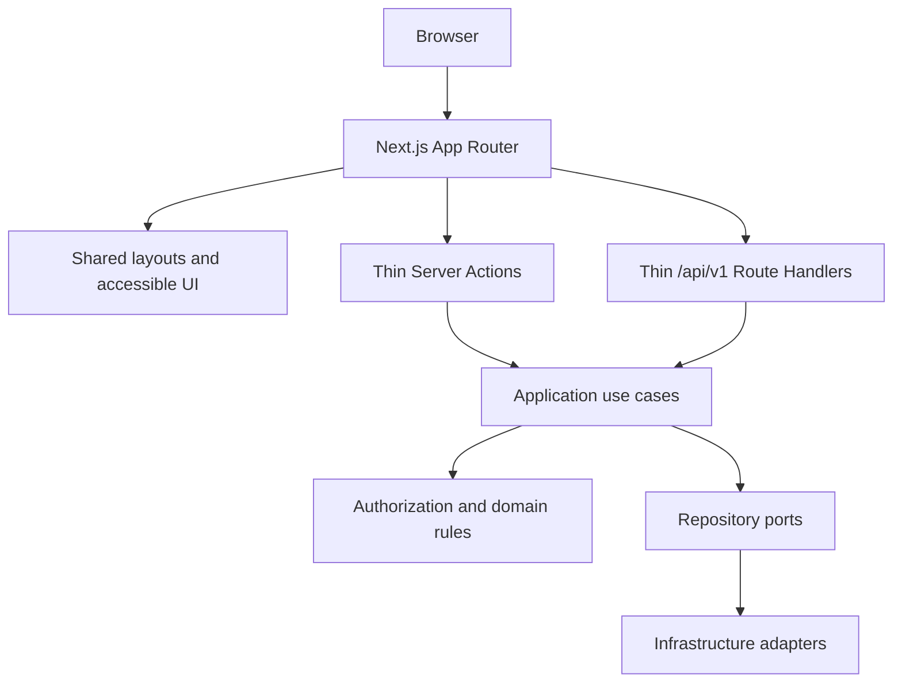

# Frontend Architecture and Installation Plan

> **Status: Approved for implementation on 2026-11-06.**
> Prepared: 2026-11-06

## 1. Goal

Establish a maintainable Next.js 16 App Router foundation for the Seafood Export CRM, using Node.js 26, npm, strict TypeScript, Tailwind CSS, shadcn/ui, and the required `src/` source directory. This phase installs and verifies the framework foundation only. It does not implement CRM business behavior or authorize module-level permissions.

## 2. Verified repository context

- The repository currently contains project documentation and static mockups. There is no `package.json`, npm lockfile, Next.js configuration, TypeScript configuration, Docker Compose application setup, or application code under `src/`.
- `docs/context.md` defines a Next.js App Router modular monolith for the web application and REST `/api/v1` on Vercel, with strict TypeScript, Tailwind, shadcn/ui, PostgreSQL, Drizzle, and Postgres.js.
- `docs/modules/RELEASES.md` identifies 15 proposed R1 modules. They are not implemented, and business grants remain subject to approval in `docs/business/permissions.md`.
- `docs/design-system.md` contains a Notion-inspired token set marked `alpha`; the owner approved provisional use, subject to contrast verification.
- The repository instructions identify the application roles as `admin`, `manager`, `sale`, and `accountant`, and require record authorization in application services. Do not infer module grants from these role names.
- The repository has existing uncommitted/untracked work outside this plan. Preserve it.

## 3. Assumptions and decisions

### Confirmed constraints

- Next.js 16, App Router, Node.js 26, npm, TypeScript, Tailwind CSS, shadcn/ui, and application source under `src/`.
- Keep the existing repository root, documentation, and mockups. Do not move or regenerate them.
- Use Server Components by default. Add Client Components only for interactions requiring browser state, event handlers, or browser APIs.
- Keep Route Handlers and Server Actions thin. They delegate to application use cases; record authorization belongs in application services.
- Add business modules incrementally. Do not generate 32 module directories or claim planned modules are implemented.

### Approved defaults

- Runtime: Node.js `26.13.0` LTS. NVM is installed; use `source /Users/andre/.nvm/nvm.sh && nvm use 26` in shells that do not load NVM automatically. The initial shell resolved to v24.13.0; the NVM-selected runtime is v26.13.0 with npm 11.20.0.
- Framework: Next.js `16.4.5` (stable patch and peer requirements verified against npm on 2026-11-06), pinned exactly in `package.json` and `package-lock.json`. Do not silently cross to Next.js 17.
- React: React and React DOM `19.3.1`; npm metadata confirms Next.js 16.4.5 accepts React 19.
- CSS/UI: Tailwind CSS 4 with its PostCSS plugin, and shadcn/ui's `new-york` style configured in `components.json` with CSS-variable tokens. Map the approved project tokens to shadcn semantic tokens rather than keeping duplicate color definitions. Do not retain the registry CLI as an application dependency; generate components from the CLI only when a component is approved.
- Lint/format/type checks: ESLint CLI, Prettier, and `tsc --noEmit`, each exposed as an npm script. Next.js 16 does not run lint as part of `next build`.
- Test setup: Vitest and React Testing Library for unit/component tests; Playwright for browser smoke tests. Use RTL for client/shared components; verify Server Components through browser or integration workflows. Initial tests cover only the framework shell, not unapproved CRM behavior.
- Keep default Next.js caching behavior until a data use case is approved. Private CRM data reads must be explicitly uncached or scoped to the authenticated request; do not add shared caching for private records.
- Do not create `proxy.ts` or treat proxy/middleware as authorization. Add an authentication/session boundary only when the current security architecture and approved auth use cases are available.

## 4. Scope

### Included in approved implementation

- Node.js 26 project version declaration and local runtime verification.
- npm project manifest and lockfile.
- Next.js 16 App Router, strict TypeScript, Tailwind CSS 4, shadcn/ui configuration, and `src/` layout.
- Minimal global layout and a small, non-business root/health page to verify rendering.
- ESLint, Prettier, type-check, unit/component test, and browser smoke-test scripts.
- An approved route inventory and shared layout skeleton only. No real CRM records, mutations, role grants, or authentication enforcement.
- Local development and production build/start verification.

### Excluded

- CRM module implementation, database schema/migrations, Docker services, API contracts, real login/session flows, role grants, audit events, uploads, integrations, and production deployment.
- Generating placeholder pages for every R1 module unless the owner explicitly selects that option.
- Analytics, telemetry, third-party scripts, state-management libraries, data-fetching libraries, or other dependencies without a demonstrated need.

## 5. Recommended architecture



The router owns URL structure, layouts, loading/error/not-found boundaries, and request validation/orchestration. Business logic stays in module application/domain layers. UI visibility is never an authorization boundary. External clients use documented REST endpoints; the first-party web UI may call Server Actions or shared application use cases according to the approved feature design, without duplicating business rules.

## 6. Proposed source directory

```text
src/
  app/
    (auth)/
      login/page.tsx                 # Proposed route; no authentication behavior in scaffold
    (workspace)/
      layout.tsx                     # Shared workspace shell, once approved
      dashboard/page.tsx             # Proposed R1 landing route
    api/v1/                          # Add Route Handlers only with approved API contracts
    error.tsx                        # Root error boundary
    global-error.tsx                 # Root layout error boundary
    globals.css                      # Tailwind import and approved design tokens
    layout.tsx                       # HTML shell, fonts, metadata
    not-found.tsx
    page.tsx                         # Minimal framework smoke page or agreed redirect
  components/
    ui/                              # shadcn/ui generated primitives actually used
    layout/                          # Shared navigation/shell components when approved
  modules/                           # Add one module at a time; no empty module folders
  lib/
    config/                          # Validated environment/config helpers
    server/                          # Server-only composition and utilities
  test/                              # Test setup and shared fixtures
```

Each implemented business module can add `src/modules/<module>/{application,domain,infrastructure,presentation}` following the project dependency direction. App Router files remain adapters, not repositories or business-rule containers. Keep server-only modules out of client component imports.

## 7. R1 routing inventory — approved prototype scope

The owner confirmed the complete R1 route inventory for static prototype screens on 2026-11-06. Paths are derived from the R1 module catalog and mapped to the corresponding HTML mockup. This approval does not approve business permissions, data access, or feature behavior. Pages use static fictional examples; action buttons remain disabled and no API, database, sign-in, or authorization behavior is connected.

| URL | Route file | Module | Mockup | Layout / rendering | Access | Status |
|---|---|---|---|---|---|---|
| `/login` | `src/app/(auth)/login/page.tsx` | Access Control | `mockup/login.mockup.html` | Auth layout; Server Component | Public visual prototype only; fields disabled | Implemented prototype |
| `/dashboard` | `src/app/(workspace)/dashboard/page.tsx` | Dashboard Reporting | `mockup/dashboard-reporting.mockup.html` | Workspace layout; Server Component; report view in query string | No auth or grants enforced | Implemented prototype |
| `/customers` | `src/app/(workspace)/customers/page.tsx` | Customers | `mockup/customers.mockup.html` | Workspace layout; Server Component | No auth or grants enforced | Implemented prototype |
| `/contacts` | `src/app/(workspace)/contacts/page.tsx` | Contacts | `mockup/contacts.mockup.html` | Workspace layout; Server Component | No auth or grants enforced | Implemented prototype |
| `/leads` | `src/app/(workspace)/leads/page.tsx` | Leads | `mockup/leads.mockup.html` | Workspace layout; Server Component | No auth or grants enforced | Implemented prototype |
| `/opportunities` | `src/app/(workspace)/opportunities/page.tsx` | Opportunities | `mockup/opportunities.mockup.html` | Workspace layout; Server Component | No auth or grants enforced | Implemented prototype |
| `/tasks` | `src/app/(workspace)/tasks/page.tsx` | Tasks & Activities | `mockup/tasks-activities.mockup.html` | Workspace layout; Server Component | No auth or grants enforced | Implemented prototype |
| `/products` | `src/app/(workspace)/products/page.tsx` | Products | `mockup/products.mockup.html` | Workspace layout; Server Component | No auth or grants enforced | Implemented prototype |
| `/products/specifications` | `src/app/(workspace)/products/specifications/page.tsx` | Product Specifications | `mockup/product-specifications.mockup.html` | Workspace layout; Server Component | No auth or grants enforced | Implemented prototype |
| `/price-lists` | `src/app/(workspace)/price-lists/page.tsx` | Price Lists | `mockup/price-lists.mockup.html` | Workspace layout; Server Component | No auth or grants enforced | Implemented prototype |
| `/rfqs` | `src/app/(workspace)/rfqs/page.tsx` | RFQs | `mockup/rfqs.mockup.html` | Workspace layout; Server Component | No auth or grants enforced | Implemented prototype |
| `/quotations` | `src/app/(workspace)/quotations/page.tsx` | Quotations | `mockup/quotations.mockup.html` | Workspace layout; Server Component | No auth or grants enforced | Implemented prototype |
| `/samples` | `src/app/(workspace)/samples/page.tsx` | Samples | `mockup/samples.mockup.html` | Workspace layout; Server Component | No auth or grants enforced | Implemented prototype |
| `/sales-orders` | `src/app/(workspace)/sales-orders/page.tsx` | Sales Orders | `mockup/sales-orders.mockup.html` | Workspace layout; Server Component | No auth or grants enforced | Implemented prototype |
| `/admin/users` | `src/app/(workspace)/admin/users/page.tsx` | Access Control | `mockup/access-control.mockup.html` | Workspace layout; Server Component | No auth or grants enforced | Implemented prototype |
| `/audit-log` | `src/app/(workspace)/audit-log/page.tsx` | Audit Log | `mockup/audit-log.mockup.html` | Workspace layout; Server Component | No auth or grants enforced | Implemented prototype |

### Route and navigation decisions

- Route groups `(auth)` and `(workspace)` provide shared layouts without adding URL prefixes. The `/login` route remains an unauthenticated visual shell. The workspace group is a presentation layout only; it does not authenticate or authorize a request.
- `/dashboard?view=overview|orders|products|customers|sales` represents the five report categories shown by the dashboard mockup. These are query-state views, not separate routes.
- The workspace navigation includes all 15 R1 module paths. R2/R3 mockups and paths are out of scope even though matching HTML files exist.
- There are no record detail, create, edit, API, or mutation routes in this slice. Add those only with approved module and API contracts. The `New` and `Export` controls are disabled in the prototype.
- List screens use shared table/search presentation and synthetic data aligned to each mockup's columns and example rows. The dashboard provides synthetic summary metrics, report-category navigation and chart illustrations. Search only filters the in-memory example rows.
- No role or module grant is inferred from the navigation. Production access must be enforced server-side once authentication, business grants and APIs are approved.

## 8. Layout, components, and design system

- Root layout owns `<html>`, `<body>`, metadata, global CSS, and font loading. It must remain small and server-rendered.
- Auth and workspace layouts are separate route groups. Workspace navigation is a reusable component, not duplicated across pages. In the approved prototype it is not an access-control boundary.
- Add shadcn/ui components on demand. Do not generate the entire registry. Keep components composable and typed; prefer composition over inheritance.
- Use semantic HTML, visible keyboard focus, labels, accessible names, and responsive behavior. Respect reduced-motion preferences if motion is introduced.
- `docs/design-system.md` is labelled `alpha`; confirm it is the intended source of palette, typography, spacing, and radius tokens before turning it into CSS variables. If approved, translate it to accessible semantic light/dark tokens and shadcn variables; test contrast rather than copying raw colors without validation.
- No dashboard widgets or sample business data in the framework shell.

## 9. API integration, environment, and rendering

- REST remains under `/api/v1`. Route Handlers validate request DTOs, call use cases, and return consistent errors; implementation must follow each approved module contract.
- Do not invent a separate backend service or let connection modules depend on routes/views. Keep PostgreSQL/Drizzle composition server-side.
- Read secrets only on the server. Validate environment variables at startup/use boundaries. Commit only an `.env.example` with synthetic names and no credentials.
- Render private CRM views on the server after authentication/authorization is implemented. Do not statically generate private records, expose secrets through `NEXT_PUBLIC_*`, or enable shared caches for user-specific data.
- Keep the initial shell independent of a live database so the framework build can be validated without production credentials.

## 10. Dependency and installation plan

Run these as the approved implementation:

| Step | Command/action | Expected files/result | Verification |
|---|---|---|---|
| 1. Runtime | Use the installed NVM to select Node 26; add `.nvmrc` with `26` and `"engines": { "node": ">=26 <27" }` | Runtime declaration; no Homebrew/global runtime change | `node --version` shows `v26.x`; `npm --version` recorded |
| 2. Manifest | Create root `package.json` and install exact stable Next 16 + peer-compatible React/React DOM; commit `package-lock.json` | Reproducible dependency graph | `npm ci`; inspect `npm ls next react react-dom` |
| 3. Framework | Add scripts: `dev`, `build`, `start`, `lint`, `format:check`, `typecheck`, `test`, `test:e2e` | Next config, strict `tsconfig.json`, ESLint flat config, Prettier config | Run lint, format check, type check |
| 4. Tailwind/UI | Install Tailwind 4 PostCSS integration and configure shadcn/ui for Next.js, `src/`, alias `@/*`, `new-york`, CSS variables | `postcss.config.mjs`, `components.json`, `src/app/globals.css`, approved tokens | Build CSS; generate components later when a concrete component is approved |
| 5. App shell | Create root layout, not-found/error boundaries and minimal home smoke page; add only owner-approved route/layout skeleton | `src/app/**`, no business logic or generated R2/R3 modules | Start dev server and verify route returns/rendered UI |
| 6. Tests | Configure Vitest + React Testing Library and Playwright; test root shell and an accessible navigation/login shell only if approved | Test config, one unit/component test, one browser smoke test | `npm run test`; `npm run test:e2e` |
| 7. Production check | Install from lockfile and build/start on Node 26 | Production build output | `npm ci`, `npm run lint`, `npm run format:check`, `npm run typecheck`, `npm run test`, `npm run build`, `npm run start` smoke check |

Install `next@16.4.5` and `react@19.3.1` / `react-dom@19.3.1` with exact versions. npm metadata confirms Next.js 16.4.5 accepts React 19. Tailwind CSS `4.3.4` is the latest stable 4.x patch observed on 2026-11-06. Pin every direct dependency exactly and keep `package-lock.json` authoritative. Next.js 16 uses Turbopack by default for dev and build; keep the default unless a verified incompatibility requires a documented choice. Add a separate `lint` script because `next build` no longer runs lint.

## 11. Testing and verification

- Unit/component: validate basic shared UI behavior and loading/error/empty patterns when present; use synthetic data only.
- Browser: confirm the approved shell routes load at desktop and mobile viewport sizes; verify keyboard access and no console/build errors.
- Runtime/build: verify Node/npm versions, clean `npm ci`, lint, format, typecheck, tests, production build, and local production start.
- API/database/auth: **not run and not in scope** for this installation phase; there are no application APIs or database implementations in the checkout.
- Do not claim deployment, production auth, authorization grants, database integration, or browser workflows beyond the tests actually run.

## 12. Deployment plan

No deployment in this task. The context document targets Vercel, but production project settings, environment variables, PostgreSQL, storage, regions, and release gates are not present in this checkout. After a later deployment approval, verify those settings separately; local build success does not prove deployment readiness.

## 13. Risks and rollback

- **Node version on shell startup:** the terminal starts with Node 24.13.0, but NVM can select Node 26.13.0. Use the NVM initialization command for all install and verification commands in this session.
- **Fresh repo has no application manifest:** preserve all docs/mockups and initialize at repository root without using a generator that overwrites existing files.
- **Next 16 breaking changes:** async request APIs are required; avoid deprecated `next lint`, old `middleware` naming for new boundary code, or unsupported config options.
- **Tailwind/shadcn token mismatch:** design file is alpha; do not finalize tokens until approved and contrast checked.
- **Unapproved module permissions:** keep module pages as non-functional skeletons or omit them, as selected; no role enforcement may be guessed.
- **Rollback:** revert only the files introduced by the approved installation commit, restore the prior `docs/structure/frontend.md` draft if rejected, and leave existing documentation/mockups untouched. Lockfile and package manifest are reverted together.

## 14. Acceptance criteria

- Owner approved the specification, the framework shell + `/login` + `/dashboard` scope, provisional alpha design tokens after contrast review, and Vitest/RTL + Playwright setup on 2026-11-06.
- Node 26 and npm are declared and verified.
- Next.js 16 App Router, strict TypeScript, Tailwind CSS 4, and shadcn/ui are installed with exact compatible versions and a committed npm lockfile.
- App source is contained in `src/`; existing docs and mockups remain intact; no unapproved business feature or permission is implemented.
- Lint, format, typecheck, test, build, and local production-start checks pass on Node 26.
- Final diff contains only the approved installation changes plus this approved specification; verification evidence distinguishes checks run from checks not applicable.

## 15. Owner decisions recorded

1. **Initial routes:** Approved: framework shell plus `/login` and `/dashboard`; other R1 routes stay as proposed inventory only.
2. **Design tokens:** Approved for provisional use: `docs/design-system.md`; check contrast before applying the token colors.
3. **Test tooling:** Approved: Vitest/React Testing Library and Playwright, limited to the scaffold.
4. **Runtime manager:** Owner confirmed NVM is installed and Node 26 is available; do not install Node through Homebrew.

## 16. Implementation and verification record

- Installed and locked Next.js `16.4.5`, React/React DOM `19.3.1`, Tailwind CSS `4.3.4`, TypeScript `5.9.3`, and the approved lint/format/test tooling. `npm ci` passed on Node `26.13.0` / npm `11.20.0`; npm audit reported zero vulnerabilities.
- Implemented only the approved shell, `/login`, and `/dashboard` routes. The sign-in route is a scaffold; there is no authentication, CRM data, or permission enforcement.
- `npm run lint`, `npm run format:check`, `npm run typecheck`, and `npm test` passed. The unit suite has one utility test.
- Playwright passed all six checks across desktop and mobile Chromium, covering root redirect, dashboard shell, horizontal overflow, and keyboard reachability.
- Default `npm run build` with Turbopack fails in this environment because its CSS worker cannot bind an internal port (`Operation not permitted`). `npm run build -- --webpack` passed. The production server started from that build and returned HTTP 307 from `/` to `/login`.
- No application API, database, auth, authorization, production deployment, or full business workflow was verified; those are outside this installation scope.
- npm warns that ESLint `9.39.5` is no longer supported. It is the newest compatible major accepted by the installed `eslint-config-next` plugin tree; ESLint 10 produced invalid plugin peer dependencies. Revisit when the Next.js lint preset supports a maintained ESLint major. Current npm audit is clean.

## 17. RP-03 routing implementation record

- Owner confirmed all routes in the inventory above, static UI-only screens with synthetic data, and no authentication or authorization behavior. Detail/create/edit routes and R2/R3 mockups remain deferred.
- Implemented the login visual shell, shared workspace navigation, shared R1 list-screen presentation, the approved R1 list routes and the five dashboard report views. Every list screen identifies its source mockup and labels its data as illustrative; login fields and New/Export controls are disabled.
- PASS: `npm run lint`, `npm run typecheck`, and `npm run build -- --webpack` on Node.js 26.13.0 / npm 11.20.0. The successful build compiled all routes and ran its TypeScript phase.
- PASS: compiled route manifest and static output contain all 16 approved routes. The report-view route is server-rendered on demand.
- PASS: production HTTP smoke check returned 200 with HTML for all 16 approved routes, including `/dashboard` and `/products/specifications`.
- The default Turbopack build is blocked when its CSS worker binds an internal port (`EPERM`); the webpack production build passed.
- Formatting: all changed source and this spec pass targeted Prettier checks. The repository-wide `npm run format:check` reports the generated `next-env.d.ts` as unformatted.

## Sources checked 2026-11-06

- [Next.js 16 upgrade guide](https://nextjs.org/docs/app/guides/upgrading/version-16) — Node 20.9 minimum, TypeScript minimum, Turbopack defaults, and Next.js 16 migration changes.
- [Next.js installation guide](https://nextjs.org/docs/app/getting-started/installation) — App Router and manual installation guidance; lint is separate from build.
- [Next.js 16.4 release](https://nextjs.org/blog/next-16-4) and [Next.js npm package](https://www.npmjs.com/package/next) — stable patch observed as 16.4.5.
- [React npm package](https://www.npmjs.com/package/react) and npm peer metadata for `next@16.4.5` — React 19.3.1 available and accepted.
- [shadcn/ui Tailwind v4 guide](https://ui.shadcn.com/docs/tailwind-v4) — `new-york` style, Tailwind v4 and React 19 support.
- [Node.js release status](https://nodejs.org/en/about/previous-releases) — Node.js 26 LTS status.
- [Tailwind CSS with Next.js](https://tailwindcss.com/docs/installation/framework-guides/nextjs) and [shadcn/ui Tailwind v4 setup](https://ui.shadcn.com/docs/tailwind-v4) — current integration approach.
