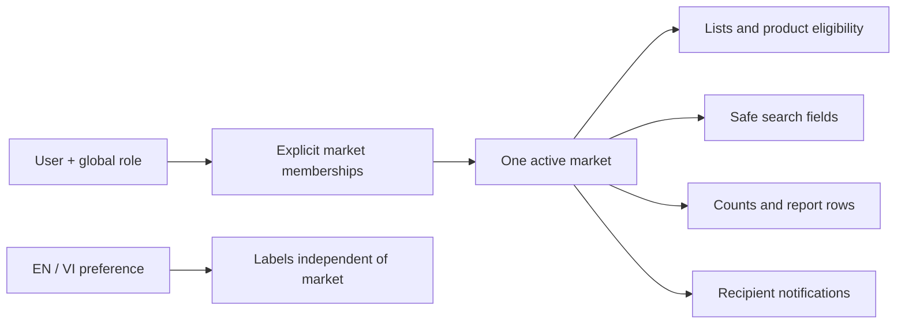

# RP-03 market context and UI contract

Owner-approved decisions, 2026-11-06. This document extends [frontend specification](frontend.md). Technical artifacts are English; the interface supports English and Vietnamese.

## 1. Goal

Provide one coherent market context across the CRM shell, lists, search, notifications and reports. Use JSON fixtures as the basis for subsequent backend design, after the owner reviews the UI.

## 2. Current context

The application is a Next.js App Router UI prototype. Business records are synthetic JSON under `src/constants/dummy`. There is no connected authentication, application authorization or database implementation in this feature. Existing create/export controls remain disabled. The architecture documents and R1 plan referenced by contributor guidance are not present at their linked paths in this checkout; reconcile them before backend implementation.

## 3. Assumptions and confirmed decisions

- Markets are sales responsibility units, not customer country, shipping destination, legal entities or tenants.
- Seed KR, JP and US; allow future markets. Default currency suggestions are KRW, JPY and USD respectively. Transaction currency remains explicit. Never silently convert or sum mixed currencies.
- Customer and contact identities are independent in each market, even for the same legal company. Duplicate detection is restricted to the current market; no global customer identity or cross-market candidate disclosure.
- Product identity is global; product eligibility, availability, specifications and pricing belong to a market.
- Roles remain global (`admin`, `manager`, `sale`, `accountant`). Separate explicit market memberships restrict market selection and business records. No All markets option.
- Only a central access administrator with explicit grant permission may change memberships. Changes and revocation must be audited. The admin role does not itself grant every market's data.
- Remember the last selected market per user, independently of EN/VI locale. No market URL prefix.
- Assign market at creation; no transfer between markets in this release.
- Fresh implementation: no legacy migration/backfill. Synthetic fixtures may be reset during UI refinement. SQL design and execution follow UI review.

## 4. Scope

Market selector in the top menu; market-filtered customers, contacts, leads, opportunities, tasks, products/specifications, price lists, RFQs, quotations, samples and sales orders. Apply the same scope to search suggestions/results, notification recipient + market, report rows and counts. Keep profile editing, sidebar expand/collapse and EN/VI switching available.

The current implementation uses a fixture membership list for the demo user and browser storage keyed by user ID. This is a prototype preference only. All fixtures ship to the browser; client filtering is not authorization. Audit and access-control screens retain their independent administrative prototype scope and are excluded from global search.

## 5. Non-scope

Real sessions, membership administration UI/API, database migrations, cross-market transfers, aggregate All markets reports, currency conversion, external search services, background queues and deployment. Profile edits are session-only UI changes. No live business mutation or export is enabled.

## 6. Recommended approach

### UI and fixture contract

`MarketProvider` supplies the validated selection to shell and screen components. Resolve invalid/stale preferences against active memberships; fall back to the first granted active market, or an explicit no-access state. Hide business content until preference hydration completes. Re-evaluate on browser storage events. Changing market clears top-menu suggestions and closes notification popovers. Locale switching preserves path/query and market preference.

Business records come from their canonical module JSON; route JSON contains presentation metadata only. An adapter builds table rows and an allowlist selects searchable fields. Contact details, financial values, administrative users and audit records are excluded from global search. Dashboard counts derive from the same scoped records. Monetary values retain their original currency. Current product/owner tabs show scoped catalogue and workload counts; revenue/conversion analytics require separately agreed formulas.

The US sales market deliberately includes a customer physically in Germany, demonstrating that `market_id`, `country_code` and `destination_country` are independent. This is synthetic example data, not an additional fourth market.

### Future backend contract and physical design inputs

Proposed structures, to be finalized after UI review:

| Structure | Key fields and constraints |
| --- | --- |
| markets | stable ID, unique code, localized names, default_currency, active status |
| user_market_memberships | user_id + market_id unique; grant/revoke actor/time; active status; explicit access-management permission |
| user_preferences | user_id unique; preferred_locale; last_market_id (revalidate membership on every use) |
| products | global ID and SKU; shared identity only |
| market_products | market_id + product_id unique; eligibility and availability |
| market-owned records | non-null market_id; unique (market_id, id); business identifiers unique within approved market scope |
| specifications / price lists | market_id plus product relationship; version and explicit currency; no country field used as authorization scope |

Require same-market composite foreign keys for customer/contact, RFQ/quotation, quotation/version/order, sample and related activity references. Child lines inherit the parent's market; enforce consistency for referenced specifications and product eligibility. Polymorphic activity references need an enforceable design, not just an unvalidated resource ID. Snapshot fields preserve historical commercial terms.

Application services must intersect active membership, resource/action grants and record scope on **every** read, mutation, count, download, export and background job. Membership does not override OWN/TEAM/ASSIGNED constraints. Validate selected `market_id` at the API boundary; never trust a browser preference as evidence. Wrong-market IDs must not disclose record existence. Scope repositories and cache keys by principal/grants and market. Revoke membership promptly and invalidate derived caches.

Proposed API shape: market discovery returns only authorized active markets; preference update accepts locale/last_market_id after validation; business list/search/report requests carry an explicit market_id. Exact endpoint names and DTOs remain a backend design deliverable. No process-local authorization cache. No queue is needed for this UI; any future export job must carry market + requester context and reauthorize before delivery. Index market_id with common status/owner/date filters; scope search at query time. Log scope-denial and membership changes without contact/financial payloads.

## 7. Task breakdown

1. Discovery: record owner decisions and inspect shell, routes and JSON relationships.
2. Design: define market identities, memberships, global product boundary and scoped record contract.
3. Implementation: normalize fixtures, add context/selector, scope all data views and preserve locale/navigation.
4. Testing: verify fixture relationships, scope isolation, stale membership fallback and browser selection persistence.
5. Backend follow-up after UI approval: finalize physical model/API DTOs; produce versioned fresh-schema migration, comments, indexes, physical ERD and dictionary using an isolated development database.
6. Deployment/monitoring follow-up: security evidence and operational review before production.

## 8. Testing plan

Run lint and production build. Unit checks cover membership fallback, no-access behavior, same-market relationships and excluded search fields. Browser checks cover market switching on list/search/dashboard, reload, locale/query persistence and mobile navigation. Backend work must add positive/negative service authorization and export/aggregate isolation checks; UI tests do not prove authorization.

## 9. Deployment plan

No deployment in RP-03. Keep fixtures explicitly synthetic. Replace fixture adapters with authorized application use cases before enabling real data. Follow existing security release gates; no production readiness claim from local build results.

## 10. Risks

Client-side data is readable regardless of selection. Browser-only preferences are not server preferences. Missing backend policy/architecture paths need reconciliation. Cross-market joins and unscoped exports could leak data if backend scoping is omitted. Resetting synthetic fixtures must never become a production migration practice. Price totals use illustrative JavaScript arithmetic only; backend financial calculations require exact decimal arithmetic and agreed rounding.

## 11. Rollback plan

Revert only the RP-03 feature changes after inspecting the diff; preserve unrelated work. No database rollback or data backfill is required. Remove the user-specific browser preference if reverting the selector. Future schema rollout requires a separate reviewed migration/rollback plan.

## 12. Acceptance criteria

- Top menu exposes only active memberships for KR/JP/US; no All markets option.
- Switching market updates every business list, global search result/suggestion, notification and report count/row without carrying previous-market data into the new selection.
- Products retain global IDs; market-owned records and references remain consistent.
- Selection survives reload and locale changes; invalid stored selection falls back safely; no membership shows no business data.
- EN/VI UI labels remain independent of market/currency and URL search parameters survive locale changes.
- Data fixtures remain JSON under the agreed directory; route metadata does not duplicate business rows.
- No real authorization, server preference persistence, SQL migration, deployment or browser verification is claimed without evidence.

## Verification record — 2026-11-06

- PASS: Node 26.13.0 / npm 11.20.0; lint; TypeScript; six Vitest tests (five market contract tests plus existing utility test).
- PASS: webpack production build, including all EN/VI module routes.
- BLOCKED in sandbox: default Turbopack production build cannot bind its internal CSS-worker port (`EPERM`). No configuration change was made to hide that restriction.
- PASS: Playwright after installing its Chromium runtime and allowing local loopback server/browser execution: 16 passed, 2 intentionally skipped (desktop-only sidebar check on mobile and mobile-only check on desktop). Coverage includes locale routes, profile edits, sidebar, scoped list/search/dashboard selection, persistence on reload and locale change, query preservation and invalid stored market fallback.
- PASS: `graphify update .` refreshed the code graph; `git diff --check` reported no whitespace errors.
- NOT RUN: real backend authorization, DB migrations, server preference storage, production deployment and runtime access revocation. These features are not implemented by this UI prototype.
- Skill: previously approved `frontend-patterns` informed component/context separation. The requested `/grill-me` entry delegated to an unavailable Skill dispatcher; the owner interview and approval were conducted through Nimbalyst interactive prompts instead.
