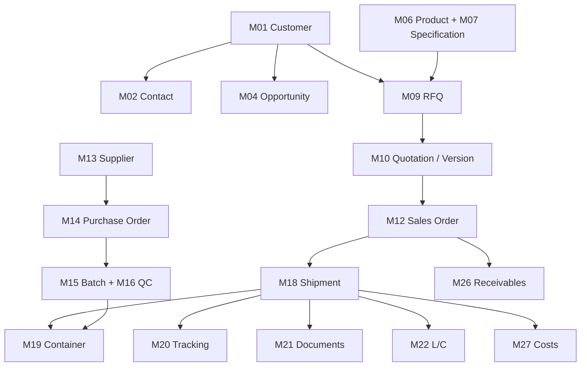

# Seafood Export CRM — Product & Module Specification

> **Document:** `spec.md`  
> **Version:** 1.0 (consolidated scope reference)  
> **Date:** 2026-11-04  
> **Status:** Planning baseline; not an implementation-completion report  
> **Product:** Internal B2B Seafood Export CRM  
> **Releases:** R1 Core CRM (15 modules), R2 Export Execution (9 modules), R3 Supply & Financial Control (8 modules)

Current R1 tasks and acceptance criteria: [R1 task plan](../../plan-r1-task.md).

## 1. Purpose and document authority

This specification consolidates the project's **32 established modules (M01–M32)**, business outcomes, minimum feature expectations, cross-module journeys, and delivery boundaries in one navigable document. It supports product planning, implementation scoping, and acceptance reviews; it **does not replace** approved business policies, detailed module specifications, or Accepted Architecture Decision Records (ADRs).

Read alongside:

- `AGENTS.md` — mandatory agent instructions.
- `docs/context.md` — project context and durable decisions.
- `docs/modules/README.md` and `docs/modules/RELEASES.md` — canonical module specifications and release assignments.
- `docs/business/README.md` — business processes and approvals.
- `docs/business/permissions.md` — proposed authorization policies; approvals still required.
- `docs/architecture/overview.md` — current architecture baseline.
- `docs/architecture/{frontend,backend,database,security,testing}.md` — implementation constraints.
- `docs/design-system.md` — UI source of truth for the remake.

**Conflict rule:** If this summary conflicts with a detailed module specification, release plan, business policy, or Accepted ADR, record the discrepancy and obtain an authorized resolution. Do not silently redefine modules, grants, workflows, or an ADR. Nimbalyst Tracker is the sole task-status authority; feature module IDs (for example, `M18`) are **not** Nimbalyst task IDs (for example, `CRM-011`).

## 2. Product definition

### 2.1 Business context

An internal CRM for a Vietnam-based seafood sourcing, processing, and export company serving international B2B buyers, with South Korea as the primary market and Japan, the United States, and other destinations as future or active target markets. Typical export execution may involve one or two containers per shipment.

**Primary business journey:** Inquiry / Lead → Customer and Contacts → RFQ → Pricing → Versioned Quotation → Sales Order → Shipment / Container → Vessel Tracking → Export Documents / L/C → Buyer Feedback → Receivables / Cost Control.

The application must link commercial commitments, physical export operations, evidence, and follow-up work without requiring staff to rely on disconnected email threads and spreadsheets.

### 2.2 Objectives

1. Maintain an accountable, searchable history of customers, commercial negotiations, and commitments.
2. Convert buyer RFQs into controlled quotations and confirmed orders with traceable versions.
3. Give staff a reliable, human-correctable shipment and export-document timeline.
4. Track deadlines and exceptions associated with vessels, documents, and documentary-credit obligations.
5. Extend into sourcing, QC, inventory visibility, receivables, and actual-vs-estimated profitability in R3.
6. Enforce role/action/record permissions and auditable transitions for sensitive operations.

### 2.3 Out of scope unless separately approved

- Public e-commerce, retail checkout, and consumer loyalty programs.
- Complete ERP, general ledger, payroll, tax filing, or full warehouse management.
- Issuing official customs, health, or origin certificates on behalf of authorities.
- Guaranteeing real-time carrier events, reefer telemetry, or regulatory eligibility without a verified source.
- Autonomous bank acceptance decisions, legally binding compliance determinations, or irreversible external actions.
- Multi-company / multi-tenant isolation (initial design is **single company**).

### 2.4 Primary users

`SALES`, `SALES_MANAGER`, `EXPORT_OPS`, `DOCUMENTS`, `FINANCE`, `PROCUREMENT_QC`, `MANAGEMENT`, `ADMIN`; optional `AUDITOR` and scoped `INTEGRATION_SERVICE`. Role names are candidate labels; **actual action/record grants require business approval**. `ADMIN` is not automatically a financial or export approval authority.

## 3. Release plan and full module inventory

**Module counts and identifiers are deliberate: 15 + 9 + 8 = 32.** A module in a release may have an optional or integration-dependent subset; module scope is not evidence of implementation.

### Release 1 — Core CRM (15 modules)

| ID | Canonical module name | Primary outcome |
|---|---|---|
| M01 | Customers | Account master, commercial ownership, buyer status |
| M02 | Contacts | Buyer contact directory and roles |
| M03 | Leads | Capture and qualify prospective buyers |
| M04 | Opportunities | Track deal pipeline and commercial probabilities |
| M05 | Tasks Activities | Follow-ups, meetings, communication history |
| M06 | Products | Seafood product catalogue and SKUs |
| M07 | Product Specifications | Commercial/technical specifications by SKU |
| M08 | Price Lists | Controlled pricing context and effective periods |
| M09 | Rfqs | Buyer inquiry and requested line items |
| M10 | Quotations | Versioned offers, approval, issuance |
| M11 | Samples | Sampling requests and buyer evaluation |
| M12 | Sales Orders | Confirmed sale commitments and order lines |
| M29 | Access Control | Identity integration, users, roles, record scope |
| M30 | Dashboard Reporting | Release-appropriate operational dashboards |
| M31 | Audit Log | Immutable-style event trail for critical actions |

### Release 2 — Export Execution (9 modules)

| ID | Canonical module name | Primary outcome |
|---|---|---|
| M18 | Shipments | Export shipment planning and milestone ownership |
| M19 | Containers | Container-level booking, assignment, loading records |
| M20 | Vessel Tracking | Voyage events, ETA/ETD history and provenance |
| M21 | Export Documents | Shipment checklist, private files and versioned reviews |
| M22 | Lc Management | Documentary credit terms, amendments and deadlines |
| M23 | Shipping Alerts | Actionable exception and deadline notifications |
| M24 | Compliance | Destination/transaction compliance evidence and review |
| M28 | Customer Feedback | Buyer feedback, claims and resolution tracking |
| M32 | Integrations | Controlled website/email/carrier and other external adapters |

### Release 3 — Supply & Financial Control (8 modules)

| ID | Canonical module name | Primary outcome |
|---|---|---|
| M13 | Suppliers | Supplier master, sourcing qualification and status |
| M14 | Purchase Orders | Purchase commitments and supplier order tracking |
| M15 | Batches | Lot/batch genealogy and traceability |
| M16 | Quality Control | Inspection, hold/release and quality evidence |
| M17 | Inventory Integration | External inventory visibility and reconciliation |
| M25 | Reefer Monitoring | Temperature/condition exceptions when data available |
| M26 | Receivables | Invoices, payments, allocations and aging |
| M27 | Cost Reconciliation | Estimated vs actual shipment/order costs and margin |

## 4. Detailed module scope

The feature lists below express the intended **minimum capability** and key integrity controls for planning. Each module's actual API, fields, lifecycle and approval thresholds belong in its individual `docs/modules/*.md` specification and must be checked before implementation.

### 4.1 R1 — Core CRM

#### M01 — Customers

**Purpose:** Maintain one authoritative record per buyer organization.

- Create, edit, search, filter and deactivate customer records; store legal/commercial identity, country, buyer status and assigned salesperson.
- Link contacts, leads, opportunities, RFQs, quotations, orders and communications.
- Flag suspected duplicates and support controlled review/merge without losing audit history.
- Restrict visibility using approved record ownership/team policies.

**Core records:** Customer, CustomerAddress, CustomerOwnership/Assignment, CustomerReference.  
**Acceptance outcome:** Authorized users can find one buyer's complete commercial history; unauthorized users cannot retrieve another owner's confidential details.

#### M02 — Contacts

**Purpose:** Maintain people and roles associated with customers.

- Record contact name, position, department, preferred language, email, phone and communication preferences.
- Support multiple contacts per customer and identify purchasing, logistics, finance and document recipients.
- Prevent accidental duplicate contact creation; preserve history if a contact leaves or changes role.

**Core records:** Contact, ContactCustomerRelationship, ContactRole.  
**Acceptance outcome:** Sales and export staff can identify the correct current recipient for each business activity.

#### M03 — Leads

**Purpose:** Capture and qualify potential business before conversion to an active opportunity/customer.

- Enter leads from manual entry, website inquiries and approved integrations.
- Track lead source, owner, product interest, target market, qualification status and next action.
- Convert qualified leads without producing duplicate customer/contact records.

**Core records:** Lead, LeadSource, LeadAssignment.  
**Acceptance outcome:** Lead source, ownership and conversion history remain traceable.

#### M04 — Opportunities

**Purpose:** Manage the commercial sales pipeline.

- Link opportunities to customers, contacts, relevant products and follow-up tasks.
- Track stage, expected value/currency, probability, expected close date, owner and loss reasons.
- Record stage history and optionally connect resulting RFQs/quotations/orders.

**Core records:** Opportunity, OpportunityStageHistory, OpportunityProduct.  
**Acceptance outcome:** Pipeline views are scoped and stage updates can be audited.

#### M05 — Tasks Activities

**Purpose:** Coordinate staff work and maintain follow-up history.

- Create assigned tasks with priorities, due dates, status and references to customer, opportunity, RFQ, shipment or document.
- Record calls, meetings, email notes, comments and follow-up outcomes.
- Show overdue items and activity timeline; avoid disclosing sensitive cross-team records.

**Core records:** Task, Activity, Reminder/Assignment.  
**Acceptance outcome:** A task has an owner, due date and verifiable completion context.

#### M06 — Products

**Purpose:** Keep a consistent commercial catalogue for export offerings.

- Manage product families, species, processing styles, forms, grades, packaging options, sale units and active/inactive SKU state.
- Candidate products include octopus, webfoot octopus, squid/cuttlefish, shrimp and other agreed seafood categories.
- Reuse the same product identity throughout RFQ, quotation, sales order and downstream shipment records.

**Core records:** ProductCategory, Product, SKU, UnitOfMeasure.  
**Acceptance outcome:** Sales documents reference stable SKU identities rather than free-text products only.

#### M07 — Product Specifications

**Purpose:** Control technical and buyer-specific product requirements.

- Store size/grade, processing form, net/drained weight where relevant, glaze, packaging, origin, labeling and storage requirements.
- Support effective versions and buyer- or destination-specific specifications when approved.
- Attach specification sheets and preserve a snapshot/version with an issued quotation or order.

**Core records:** ProductSpecification, SpecificationVersion, SpecificationAttribute.  
**Acceptance outcome:** Historical orders retain the specifications agreed at confirmation time.

#### M08 — Price Lists

**Purpose:** Provide governed commercial pricing references, not unapproved automatic quote approval.

- Manage currency, unit, market/customer context, effective dates and controlled revisions.
- Handle reference price and permitted discount/override workflow as defined by business policy.
- Restrict sensitive price and cost visibility; preserve price snapshot on a quotation line.

**Core records:** PriceList, PriceListItem, PriceRevision.  
**Acceptance outcome:** Quotes preserve the offered price even after the reference price list changes.

#### M09 — Rfqs

**Purpose:** Capture buyer requests for quotation (RFQs) accurately.

- Register inquiry source, customer/contact, owner, target market, delivery requirements and requested quote deadline.
- Add multiple RFQ lines with product/specification, quantity, unit, packaging, requested dates and notes.
- Support assignment, attachments, lifecycle, search and conversion to versioned quotations.

**Core records:** RFQ, RFQLine, RFQAttachment, RFQStatusHistory.  
**Acceptance outcome:** Every quotation can be traced to the requested commercial requirements and their revisions.

#### M10 — Quotations

**Purpose:** Produce controlled commercial offers and preserve negotiation history.

- Create and revise quotations from RFQ lines; capture price, currency, quantity, Incoterms, payment terms, validity and lead time.
- Maintain immutable issued versions, PDF output by version and manager approval evidence for every submitted version.
- Support draft, review, issue, accepted, rejected, expired and superseded outcomes as defined by approved business policy.

**Core records:** Quotation, QuotationVersion, QuotationLine, QuotationApproval.  
**Acceptance outcome:** Issued versions cannot be silently overwritten; an accepted quotation version is identifiable.

#### M11 — Samples

**Purpose:** Track sample requests and buyer product evaluation.

- Record requester, products/specifications, sample quantities, preparation, dispatch, shipment/reference and feedback.
- Link sample outcomes to an opportunity/RFQ and later quotation decisions.
- Keep the first release limited to a lightweight workflow if sample logistics are not yet business-critical.

**Core records:** SampleRequest, SampleLine, SampleDispatch, SampleFeedback.  
**Acceptance outcome:** The team can determine which sample version/lot the buyer accepted or rejected.

#### M12 — Sales Orders

**Purpose:** Turn accepted commercial terms into confirmed fulfillment commitments.

- Generate an order from a selected accepted quotation version.
- Preserve buyer, product/specification, quantity, pricing, currency, payment, delivery and Incoterms snapshot.
- Track confirmation, amendments and cancellation with explicit permissions and reasons.
- Expose controlled order-line quantities for later allocation to shipments.

**Core records:** SalesOrder, SalesOrderLine, SalesOrderRevision, OrderApproval.  
**Acceptance outcome:** Changes to an issued quote do not silently change a confirmed order.

#### M29 — Access Control

**Purpose:** Control who may access which action, record and sensitive field.

- Invite-only employee email/password accounts with current permission checks.
- Role- and action-based permissions with record scopes `NONE`, `OWN`, `TEAM`, `ASSIGNED`, `ALL`.
- Enforce permission in use cases/data access and protect admin functions, exports, document links and finance data.
- JWT in HttpOnly cookies, one-hour access, seven-day absolute and three-day idle expiry, no employee MFA. Revocation takes effect on the next request.

**Core records:** UserProfile, Role, Permission, RoleGrant, Assignment/AccessScope; session metadata only if required by accepted architecture.  
**Acceptance outcome:** Wrong-role, wrong-owner, expired/revoked-session and tampered-ID access tests fail closed.

#### M30 — Dashboard Reporting

**Purpose:** Present a consistent operational overview and actionable priorities.

- R1 views: lead/opportunity funnel, pending RFQs, quotation status, confirmed orders and overdue tasks.
- Extend dashboards in R2/R3 to shipment/document deadlines, receivable aging, costs and margin.
- Apply row/field authorization to aggregates and drill-downs; avoid misleading metrics where no data exists.

**Core records:** Derived reporting views/queries, report definitions where necessary.  
**Acceptance outcome:** Counts reconcile to underlying authorized records using documented metric definitions.

#### M31 — Audit Log

**Purpose:** Preserve traceable evidence for sensitive data and state changes.

- Audit actor, action, resource ID/type, timestamp, result and relevant before/after metadata (safely redacted).
- Cover privilege changes, commercial approvals, confirmed orders, shipment milestone edits, document approvals, payments and financial adjustments.
- Make the log read-only to ordinary business users; restrict exports and guard integrity/retention.

**Core records:** AuditEvent, optionally AuditCorrelation/RequestContext.  
**Acceptance outcome:** An auditor can reconstruct who changed a critical field and when without exposing credentials.

### 4.2 R2 — Export Execution

#### M18 — Shipments

**Purpose:** Track each export movement from planned fulfillment to closeout.

- Create shipment records and allocate order lines/quantities with controlled partial fulfillment.
- Store origin/destination, forwarder, carrier, ports, voyage/booking references, planned dates and milestones.
- Show shipment status, owner, exceptions, attached containers and document readiness.

**Core records:** Shipment, ShipmentOrderAllocation, ShipmentMilestone, ShipmentParty.  
**Acceptance outcome:** Staff can identify what was shipped, against which orders, and what remains pending.

#### M19 — Containers

**Purpose:** Control container-level allocation and loading evidence.

- Record container number, type/size, booking, seal, load plan, weight, load dates, shipment link and status.
- Allocate order lines and later batch/lot data when R3 traceability exists.
- Track loading exceptions and corrections with audit evidence.

**Core records:** Container, ContainerLoading, ContainerAllocation, SealHistory.  
**Acceptance outcome:** Container loads reconcile with shipment allocations and available verified quantity.

#### M20 — Vessel Tracking

**Purpose:** Show reliable voyage progress and changing arrival/departure expectations.

- Track events, ETD/ETA, actual departure/arrival, vessel/voyage and source timestamps.
- Support manual updates with actor, reason and provenance; preserve historical ETA revisions.
- Consume carrier/provider events only via verified adapters; display stale/unknown coverage explicitly.

**Core records:** VesselVoyage, TrackingEvent, EtaRevision, TrackingSource.  
**Acceptance outcome:** Staff can explain why ETA changed and distinguish verified, manual and estimated data.

#### M21 — Export Documents

**Purpose:** Control shipment-specific documentation, versions, approval and handoff.

- Generate a buyer/destination/shipment-specific checklist based on approved rules and reviewed requirements.
- Candidate document types: commercial invoice, packing list, bill of lading/sea waybill, C/O, health/inspection certificate, insurance and customs evidence, **only when applicable**.
- Version private uploads, enforce reviewer/approver grants, record deadlines and safely share expiring access links.
- Track checklist status independently from file issuance/replacement status.

**Core records:** DocumentChecklist, ChecklistItem, ExportDocument, DocumentVersion, DocumentReview.  
**Acceptance outcome:** Incomplete or rejected mandatory evidence is visible; sensitive files are never publicly exposed.

#### M22 — Lc Management

**Purpose:** Track documentary credit (L/C) obligations without replacing bank judgment.

- Record beneficiary/applicant, bank references, amount/currency, expiry, presentation deadlines and required document clauses.
- Preserve amendments, discrepancy reviews, owner assignments and notification dates.
- Link terms to quotation/order, shipment, documents and bank review evidence.

**Core records:** LetterOfCredit, LCAmendment, LCRequirement, LCDiscrepancy.  
**Acceptance outcome:** Staff can identify upcoming presentation/expiry deadlines and the current approved L/C terms.

#### M23 — Shipping Alerts

**Purpose:** Convert export risks and deadlines into assignable, non-duplicative alerts.

- Alert on planned/actual milestones, ETA changes, document deadlines, L/C deadlines and missing evidence.
- Support severity, owner, acknowledgment, snooze/escalation (if approved) and resolved state.
- Use idempotent rules and safe notification delivery; an alert must link back to its source record/event.

**Core records:** AlertRule, AlertInstance, AlertDelivery, AlertAcknowledgement.  
**Acceptance outcome:** An event does not generate unlimited duplicate notifications, and failures can be retried safely.

#### M24 — Compliance

**Purpose:** Track applicable buyer, destination and export compliance requirements as reviewed evidence.

- Maintain candidate checks for market, species, origin, establishment, labeling, certificate and inspection obligations.
- Attach authoritative sources, applicability dates, reviewer decisions and shipment-level exceptions.
- Prevent an unreviewed checklist or generic product catalog from being represented as legal certification.

**Core records:** ComplianceRequirement, RequirementVersion, ComplianceReview, ComplianceEvidence.  
**Acceptance outcome:** Each compliance status is traceable to a specific shipment/product/market and accountable reviewer.

#### M28 — Customer Feedback

**Purpose:** Capture post-delivery satisfaction, quality claims and resolution responsibilities.

- Register feedback/complaints tied to buyer, order, shipment, container or lot (when available).
- Track severity, evidence, owner, response target, root cause and corrective action.
- Support controlled compensation/credit recommendations; financial posting remains a separate authorization.

**Core records:** FeedbackCase, ClaimEvidence, CorrectiveAction, CaseStatusHistory.  
**Acceptance outcome:** A complaint has a traceable resolution and commercial/quality linkage.

#### M32 — Integrations

**Purpose:** Connect approved external sources without making business modules depend on providers.

- Candidate adapters: website RFQ ingestion, email-assisted references, carrier schedules/tracking, document exchanges and future inventory sources.
- Validate signatures/authentication, normalize payloads, deduplicate events and preserve source provenance.
- Provide failure visibility, retries, idempotency, configuration controls and audit trails.
- Provider availability, paid APIs and automatic background execution require separate approval and infrastructure decisions.

**Core records:** IntegrationConnection, ProviderEvent, SyncCursor, IntegrationJob, DeadLetter/FailureRecord.  
**Acceptance outcome:** Duplicate, late or malformed external events do not corrupt canonical CRM records.

### 4.3 R3 — Supply & Financial Control

#### M13 — Suppliers

**Purpose:** Maintain vetted sourcing partners and their commercial contacts.

- Manage supplier identity, contacts, products, qualifications, approvals and active/blocked status.
- Record sourcing suitability, evidence expiry and relationship history.
- Restrict supplier pricing and confidential procurement data.

**Core records:** Supplier, SupplierContact, SupplierQualification, SupplierProduct.  
**Acceptance outcome:** Purchase commitments can only be issued to suppliers eligible under approved policy.

#### M14 — Purchase Orders

**Purpose:** Track procurement commitments and expected supply availability.

- Create supplier purchase orders with product/specification, quantity, agreed cost/currency and expected delivery.
- Track approvals, revisions, received quantities and linkage to orders/shipments where needed.
- Preserve historical commercial terms and prevent unauthorized post-approval edits.

**Core records:** PurchaseOrder, PurchaseOrderLine, ProcurementApproval, ReceiptReference.  
**Acceptance outcome:** Procured and received quantities can be reconciled to shipment needs.

#### M15 — Batches

**Purpose:** Support lot genealogy and traceability through sourcing and export allocation.

- Record batch/lot identifiers, supplier, product, origin, production/processing dates and quantities.
- Link lots to QC results, inventory references, containers, shipments and export evidence.
- Support held, released, consumed and rejected states with accountable transitions.

**Core records:** Batch, BatchMovement/Allocation, BatchSource, BatchTraceabilityLink.  
**Acceptance outcome:** A shipment/container can be traced back to relevant verified lots, and vice versa.

#### M16 — Quality Control

**Purpose:** Record inspections and prevent release of rejected or unverified product.

- Store inspection plans/checklists, measurements, attachments, findings and reinspection history.
- Restrict QC hold/release to authorized roles; make release an explicit gate when required.
- Link QC evidence to lots, suppliers, specifications and customer complaints.

**Core records:** QCInspection, QCResult, QCHold, QCRelease.  
**Acceptance outcome:** A blocked batch cannot be silently allocated as released product.

#### M17 — Inventory Integration

**Purpose:** Provide accurate inventory visibility while avoiding an accidental full WMS implementation.

- Read/synchronize approved inventory balances, reservations and batch references from an external source.
- Track synchronization status, source-of-truth ownership, discrepancies and reconciliation evidence.
- Avoid treating delayed supplier/warehouse data as confirmed available stock.

**Core records:** InventorySnapshot, ExternalInventoryMapping, InventoryDiscrepancy, SyncRun.  
**Acceptance outcome:** Users can distinguish live-confirmed, last-synced and unverified quantities.

#### M25 — Reefer Monitoring

**Purpose:** Record cold-chain evidence and exceptions when reliable data exists.

- Ingest or manually record temperature/condition events linked to containers and shipment intervals.
- Preserve device/provider source, measurement units, timestamp, gaps and calibration/quality caveats.
- Trigger alerts on approved excursion rules; telemetry integrations are optional and source-dependent.

**Core records:** ReeferReading, ReeferDevice/Source, TemperatureExcursion, ReeferEvidence.  
**Acceptance outcome:** Excursions are reviewable and no unsupported promise of continuous monitoring is made.

#### M26 — Receivables

**Purpose:** Track customer invoices, payment allocations and collections exposure.

- Record invoice amounts/currency, due dates, payment receipts, allocations, outstanding balance and aging.
- Support partial payments, reconciliation and controlled adjustments/reversals with audit history.
- Restrict payment posting and bank information; this is not a general ledger.

**Core records:** ReceivableInvoice, PaymentReceipt, PaymentAllocation, ReceivableAdjustment.  
**Acceptance outcome:** An invoice's balance reconciles exactly and negative/duplicate allocations are prevented.

#### M27 — Cost Reconciliation

**Purpose:** Compare expected and actual costs to calculate controlled margins.

- Capture estimate and actuals for product procurement, processing, freight, insurance, handling and other approved cost categories.
- Attribute costs to order, shipment or container with documented allocation rules.
- Preserve currency/FX snapshots and distinguish incomplete data from finalized margin.

**Core records:** CostEstimate, ActualCost, CostAllocation, MarginSnapshot.  
**Acceptance outcome:** Finance can explain all variances and reproduce the calculation from preserved inputs.

## 5. End-to-end business workflows

### W1 — Inquiry to confirmed sale (R1)

`M03 Leads → M01 Customers / M02 Contacts → M04 Opportunities → M09 Rfqs → M06/M07 Products & Specifications → M08 Price Lists → M10 Quotations → M12 Sales Orders`

- Capture buyer demand and identify an accountable owner.
- Preserve requested vs offered product, price, quantity, terms and version information.
- Require manager approval for every quote version. Sales confirms with evidence and notifies both managers.
- Link tasks (`M05`) and audits (`M31`) throughout.

### W2 — Order to export delivery (R2)

`M12 Sales Orders → M18 Shipments → M19 Containers → M20 Vessel Tracking → M21 Export Documents / M22 Lc Management / M24 Compliance → M23 Shipping Alerts → M28 Customer Feedback`

- Allow partial order-to-shipment allocation while preventing unnoticed double allocation.
- Show milestone provenance and user corrections without overwriting history.
- Link shipment-specific document readiness and approaching deadlines.
- Integrate external tracking through `M32`, with manual fallback and source transparency.

### W3 — Sourcing to traceable shipment (R3)

`M13 Suppliers → M14 Purchase Orders → M15 Batches → M16 Quality Control → M17 Inventory Integration → M19 Containers / M18 Shipments → M25 Reefer Monitoring`

- Separate supplier commitments, physically available stock, QC release and container allocation.
- Preserve origin-to-shipment evidence for investigations and buyer claims.
- Never mark telemetry or inventory current without source validation.

### W4 — Order to cash and profitability (R3)

`M12 Sales Orders → M18 Shipments → M26 Receivables → M27 Cost Reconciliation → M30 Dashboard Reporting`

- Track amount invoiced, amount paid, amount outstanding and days overdue.
- Preserve estimated and actual cost versions, exchange rates and cost allocation evidence.
- Separate reporting visibility from authority to change financial records.

## 6. Minimum domain relationships

The eventual physical ERD must come from **approved migrations applied to a test database**, not be inferred as already implemented from this conceptual model.

**Integrity requirements:** typed IDs, explicit foreign keys, uniqueness constraints and well-defined status transitions; avoid assuming a strict 1:1 relation between Sales Orders, Shipments and Containers. Use allocation/link records for many-to-many fulfillment.

## 7. Authorization, data and audit requirements

### 7.1 Role/action/record authorization

Access decisions are based on **actor + action + resource + record scope + business state + sensitive fields**. Use default-deny and server-enforced checks across Server Components, Server Actions, REST API endpoints and background integrations. The business permission matrix is **proposed** until formally approved.

### 7.2 Sensitive data classes

- Contact identity and private communications.
- Customer quotations and negotiated prices.
- Supplier unit cost, margin and profitability.
- Bank and L/C information, invoices and payment records.
- Private export documents, certifications and document access links.
- User security/session events and audit entries.

Apply default-deny authorization in services and scoped queries for list, detail, report, export and file access.

### 7.3 Common records

All mutable business records should have appropriate business IDs, creation/change timestamps, actor provenance, status/history and soft-deactivation policy where needed. Do not add universal soft-delete or unrestricted cascade rules without domain review.

Money must use exact decimal representation and ISO currency, with exchange-rate source and snapshot when converted. Store instants in UTC and preserve source time zones for port/vessel timelines. Imported events require source IDs and idempotency keys.

## 8. Technical implementation constraints

- **Architecture:** One Next.js 16 App Router application; TypeScript strict; modular monolith with separated presentation, application, domain and infrastructure layers.
- **UI:** Tailwind CSS 4 and shadcn/ui; apply the canonical `docs/design-system.md` for CRM workflows. Ensure keyboard accessibility and loading/empty/error/permission states.
- **API:** Versioned `/api/v1` REST; OpenAPI 3.1 + protected Swagger UI. Server Components should call server-side services directly rather than loop back over HTTP.
- **Database:** fresh PostgreSQL in Docker Compose, versioned SQL, Drizzle + Postgres.js and application authorization.
- **Authentication:** employee sessions. Verify cookie, refresh, expiry and immediate revocation behavior.
- **Package manager:** npm is the requested project standard; ensure migration of the worktree/CI/documentation is verified before calling this fully implemented.
- **Hosting:** Vercel for web/API. Long-running carrier polling, queues or integration workers require separate approved execution infrastructure.
- **Testing:** Unit/integration/API HTTP/browser UI/security checks according to changed scope; report actual commands and `PASS`, `FAIL` or `NOT RUN`.
- **Work management:** Nimbalyst Tracker; one implementation task per task branch and Git worktree; owner approval before merge.
- **Documentation language:** English for all code/docs/technical artifacts; Vietnamese for agent-to-owner questions, approvals and reporting.

### 8.1 Database migration requirements

Every new table requires a meaningful `COMMENT ON TABLE`; every column requires `COMMENT ON COLUMN`. Maintain the verified physical ERD and Data Dictionary in `docs/architecture/database.md` in the same schema-changing task. Test migrations on isolated Docker Compose PostgreSQL, never production. Distinguish conceptual data in this document from migrated tables.

### 8.2 Integration and reliability requirements

- Timeouts, bounded retries, idempotency and observability for external APIs and webhooks.
- Explicit freshness/provenance for vessel ETA, inventory balances and reefer readings.
- No silent partial success for payment posting, confirmed-order changes, document approval or stock allocation.
- Database transactions for consistency boundaries; use an outbox/worker only after the architecture decision is approved.
- Rate limits, secure file handling, sensitive-data redaction, backup/restore planning and fail-safe behavior.

## 9. Release readiness and acceptance gates

| Release | Required demonstrations before acceptance |
|---|---|
| **R1** | Authorized user can record a buyer, qualify a lead, capture RFQ, issue versioned quote, confirm order, see assigned tasks and inspect relevant audit trail. |
| **R2** | Authorized export operator can allocate order to shipment/container, update or ingest sourced ETA, track document and L/C deadlines, resolve shipping alerts and record buyer feedback. |
| **R3** | Authorized team can trace supplier PO to QC-released batch and container, view inventory provenance, review reefer exceptions, allocate payments and reconcile shipment costs. |

Each feature slice must also pass its applicable validation, permissions, negative-case tests, API/UI tests, migration verification and documentation updates. `M31` audit, `M29` access control and cross-cutting safeguards must extend to future modules even though they are introduced in R1.

## 10. Pending decisions and implementation boundaries

The following topics are **not implicitly approved by inclusion in this specification**:

1. Verify the agreed session behavior in the foundation and access-control tasks.
2. **Business permission grants:** Approve role-by-action matrix, OWN/TEAM/ASSIGNED/ALL scope, segregation of duties, approval thresholds and emergency access.
3. **Design system:** Approve canonical visual tokens and interaction patterns for dense CRM tables, forms and workflow states.
4. **Document storage:** Approve private storage provider, retention, file-type limits, signed URL controls and malware-scanning requirements.
5. **Export/compliance policies:** Confirm destination- and buyer-specific document requirements, verification authorities and approval responsibilities.
6. **Commercial/financial policies:** Confirm price overrides, quotation issuance, payment posting, bank-detail changes, cost allocation and currency conversion rules.
7. **Integrations and infrastructure:** Confirm email/provider/carrier connectors, operational costs, synchronization frequency and background execution.
8. **Operational SLAs:** Set measurable performance, availability, backup, restore, retention and notification expectations through separate decisions.

## 11. Planning and specification maintenance rules

1. Keep the **32 canonical IDs and names** stable; changes require explicit product-owner approval.
2. Preserve the **15/9/8** release grouping unless an approved roadmap revision changes it.
3. Detail each module in its corresponding `docs/modules/*.md`; do not use this summary to replace those specifications.
4. Treat all business workflows and roles as subject to their approved policies; proposals must be labeled as such.
5. Maintain Nimbalyst as the source of task status; never mirror a live backlog in this document.
6. Use separate Git worktrees for authorized implementation tasks, and preserve approved ADRs and documentation during merge.
7. Update this file only for material, owner-approved scope changes; normal task progress belongs in Nimbalyst.

---

**Scope check:** R1 = 15 modules; R2 = 9 modules; R3 = 8 modules; **total = 32 unique modules**.  
**Implementation status note:** This is an intended product scope, not a claim that the 32 modules, authentication or production database currently exist.
